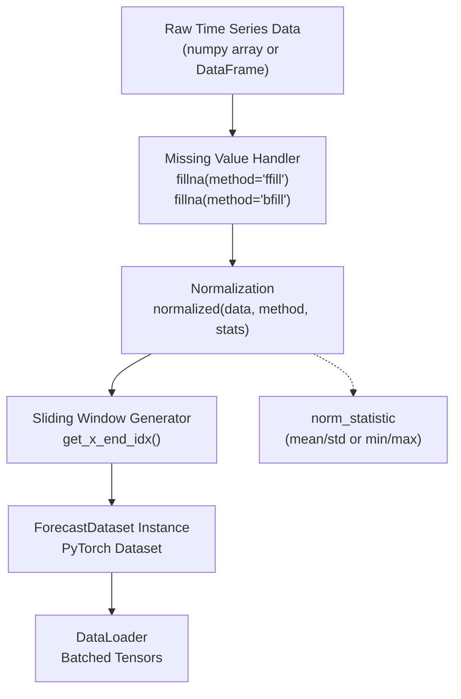
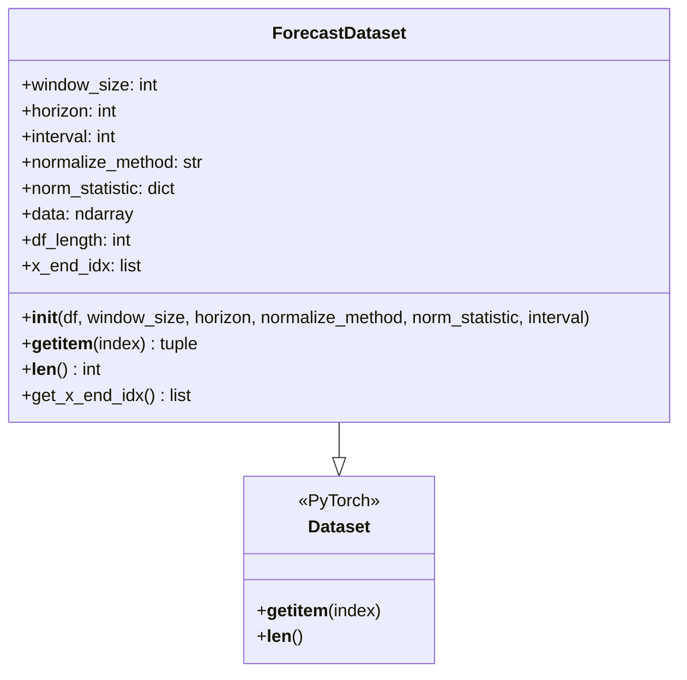
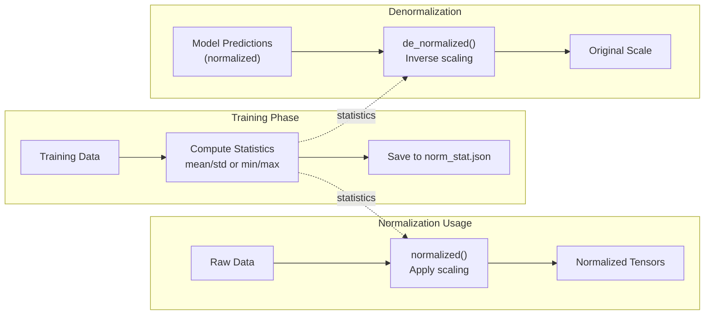
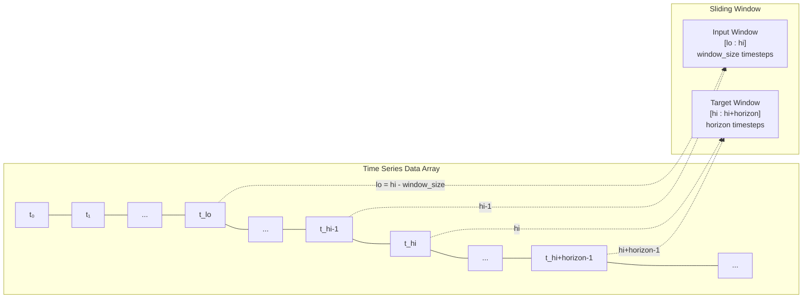
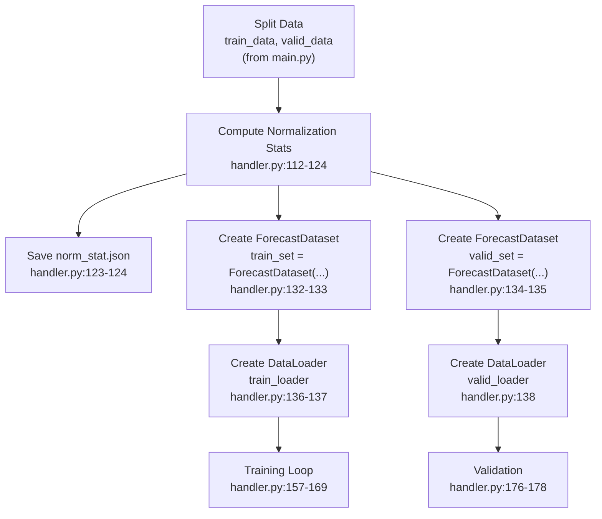
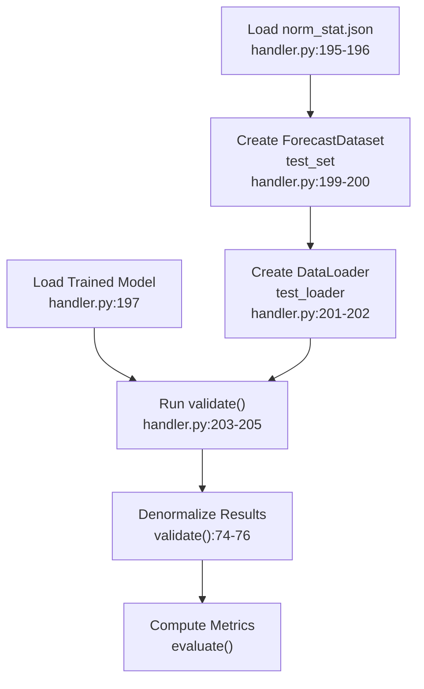
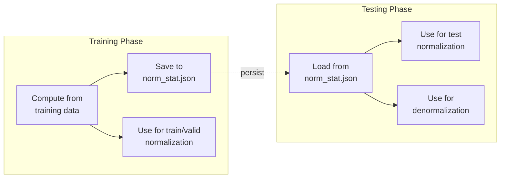

<!-- source: DeepWiki mcp.deepwiki.com · repo microsoft/StemGNN · page 4.4 Data Pipeline · fetched 2026-10-26 -->

# Data Pipeline

<details>
<summary>Relevant source files</summary>

The following files were used as context for generating this wiki page:

- [data_loader/forecast_dataloader.py](data_loader/forecast_dataloader.py)
- [models/handler.py](models/handler.py)

</details>


## Purpose and Scope

This document describes the data pipeline implementation in STemGNN, covering data loading, preprocessing, normalization, and windowing mechanisms. The pipeline is responsible for transforming raw time-series CSV data into batched PyTorch tensors suitable for model training and inference.

For information about training and validation workflows that consume this pipeline, see [Model Lifecycle Manager](#4.2). For details on evaluation metrics applied to pipeline outputs, see [Evaluation Metrics](#4.5). For dataset format specifications and examples, see [Working with Datasets](#3.4).

---

## Overview

The data pipeline is implemented primarily in [data_loader/forecast_dataloader.py]() and centers around the `ForecastDataset` class, which extends `torch.utils.data.Dataset`. The pipeline performs four main operations:

1. **Data Loading**: Reading raw time-series data from NumPy arrays or pandas DataFrames
2. **Missing Value Handling**: Forward-fill and backward-fill imputation
3. **Normalization**: Z-score or min-max scaling applied to the entire dataset
4. **Windowing**: Creating sliding windows of historical data paired with future prediction targets



**Diagram: Data Pipeline Flow from Raw Data to Batched Tensors**

Sources: [data_loader/forecast_dataloader.py:1-74]()

---

## ForecastDataset Class

The `ForecastDataset` class is the core component of the data pipeline, implementing PyTorch's `Dataset` interface.

### Class Structure



**Diagram: ForecastDataset Class Structure**

### Constructor Parameters

The `ForecastDataset` constructor [data_loader/forecast_dataloader.py:42-54]() accepts the following parameters:

| Parameter | Type | Description |
|-----------|------|-------------|
| `df` | ndarray/DataFrame | Raw time-series data with shape `(timesteps, nodes)` |
| `window_size` | int | Number of historical timesteps used as input (default: 12) |
| `horizon` | int | Number of future timesteps to predict (default: 3) |
| `normalize_method` | str | Normalization method: `'z_score'`, `'min_max'`, or `None` |
| `norm_statistic` | dict | Pre-computed normalization statistics (mean/std or min/max) |
| `interval` | int | Sampling interval for sliding windows (default: 1) |

Sources: [data_loader/forecast_dataloader.py:42-54]()

---

## Missing Value Handling

The pipeline automatically handles missing values using pandas forward-fill and backward-fill methods [data_loader/forecast_dataloader.py:48-49]():

```python
df = pd.DataFrame(df)
df = df.fillna(method='ffill', limit=len(df)).fillna(method='bfill', limit=len(df)).values
```

This two-stage approach ensures:
1. **Forward Fill**: Propagates the last valid observation forward
2. **Backward Fill**: Fills remaining gaps at the beginning by propagating backward

The `limit=len(df)` parameter allows the fill to extend across the entire time series, ensuring no `NaN` values remain.

Sources: [data_loader/forecast_dataloader.py:48-49]()

---

## Normalization Methods

The pipeline supports two normalization methods implemented in the `normalized()` and `de_normalized()` functions. Normalization is essential for stable neural network training.

### Z-Score Normalization

The z-score method [data_loader/forecast_dataloader.py:14-22]() standardizes data to have zero mean and unit variance:

```
normalized_value = (value - mean) / std
```

**Computation**: For training data, statistics are computed as:
```python
mean = np.mean(train_data, axis=0)
std = np.std(train_data, axis=0)
```

**Special Case**: When `std == 0`, it is replaced with `1` to avoid division by zero [data_loader/forecast_dataloader.py:19]().

### Min-Max Normalization

The min-max method [data_loader/forecast_dataloader.py:8-13]() scales data to the range `[0, 1]`:

```
normalized_value = (value - min) / (max - min + 1e-5)
```

**Computation**: For training data:
```python
min_val = np.min(train_data, axis=0)
max_val = np.max(train_data, axis=0)
```

**Numerical Stability**: A small epsilon `1e-5` is added to prevent division by zero, and values are clipped to `[0, 1]` [data_loader/forecast_dataloader.py:11-13]().

### Denormalization

The `de_normalized()` function [data_loader/forecast_dataloader.py:25-38]() reverses the normalization for evaluation and result interpretation:

- **Z-Score**: `original_value = normalized_value * std + mean`
- **Min-Max**: `original_value = normalized_value * (max - min) + min`



**Diagram: Normalization Lifecycle in the Pipeline**

Sources: [data_loader/forecast_dataloader.py:7-38](), [models/handler.py:112-124]()

---

## Sliding Window Mechanism

The sliding window mechanism creates overlapping sequences for time-series forecasting. Each window consists of:
- **Input Window**: `window_size` historical timesteps
- **Target Window**: `horizon` future timesteps to predict

### Window Index Generation

The `get_x_end_idx()` method [data_loader/forecast_dataloader.py:68-73]() computes valid window ending indices:

```python
x_index_set = range(self.window_size, self.df_length - self.horizon + 1)
x_end_idx = [x_index_set[j * self.interval] for j in range((len(x_index_set)) // self.interval)]
```

**Logic**:
1. Valid ending indices start at `window_size` (to have enough history)
2. Must stop at `df_length - horizon + 1` (to have enough future data)
3. `interval` parameter controls sampling density (default: 1 means no skipping)

### Data Retrieval

The `__getitem__()` method [data_loader/forecast_dataloader.py:56-63]() extracts window pairs:

```python
hi = self.x_end_idx[index]
lo = hi - self.window_size
train_data = self.data[lo: hi]
target_data = self.data[hi:hi + self.horizon]
```



**Diagram: Sliding Window Extraction from Time Series**

### Example

For a dataset with 100 timesteps, `window_size=12`, `horizon=3`, `interval=1`:

| Attribute | Value | Explanation |
|-----------|-------|-------------|
| `df_length` | 100 | Total timesteps in dataset |
| `window_size` | 12 | Input sequence length |
| `horizon` | 3 | Prediction horizon |
| `x_index_set` | range(12, 98) | Valid ending indices: [12, 13, ..., 97] |
| `x_end_idx` | [12, 13, ..., 97] | 86 windows total |
| Sample 0 | Input: [0:12], Target: [12:15] | First window |
| Sample 1 | Input: [1:13], Target: [13:16] | Shifted by `interval` |

Sources: [data_loader/forecast_dataloader.py:56-73]()

---

## Integration with Model Training

The data pipeline integrates into the training workflow through the `train()` function in [models/handler.py]().

### Training Data Preparation



**Diagram: Data Pipeline Integration in Training Workflow**

### Code Flow

1. **Compute Normalization Statistics** [models/handler.py:112-124]():
   - Statistics computed on **training data only** to prevent data leakage
   - Saved to `norm_stat.json` for later use in testing

2. **Create Dataset Instances** [models/handler.py:132-135]():
   ```python
   train_set = ForecastDataset(train_data, window_size=args.window_size, 
                                horizon=args.horizon,
                                normalize_method=args.norm_method, 
                                norm_statistic=normalize_statistic)
   valid_set = ForecastDataset(valid_data, window_size=args.window_size, 
                                horizon=args.horizon,
                                normalize_method=args.norm_method, 
                                norm_statistic=normalize_statistic)
   ```
   - Both datasets use the **same normalization statistics** from training data

3. **Create DataLoaders** [models/handler.py:136-138]():
   ```python
   train_loader = torch_data.DataLoader(train_set, batch_size=args.batch_size, 
                                        drop_last=False, shuffle=True, num_workers=0)
   valid_loader = torch_data.DataLoader(valid_set, batch_size=args.batch_size, 
                                        shuffle=False, num_workers=0)
   ```
   - Training loader shuffles data
   - Validation loader maintains sequential order

Sources: [models/handler.py:103-138]()

---

## Testing Data Preparation

During testing, the pipeline loads previously saved normalization statistics to ensure consistency.

### Test Workflow



**Diagram: Data Pipeline in Test Phase**

### Key Points

- **No Statistics Recomputation**: Test phase loads `norm_stat.json` from training [models/handler.py:195-196]()
- **Same Preprocessing**: Test data undergoes identical normalization using training statistics
- **Denormalization**: Results are denormalized before metric calculation [models/handler.py:74-76]()

Sources: [models/handler.py:194-207](), [models/handler.py:67-78]()

---

## Data Shape Transformations

Understanding tensor shapes throughout the pipeline is critical for debugging and extension.

### Shape Evolution Table

| Stage | Shape | Description |
|-------|-------|-------------|
| Raw CSV | `(timesteps, nodes)` | Original time-series data |
| After Missing Value Handling | `(timesteps, nodes)` | Same shape, NaNs filled |
| After Normalization | `(timesteps, nodes)` | Same shape, values scaled |
| Single Window Input | `(window_size, nodes)` | One training sample input |
| Single Window Target | `(horizon, nodes)` | One training sample target |
| Batched Input | `(batch_size, window_size, nodes)` | DataLoader output |
| Batched Target | `(batch_size, horizon, nodes)` | DataLoader output |

### Conversion in `__getitem__()`

[data_loader/forecast_dataloader.py:56-63]() converts NumPy arrays to PyTorch tensors:

```python
x = torch.from_numpy(train_data).type(torch.float)
y = torch.from_numpy(target_data).type(torch.float)
```

- Input `x`: shape `(window_size, nodes)`
- Target `y`: shape `(horizon, nodes)`
- DataLoader automatically stacks into batches: `(batch_size, window_size, nodes)`

Sources: [data_loader/forecast_dataloader.py:56-63]()

---

## Normalization Statistics Persistence

The pipeline ensures reproducibility by persisting normalization statistics.

### Statistics Format

The `norm_stat.json` file contains:

**Z-Score Method**:
```json
{
  "mean": [0.123, 0.456, ...],
  "std": [1.234, 2.345, ...]
}
```

**Min-Max Method**:
```json
{
  "min": [0.0, 1.0, ...],
  "max": [100.0, 200.0, ...]
}
```

### Save and Load Operations

**Saving** [models/handler.py:122-124]():
```python
if normalize_statistic is not None:
    with open(os.path.join(result_file, 'norm_stat.json'), 'w') as f:
        json.dump(normalize_statistic, f)
```

**Loading** [models/handler.py:195-196]():
```python
with open(os.path.join(result_train_file, 'norm_stat.json'),'r') as f:
    normalize_statistic = json.load(f)
```

### Usage Pattern



**Diagram: Normalization Statistics Lifecycle**

Sources: [models/handler.py:112-124](), [models/handler.py:195-196]()

---

## Error Handling and Edge Cases

The pipeline handles several edge cases to ensure robustness.

### Zero Standard Deviation

When a feature has constant values (zero standard deviation), the pipeline sets `std = 1` [data_loader/forecast_dataloader.py:19]():

```python
std = [1 if i == 0 else i for i in std]
```

This prevents division by zero while keeping the normalized value at zero (since `mean` equals the constant value).

### Insufficient Data

The training function validates data availability [models/handler.py:107-110]():

```python
if len(train_data) == 0:
    raise Exception('Cannot organize enough training data')
if len(valid_data) == 0:
    raise Exception('Cannot organize enough validation data')
```

### Missing Values

The forward-fill and backward-fill strategy [data_loader/forecast_dataloader.py:49]() handles:
- Missing values in the middle: Forward-filled from previous valid value
- Missing values at start: Backward-filled from next valid value
- All values missing: Would fail (requires at least one valid value)

### Numerical Stability

- Min-max epsilon: `1e-5` added to denominator [data_loader/forecast_dataloader.py:11]()
- Clipping: Values clipped to `[0, 1]` after min-max normalization [data_loader/forecast_dataloader.py:13]()
- Denormalization epsilon: `1e-8` used [data_loader/forecast_dataloader.py:29]()

Sources: [data_loader/forecast_dataloader.py:7-54](), [models/handler.py:107-110]()

---

## Summary

The data pipeline consists of the following key components:

| Component | Location | Responsibility |
|-----------|----------|----------------|
| `ForecastDataset` | [data_loader/forecast_dataloader.py:41-73]() | PyTorch Dataset implementation |
| `normalized()` | [data_loader/forecast_dataloader.py:7-22]() | Apply normalization transformations |
| `de_normalized()` | [data_loader/forecast_dataloader.py:25-38]() | Reverse normalization transformations |
| Training Integration | [models/handler.py:103-191]() | Create datasets and loaders for training |
| Testing Integration | [models/handler.py:194-207]() | Load statistics and create test dataset |

The pipeline ensures:
- **Consistency**: Same normalization statistics used across train/valid/test
- **Reproducibility**: Statistics persisted to `norm_stat.json`
- **Flexibility**: Supports multiple normalization methods
- **Robustness**: Handles missing values and edge cases
- **Efficiency**: PyTorch-native implementation with batching support

Sources: [data_loader/forecast_dataloader.py:1-74](), [models/handler.py:1-207]()

---

