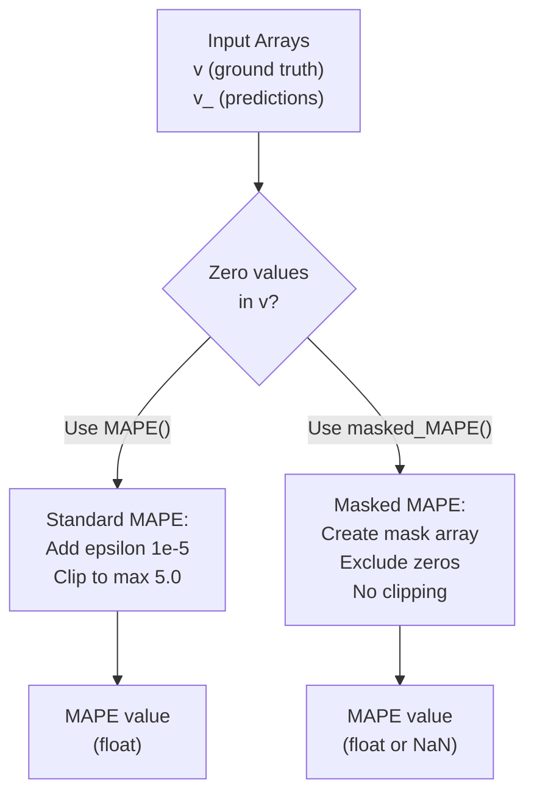
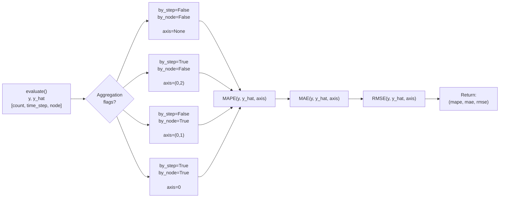
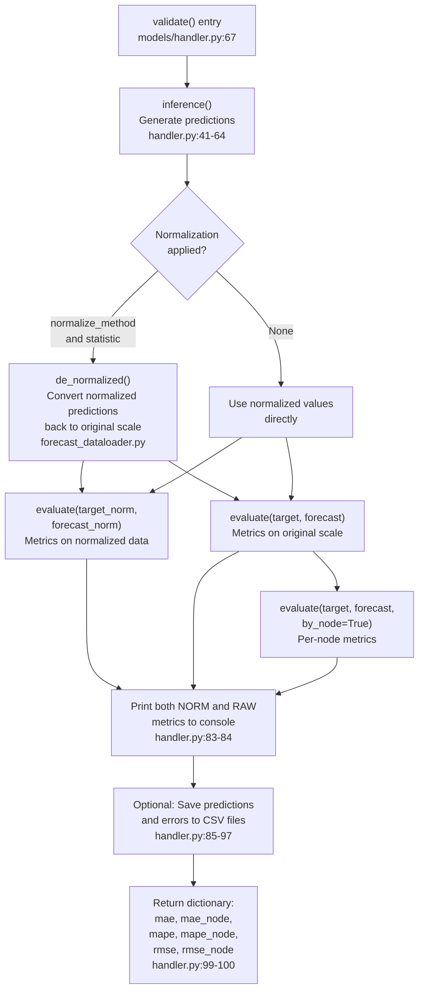
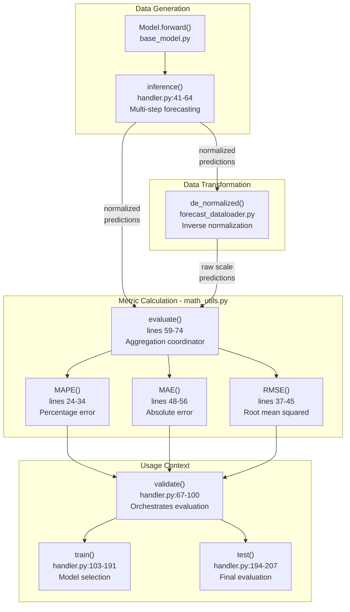

<!-- source: DeepWiki mcp.deepwiki.com · repo microsoft/StemGNN · page 4.5 Evaluation Metrics · fetched 2026-10-26 -->

# Evaluation Metrics

<details>
<summary>Relevant source files</summary>

The following files were used as context for generating this wiki page:

- [models/handler.py](models/handler.py)
- [utils/math_utils.py](utils/math_utils.py)

</details>


## Purpose and Scope

This document details the evaluation metric implementations used to assess model performance in the STemGNN system. It covers the three primary metrics (MAPE, MAE, RMSE), their mathematical definitions, implementation details, aggregation options, and integration with the validation pipeline.

For information about using these metrics during model evaluation workflows, see [Evaluating Models](#3.3). For the broader model lifecycle management context, see [Model Lifecycle Manager](#4.2).

---

## Overview

The STemGNN system uses three standard regression metrics to evaluate forecasting performance:

| Metric | Full Name | Purpose | Range |
|--------|-----------|---------|-------|
| **MAPE** | Mean Absolute Percentage Error | Measures relative prediction error | [0%, ∞) |
| **MAE** | Mean Absolute Error | Measures average absolute deviation | [0, ∞) |
| **RMSE** | Root Mean Squared Error | Measures standard deviation of errors, penalizes large errors more | [0, ∞) |

All metric implementations are located in [utils/math_utils.py:1-75]() and called from [models/handler.py:78-100]().

---

## Metric Implementations

### MAPE (Mean Absolute Percentage Error)

The system provides two MAPE implementations with different handling of zero values in ground truth.

#### Standard MAPE Function

[utils/math_utils.py:24-34]() implements the standard MAPE calculation:

```python
MAPE = |predicted - actual| / (|actual| + 1e-5)
```

**Key implementation details:**
- Adds small epsilon (1e-5) to denominator to avoid division by zero
- Clips values above 5.0 to prevent outliers from dominating the metric
- Returns mean across specified axis

**Mathematical formula:**
```
MAPE = mean(|v_ - v| / (|v| + ε))
where ε = 1e-5, clipped to maximum of 5.0
```

#### Masked MAPE Function

[utils/math_utils.py:4-21]() implements a masked version that properly handles true zero values:

**Behavior:**
- Identifies positions where ground truth equals zero: `mask = (v == 0)`
- Uses NumPy's masked array to exclude these positions from calculation
- Returns NaN for dimensions where all values are masked
- No clipping applied (unlike standard MAPE)

**Use case:** The masked version is available but not currently used in the main validation pipeline. The standard `MAPE()` function is used throughout [models/handler.py]().



**Sources:** [utils/math_utils.py:4-34]()

### MAE (Mean Absolute Error)

[utils/math_utils.py:48-56]() implements MAE calculation:

```python
MAE = mean(|predicted - actual|)
```

**Mathematical formula:**
```
MAE = mean(|v_ - v|)
```

**Characteristics:**
- Simple absolute difference averaging
- Same unit as the original data
- Not sensitive to scale (unlike RMSE)
- Treats all errors equally regardless of magnitude

### RMSE (Root Mean Squared Error)

[utils/math_utils.py:37-45]() implements RMSE calculation:

```python
RMSE = sqrt(mean((predicted - actual)²))
```

**Mathematical formula:**
```
RMSE = sqrt(mean((v_ - v)²))
```

**Characteristics:**
- Penalizes large errors more heavily than MAE
- Same unit as the original data
- More sensitive to outliers than MAE
- Commonly used in time-series forecasting

**Sources:** [utils/math_utils.py:37-56]()

---

## The evaluate() Function

The `evaluate()` function [utils/math_utils.py:59-74]() provides a unified interface for computing all three metrics with flexible aggregation options.

### Function Signature

```python
def evaluate(y, y_hat, by_step=False, by_node=False)
```

### Input Format

Both `y` and `y_hat` must be 3D NumPy arrays with shape:
```
[count, time_step, node]
```

Where:
- **count**: Number of samples in the dataset
- **time_step**: Forecast horizon (number of future steps)
- **node**: Number of nodes/variables in the multivariate series

### Aggregation Modes

The function supports four aggregation modes based on the boolean flags:

| `by_step` | `by_node` | Aggregation Behavior | Output Shape | Use Case |
|-----------|-----------|---------------------|--------------|----------|
| `False` | `False` | Global average across all dimensions | Single scalar per metric | Overall model performance |
| `True` | `False` | Average per time step | `[time_step]` per metric | Performance by forecast horizon |
| `False` | `True` | Average per node | `[node]` per metric | Performance by variable/location |
| `True` | `True` | Per time step and node | `[time_step, node]` per metric | Detailed error analysis |

### Return Value

The function returns a tuple of three values:
```python
(MAPE_result, MAE_result, RMSE_result)
```

Each result can be:
- A scalar (when both flags are False)
- A 1D array (when exactly one flag is True)
- A 2D array (when both flags are True)



**Sources:** [utils/math_utils.py:59-74]()

---

## Integration with Validation Pipeline

### Validation Flow

The `validate()` function in [models/handler.py:67-100]() orchestrates the complete evaluation process:



**Sources:** [models/handler.py:67-100]()

### Dual Metric Calculation: Normalized vs Raw

The validation pipeline computes metrics on **both** normalized and denormalized data:

**1. Normalized Metrics [models/handler.py:82-83]()**
```python
score_norm = evaluate(target_norm, forecast_norm)
print(f'NORM: MAPE {score_norm[0]:7.9%}; MAE {score_norm[1]:7.9f}; RMSE {score_norm[2]:7.9f}.')
```

**Purpose:**
- Evaluates model performance in the transformed space where training occurred
- All features are on similar scales (z-score or min-max normalized)
- Useful for comparing training vs validation loss

**2. Raw Metrics [models/handler.py:84]()**
```python
print(f'RAW : MAPE {score[0]:7.9%}; MAE {score[1]:7.9f}; RMSE {score[2]:7.9f}.')
```

**Purpose:**
- Evaluates predictions on the original data scale
- Provides interpretable error magnitudes in real-world units
- Used for model selection and final reporting

### Global and Per-Node Metrics

The system computes both global and per-node metrics:

```python
# Global metrics (averaged across all dimensions)
score = evaluate(target, forecast)

# Per-node metrics (averaged across samples and time steps)
score_by_node = evaluate(target, forecast, by_node=True)
```

**Return structure [models/handler.py:99-100]():**
```python
dict(
    mae=score[1],           # Scalar: global MAE
    mae_node=score_by_node[1],  # Array[node]: MAE per node
    mape=score[0],          # Scalar: global MAPE
    mape_node=score_by_node[0],  # Array[node]: MAPE per node
    rmse=score[2],          # Scalar: global RMSE
    rmse_node=score_by_node[2]   # Array[node]: RMSE per node
)
```

**Sources:** [models/handler.py:78-100]()

---

## Metric Usage in Training

### During Training Loop

The `train()` function [models/handler.py:103-191]() uses validation metrics for:

1. **Model Selection [models/handler.py:179-187]()**
   - Tracks best MAE on validation set
   - Saves model when validation MAE improves
   - Updates `best_validate_mae` variable

2. **Early Stopping [models/handler.py:189-190]()**
   - Monitors `validate_score_non_decrease_count`
   - Stops training if MAE doesn't improve for `args.early_stop_step` validation cycles

```python
if best_validate_mae > performance_metrics['mae']:
    best_validate_mae = performance_metrics['mae']
    is_best_for_now = True
    validate_score_non_decrease_count = 0
else:
    validate_score_non_decrease_count += 1
```

### Validation Frequency

Validation is performed periodically based on `args.validate_freq` [models/handler.py:172]():

```python
if (epoch + 1) % args.validate_freq == 0:
    performance_metrics = validate(model, valid_loader, ...)
```

**Default behavior:**
- Validation runs every `validate_freq` epochs
- Each validation computes all metrics (MAPE, MAE, RMSE)
- Only MAE is used for model selection (not MAPE or RMSE)

**Sources:** [models/handler.py:172-190]()

---

## Result Output Files

When the `result_file` parameter is provided, the validation function saves detailed predictions and errors to CSV files [models/handler.py:85-97]():

### Saved Files

| File Name | Content | Shape |
|-----------|---------|-------|
| `target.csv` | Ground truth values at step 0 | `[count, node]` |
| `predict.csv` | Predicted values at step 0 | `[count, node]` |
| `predict_abs_error.csv` | Absolute errors: `|predicted - actual|` | `[count, node]` |
| `predict_ape.csv` | Absolute percentage errors: `|predicted - actual| / actual` | `[count, node]` |

**Note:** Only the first forecast step (`step_to_print = 0`) is saved to files, even when horizon > 1.

### Example Output Format

For a dataset with 100 samples and 10 nodes:
```
target.csv:        100 rows × 10 columns
predict.csv:       100 rows × 10 columns
predict_abs_error.csv:  100 rows × 10 columns
predict_ape.csv:   100 rows × 10 columns
```

**Sources:** [models/handler.py:85-97]()

---

## Metric Computation Architecture



**Sources:** [utils/math_utils.py:1-75](), [models/handler.py:41-207]()

---

## Implementation Notes

### Numerical Stability

1. **MAPE epsilon addition [utils/math_utils.py:32]():**
   - Prevents division by zero
   - Value: `1e-5`
   - Applied before division

2. **MAPE clipping [utils/math_utils.py:33]():**
   - Clips percentage errors to maximum of 5.0 (500%)
   - Prevents extreme outliers from dominating the metric
   - Applied after percentage calculation

### Data Type Handling

All metric functions explicitly cast results to `np.float64` for consistency [utils/math_utils.py:21,34,45,56]():

```python
return np.mean(mape, axis).astype(np.float64)
return np.mean(np.abs(v_ - v), axis).astype(np.float64)
return np.sqrt(np.mean((v_ - v) ** 2, axis)).astype(np.float64)
```

### Axis Parameter

The `axis` parameter in NumPy aggregations can take multiple forms:
- `None`: Aggregate over all dimensions (scalar output)
- Single integer: Aggregate over one dimension
- Tuple of integers: Aggregate over multiple dimensions

Example from [utils/math_utils.py:72]():
```python
# Aggregate over samples (0) and nodes (2), keep time_step dimension
MAPE(y, y_hat, axis=(0, 2))
```

**Sources:** [utils/math_utils.py:1-75]()

---

## Summary

The evaluation metrics system provides:

- **Three standard metrics**: MAPE, MAE, RMSE
- **Flexible aggregation**: Global, by time step, by node, or both
- **Dual evaluation**: Both normalized and raw scale metrics
- **Model selection**: Uses MAE for choosing best model
- **Early stopping**: Monitors MAE for convergence
- **Detailed output**: CSV files with predictions and errors

The system prioritizes MAE as the primary metric for model selection while computing all three metrics for comprehensive performance assessment.

**Sources:** [utils/math_utils.py:1-75](), [models/handler.py:67-207]()

---

