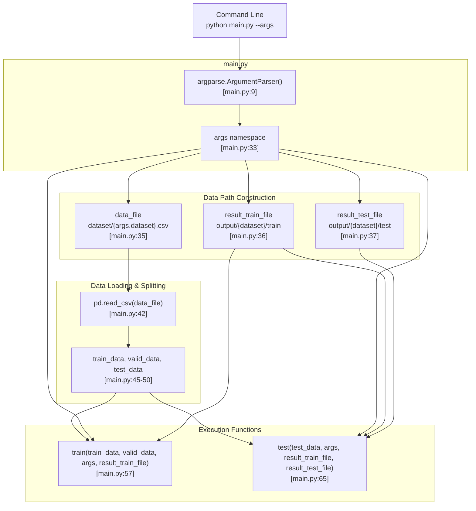
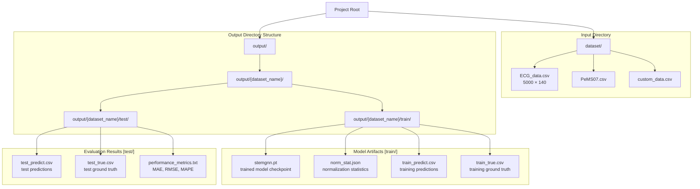
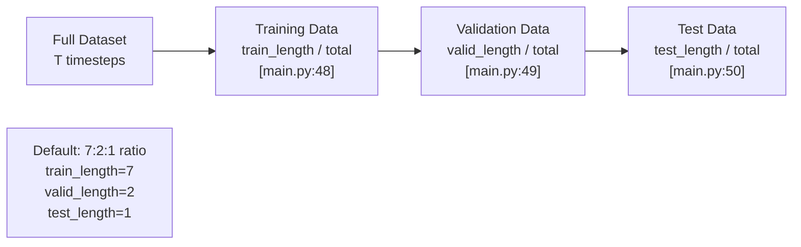
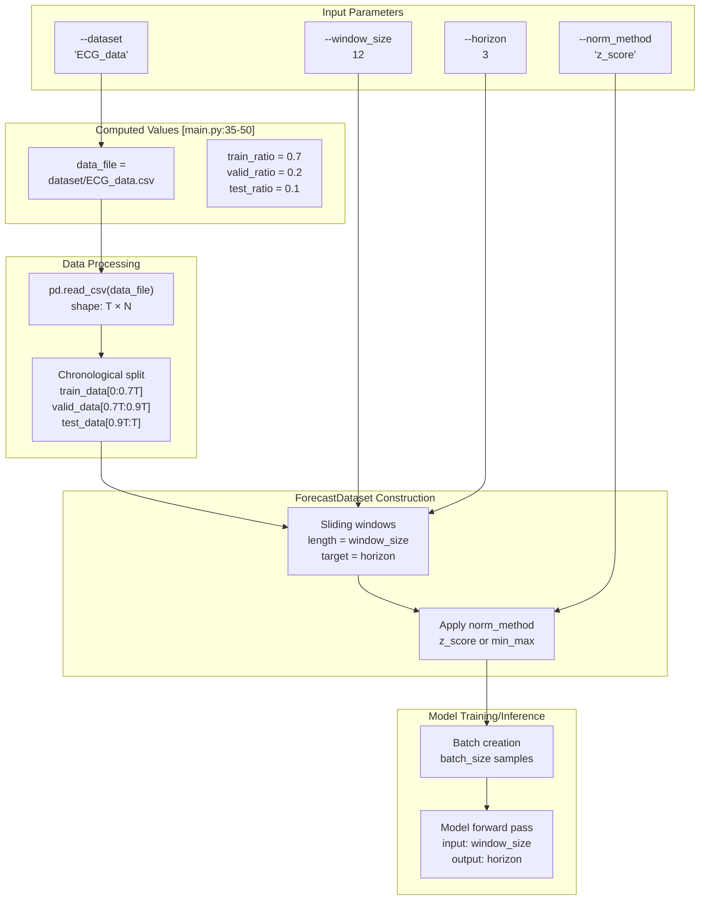

<!-- source: DeepWiki mcp.deepwiki.com · repo microsoft/StemGNN · page 5 Reference · fetched 2026-10-26 -->

# Reference

<details>
<summary>Relevant source files</summary>

The following files were used as context for generating this wiki page:

- [README.md](README.md)
- [main.py](main.py)

</details>


This page provides technical reference material for the STemGNN system, including configuration parameters, dataset specifications, file formats, and performance benchmarks. This is intended as a quick lookup guide for developers and users who need precise technical details.

For complete documentation of individual parameters, see [Configuration Parameters](#5.1). For detailed dataset characteristics and usage, see [Supported Datasets](#5.2). For API documentation of classes and functions, see [API Reference](#5.3).

## Parameter Quick Reference

The following table summarizes all command-line parameters accepted by [main.py:9-30]():

| Parameter | Type | Default | Description |
|-----------|------|---------|-------------|
| `--train` | bool | True | Enable training phase |
| `--evaluate` | bool | True | Enable evaluation/testing phase |
| `--dataset` | str | 'ECG_data' | Dataset filename (without .csv extension) |
| `--window_size` | int | 12 | Length of input sliding window |
| `--horizon` | int | 3 | Prediction horizon (future timesteps) |
| `--train_length` | float | 7 | Training data ratio |
| `--valid_length` | float | 2 | Validation data ratio |
| `--test_length` | float | 1 | Testing data ratio |
| `--epoch` | int | 50 | Number of training epochs |
| `--lr` | float | 1e-4 | Learning rate |
| `--multi_layer` | int | 5 | Number of StockBlockLayers (controls depth) |
| `--device` | str | 'cpu' | Computing device ('cpu' or 'cuda:x') |
| `--validate_freq` | int | 1 | Validation frequency (epochs) |
| `--batch_size` | int | 32 | Training batch size |
| `--norm_method` | str | 'z_score' | Normalization method ('z_score' or 'min_max') |
| `--optimizer` | str | 'RMSProp' | Optimizer type |
| `--early_stop` | bool | False | Enable early stopping |
| `--exponential_decay_step` | int | 5 | Learning rate decay step size |
| `--decay_rate` | float | 0.5 | Learning rate decay multiplier |
| `--dropout_rate` | float | 0.5 | Dropout probability |
| `--leakyrelu_rate` | int | 0.2 | LeakyReLU negative slope |

**Sources:** [main.py:9-30](), [README.md:49-68]()

## Command-Line Argument Flow



**Sources:** [main.py:1-68]()

## File System Structure

The system uses a specific directory layout for organizing inputs, outputs, and model artifacts:



**Sources:** [main.py:35-41](), [README.md:39]()

## Dataset Format Specification

### CSV File Requirements

The input CSV file must conform to the following specification:

| Property | Requirement |
|----------|-------------|
| **File Format** | CSV (Comma-Separated Values) |
| **Header** | **No header row** |
| **Shape** | `T × N` where T = timestamps, N = nodes |
| **Data Type** | Numeric (float or int) |
| **Missing Values** | Not supported (must be preprocessed) |
| **Ordering** | Rows are chronological timesteps |

**Example structure for 5 timesteps, 3 nodes:**
```
1.2,3.4,5.6
2.3,4.5,6.7
3.4,5.6,7.8
4.5,6.7,8.9
5.6,7.8,9.0
```

**Sources:** [README.md:37-39]()

### Data Split Ratios

The system splits data chronologically based on ratio parameters:



**Sources:** [main.py:45-50](), [README.md:46]()

## Normalization Statistics Format

The `norm_stat.json` file stores normalization parameters for reproducible inference:

**Z-Score normalization (`norm_method='z_score'`):**
```json
{
  "mean": [<mean values per node>],
  "std": [<standard deviation per node>]
}
```

**Min-Max normalization (`norm_method='min_max'`):**
```json
{
  "min": [<minimum values per node>],
  "max": [<maximum values per node>]
}
```

These statistics are computed during training and applied during evaluation to ensure consistent scaling.

**Sources:** [main.py:57](), [README.md:67]()

## Recommended Dataset Configurations

The following configurations have been validated for specific datasets:

| Dataset | node_cnt | window_size | horizon | norm_method | Notes |
|---------|----------|-------------|---------|-------------|-------|
| METR-LA | 207 | 12 | 3 | z_score | Traffic speed forecasting |
| PEMS-BAY | 325 | 12 | 3 | z_score | Traffic speed forecasting |
| PEMS03 | 358 | 12 | 3 | z_score | Traffic flow forecasting |
| PEMS04 | 307 | 12 | 3 | z_score | Traffic speed forecasting |
| PEMS07 | 228 | 12 | 3 | z_score | Traffic flow forecasting |
| PEMS08 | 170 | 12 | 3 | z_score | Traffic flow forecasting |
| COVID-19 | 25 | 28 | 28 | z_score | Long-horizon forecasting |
| ECG_data | 140 | 12 | 3 | z_score | Provided sample dataset |

**Sources:** [README.md:71-81]()

## Performance Benchmarks

### Short-Term Forecasting (3-step horizon)

| Dataset | MAE | RMSE | MAPE (%) |
|---------|-----|------|----------|
| METR-LA | 2.56 | 5.06 | 6.46 |
| PEMS-BAY | 1.23 | 2.48 | 2.63 |
| PEMS03 | 14.32 | 21.64 | 16.24 |
| PEMS04 | 20.24 | 32.15 | 10.03 |
| PEMS07 | 2.14 | 4.01 | 5.01 |
| PEMS08 | 15.83 | 24.93 | 9.26 |

### Long-Term Forecasting (28-step horizon)

| Dataset | MAE | RMSE | MAPE (%) |
|---------|-----|------|----------|
| COVID-19 | 662.24 | 1023.19 | 19.3 |

These metrics are computed using the implementations in `utils/math_utils.py` and represent model performance on held-out test data.

**Sources:** [README.md:82-102]()

## Model Artifact Details

### Model Checkpoint (`stemgnn.pt`)

PyTorch state dictionary containing:
- Model architecture parameters (`state_dict`)
- Optimizer state (if saved)
- Training metadata

Loaded using: `torch.load('output/{dataset}/train/stemgnn.pt')`

### Prediction Output Files

**Format:** CSV files with shape `T × N`
- `train_predict.csv`: Model predictions on training data
- `train_true.csv`: Ground truth for training data
- `test_predict.csv`: Model predictions on test data
- `test_true.csv`: Ground truth for test data

These files can be directly compared for error analysis or visualization.

**Sources:** [main.py:36-37]()

## Execution Mode Matrix

The system supports four execution modes based on `--train` and `--evaluate` flags:

| --train | --evaluate | Behavior |
|---------|------------|----------|
| True | True | Train model, save artifacts, then evaluate on test set |
| True | False | Train model only, save artifacts |
| False | True | Load existing model from `result_train_file`, evaluate on test set |
| False | False | No operation (prints "done") |

The most common workflow is `--train True --evaluate True` (default), which performs end-to-end training and testing.

**Sources:** [main.py:54-68]()

## Data Flow Through Parameters



**Sources:** [main.py:9-50]()

## Environment Variables

The system sets CUDA device visibility at [main.py:3]():

```python
os.environ['CUDA_VISIBLE_DEVICES'] = '0,1'
```

This restricts visible GPUs to devices 0 and 1. Users can modify this or use the `--device` parameter to select specific devices.

**Sources:** [main.py:3]()

## Random Seed

For reproducibility, the system sets PyTorch's random seed at [main.py:52]():

```python
torch.manual_seed(0)
```

This ensures deterministic behavior across runs when using CPU. GPU operations may still have non-deterministic behavior depending on CUDA configuration.

**Sources:** [main.py:52]()

## Timing Measurements

The system measures and reports execution time for both training and evaluation phases:

```python
# Training time measurement [main.py:56-59]
before_train = datetime.now().timestamp()
_, normalize_statistic = train(...)
after_train = datetime.now().timestamp()
print(f'Training took {(after_train - before_train) / 60} minutes')

# Evaluation time measurement [main.py:64-67]
before_evaluation = datetime.now().timestamp()
test(...)
after_evaluation = datetime.now().timestamp()
print(f'Evaluation took {(after_evaluation - before_evaluation) / 60} minutes')
```

Times are reported in minutes to the console.

**Sources:** [main.py:56-67]()

---

