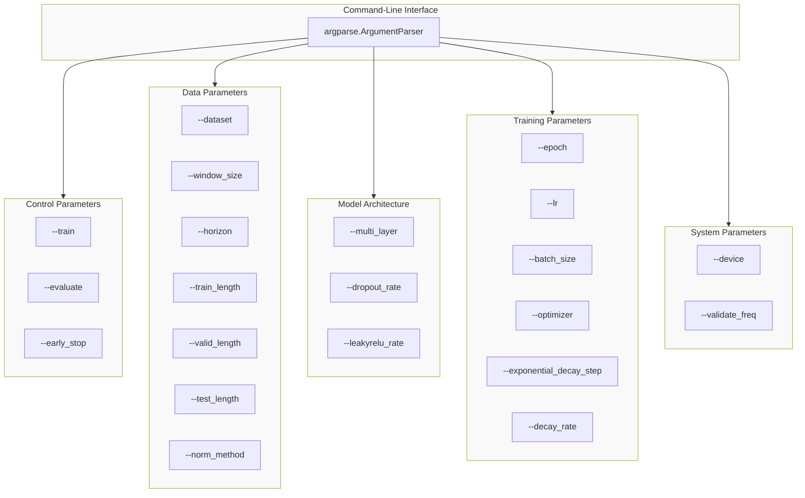
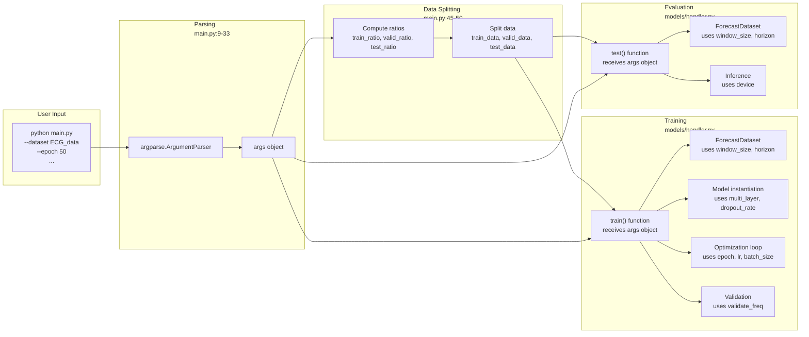
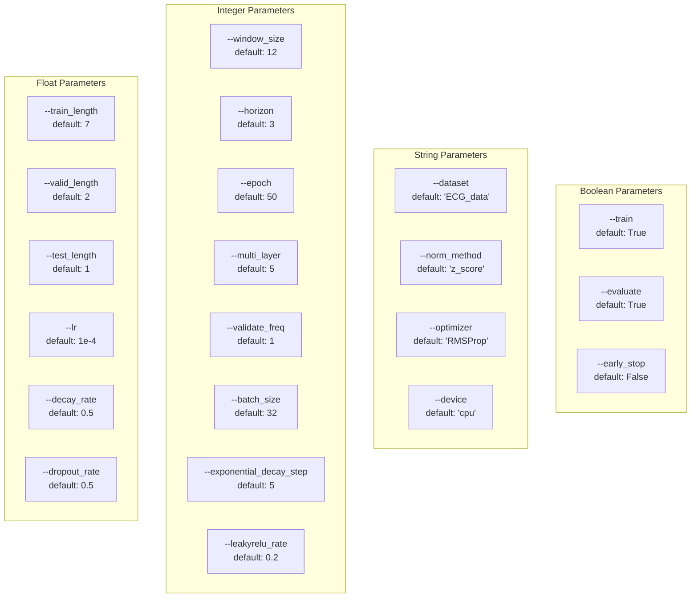

<!-- source: DeepWiki mcp.deepwiki.com · repo microsoft/StemGNN · page 5.1 Configuration Parameters · fetched 2026-10-26 -->

# Configuration Parameters

<details>
<summary>Relevant source files</summary>

The following files were used as context for generating this wiki page:

- [README.md](README.md)
- [main.py](main.py)

</details>


## Purpose and Scope

This page provides a complete reference for all configuration parameters available in the STemGNN system. These parameters control every aspect of the training and evaluation pipeline, from data processing to model architecture and optimization. All parameters are exposed through command-line arguments in the main entry point.

For information about how to use these parameters in practice, see [Command-Line Interface](#3.1). For examples of parameter combinations for specific datasets, see [Supported Datasets](#5.2). For details about the training and evaluation workflows these parameters control, see [Training Models](#3.2) and [Evaluating Models](#3.3).

**Sources:** [main.py:9-30](), [README.md:49-68]()

---

## Parameter Categories

The configuration parameters are organized into six functional categories:



**Sources:** [main.py:9-30]()

---

## Complete Parameter Reference

### Control Parameters

These parameters control the execution flow of the system.

| Parameter | Type | Default | Description | Code Location |
|-----------|------|---------|-------------|---------------|
| `--train` | `bool` | `True` | Enable training phase. When `True`, executes the training loop with the training and validation datasets. | [main.py:10]() |
| `--evaluate` | `bool` | `True` | Enable evaluation phase. When `True`, loads trained model and evaluates on test dataset. | [main.py:11]() |
| `--early_stop` | `bool` | `False` | Enable early stopping during training. Stops training if validation performance does not improve. | [main.py:26]() |

**Sources:** [main.py:10-11,26](), [README.md:53-54,68]()

---

### Data Parameters

These parameters define the dataset and its preprocessing.

| Parameter | Type | Default | Description | Code Location |
|-----------|------|---------|-------------|---------------|
| `--dataset` | `str` | `'ECG_data'` | Name of the CSV file (without `.csv` extension) in the `dataset/` directory to use for training/evaluation. | [main.py:12]() |
| `--window_size` | `int` | `12` | Length of the sliding window for input sequences. Number of historical time steps used to predict future values. | [main.py:13]() |
| `--horizon` | `int` | `3` | Prediction horizon. Number of future time steps to forecast. | [main.py:14]() |
| `--train_length` | `float` | `7` | Relative length of training data in the train/valid/test split ratio. | [main.py:15]() |
| `--valid_length` | `float` | `2` | Relative length of validation data in the train/valid/test split ratio. | [main.py:16]() |
| `--test_length` | `float` | `1` | Relative length of test data in the train/valid/test split ratio. | [main.py:17]() |
| `--norm_method` | `str` | `'z_score'` | Normalization method for input data. Valid values: `'z_score'` or `'min_max'`. | [main.py:24]() |

**Data Split Calculation:** The actual split ratios are computed as `train_ratio = train_length / (train_length + valid_length + test_length)`, and similarly for validation and test. This allows flexible specification without requiring ratios to sum to 1.0.

**Sources:** [main.py:12-17,24](), [main.py:45-50](), [README.md:55-60,67]()

---

### Model Architecture Parameters

These parameters control the neural network architecture.

| Parameter | Type | Default | Description | Code Location |
|-----------|------|---------|-------------|---------------|
| `--multi_layer` | `int` | `5` | Number of stacked `StockBlockLayer` instances in the model. Controls the depth of the network and number of hidden layers. Higher values increase model capacity. | [main.py:20]() |
| `--dropout_rate` | `float` | `0.5` | Dropout rate applied in the model for regularization. Range: [0.0, 1.0]. | [main.py:29]() |
| `--leakyrelu_rate` | `int` | `0.2` | Negative slope coefficient for LeakyReLU activation functions. | [main.py:30]() |

**Note:** The `multi_layer` parameter is documented in the README as a "hyper parameter of STemGNN which controls the parameter number of hidden layers."

**Sources:** [main.py:20,29-30](), [README.md:63]()

---

### Training Parameters

These parameters control the optimization process.

| Parameter | Type | Default | Description | Code Location |
|-----------|------|---------|-------------|---------------|
| `--epoch` | `int` | `50` | Total number of training epochs. One epoch processes the entire training dataset. | [main.py:18]() |
| `--lr` | `float` | `1e-4` | Learning rate for the optimizer. Controls the step size during gradient descent. | [main.py:19]() |
| `--batch_size` | `int` | `32` | Number of samples in each training batch. | [main.py:23]() |
| `--optimizer` | `str` | `'RMSProp'` | Optimizer algorithm to use for training. Default is RMSProp. | [main.py:25]() |
| `--exponential_decay_step` | `int` | `5` | Number of epochs between learning rate decay applications. | [main.py:27]() |
| `--decay_rate` | `float` | `0.5` | Multiplicative factor for learning rate decay. New LR = current LR × decay_rate. | [main.py:28]() |

**Learning Rate Schedule:** The learning rate is decayed exponentially every `exponential_decay_step` epochs by multiplying with `decay_rate`.

**Sources:** [main.py:18-19,23,25,27-28](), [README.md:61-62,66]()

---

### System Parameters

These parameters control system-level behavior and resource usage.

| Parameter | Type | Default | Description | Code Location |
|-----------|------|---------|-------------|---------------|
| `--device` | `str` | `'cpu'` | Computational device to use. Valid values: `'cpu'` or `'cuda:x'` where x is GPU index. | [main.py:21]() |
| `--validate_freq` | `int` | `1` | Frequency of validation in epochs. Model is validated every `validate_freq` epochs during training. | [main.py:22]() |

**Sources:** [main.py:21-22](), [README.md:64-65]()

---

## Parameter Flow Through System

The following diagram shows how parameters flow from the command-line through the system components:



**Key Observations:**

1. **Single Parse Point:** All parameters are parsed once in [main.py:9-33]() and stored in the `args` object.
2. **Data Split Dependencies:** The `train_length`, `valid_length`, and `test_length` parameters are used exclusively for data splitting in [main.py:45-50]().
3. **Args Pass-Through:** The entire `args` object is passed to both `train()` and `test()` functions in [models/handler.py](), where individual parameters are extracted as needed.
4. **Multi-Component Usage:** Some parameters like `window_size` and `horizon` are used by multiple components (data loader, model architecture).

**Sources:** [main.py:9-50](), [main.py:54-68]()

---

## Parameter Usage by Component

This table shows which components consume each parameter:

| Parameter | main.py | handler.py | base_model.py | forecast_dataloader.py |
|-----------|---------|------------|---------------|------------------------|
| `train` | ✓ | | | |
| `evaluate` | ✓ | | | |
| `dataset` | ✓ | | | |
| `window_size` | | ✓ | | ✓ |
| `horizon` | | ✓ | ✓ | ✓ |
| `train_length` | ✓ | | | |
| `valid_length` | ✓ | | | |
| `test_length` | ✓ | | | |
| `epoch` | | ✓ | | |
| `lr` | | ✓ | | |
| `multi_layer` | | ✓ | ✓ | |
| `device` | | ✓ | ✓ | |
| `validate_freq` | | ✓ | | |
| `batch_size` | | ✓ | | |
| `norm_method` | | ✓ | | ✓ |
| `optimizer` | | ✓ | | |
| `early_stop` | | ✓ | | |
| `exponential_decay_step` | | ✓ | | |
| `decay_rate` | | ✓ | | |
| `dropout_rate` | | ✓ | ✓ | |
| `leakyrelu_rate` | | ✓ | ✓ | |

**Sources:** [main.py](), System Architecture Diagrams

---

## Dataset-Specific Parameter Configurations

The following table, extracted from the README documentation, shows recommended parameter values for different datasets:

| Dataset | `--train` | `--evaluate` | `--n_route` (nodes) | `--window_size` | `--horizon` | `--norm_method` |
|---------|-----------|--------------|---------------------|-----------------|-------------|-----------------|
| METR-LA | `True` | `True` | 207 | 12 | 3 | `z_score` |
| PEMS-BAY | `True` | `True` | 325 | 12 | 3 | `z_score` |
| PEMS03 | `True` | `True` | 358 | 12 | 3 | `z_score` |
| PEMS04 | `True` | `True` | 307 | 12 | 3 | `z_score` |
| PEMS07 | `True` | `True` | 228 | 12 | 3 | `z_score` |
| PEMS08 | `True` | `True` | 170 | 12 | 3 | `z_score` |
| COVID-19 | `True` | `True` | 25 | 28 | 28 | `z_score` |

**Note:** The `n_route` parameter (number of nodes) is not explicitly defined in the argument parser but is documented in the README as a required parameter. The actual node count is inferred from the dataset shape.

**Key Patterns:**
- Most traffic datasets use `window_size=12` and `horizon=3`
- COVID-19 dataset uses longer sequences: `window_size=28`, `horizon=28`
- All datasets use `z_score` normalization

**Sources:** [README.md:71-81]()

---

## Parameter Type Reference



**Type Constraints:**

- **Boolean:** Must be `True` or `False`
- **String:** 
  - `dataset`: Any filename without extension in `dataset/` directory
  - `norm_method`: Must be `'z_score'` or `'min_max'`
  - `optimizer`: Optimizer name (typically `'RMSProp'`)
  - `device`: `'cpu'` or `'cuda:X'` where X is GPU index
- **Integer:** Positive integers only
- **Float:** 
  - Rates (dropout, decay, leaky): Range [0.0, 1.0]
  - Learning rate: Typically small positive values (e.g., 1e-4 to 1e-2)
  - Data lengths: Positive values representing relative proportions

**Sources:** [main.py:9-30]()

---

## Default Configuration

When running `python main.py` without arguments, the system uses the following default configuration:

```
--train True
--evaluate True
--dataset ECG_data
--window_size 12
--horizon 3
--train_length 7
--valid_length 2
--test_length 1
--epoch 50
--lr 1e-4
--multi_layer 5
--device cpu
--validate_freq 1
--batch_size 32
--norm_method z_score
--optimizer RMSProp
--early_stop False
--exponential_decay_step 5
--decay_rate 0.5
--dropout_rate 0.5
--leakyrelu_rate 0.2
```

This default configuration is designed to work with the provided ECG_data.csv sample dataset and can complete training on a CPU in reasonable time.

**Sources:** [main.py:10-30](), [README.md:39]()

---

## Parameter Validation

The system performs minimal parameter validation at the argparse level. Most validation occurs implicitly during execution:

1. **File Existence:** The dataset file must exist at `dataset/{dataset}.csv` (checked in [main.py:35]())
2. **Device Availability:** CUDA device must be available if specified (runtime error otherwise)
3. **Normalization Method:** Must be one of the valid methods supported by the data loader
4. **Data Split:** The split lengths must allow at least some data in each split

**No explicit validation occurs for:**
- Range constraints on numeric parameters
- Compatibility between parameters (e.g., `window_size` vs. dataset length)
- Model architecture constraints

Users must ensure parameter values are sensible for their use case.

**Sources:** [main.py:35-42]()

---

## Output Directory Configuration

While not a command-line parameter, output directories are constructed from the `dataset` parameter:

```python
result_train_file = os.path.join('output', args.dataset, 'train')
result_test_file = os.path.join('output', args.dataset, 'test')
```

This creates the directory structure:
```
output/
└── {dataset_name}/
    ├── train/
    │   ├── norm_stat.json
    │   └── {model_name}.pt
    └── test/
        └── (evaluation results)
```

**Sources:** [main.py:36-41]()

---

