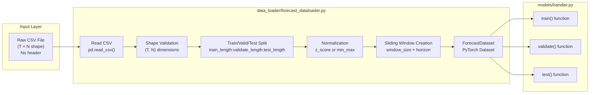
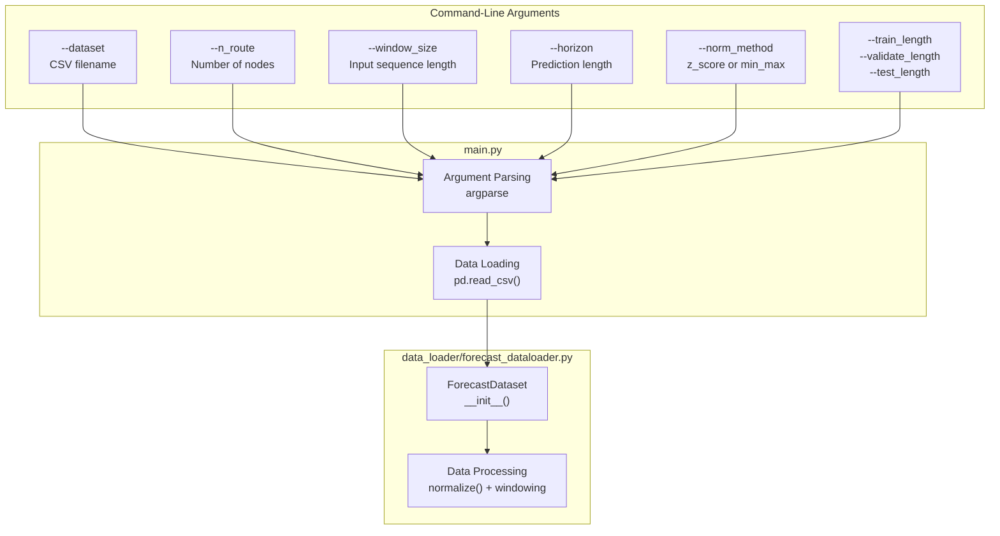
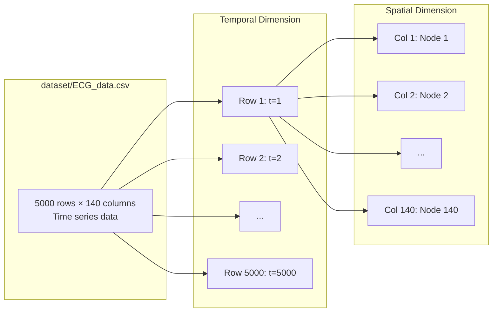
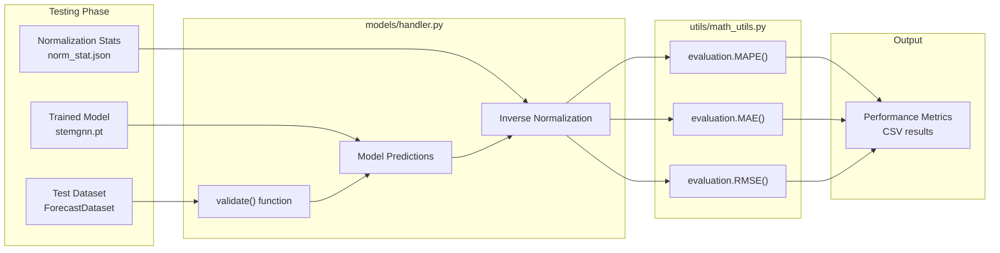

<!-- source: DeepWiki mcp.deepwiki.com · repo microsoft/StemGNN · page 5.2 Supported Datasets · fetched 2026-10-26 -->

# Supported Datasets

<details>
<summary>Relevant source files</summary>

The following files were used as context for generating this wiki page:

- [README.md](README.md)
- [dataset/ECG_data.csv](dataset/ECG_data.csv)
- [dataset/PeMS07.csv](dataset/PeMS07.csv)

</details>


This page provides a comprehensive reference of all datasets officially supported by STemGNN, including their characteristics, configuration parameters, and expected performance metrics. This information is essential for reproducing published results and for understanding how to format custom datasets for use with the model.

For information about how datasets are loaded and preprocessed, see [Data Pipeline](#4.4). For details on normalization methods applied to datasets, see [Normalization Methods](#3.5). For command-line parameters used when training on specific datasets, see [Configuration Parameters](#5.1).

---

## Dataset Format Requirements

All datasets used with STemGNN must conform to a specific CSV format to be properly loaded by the `ForecastDataset` class.

### Format Specification

**File Format:** CSV (Comma-Separated Values)

**Required Structure:**
- **No header row** - The CSV file must contain only numeric data
- **Shape:** `T × N` where:
  - `T` = Total number of timestamps (rows)
  - `N` = Number of nodes/variables (columns)
- **Data Type:** Float values representing time series measurements
- **Missing Values:** Not explicitly handled; preprocessing required before use

**Example Structure:**
```
3.6908442, 0.71141435, -2.1140915, -4.1410067, ...
-1.3481323, -3.9960376, -4.2267496, -4.2511874, ...
1.0242946, -0.59031419, -1.9169491, -2.8069889, ...
```

Sources: [README.md:37-38]()

### Data Flow Pipeline



Sources: [README.md:37-39](), [data_loader/forecast_dataloader.py]()

---

## Officially Supported Datasets

The following datasets have been tested and validated with STemGNN. Each dataset represents a different multivariate time-series forecasting problem.

### Dataset Catalog

| Dataset | Domain | Source | Nodes (N) | Task |
|---------|--------|--------|-----------|------|
| **PEMS03** | Traffic | [PeMS District 3](http://pems.dot.ca.gov/?dnode=Clearinghouse&type=station_5min&district_id=3&submit=Submit) | 358 | Traffic flow forecasting |
| **PEMS04** | Traffic | [PeMS District 4](http://pems.dot.ca.gov/?dnode=Clearinghouse&type=station_5min&district_id=4&submit=Submit) | 307 | Traffic speed forecasting |
| **PEMS07** | Traffic | [PeMS District 7](http://pems.dot.ca.gov/?dnode=Clearinghouse&type=station_5min&district_id=7&submit=Submit) | 228 | Traffic flow forecasting |
| **PEMS08** | Traffic | [PeMS District 8](http://pems.dot.ca.gov/?dnode=Clearinghouse&type=station_5min&district_id=8&submit=Submit) | 170 | Traffic flow forecasting |
| **METR-LA** | Traffic | [DCRNN Repository](https://github.com/liyaguang/DCRNN) | 207 | Traffic speed forecasting |
| **PEMS-BAY** | Traffic | [DCRNN Repository](https://github.com/liyaguang/DCRNN) | 325 | Traffic speed forecasting |
| **Solar** | Energy | [NREL Solar Power Data](https://www.nrel.gov/grid/solar-power-data.html) | 137 | Solar power forecasting |
| **Electricity** | Energy | [UCI Repository](https://archive.ics.uci.edu/ml/datasets/ElectricityLoadDiagrams20112014) | Variable | Electricity load forecasting |
| **ECG5000** | Healthcare | [Time Series Classification](http://www.timeseriesclassification.com/description.php?Dataset=ECG5000) | 140 | ECG signal analysis |
| **COVID-19** | Epidemiology | [JHU CSSE Repository](https://github.com/CSSEGISandData/COVID-19/tree/master) | 25 | Infection count forecasting |

Sources: [README.md:24-34]()

### Data Source Details

**PeMS Datasets (PEMS03/04/07/08):**
- Use traffic flow tables for PEMS03, PEMS07, PEMS08
- Use traffic speed tables for PEMS04
- Raw data requires extraction and preprocessing from 5-minute interval files

**Solar Dataset:**
- Alabama (Eastern States) region
- Merged from 5-minute CSV files
- 137 time series total

**Electricity Dataset:**
- Header and index rows must be deleted from raw download

**COVID-19 Dataset:**
- Source file: `csse_covid_19_data/csse_covid_19_time_series/time_series_covid19_confirmed_global.csv`
- Calculated as daily newly confirmed infected people
- Date range: 1/22/2020 to 5/10/2020
- 25 countries: US, Canada, Mexico, Russia, UK, Italy, Germany, France, Belarus, Brazil, Peru, Ecuador, Chile, India, Turkey, Saudi Arabia, Pakistan, Iran, Singapore, Qatar, Bangladesh, Arab, China, Japan, Korea

Sources: [README.md:34-35]()

---

## Dataset Configuration Parameters

Each dataset requires specific configuration parameters for optimal performance. These parameters are passed as command-line arguments to `main.py`.

### Configuration Mapping



Sources: [README.md:49-68](), [main.py]()

### Standard Configuration Table

The following table shows the recommended configuration for each officially supported dataset:

| Dataset | n_route | window_size | horizon | norm_method | train_length | validate_length | test_length |
|---------|---------|-------------|---------|-------------|--------------|-----------------|-------------|
| **METR-LA** | 207 | 12 | 3 | z_score | 7 | 2 | 1 |
| **PEMS-BAY** | 325 | 12 | 3 | z_score | 7 | 2 | 1 |
| **PEMS03** | 358 | 12 | 3 | z_score | 7 | 2 | 1 |
| **PEMS04** | 307 | 12 | 3 | z_score | 7 | 2 | 1 |
| **PEMS07** | 228 | 12 | 3 | z_score | 7 | 2 | 1 |
| **PEMS08** | 170 | 12 | 3 | z_score | 7 | 2 | 1 |
| **COVID-19** | 25 | 28 | 28 | z_score | 7 | 2 | 1 |

**Parameter Definitions:**
- `n_route`: Number of nodes/variables in the multivariate time series
- `window_size`: Length of historical window used for prediction (input sequence length)
- `horizon`: Number of future time steps to predict
- `norm_method`: Normalization strategy (`z_score` for zero-mean unit-variance, `min_max` for [0,1] scaling)
- `train_length`: Proportion of data for training (ratio)
- `validate_length`: Proportion of data for validation (ratio)
- `test_length`: Proportion of data for testing (ratio)

**Note:** The default split ratio is 7:2:1 (70% train, 20% validation, 10% test).

Sources: [README.md:71-81]()

---

## Provided Example Dataset

### ECG_data.csv

A preprocessed ECG5000 dataset is included in the repository for immediate use and reproduction testing.

**Location:** `dataset/ECG_data.csv`

**Specifications:**
- **Shape:** 5000 × 140
  - 5000 timestamps (rows)
  - 140 nodes (columns)
- **Format:** CSV with no header
- **Preprocessing:** Already cleaned and formatted for STemGNN
- **Purpose:** Quick start and validation without complex data preprocessing

**Quick Start Command:**
```bash
python main.py --train True --evaluate True \
    --dataset ECG_data.csv \
    --n_route 140 \
    --window_size 12 \
    --horizon 3
```

This dataset serves as the default example and requires no additional preprocessing steps.

Sources: [README.md:37-39](), [dataset/ECG_data.csv:1]()

### ECG Dataset Structure



Sources: [dataset/ECG_data.csv:1-10]()

---

## Performance Benchmarks

The following tables show expected performance metrics when using the recommended configurations. These results can be used to validate your implementation and compare against published results.

### Short-Term Forecasting (Horizon: 3 steps)

Performance metrics for traffic datasets with 3-step-ahead prediction:

| Dataset | MAE ↓ | RMSE ↓ | MAPE (%) ↓ | Notes |
|---------|-------|--------|------------|-------|
| **METR-LA** | 2.56 | 5.06 | 6.46 | Traffic speed forecasting |
| **PEMS-BAY** | 1.23 | 2.48 | 2.63 | Traffic speed forecasting |
| **PEMS03** | 14.32 | 21.64 | 16.24 | Traffic flow forecasting |
| **PEMS04** | 20.24 | 32.15 | 10.03 | Traffic speed forecasting |
| **PEMS07** | 2.14 | 4.01 | 5.01 | Traffic flow forecasting |
| **PEMS08** | 15.83 | 24.93 | 9.26 | Traffic flow forecasting |

**Metric Definitions:**
- **MAE** (Mean Absolute Error): Average absolute difference between predictions and ground truth
- **RMSE** (Root Mean Square Error): Square root of average squared differences
- **MAPE** (Mean Absolute Percentage Error): Average percentage error relative to ground truth

Sources: [README.md:86-96]()

### Long-Term Forecasting (Horizon: 28 steps)

Performance metrics for COVID-19 dataset with 28-step-ahead prediction:

| Dataset | MAE ↓ | RMSE ↓ | MAPE (%) ↓ | Notes |
|---------|-------|--------|------------|-------|
| **COVID-19** | 662.24 | 1023.19 | 19.3 | Daily new infections |

The COVID-19 dataset uses a significantly longer prediction horizon (28 days) compared to traffic datasets (3 time steps), reflecting the different temporal dynamics of epidemic forecasting.

Sources: [README.md:97-102]()

### Performance Evaluation Pipeline



Sources: [README.md:86-102](), [models/handler.py](), [utils/math_utils.py]()

---

## Using Custom Datasets

To use your own dataset with STemGNN, follow these preparation steps:

### Data Preprocessing Requirements

1. **Format Conversion:**
   - Convert your data to CSV format
   - Remove any header rows
   - Ensure the file contains only numeric values
   - Organize as `T × N` matrix (timestamps × nodes)

2. **Data Cleaning:**
   - Handle missing values (interpolation or removal)
   - Remove outliers if necessary
   - Ensure consistent time intervals
   - Verify data type compatibility (float values)

3. **File Organization:**
   - Place CSV file in an accessible directory
   - Note the exact path for the `--dataset` parameter

### Example Command for Custom Dataset

```bash
python main.py \
    --train True \
    --evaluate True \
    --dataset path/to/your_data.csv \
    --output_dir ./output \
    --n_route <number_of_variables> \
    --window_size 12 \
    --horizon 3 \
    --norm_method z_score \
    --train_length 7 \
    --validate_length 2 \
    --test_length 1
```

**Critical Parameters to Set:**
- `--dataset`: Path to your CSV file
- `--n_route`: Must match the number of columns in your CSV
- `--window_size`: Length of input sequence (adjust based on temporal dynamics)
- `--horizon`: Prediction horizon (adjust based on forecasting needs)

Sources: [README.md:43-47]()

### Parameter Tuning Guidelines

**Window Size Selection:**
- Short-term patterns: `window_size = 12` (e.g., hourly data for half-day patterns)
- Long-term patterns: `window_size = 28` or higher (e.g., daily data for monthly patterns)
- Rule of thumb: Window should capture at least one complete cycle of your data's periodicity

**Horizon Selection:**
- Depends on application requirements
- Shorter horizons (3-6) generally yield better accuracy
- Longer horizons (24-28) suitable for planning applications

**Normalization Method:**
- `z_score`: Recommended for most datasets, especially with varying scales
- `min_max`: Use when data has known bounded ranges

**Data Split Ratios:**
- Default `7:2:1` works well for most datasets
- Increase training proportion for smaller datasets
- Ensure validation set is large enough for meaningful early stopping

Sources: [README.md:46-68]()

---

## Dataset Preprocessing Notes

### Traffic Datasets (PEMS, METR-LA, PEMS-BAY)

**Raw Data Characteristics:**
- Provided in 5-minute intervals
- Multiple sensor stations across highway networks
- Requires selection of appropriate measurement type (flow vs. speed)

**Preprocessing Steps:**
1. Select measurement type (traffic flow or speed)
2. Aggregate sensor readings if necessary
3. Handle missing sensor data
4. Remove timestamps with incomplete readings
5. Format as `T × N` CSV

### Solar Dataset

**Raw Data Characteristics:**
- 5-minute resolution solar power measurements
- Multiple time series from different locations
- Alabama Eastern States region

**Preprocessing Steps:**
1. Merge individual 5-minute CSV files
2. Align timestamps across all 137 time series
3. Handle missing measurements
4. Format as `T × N` CSV

### COVID-19 Dataset

**Raw Data Characteristics:**
- Cumulative confirmed cases
- Daily reporting with potential delays/corrections

**Preprocessing Steps:**
1. Extract `time_series_covid19_confirmed_global.csv`
2. Calculate daily new cases (first difference of cumulative)
3. Select 25 target countries
4. Handle negative values from data corrections
5. Format as `T × N` CSV with 25 columns

Sources: [README.md:34-35]()

---

## Validation and Testing

After preparing your dataset, validate it before training:

1. **Shape Verification:**
   ```python
   import pandas as pd
   data = pd.read_csv('your_data.csv', header=None)
   print(f"Shape: {data.shape}")  # Should be (T, N)
   print(f"Data types: {data.dtypes.unique()}")  # Should be numeric
   ```

2. **Value Range Check:**
   ```python
   print(f"Min: {data.min().min()}")
   print(f"Max: {data.max().max()}")
   print(f"NaN count: {data.isna().sum().sum()}")
   ```

3. **Test Run:**
   Start with a small number of epochs to verify the pipeline works:
   ```bash
   python main.py --train True --dataset your_data.csv \
       --n_route <N> --epoch 2
   ```

Sources: [data_loader/forecast_dataloader.py]()

---

