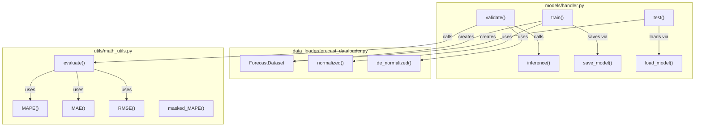
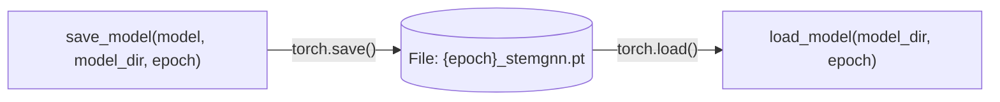
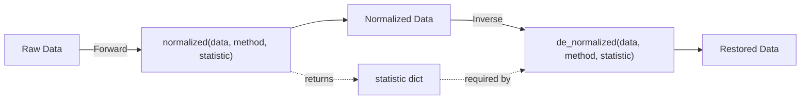
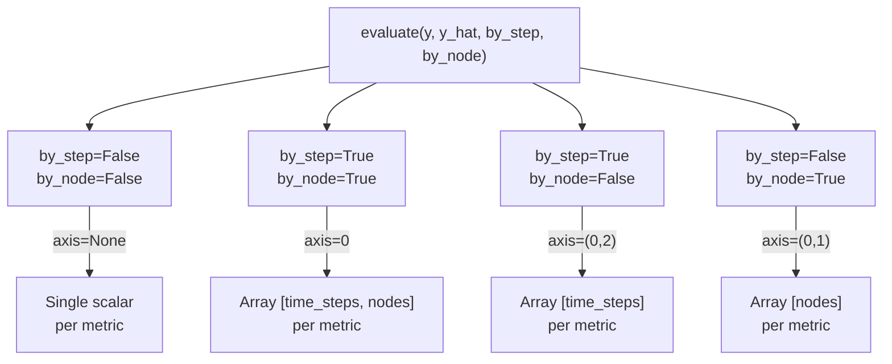
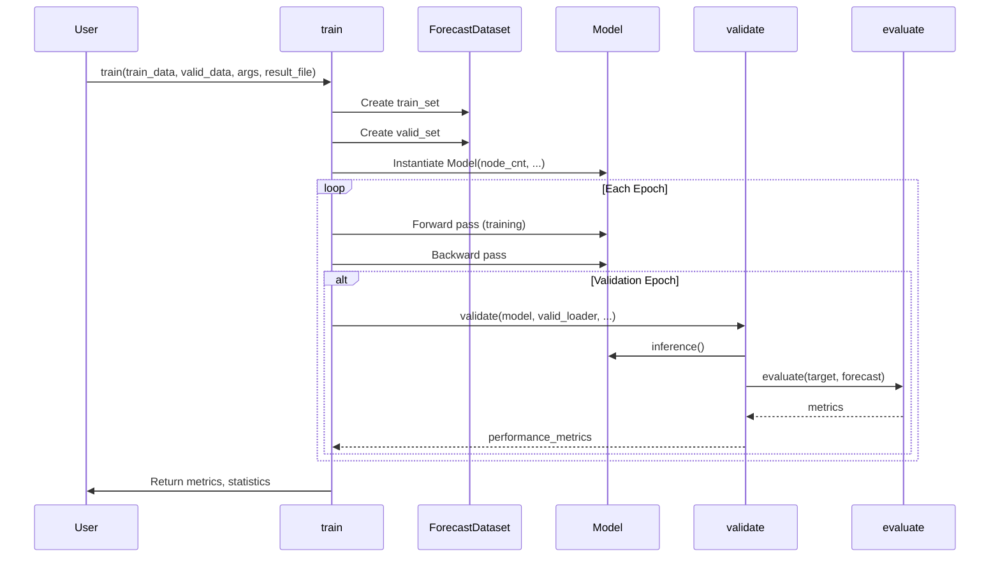
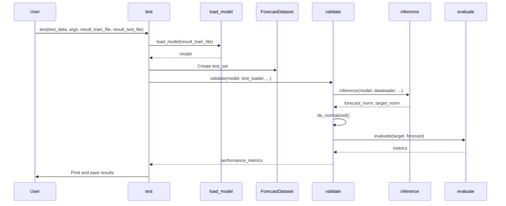

<!-- source: DeepWiki mcp.deepwiki.com · repo microsoft/StemGNN · page 5.3 API Reference · fetched 2026-10-26 -->

# API Reference

<details>
<summary>Relevant source files</summary>

The following files were used as context for generating this wiki page:

- [data_loader/forecast_dataloader.py](data_loader/forecast_dataloader.py)
- [models/handler.py](models/handler.py)
- [utils/math_utils.py](utils/math_utils.py)

</details>


This page documents the public API of key classes and functions in the STemGNN codebase. Developers extending the system or integrating it into other projects should use these interfaces. This covers the three main modules: model lifecycle management, data pipeline, and evaluation metrics.

For configuration parameters and command-line options, see [Configuration Parameters](#5.1). For dataset format specifications, see [Supported Datasets](#5.2).

---

## Overview of API Modules

The STemGNN public API is organized into three primary modules, each serving distinct responsibilities in the machine learning pipeline:



**Sources:** [models/handler.py:1-207](), [data_loader/forecast_dataloader.py:1-74](), [utils/math_utils.py:1-75]()

---

## Model Lifecycle Management

Module: `models/handler.py`

This module provides high-level functions for training, validation, testing, and model persistence. These functions orchestrate the entire machine learning workflow.

### Training API

#### `train(train_data, valid_data, args, result_file)`

Primary training function that orchestrates the complete training loop including optimization, validation, and early stopping.

**Parameters:**

| Parameter | Type | Description |
|-----------|------|-------------|
| `train_data` | `np.ndarray` | Training dataset with shape `[time_steps, nodes]` |
| `valid_data` | `np.ndarray` | Validation dataset with same shape as `train_data` |
| `args` | `argparse.Namespace` | Configuration object containing hyperparameters (see table below) |
| `result_file` | `str` | Directory path for saving model checkpoints and statistics |

**Key `args` Attributes:**

| Attribute | Type | Purpose |
|-----------|------|---------|
| `args.window_size` | `int` | Input sequence length |
| `args.horizon` | `int` | Forecast horizon |
| `args.multi_layer` | `int` | Number of stacked layers in model |
| `args.device` | `torch.device` | Device for computation (CPU/GPU) |
| `args.norm_method` | `str` | Normalization method: `'z_score'` or `'min_max'` |
| `args.optimizer` | `str` | Optimizer type: `'Adam'` or `'RMSProp'` |
| `args.lr` | `float` | Initial learning rate |
| `args.decay_rate` | `float` | Exponential decay rate for learning rate |
| `args.batch_size` | `int` | Batch size for training |
| `args.epoch` | `int` | Maximum number of epochs |
| `args.validate_freq` | `int` | Validation frequency (every N epochs) |
| `args.early_stop` | `bool` | Enable early stopping |
| `args.early_stop_step` | `int` | Patience for early stopping |
| `args.exponential_decay_step` | `int` | Apply LR decay every N epochs |

**Returns:**

- `performance_metrics` (`dict`): Dictionary with keys `'mae'`, `'mape'`, `'rmse'`, `'mae_node'`, `'mape_node'`, `'rmse_node'`
- `normalize_statistic` (`dict`): Normalization statistics saved to `norm_stat.json`

**Side Effects:**

- Creates model checkpoints at `{result_file}/{epoch}_stemgnn.pt`
- Saves best model at `{result_file}/_stemgnn.pt`
- Writes `norm_stat.json` containing normalization statistics

**Implementation Details:**

- Instantiates `Model` from [models/base_model.py:105]()
- Creates `ForecastDataset` instances for train/validation splits
- Uses MSE loss for optimization
- Performs periodic validation and saves best model based on MAE
- Supports early stopping based on validation performance

**Sources:** [models/handler.py:103-191]()

---

#### `test(test_data, args, result_train_file, result_test_file)`

Evaluates a trained model on test data.

**Parameters:**

| Parameter | Type | Description |
|-----------|------|-------------|
| `test_data` | `np.ndarray` | Test dataset with shape `[time_steps, nodes]` |
| `args` | `argparse.Namespace` | Configuration object (must match training config) |
| `result_train_file` | `str` | Directory containing trained model and `norm_stat.json` |
| `result_test_file` | `str` | Directory for saving test predictions and errors |

**Returns:**

None. Prints performance metrics to stdout.

**Side Effects:**

- Saves test predictions to `{result_test_file}/predict.csv`
- Saves ground truth to `{result_test_file}/target.csv`
- Saves absolute errors to `{result_test_file}/predict_abs_error.csv`
- Saves APE to `{result_test_file}/predict_ape.csv`

**Sources:** [models/handler.py:194-207]()

---

### Validation and Inference API

#### `validate(model, dataloader, device, normalize_method, statistic, node_cnt, window_size, horizon, result_file=None)`

Validates model performance by running inference and computing metrics.

**Parameters:**

| Parameter | Type | Description |
|-----------|------|-------------|
| `model` | `torch.nn.Module` | Trained STemGNN model instance |
| `dataloader` | `torch.utils.data.DataLoader` | DataLoader for validation/test data |
| `device` | `torch.device` | Device for computation |
| `normalize_method` | `str` | Normalization method used during training |
| `statistic` | `dict` | Normalization statistics from training |
| `node_cnt` | `int` | Number of nodes in time series |
| `window_size` | `int` | Input sequence length |
| `horizon` | `int` | Forecast horizon |
| `result_file` | `str` (optional) | Directory for saving predictions |

**Returns:**

`dict` with keys:
- `'mae'`: Mean Absolute Error across all nodes
- `'mape'`: Mean Absolute Percentage Error across all nodes
- `'rmse'`: Root Mean Squared Error across all nodes
- `'mae_node'`: Per-node MAE array
- `'mape_node'`: Per-node MAPE array
- `'rmse_node'`: Per-node RMSE array

**Sources:** [models/handler.py:67-100]()

---

#### `inference(model, dataloader, device, node_cnt, window_size, horizon)`

Low-level inference function for generating multi-step forecasts.

**Parameters:**

| Parameter | Type | Description |
|-----------|------|-------------|
| `model` | `torch.nn.Module` | Model in evaluation mode |
| `dataloader` | `torch.utils.data.DataLoader` | Data to forecast |
| `device` | `torch.device` | Computation device |
| `node_cnt` | `int` | Number of nodes |
| `window_size` | `int` | Input window size |
| `horizon` | `int` | Steps to forecast |

**Returns:**

- `forecast` (`np.ndarray`): Predictions with shape `[batch_size, horizon, node_cnt]`
- `target` (`np.ndarray`): Ground truth with same shape

**Algorithm:**

Uses iterative forecasting where model predictions are fed back as input for subsequent steps until the full horizon is covered.

**Sources:** [models/handler.py:41-64]()

---

### Model Persistence API



#### `save_model(model, model_dir, epoch=None)`

Saves a model to disk.

**Parameters:**

| Parameter | Type | Description |
|-----------|------|-------------|
| `model` | `torch.nn.Module` | Model to save |
| `model_dir` | `str` | Directory for saving |
| `epoch` | `int` (optional) | Epoch number for filename |

**File Naming:**

- With epoch: `{model_dir}/{epoch}_stemgnn.pt`
- Without epoch: `{model_dir}/_stemgnn.pt` (best model)

**Sources:** [models/handler.py:16-24]()

---

#### `load_model(model_dir, epoch=None)`

Loads a saved model from disk.

**Parameters:**

| Parameter | Type | Description |
|-----------|------|-------------|
| `model_dir` | `str` | Directory containing model |
| `epoch` | `int` (optional) | Epoch number to load |

**Returns:**

- `torch.nn.Module` or `None` if file doesn't exist

**Sources:** [models/handler.py:27-38]()

---

## Data Pipeline API

Module: `data_loader/forecast_dataloader.py`

Provides dataset handling and normalization utilities for time series forecasting.

### ForecastDataset Class

PyTorch `Dataset` implementation for time series forecasting with sliding windows.

#### Constructor

```python
ForecastDataset(df, window_size, horizon, normalize_method=None, norm_statistic=None, interval=1)
```

**Parameters:**

| Parameter | Type | Description |
|-----------|------|-------------|
| `df` | `np.ndarray` or `pd.DataFrame` | Time series data with shape `[time_steps, nodes]` |
| `window_size` | `int` | Input sequence length |
| `horizon` | `int` | Forecast horizon length |
| `normalize_method` | `str` (optional) | `'z_score'` or `'min_max'` |
| `norm_statistic` | `dict` (optional) | Pre-computed statistics for normalization |
| `interval` | `int` | Sampling interval for sliding windows (default: 1) |

**Attributes:**

| Attribute | Type | Description |
|-----------|------|-------------|
| `self.data` | `np.ndarray` | Normalized time series data |
| `self.df_length` | `int` | Length of time series |
| `self.x_end_idx` | `list` | Valid end indices for windows |

**Sources:** [data_loader/forecast_dataloader.py:41-54]()

---

#### `__getitem__(index)`

Returns a single training sample.

**Returns:**

- `x` (`torch.Tensor`): Input sequence with shape `[window_size, nodes]`
- `y` (`torch.Tensor`): Target sequence with shape `[horizon, nodes]`

**Sources:** [data_loader/forecast_dataloader.py:56-63]()

---

#### `__len__()`

Returns the total number of samples.

**Returns:**

`int`: Number of valid sliding windows

**Sources:** [data_loader/forecast_dataloader.py:65-66]()

---

#### `get_x_end_idx()`

Computes valid end indices for sliding windows.

**Logic:**

- Windows must fit within `[window_size, df_length - horizon + 1]`
- Samples every `interval` time steps

**Returns:**

`list[int]`: End indices for each window

**Sources:** [data_loader/forecast_dataloader.py:68-73]()

---

### Normalization Functions



#### `normalized(data, normalize_method, norm_statistic=None)`

Normalizes time series data.

**Parameters:**

| Parameter | Type | Description |
|-----------|------|-------------|
| `data` | `np.ndarray` | Raw time series data |
| `normalize_method` | `str` | `'z_score'` or `'min_max'` |
| `norm_statistic` | `dict` (optional) | Pre-computed statistics |

**Returns:**

- `data` (`np.ndarray`): Normalized data
- `norm_statistic` (`dict`): Statistics dictionary

**Normalization Methods:**

| Method | Statistics | Formula |
|--------|-----------|---------|
| `'z_score'` | `mean`, `std` | `(x - mean) / std` |
| `'min_max'` | `min`, `max` | `(x - min) / (max - min)` |

**Special Cases:**

- Zero standard deviation handled by replacing with 1
- Min-max clipped to `[0.0, 1.0]`
- Small epsilon (`1e-5`) added to prevent division by zero

**Sources:** [data_loader/forecast_dataloader.py:7-22]()

---

#### `de_normalized(data, normalize_method, norm_statistic)`

Reverses normalization to restore original scale.

**Parameters:**

| Parameter | Type | Description |
|-----------|------|-------------|
| `data` | `np.ndarray` | Normalized data |
| `normalize_method` | `str` | `'z_score'` or `'min_max'` |
| `norm_statistic` | `dict` | Statistics from normalization |

**Returns:**

`np.ndarray`: Data in original scale

**Inverse Formulas:**

| Method | Formula |
|--------|---------|
| `'z_score'` | `x * std + mean` |
| `'min_max'` | `x * (max - min) + min` |

**Sources:** [data_loader/forecast_dataloader.py:25-38]()

---

## Evaluation Metrics API

Module: `utils/math_utils.py`

Provides metrics for evaluating forecast accuracy.

### Core Evaluation Function

#### `evaluate(y, y_hat, by_step=False, by_node=False)`

Unified evaluation function computing multiple metrics.

**Parameters:**

| Parameter | Type | Description |
|-----------|------|-------------|
| `y` | `np.ndarray` | Ground truth with shape `[samples, time_steps, nodes]` |
| `y_hat` | `np.ndarray` | Predictions with same shape |
| `by_step` | `bool` | Compute metrics per time step |
| `by_node` | `bool` | Compute metrics per node |

**Returns:**

Tuple of `(MAPE, MAE, RMSE)` where each element is:
- `float`: If both flags are `False` (aggregate metrics)
- `np.ndarray` shape `[time_steps, nodes]`: If both flags are `True`
- `np.ndarray` shape `[time_steps]`: If `by_step=True`, `by_node=False`
- `np.ndarray` shape `[nodes]`: If `by_node=True`, `by_step=False`

**Aggregation Logic:**



**Sources:** [utils/math_utils.py:59-74]()

---

### Individual Metric Functions

#### `MAPE(v, v_, axis=None)`

Mean Absolute Percentage Error with capping.

**Formula:**

```
MAPE = mean(|v_ - v| / (|v| + 1e-5))
```

**Capping:** Values exceeding 5.0 are clipped to 5.0 to handle outliers.

**Parameters:**

| Parameter | Type | Description |
|-----------|------|-------------|
| `v` | `np.ndarray` | Ground truth |
| `v_` | `np.ndarray` | Predictions |
| `axis` | `int` or `tuple` (optional) | Aggregation axis |

**Returns:**

`np.ndarray` or `float`: MAPE value(s)

**Sources:** [utils/math_utils.py:24-34]()

---

#### `MAE(v, v_, axis=None)`

Mean Absolute Error.

**Formula:**

```
MAE = mean(|v_ - v|)
```

**Sources:** [utils/math_utils.py:48-56]()

---

#### `RMSE(v, v_, axis=None)`

Root Mean Squared Error.

**Formula:**

```
RMSE = sqrt(mean((v_ - v)^2))
```

**Sources:** [utils/math_utils.py:37-45]()

---

#### `masked_MAPE(v, v_, axis=None)`

MAPE with masking for zero ground truth values.

**Behavior:**

- Masks divisions where `v == 0` using `np.ma.masked_array`
- Returns `np.nan` for fully masked results
- More robust than standard MAPE for sparse or zero-heavy data

**Sources:** [utils/math_utils.py:4-21]()

---

## API Usage Patterns

### Training Workflow



**Sources:** [models/handler.py:103-191]()

---

### Evaluation Workflow



**Sources:** [models/handler.py:194-207](), [models/handler.py:67-100](), [models/handler.py:41-64]()

---

## API Reference Summary Table

| Module | Component | Type | Primary Use Case |
|--------|-----------|------|------------------|
| `models.handler` | `train()` | Function | End-to-end model training |
| `models.handler` | `test()` | Function | Model evaluation on test set |
| `models.handler` | `validate()` | Function | Compute validation metrics |
| `models.handler` | `inference()` | Function | Multi-step forecasting |
| `models.handler` | `save_model()` | Function | Model checkpoint persistence |
| `models.handler` | `load_model()` | Function | Model checkpoint loading |
| `data_loader.forecast_dataloader` | `ForecastDataset` | Class | PyTorch Dataset for time series |
| `data_loader.forecast_dataloader` | `normalized()` | Function | Data normalization |
| `data_loader.forecast_dataloader` | `de_normalized()` | Function | Inverse normalization |
| `utils.math_utils` | `evaluate()` | Function | Unified metric computation |
| `utils.math_utils` | `MAPE()` | Function | Percentage error metric |
| `utils.math_utils` | `MAE()` | Function | Absolute error metric |
| `utils.math_utils` | `RMSE()` | Function | Root mean squared error |
| `utils.math_utils` | `masked_MAPE()` | Function | Robust MAPE for sparse data |

**Sources:** [models/handler.py:1-207](), [data_loader/forecast_dataloader.py:1-74](), [utils/math_utils.py:1-75]()

---

