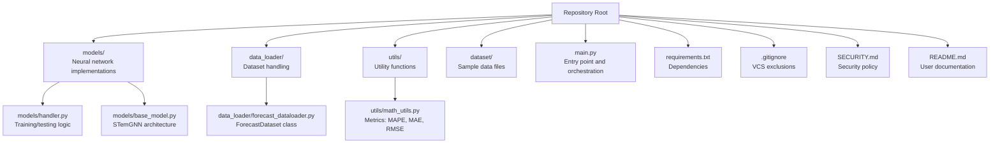
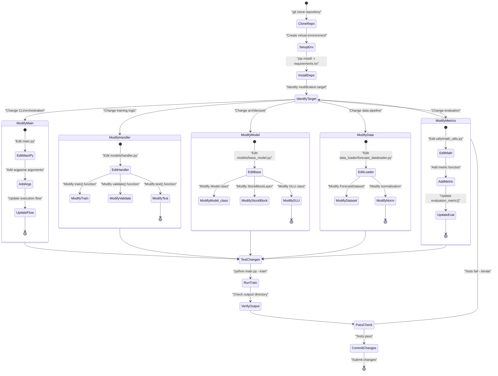
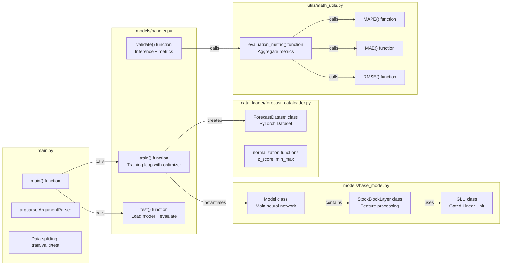

<!-- source: DeepWiki mcp.deepwiki.com · repo microsoft/StemGNN · page 6 Development Guide · fetched 2026-10-26 -->

# Development Guide

<details>
<summary>Relevant source files</summary>

The following files were used as context for generating this wiki page:

- [.gitignore](.gitignore)
- [SECURITY.md](SECURITY.md)
- [requirements.txt](requirements.txt)

</details>


This guide provides technical information for developers who want to contribute to, extend, or modify the STemGNN codebase. It covers the repository structure, development workflow, extension points, dependencies, and contribution guidelines.

For detailed user-level documentation on running the system, see [User Guide](#3). For technical details on the architecture, see [System Architecture](#4).

## Purpose and Scope

This page provides an overview of development concepts. Detailed information is available in:
- [Project Structure](#6.1) - detailed repository organization and file purposes
- [Dependencies](#6.2) - complete dependency analysis
- [Contributing](#6.3) - security policies and contribution procedures

Sources: [SECURITY.md:1-42]()

---

## Development Environment Setup

### Prerequisites

The codebase requires Python with specific package versions. A development environment should include:

| Component | Version | Purpose |
|-----------|---------|---------|
| Python | 3.7+ | Runtime environment |
| numpy | 1.19.5 | Numerical computations |
| scipy | 1.5.4 | Scientific computing |
| pandas | 1.1.5 | Data manipulation |
| torch | 1.7.1 | Deep learning framework |

### Environment Isolation

The `.gitignore` configuration excludes common Python environment directories:

- Virtual environments: `.env`, `.venv`, `env/`, `venv/`, `ENV/`
- Build artifacts: `build/`, `dist/`, `*.egg-info/`
- Python cache: `__pycache__/`, `*.pyc`
- Output data: `output/`
- IDE configurations: `.idea/`

This ensures that local development artifacts do not pollute the repository.

Sources: [requirements.txt:1-5](), [.gitignore:1-41]()

---

## Repository Structure Overview

### Directory Organization



### Key Development Files

| File Path | Purpose | Typical Modifications |
|-----------|---------|----------------------|
| `main.py` | System entry point | Add new command-line arguments |
| `models/handler.py` | Training/testing orchestration | Modify training loop, add callbacks |
| `models/base_model.py` | Neural network architecture | Extend model, add layers |
| `data_loader/forecast_dataloader.py` | Data pipeline | Support new data formats |
| `utils/math_utils.py` | Evaluation metrics | Add custom metrics |
| `requirements.txt` | Python dependencies | Add/update packages |

For detailed file-by-file documentation, see [Project Structure](#6.1).

Sources: [.gitignore:1-41](), [requirements.txt:1-5]()

---

## Development Workflow

### Code Modification Flow



### Testing Modifications

After making changes, validate them using the existing datasets:

```bash
# Test training pipeline
python main.py --train --dataset ECG_data.csv --norm_method z_score --epoch 5

# Test evaluation pipeline
python main.py --evaluate --dataset ECG_data.csv --norm_method z_score
```

Check that the `output/` directory contains:
- `norm_stat.json` - normalization statistics
- `stemgnn.pt` - model checkpoint
- Result CSVs with predictions and metrics

Sources: [.gitignore:39]()

---

## Common Extension Points

### Adding Custom Models

To add a new neural network architecture:

1. Create a new model class in `models/base_model.py` or a new file
2. Implement the `forward()` method with the same signature as the `Model` class
3. Update `models/handler.py` to instantiate your model
4. Ensure output shape matches `(batch_size, horizon, num_nodes)`

### Adding Custom Metrics

To add evaluation metrics:

1. Implement the metric function in `utils/math_utils.py`
2. Follow the signature pattern: `def metric_name(y_true, y_pred, mask=None)`
3. Handle masked calculations for sparse data
4. Add the metric to the `evaluation_metric()` function aggregation

### Adding Custom Datasets

To support new data formats:

1. Modify `data_loader/forecast_dataloader.py`
2. Extend the `ForecastDataset.__init__()` to parse your format
3. Ensure output shape: `(num_samples, num_nodes, time_steps)`
4. Update normalization logic if needed

### Adding Command-Line Options

To add new configuration options:

1. Add argument in `main.py` using `parser.add_argument()`
2. Pass the argument to relevant functions in `models/handler.py`
3. Update the model or data pipeline to use the new parameter
4. Document the parameter in the README

Sources: None (derived from architecture diagrams)

---

## Code Entity Reference Map

### Main Execution Components



### Class and Function Responsibilities

| Code Entity | Location | Responsibility |
|-------------|----------|----------------|
| `main()` | `main.py` | Parse arguments, split data, orchestrate train/test |
| `train()` | `models/handler.py` | Training loop, optimization, model saving |
| `validate()` | `models/handler.py` | Run inference and compute metrics |
| `test()` | `models/handler.py` | Load saved model and evaluate on test set |
| `Model` | `models/base_model.py` | STemGNN neural network implementation |
| `StockBlockLayer` | `models/base_model.py` | Graph convolution + spectral processing |
| `GLU` | `models/base_model.py` | Gated activation unit |
| `ForecastDataset` | `data_loader/forecast_dataloader.py` | PyTorch Dataset with sliding windows |
| `evaluation_metric()` | `utils/math_utils.py` | Aggregate MAPE, MAE, RMSE |

Sources: Derived from architecture diagrams

---

## Dependency Management

### Core Dependencies

The system has four critical dependencies specified in `requirements.txt`:

1. **numpy 1.19.5** - Array operations, numerical computations
2. **scipy 1.5.4** - FFT operations for spectral processing, sparse matrix operations
3. **pandas 1.1.5** - CSV loading, DataFrame operations in data pipeline
4. **torch 1.7.1** - Neural network framework, GPU acceleration, automatic differentiation

### Version Constraints

The specific versions are pinned to ensure reproducibility:
- Prevents dependency conflicts
- Ensures consistent results across environments
- Matches the development and testing environment

When updating dependencies:
1. Test thoroughly with multiple datasets
2. Verify numerical stability (metrics should remain consistent)
3. Check GPU compatibility if using CUDA
4. Update version numbers in `requirements.txt`

For detailed dependency analysis, see [Dependencies](#6.2).

Sources: [requirements.txt:1-5]()

---

## Security and Contribution Guidelines

### Security Policy

Microsoft maintains a formal security policy for this repository. Key points:

**DO NOT report security vulnerabilities through public GitHub issues.**

Instead:
- Report to Microsoft Security Response Center (MSRC)
- Use https://msrc.microsoft.com/create-report
- Or email secure@microsoft.com
- Expect response within 24 hours

When reporting, include:
- Issue type (buffer overflow, injection, etc.)
- Full source file paths
- Source code location (tag/branch/commit)
- Reproduction steps
- Proof-of-concept if available
- Impact assessment

### Contribution Process

While specific contribution guidelines are not provided in the available files, standard practices apply:

1. **Fork and Branch** - Create a feature branch from the main branch
2. **Follow Code Style** - Match existing code formatting and structure
3. **Test Changes** - Validate with provided datasets
4. **Document** - Update README.md if adding features
5. **Submit PR** - Provide clear description of changes

### File Exclusions

When contributing, ensure your changes do not include:
- Virtual environment directories (`.venv`, `env/`, etc.)
- Python cache files (`__pycache__/`, `*.pyc`)
- IDE configurations (`.idea/`)
- Output data (`output/`)
- Test files (`test.py`)

These are automatically excluded via `.gitignore`.

For complete contribution guidelines, see [Contributing](#6.3).

Sources: [SECURITY.md:1-42](), [.gitignore:1-41]()

---

## Development Best Practices

### Code Organization Principles

The codebase follows a modular architecture with clear separation of concerns:

| Principle | Implementation | Benefit |
|-----------|----------------|---------|
| **Separation of Concerns** | Distinct modules for orchestration, model, data, metrics | Easy to modify individual components |
| **Single Responsibility** | Each file has one primary purpose | Simplified debugging and testing |
| **Dependency Injection** | Configuration passed as arguments | Flexible parameterization |
| **Persistence** | Save model + normalization stats | Reproducible evaluation |

### Extending the System

When extending the codebase:

1. **Preserve Interfaces** - Maintain function signatures for backward compatibility
2. **Add Parameters** - Use optional arguments with sensible defaults
3. **Document Changes** - Update docstrings and README
4. **Test Incrementally** - Validate each component independently
5. **Follow Patterns** - Match existing code style and structure

### Common Pitfalls

- **Breaking Tensor Shapes** - Always verify output shapes match expectations
- **Normalization Mismatch** - Ensure training and evaluation use same normalization stats
- **Device Mismatch** - Keep all tensors on the same device (CPU/GPU)
- **Path Dependencies** - Use relative paths for dataset files
- **Memory Leaks** - Clear gradients and detach tensors when necessary

Sources: Derived from architecture analysis

---

## Quick Reference

### Key File Paths

```
microsoft/StemGNN/
├── main.py                              # Entry point
├── requirements.txt                      # Dependencies
├── models/
│   ├── handler.py                       # Training/testing orchestration
│   └── base_model.py                    # STemGNN architecture
├── data_loader/
│   └── forecast_dataloader.py           # ForecastDataset class
├── utils/
│   └── math_utils.py                    # Metrics: MAPE, MAE, RMSE
├── dataset/                             # Sample datasets
├── output/                              # Generated artifacts
│   ├── norm_stat.json                   # Normalization stats
│   ├── stemgnn.pt                       # Model checkpoint
│   └── *.csv                            # Results
└── SECURITY.md                          # Security policy
```

### Development Commands

```bash
# Set up environment
python -m venv venv
source venv/bin/activate  # or venv\Scripts\activate on Windows
pip install -r requirements.txt

# Run training
python main.py --train --dataset ECG_data.csv --epoch 10

# Run evaluation
python main.py --evaluate --dataset ECG_data.csv

# Quick test (5 epochs)
python main.py --train --dataset ECG_data.csv --epoch 5 --early_stop

# Clean output
rm -rf output/*
```

### Modification Checklist

When making changes:
- [ ] Code follows existing patterns
- [ ] Function signatures preserved or extended with optional parameters
- [ ] Changes tested with at least one dataset
- [ ] Output files generated correctly in `output/` directory
- [ ] No sensitive files committed (check `.gitignore`)
- [ ] Documentation updated if adding features
- [ ] Security issues reported privately (not via public issues)

Sources: [.gitignore:1-41](), [requirements.txt:1-5](), [SECURITY.md:1-42]()

---

