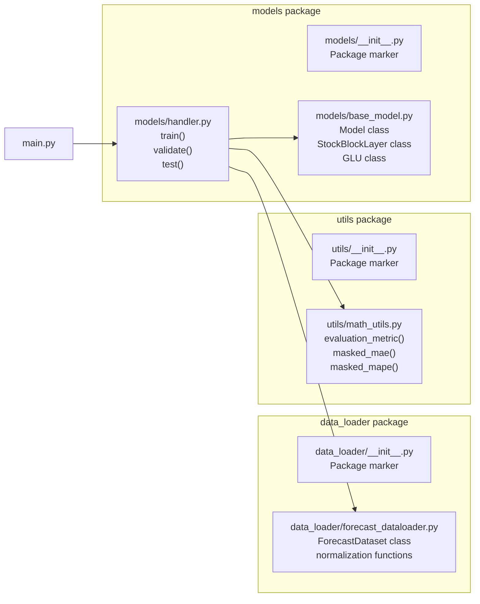
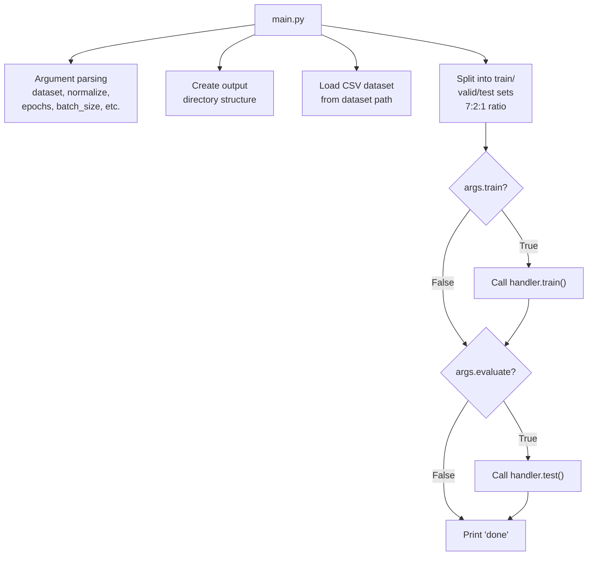
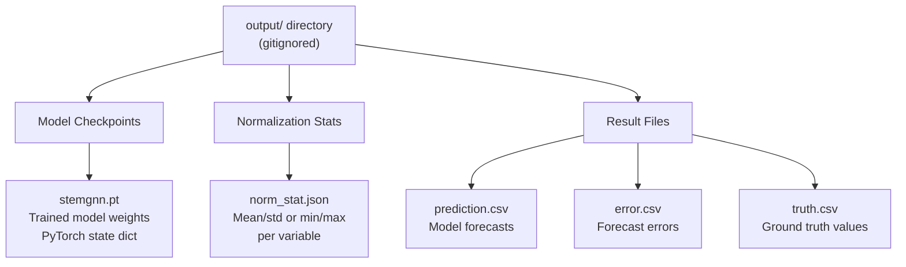
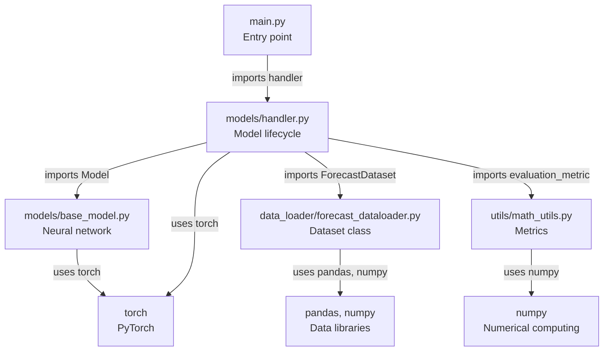

<!-- source: DeepWiki mcp.deepwiki.com · repo microsoft/StemGNN · page 6.1 Project Structure · fetched 2026-10-26 -->

# Project Structure

<details>
<summary>Relevant source files</summary>

The following files were used as context for generating this wiki page:

- [.gitignore](.gitignore)
- [data_loader/__init__.py](data_loader/__init__.py)
- [models/__init__.py](models/__init__.py)
- [utils/__init__.py](utils/__init__.py)

</details>


This page documents the organization of the STemGNN repository, including its directory layout, package structure, and the purpose of each file. This information is essential for developers who want to understand the codebase organization, navigate the code effectively, or contribute new features.

For information about specific components and their implementations, see:
- Main entry point details: [Main Entry Point](#4.1)
- Model architecture details: [Neural Network Architecture](#4.3)
- Data pipeline implementation: [Data Pipeline](#4.4)
- API documentation: [API Reference](#5.3)

## Repository Layout

The STemGNN repository follows a modular Python package structure with clear separation between models, data loading, utilities, and the main orchestrator.

```mermaid
graph TB
    ROOT["Repository Root<br/>(StemGNN/)"]
    
    ROOT --> MAIN["main.py<br/>Entry point orchestrator"]
    ROOT --> README["README.md<br/>User documentation"]
    ROOT --> REQUIREMENTS["requirements.txt<br/>Python dependencies"]
    ROOT --> SECURITY["SECURITY.md<br/>Security policy"]
    ROOT --> GITIGNORE[".gitignore<br/>VCS exclusions"]
    
    ROOT --> MODELS_DIR["models/<br/>Neural network package"]
    ROOT --> DATALOADER_DIR["data_loader/<br/>Data pipeline package"]
    ROOT --> UTILS_DIR["utils/<br/>Utilities package"]
    ROOT --> OUTPUT_DIR["output/<br/>Generated artifacts"]
    
    MODELS_DIR --> MODELS_INIT["__init__.py"]
    MODELS_DIR --> BASE_MODEL["base_model.py<br/>Model class"]
    MODELS_DIR --> HANDLER["handler.py<br/>train/test/validate"]
    
    DATALOADER_DIR --> DL_INIT["__init__.py"]
    DATALOADER_DIR --> FORECAST_DL["forecast_dataloader.py<br/>ForecastDataset"]
    
    UTILS_DIR --> UTILS_INIT["__init__.py"]
    UTILS_DIR --> MATH_UTILS["math_utils.py<br/>MAPE/MAE/RMSE"]
    
    OUTPUT_DIR --> MODEL_FILES["*.pt<br/>Trained models"]
    OUTPUT_DIR --> NORM_STATS["norm_stat.json<br/>Normalization params"]
    OUTPUT_DIR --> RESULTS["*.csv<br/>Predictions/errors"]
    
    style ROOT fill:#f9f9f9
    style MODELS_DIR fill:#f0f0f0
    style DATALOADER_DIR fill:#f0f0f0
    style UTILS_DIR fill:#f0f0f0
    style OUTPUT_DIR fill:#e8e8e8
```



**Sources:** [.gitignore:1-41](), repository structure from diagrams

## Directory Structure

The repository consists of four main directories plus several top-level files:

| Directory/File | Type | Purpose |
|---------------|------|---------|
| `models/` | Package | Contains neural network architecture and training/testing logic |
| `data_loader/` | Package | Handles data loading, normalization, and windowing |
| `utils/` | Package | Provides evaluation metrics and helper functions |
| `output/` | Runtime | Stores trained models, normalization statistics, and results |
| `main.py` | Executable | Entry point and system orchestrator |
| `requirements.txt` | Config | Python package dependencies |
| `README.md` | Documentation | User guide and setup instructions |
| `SECURITY.md` | Documentation | Security vulnerability reporting policy |
| `.gitignore` | Config | Version control exclusions |

**Sources:** [.gitignore:1-41](), repository analysis from diagrams

## Python Package Structure

The codebase is organized into three Python packages, each marked by an `__init__.py` file:



**Sources:** [models/__init__.py:1](), [data_loader/__init__.py:1](), [utils/__init__.py:1](), diagram analysis

### Package Initialization Files

Each package contains an `__init__.py` file that marks it as a Python package:

- [models/__init__.py:1]() - Empty file, marks `models/` as a package
- [data_loader/__init__.py:1]() - Empty file, marks `data_loader/` as a package  
- [utils/__init__.py:1]() - Empty file, marks `utils/` as a package

These files are required for Python to recognize the directories as importable packages, enabling statements like `from models.handler import train` in the codebase.

**Sources:** [models/__init__.py:1](), [data_loader/__init__.py:1](), [utils/__init__.py:1]()

## Core Components by Directory

### models/ - Neural Network Package

Contains all neural network architecture and model lifecycle management code:

| File | Key Classes/Functions | Purpose |
|------|---------------------|---------|
| `base_model.py` | `Model`, `StockBlockLayer`, `GLU` | Defines the STemGNN architecture with graph learning and spectral processing |
| `handler.py` | `train()`, `validate()`, `test()` | Manages training loops, validation, inference, and model persistence |

The `Model` class in `base_model.py` implements the core neural architecture, including:
- Graph structure learning via self-attention
- Laplacian computation and Chebyshev polynomials
- Stacked `StockBlockLayer` instances for feature processing
- Gated Linear Units (GLU) for activation

The `handler.py` module provides the interface between `main.py` and the neural network, handling:
- Training loop with optimizer and learning rate scheduling
- Periodic validation during training
- Model checkpoint saving and loading
- Test inference on held-out data

**Sources:** Diagram analysis of models package from system architecture

### data_loader/ - Data Pipeline Package

Contains data loading and preprocessing functionality:

| File | Key Classes/Functions | Purpose |
|------|---------------------|---------|
| `forecast_dataloader.py` | `ForecastDataset`, normalization functions | Implements PyTorch Dataset for time-series windowing and normalization |

The `ForecastDataset` class:
- Loads CSV files containing time-series data
- Applies z-score or min-max normalization
- Creates sliding windows with configurable window size and prediction horizon
- Returns batched tensors for PyTorch DataLoader

Normalization functions persist statistics to `norm_stat.json` for consistent denormalization during inference.

**Sources:** Diagram analysis of data_loader package from system architecture

### utils/ - Utilities Package

Contains evaluation metrics and helper functions:

| File | Key Functions | Purpose |
|------|--------------|---------|
| `math_utils.py` | `evaluation_metric()`, `masked_mae()`, `masked_mape()`, `masked_rmse()` | Calculates forecast accuracy metrics with optional masking |

Implements three standard time-series forecasting metrics:
- **MAE** (Mean Absolute Error): Average absolute difference between predictions and ground truth
- **MAPE** (Mean Absolute Percentage Error): Percentage-based error metric
- **RMSE** (Root Mean Squared Error): Square root of mean squared errors

The "masked" variants exclude specific values (e.g., zeros) from metric calculation, useful for sparse datasets.

**Sources:** Diagram analysis of utils package from system architecture

## Top-Level Files

### main.py - System Orchestrator

The primary entry point that coordinates all system components:



The orchestrator's responsibilities include:
1. Parsing command-line arguments
2. Setting up output directories
3. Loading and splitting data
4. Conditionally invoking training or evaluation
5. Managing the overall execution flow

**Sources:** Diagram analysis of main.py execution flow

### requirements.txt - Dependency Specification

Specifies the Python packages required to run the system. Key dependencies include:

- `torch` - PyTorch deep learning framework
- `pandas` - Data manipulation and CSV reading
- `numpy` - Numerical computing
- `scipy` - Scientific computing (used for FFT operations)

For detailed information about dependencies, see [Dependencies](#6.2).

**Sources:** Diagram analysis showing requirements.txt importance

### Configuration and Documentation Files

| File | Purpose |
|------|---------|
| `README.md` | Primary user documentation with setup instructions and usage examples |
| `SECURITY.md` | Security vulnerability reporting procedures and contact information |
| `.gitignore` | Specifies files and directories to exclude from version control |

**Sources:** [.gitignore:1-41](), diagram analysis

## Version Control Exclusions

The `.gitignore` file excludes several categories of files from version control:

### Python Artifacts
```
__pycache__/
*.py[cod]
*$py.class
```
Excludes compiled Python bytecode and cache directories.

**Sources:** [.gitignore:1-3]()

### Build and Distribution
```
build/
dist/
*.egg-info/
```
Excludes packaging and distribution artifacts generated during builds.

**Sources:** [.gitignore:7-24]()

### Virtual Environments
```
.env
.venv
env/
venv/
ENV/
```
Excludes Python virtual environment directories, which should be created locally by each developer.

**Sources:** [.gitignore:26-33]()

### Project-Specific Exclusions
```
output/
.idea/
test.py
```
Excludes:
- `output/` - Runtime-generated artifacts (models, results, statistics)
- `.idea/` - IDE configuration files
- `test.py` - Local testing scripts

**Sources:** [.gitignore:39-41]()

## Generated Artifacts

During execution, the system creates an `output/` directory containing runtime artifacts:



**Sources:** [.gitignore:39](), diagram analysis of outputs

### Model Checkpoints

- **Filename pattern:** `{dataset}_{normalize}_{epochs}_{predstep}.pt`
- **Content:** PyTorch state dictionary containing trained model weights
- **Generated by:** `handler.py` during training
- **Used by:** `handler.py` during evaluation/inference

### Normalization Statistics

- **Filename:** `norm_stat.json`
- **Content:** JSON object with mean/std (z-score) or min/max values per variable
- **Purpose:** Enables denormalization of predictions back to original scale
- **Generated by:** `data_loader/forecast_dataloader.py` during first data load

### Result Files

During evaluation, the system generates three CSV files:
- **prediction.csv** - Model forecasts
- **error.csv** - Difference between predictions and ground truth
- **truth.csv** - Actual values from the test set

These files enable detailed analysis of model performance across time steps and variables.

**Sources:** Diagram analysis of evaluation outputs

## Import Structure

The following diagram shows how modules import from each other:



The dependency flow is hierarchical:
1. `main.py` imports only from `models.handler`
2. `handler.py` imports from all other internal packages
3. Core implementation files (`base_model.py`, `forecast_dataloader.py`, `math_utils.py`) depend only on external libraries

This structure maintains clear separation of concerns with minimal coupling between components.

**Sources:** System architecture diagram analysis

## File Purpose Reference

For quick reference, here is a complete mapping of files to their primary purposes:

| File Path | Primary Classes/Functions | Importance Score | Purpose |
|-----------|-------------------------|------------------|---------|
| `README.md` | N/A | 39.77 | User documentation and setup guide |
| `main.py` | `main()` | 38.64 | System orchestrator and entry point |
| `models/handler.py` | `train()`, `validate()`, `test()` | 14.78 | Model lifecycle management |
| `models/base_model.py` | `Model`, `StockBlockLayer`, `GLU` | 8.85 | STemGNN neural architecture |
| `data_loader/forecast_dataloader.py` | `ForecastDataset` | 8.07 | Data loading and preprocessing |
| `utils/math_utils.py` | `evaluation_metric()` | 7.95 | Evaluation metrics |
| `requirements.txt` | N/A | 5.97 | Dependency specifications |
| `.gitignore` | N/A | 4.96 | VCS exclusions |
| `SECURITY.md` | N/A | 3.55 | Security policy |
| Sample datasets | N/A | ~2-3 | Example data for testing |
| `*/__init__.py` | N/A | ~0.5 | Python package markers |

Importance scores indicate the relative centrality of each file to the system's operation, with higher scores representing more critical components.

**Sources:** Diagram analysis of component importance

---

