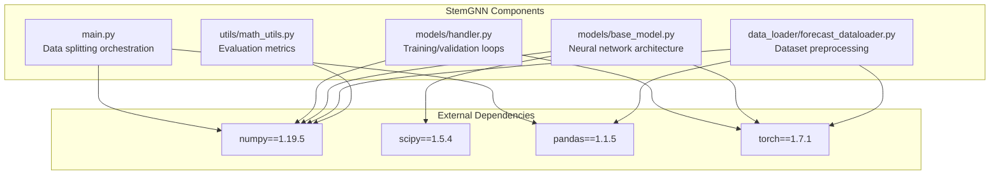
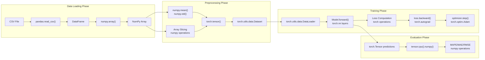
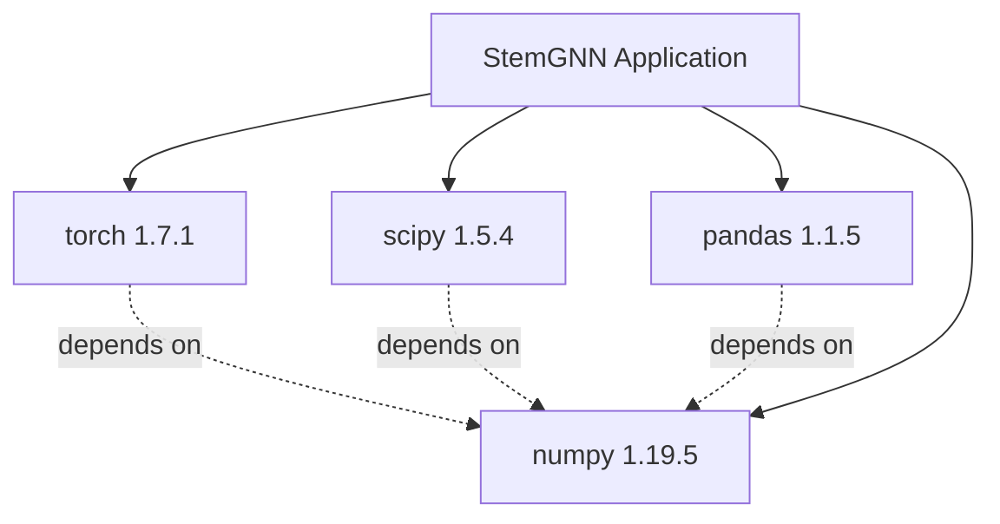

<!-- source: DeepWiki mcp.deepwiki.com · repo microsoft/StemGNN · page 6.2 Dependencies · fetched 2026-10-26 -->

# Dependencies

<details>
<summary>Relevant source files</summary>

The following files were used as context for generating this wiki page:

- [requirements.txt](requirements.txt)

</details>


This page documents the external Python packages required by StemGNN, their purposes, version constraints, and relationships to system components. For installation instructions, see [Installation](#2.1). For general project structure, see [Project Structure](#6.1).

## Overview

StemGNN has a minimal dependency footprint consisting of four core packages. All dependencies are specified in [requirements.txt:1-4]() with pinned versions to ensure reproducibility.

| Package | Version | Primary Purpose | Key Components Using It |
|---------|---------|-----------------|-------------------------|
| `numpy` | 1.19.5 | Numerical array operations | All components |
| `scipy` | 1.5.4 | Scientific computing, sparse matrices | Graph operations in model |
| `pandas` | 1.1.5 | Data loading and CSV processing | Data pipeline |
| `torch` | 1.7.1 | Deep learning framework | Model architecture, training |

**Sources:** [requirements.txt:1-4]()

## Dependency Architecture

The following diagram shows how system components depend on external packages:



**Diagram:** Component-to-dependency mapping showing which external packages each system component requires.

**Sources:** [requirements.txt:1-4](), architecture diagrams from context

## Core Dependencies

### PyTorch (torch==1.7.1)

PyTorch is the deep learning framework that powers the entire neural network implementation.

**Primary Uses:**
- **Neural network layers**: `torch.nn.Linear`, `torch.nn.GRU`, `torch.nn.Conv1d` in `models/base_model.py`
- **Model training**: Optimizers (`torch.optim.Adam`), loss functions, gradient computation in `models/handler.py`
- **Tensor operations**: All matrix multiplications, activations, and transformations
- **Data loading**: `torch.utils.data.Dataset`, `torch.utils.data.DataLoader` in `data_loader/forecast_dataloader.py`
- **Device management**: CPU/GPU tensor placement

**Key Classes Using PyTorch:**
- `Model` class (neural network)
- `StockBlockLayer` class (model component)
- `GLU` class (gated linear unit)
- `ForecastDataset` class (data pipeline)
- `train()` function (optimization loop)
- `validate()` function (inference)

**Sources:** [requirements.txt:4](), architecture diagrams

### NumPy (numpy==1.19.5)

NumPy provides fundamental array operations and is used throughout the codebase for numerical computations.

**Primary Uses:**
- **Data manipulation**: Array slicing, reshaping, concatenation in `main.py` for data splitting
- **Normalization statistics**: Computing mean, std, min, max in `data_loader/forecast_dataloader.py`
- **Metric calculations**: Array operations for MAPE, MAE, RMSE in `utils/math_utils.py`
- **Preprocessing**: Window sliding, masking operations
- **Bridge to PyTorch**: Converting between NumPy arrays and PyTorch tensors

**Key Operations:**
- `numpy.mean()`, `numpy.std()` for z-score normalization
- `numpy.min()`, `numpy.max()` for min-max normalization
- `numpy.isnan()` for masked metric calculations
- `numpy.array()` for data structure conversions

**Sources:** [requirements.txt:1](), architecture diagrams

### Pandas (pandas==1.1.5)

Pandas handles CSV file I/O and tabular data processing in the data pipeline.

**Primary Uses:**
- **CSV loading**: Reading dataset files in `main.py`
- **Data inspection**: Examining dataset shape and structure
- **Type conversion**: Converting DataFrames to NumPy arrays for processing
- **Result saving**: Writing predictions and metrics to CSV files (implied from test phase)

**Key Operations:**
- `pandas.read_csv()` for loading datasets like `ECG_data.csv`, `PeMS07.csv`
- DataFrame to NumPy conversion via `.values` attribute
- Data shape inspection via `.shape` attribute

**Sources:** [requirements.txt:3](), architecture diagrams

### SciPy (scipy==1.5.4)

SciPy provides scientific computing functions, particularly for graph operations.

**Primary Uses:**
- **Graph representations**: Sparse matrix operations for adjacency matrices
- **Spectral graph theory**: Laplacian computation and decomposition in `models/base_model.py`
- **Efficient computations**: Sparse matrix multiplication for large graphs

**Expected Usage Context:**
- Chebyshev polynomial computation for graph convolution
- Normalized Laplacian matrix construction
- Eigenvalue/eigenvector operations for spectral methods

**Sources:** [requirements.txt:2](), architecture diagrams (Graph Learning Components)

## Dependency Interaction Flow

This diagram illustrates how dependencies interact during typical execution phases:



**Diagram:** Data flow through dependencies across execution phases, showing how data transforms between package types.

**Sources:** [requirements.txt:1-4](), Diagram 2 from context (Data Flow Pipeline)

## Version Constraints

All dependencies use exact version pinning (`==`) rather than minimum versions (`>=`) or compatible releases (`~=`).

### Rationale for Version Pinning

| Aspect | Reason |
|--------|--------|
| **Reproducibility** | Ensures identical behavior across different environments and over time |
| **Stability** | Avoids breaking changes from automatic updates |
| **Research Validation** | Critical for reproducing published experimental results |
| **PyTorch Compatibility** | Different PyTorch versions have incompatible APIs and numerical differences |

### Version Selection Rationale

**PyTorch 1.7.1** (Released December 2020):
- Mature stable release with comprehensive deep learning features
- Good balance between modern functionality and stability
- Compatible with both CPU and CUDA 10.2/11.0 for GPU acceleration
- Includes necessary operations for spectral graph neural networks

**NumPy 1.19.5** (Released January 2021):
- Last version before major 1.20.0 release that introduced breaking changes
- Stable and well-tested for numerical computations
- Compatible with PyTorch 1.7.1 tensor interoperability

**Pandas 1.1.5** (Released December 2020):
- Contemporary release with NumPy 1.19.x
- Provides all necessary CSV I/O and DataFrame operations
- No breaking API changes from later versions needed by this codebase

**SciPy 1.5.4** (Released August 2020):
- Compatible with NumPy 1.19.x
- Contains all required sparse matrix and spectral graph operations
- Stable version without known numerical issues

**Sources:** [requirements.txt:1-4]()

## Dependency Hierarchy

The following diagram shows the internal dependency relationships between packages:



**Diagram:** Package dependency hierarchy showing that PyTorch, SciPy, and Pandas all depend on NumPy as their common foundation.

**Sources:** [requirements.txt:1-4](), standard Python package dependencies

## Component-Specific Usage

### models/base_model.py

| Dependency | Specific Uses |
|------------|---------------|
| `torch` | `nn.Module`, `nn.Linear`, `nn.GRU`, `nn.Parameter`, `nn.functional`, autograd operations |
| `numpy` | Array reshaping, matrix operations passed to torch tensors |
| `scipy` | Sparse matrices for graph adjacency, Laplacian matrix operations |

**Sources:** Architecture diagrams (Diagram 4)

### models/handler.py

| Dependency | Specific Uses |
|------------|---------------|
| `torch` | `optim.Adam`, `nn.MSELoss`, model state dict operations, device management |
| `numpy` | Converting predictions to arrays for metric computation |

**Sources:** Architecture diagrams (Diagram 1, Diagram 2)

### data_loader/forecast_dataloader.py

| Dependency | Specific Uses |
|------------|---------------|
| `torch` | `Dataset` base class, `from_numpy()` tensor conversion |
| `pandas` | DataFrame operations (implied from CSV loading) |
| `numpy` | Sliding window creation, normalization statistics, array slicing |

**Sources:** Architecture diagrams (Diagram 2)

### utils/math_utils.py

| Dependency | Specific Uses |
|------------|---------------|
| `numpy` | `isnan()` for masked metrics, array arithmetic for MAPE/MAE/RMSE, `mean()` aggregation |

**Sources:** Architecture diagrams (Diagram 1, Diagram 2)

### main.py

| Dependency | Specific Uses |
|------------|---------------|
| `pandas` | `read_csv()` for dataset loading |
| `numpy` | Array slicing for train/valid/test splitting (7:2:1 ratio) |

**Sources:** Architecture diagrams (Diagram 1, Diagram 3)

## Installation Notes

The pinned versions require Python 3.6-3.8 (PyTorch 1.7.1 does not support Python 3.9+).

**Installation command:**
```bash
pip install -r requirements.txt
```

For detailed installation instructions including Python environment setup and troubleshooting, see [Installation](#2.1).

**Important:** Installing a different PyTorch version may cause:
- API incompatibilities with `nn.Module` subclasses
- Different numerical results affecting reproducibility
- CUDA version mismatches for GPU execution

**Sources:** [requirements.txt:1-4]()

## Missing Dependencies

Notable packages **not** included in dependencies:

| Package | Why Not Needed |
|---------|----------------|
| `matplotlib`, `seaborn` | No visualization code in repository |
| `scikit-learn` | No sklearn models or preprocessing used |
| `tensorboard` | No experiment tracking implemented |
| `pytest` | No unit tests in repository |

This minimal dependency set keeps the codebase lightweight and focused on core forecasting functionality.

**Sources:** [requirements.txt:1-4]()

---

