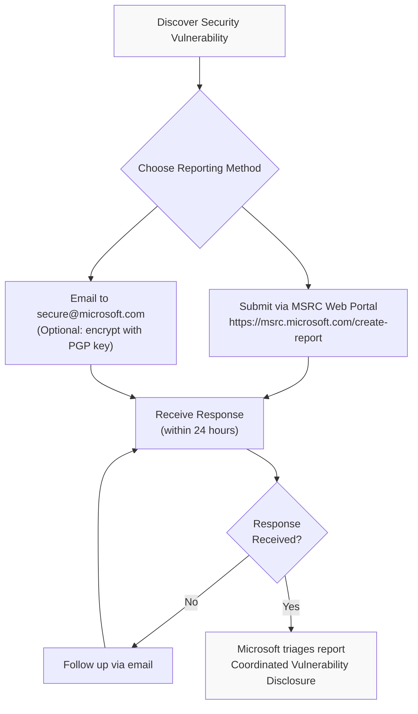
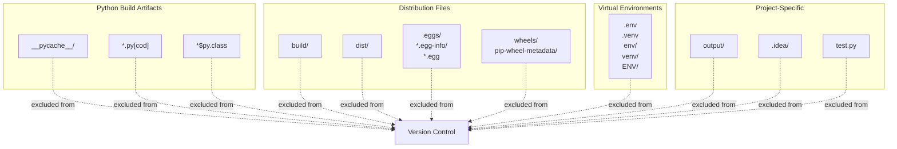
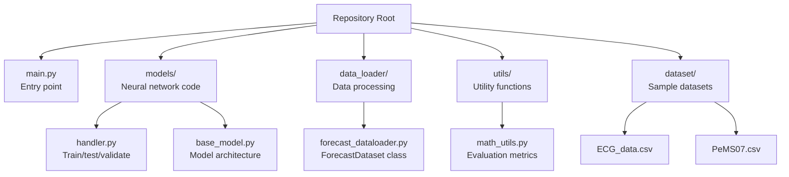
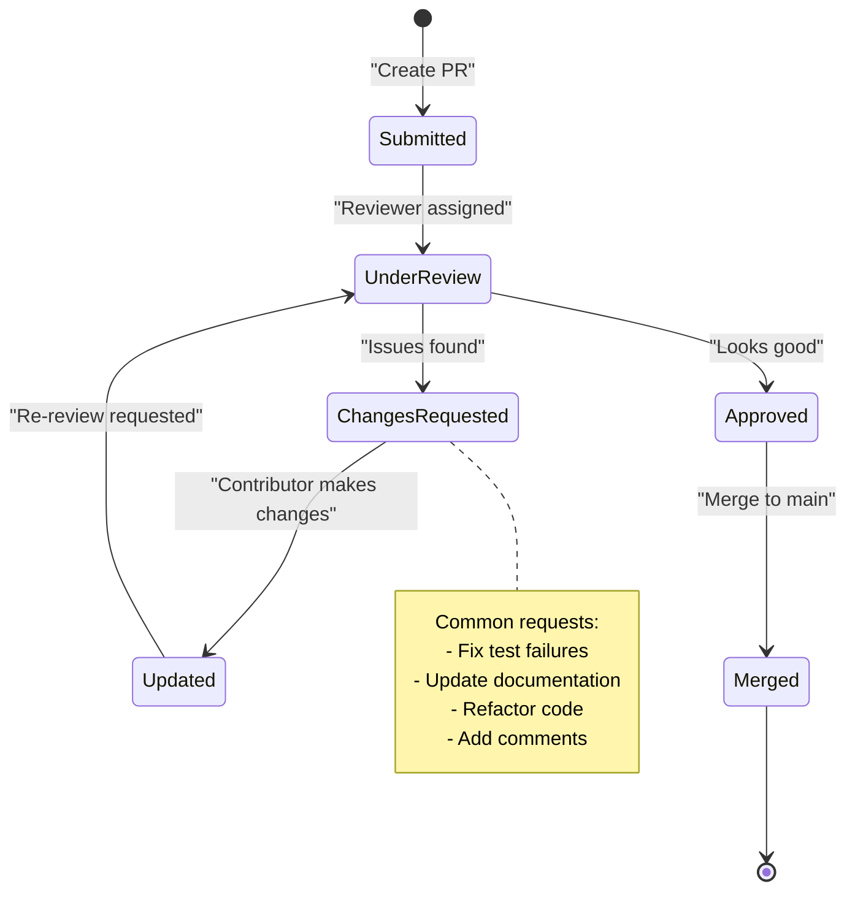

<!-- source: DeepWiki mcp.deepwiki.com · repo microsoft/StemGNN · page 6.3 Contributing · fetched 2026-10-26 -->

# Contributing

<details>
<summary>Relevant source files</summary>

The following files were used as context for generating this wiki page:

- [.gitignore](.gitignore)
- [SECURITY.md](SECURITY.md)

</details>


This document provides guidelines for contributing to the STemGNN codebase, including security vulnerability reporting, development workflows, and code standards. For information about the project structure and organization, see [Project Structure](#6.1). For details about dependencies and their roles, see [Dependencies](#6.2).

## Purpose and Scope

This page covers:
- Security vulnerability reporting procedures
- Development environment setup for contributors
- Version control practices and ignored files
- Contribution workflow and pull request guidelines
- Code standards and testing expectations

## Security Vulnerability Reporting

Microsoft takes security seriously for all repositories under Microsoft GitHub organizations. **Do not report security vulnerabilities through public GitHub issues.**

### Reporting Process



**Sources:** [SECURITY.md:1-42]()

### Required Information for Security Reports

When reporting a security vulnerability, include as much of the following information as possible:

| Information Type | Description |
|-----------------|-------------|
| **Issue Type** | Buffer overflow, SQL injection, cross-site scripting, etc. |
| **Source Files** | Full paths of source file(s) related to the issue |
| **Location** | Tag/branch/commit or direct URL of affected code |
| **Configuration** | Any special configuration required to reproduce |
| **Reproduction Steps** | Step-by-step instructions to reproduce the issue |
| **Proof-of-Concept** | Exploit code (if possible) |
| **Impact Assessment** | How an attacker might exploit the issue |

Complete reports contribute to higher bug bounty awards under the [Microsoft Bug Bounty Program](https://aka.ms/opensource/security/bounty).

**Sources:** [SECURITY.md:19-31]()

### Communication Policy

- **Preferred Language:** English
- **Disclosure Policy:** Microsoft follows [Coordinated Vulnerability Disclosure](https://aka.ms/opensource/security/cvd)
- **Response Time:** Within 24 hours for initial acknowledgment

**Sources:** [SECURITY.md:33-40]()

## Version Control Practices

### Ignored Files and Directories

The project uses `.gitignore` to exclude build artifacts, temporary files, and environment-specific configurations from version control. Contributors should be aware of these exclusions when setting up development environments.

#### Build and Distribution Artifacts



**Sources:** [.gitignore:1-41]()

#### Excluded File Categories

| Category | Patterns | Purpose |
|----------|----------|---------|
| **Python Bytecode** | `__pycache__/`, `*.pyc`, `*.pyo`, `*.pyd` | Compiled Python files generated at runtime |
| **Distribution** | `build/`, `dist/`, `*.egg-info/`, `wheels/` | Package distribution artifacts from `setup.py` |
| **Virtual Environments** | `.env`, `venv/`, `ENV/`, `.venv` | Python virtual environment directories |
| **IDE Configuration** | `.idea/` | JetBrains IDE project settings |
| **Project Output** | `output/` | Generated results, checkpoints, and predictions |
| **Test Files** | `test.py` | Ad-hoc test scripts not part of official test suite |

**Sources:** [.gitignore:1-41]()

### Important Notes for Contributors

1. **Never commit** files matching these patterns
2. **The `output/` directory** ([.gitignore:39]()) is excluded because it contains:
   - Model checkpoints (`save/stemgnn.pt`)
   - Normalization statistics (`save/norm_stat.json`)
   - Prediction results and error analyses
3. **Test files** should be added to a proper test directory, not as `test.py` at the root
4. **Virtual environments** should be created inside the project directory but will be automatically ignored

**Sources:** [.gitignore:39-41]()

## Contribution Workflow

```mermaid
flowchart LR
    Fork["Fork Repository<br/>github.com/microsoft/StemGNN"]
    Clone["Clone Fork Locally<br/>git clone"]
    Setup["Setup Environment<br/>See Installation Guide"]
    Branch["Create Feature Branch<br/>git checkout -b feature-name"]
    
    subgraph Development["Development Cycle"]
        Code["Write Code"]
        Test["Run Tests<br/>Train/Evaluate"]
        Lint["Check Standards"]
    end
    
    Commit["Commit Changes<br/>git commit"]
    Push["Push to Fork<br/>git push origin feature-name"]
    PR["Create Pull Request<br/>to microsoft/StemGNN"]
    Review["Code Review"]
    Merge["Merge"]
    
    Fork --> Clone
    Clone --> Setup
    Setup --> Branch
    Branch --> Development
    Development --> Commit
    Commit --> Push
    Push --> PR
    PR --> Review
    Review -->|Changes Requested| Development
    Review -->|Approved| Merge
```



**Sources:** Based on standard GitHub contribution workflow

## Development Environment Setup

### Prerequisites

Contributors should ensure their development environment matches the project requirements. See [Installation](#2.1) for detailed setup instructions and [Dependencies](#6.2) for dependency explanations.

### Recommended Development Setup

| Component | Recommendation |
|-----------|----------------|
| **Python Version** | 3.6+ (specified in `requirements.txt`) |
| **Virtual Environment** | Use `venv` or `conda` to isolate dependencies |
| **IDE** | Any Python IDE (PyCharm, VSCode, etc.) |
| **Git** | Version 2.0+ for version control |

### Initial Setup Steps

1. **Clone the repository** to your local machine
2. **Create a virtual environment**:
   ```bash
   python -m venv venv
   source venv/bin/activate  # On Windows: venv\Scripts\activate
   ```
3. **Install dependencies** from `requirements.txt`:
   ```bash
   pip install -r requirements.txt
   ```
4. **Verify installation** by running a quick test:
   ```bash
   python main.py --train --dataset ECG_data --epochs 2
   ```

**Sources:** [requirements.txt]() (referenced), [.gitignore:26-33]() (virtual environment patterns)

## Code Standards and Testing

### File Organization

Contributors should maintain the existing project structure when adding new code:



**Sources:** See [Project Structure](#6.1) for complete details

### Testing Expectations

Contributors should test their changes using the existing evaluation framework:

1. **Train on sample datasets**:
   - Verify training runs without errors on `ECG_data` and `PeMS07`
   - Check that model checkpoints are saved correctly

2. **Evaluate metrics**:
   - Ensure `MAPE`, `MAE`, and `RMSE` calculations in [utils/math_utils.py]() remain accurate
   - Test with both `z-score` and `min_max` normalization methods

3. **Data pipeline**:
   - Test with different `window_size` and `horizon` values
   - Verify `ForecastDataset` handles edge cases correctly

**Sources:** See [Training Models](#3.2), [Evaluating Models](#3.3), and [Evaluation Metrics](#4.5)

### Code Style Guidelines

While the project does not specify explicit style guidelines, contributors should:

- **Follow existing patterns** in the codebase
- **Use meaningful variable names** (e.g., `mul_L` for Laplacian multiplication, `stack_cnt` for layer count)
- **Document complex logic**, especially in the neural network architecture
- **Maintain consistency** with existing function signatures and class interfaces

## Pull Request Guidelines

### Before Submitting

- [ ] Code runs without errors on sample datasets
- [ ] No new files match `.gitignore` patterns are committed
- [ ] Changes are tested with both training and evaluation modes
- [ ] Code follows existing patterns in the repository
- [ ] Virtual environment files are not included

### Pull Request Content

| Section | Content |
|---------|---------|
| **Title** | Clear, concise description of changes |
| **Description** | Detailed explanation of what changed and why |
| **Testing** | How changes were tested |
| **Breaking Changes** | Any backward-incompatible changes |
| **Related Issues** | Links to GitHub issues addressed |

### Review Process



**Sources:** Based on standard GitHub PR workflow

## Areas for Contribution

Contributors may want to focus on:

| Area | Description | Relevant Files |
|------|-------------|----------------|
| **New Datasets** | Add support for additional time-series datasets | [data_loader/forecast_dataloader.py]() |
| **Model Improvements** | Enhance neural architecture or training procedures | [models/base_model.py](), [models/handler.py]() |
| **Evaluation Metrics** | Add new metrics or improve existing calculations | [utils/math_utils.py]() |
| **Documentation** | Improve README, add examples, or clarify usage | [README.md]() |
| **Performance** | Optimize training speed or memory usage | [models/handler.py](), [models/base_model.py]() |
| **Visualization** | Add prediction visualization or attention analysis | New files in `utils/` |

**Sources:** Based on system architecture from [System Architecture](#4)

## Getting Help

For questions about:
- **Installation or setup:** See [Installation](#2.1)
- **Using the system:** See [User Guide](#3)
- **Architecture details:** See [System Architecture](#4)
- **API reference:** See [API Reference](#5.3)
- **Security issues:** Follow the reporting process above

---

**Important:** Always check the latest version of `SECURITY.md` in the repository for the most current security reporting procedures, as Microsoft's security policies may be updated.

**Sources:** [SECURITY.md:1-42](), [.gitignore:1-41]()