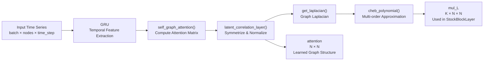
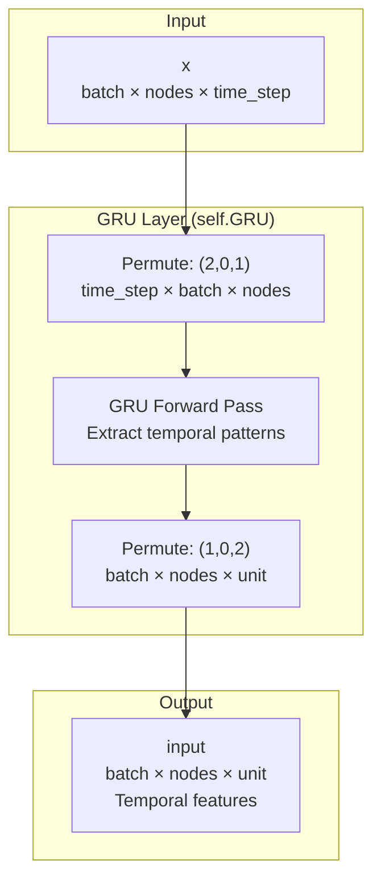
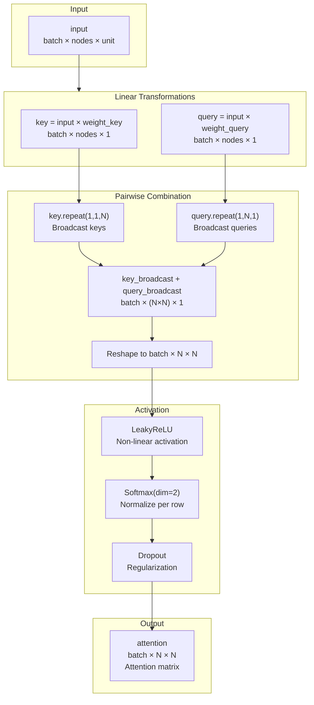
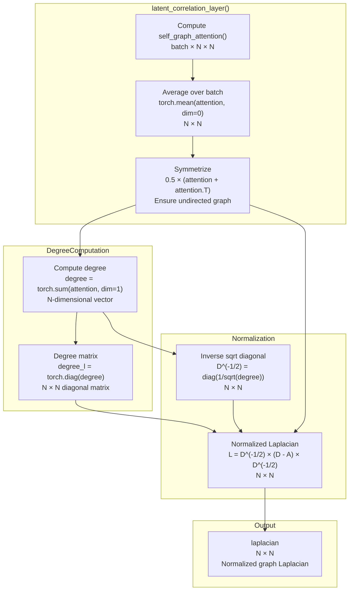
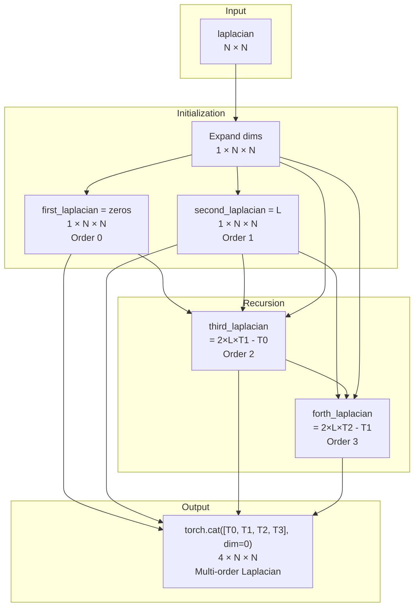
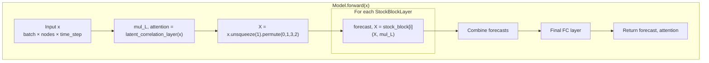

<!-- source: DeepWiki mcp.deepwiki.com · repo microsoft/StemGNN · extra page Graph Learning Components · fetched 2026-10-26 -->

# Graph Learning Components

<details>
<summary>Relevant source files</summary>

The following files were used as context for generating this wiki page:

- [models/base_model.py](models/base_model.py)

</details>


## Purpose and Scope

This document explains the graph learning components in the STemGNN architecture, specifically the mechanisms that automatically discover relationships between nodes (time series) in multivariate time-series data. These components transform raw temporal data into a learned graph structure that captures latent correlations.

This page covers:
- Temporal feature extraction using GRU
- Self-attention mechanism for learning node relationships
- Graph Laplacian computation
- Chebyshev polynomial approximation for multi-order graph convolutions

For information about how these learned graph structures are used in the spectral processing pipeline, see [StockBlockLayer](#4.3.2). For the overall neural network architecture, see [Neural Network Architecture](#4.3).

---

## Overview

The graph learning components in STemGNN address a fundamental challenge: given multiple time series without predefined relationships, how can the model automatically discover which series influence each other? Rather than requiring a pre-specified graph structure, STemGNN learns the graph directly from data using self-attention.

The process follows this pipeline:



**Sources:** [models/base_model.py:78-180]()

---

## Component Architecture

### Model Initialization

The `Model` class initializes learnable parameters for the graph learning process:

| Parameter | Shape | Purpose |
|-----------|-------|---------|
| `weight_key` | `(unit, 1)` | Learnable weight for computing attention keys |
| `weight_query` | `(unit, 1)` | Learnable weight for computing attention queries |
| `GRU` | `(time_step, unit)` | Temporal feature extractor |

**Sources:** [models/base_model.py:88-92]()

---

## Temporal Feature Extraction

Before computing relationships between nodes, the model extracts temporal features using a GRU layer. This transforms raw time series values into learned representations that capture temporal patterns.



The GRU processes each time step sequentially, producing a `unit`-dimensional feature vector for each node. These features encode temporal dynamics and serve as input to the attention mechanism.

**Sources:** [models/base_model.py:137-138]()

---

## Self-Attention Mechanism

The self-attention mechanism learns which nodes have strong relationships by computing pairwise attention scores.

### Computation Flow



### Implementation Details

The attention score between node `i` and node `j` is computed as:

```
attention[i,j] = softmax(LeakyReLU(key[i] + query[j]))
```

This creates a weighted adjacency matrix where high values indicate strong learned relationships.

| Step | Operation | Code Reference |
|------|-----------|----------------|
| 1. Permute input | `input.permute(0, 2, 1)` | [models/base_model.py:152]() |
| 2. Compute keys | `torch.matmul(input, self.weight_key)` | [models/base_model.py:154]() |
| 3. Compute queries | `torch.matmul(input, self.weight_query)` | [models/base_model.py:155]() |
| 4. Broadcast and combine | `key.repeat(...) + query.repeat(...)` | [models/base_model.py:156]() |
| 5. Apply activation | `self.leakyrelu(data)` | [models/base_model.py:159]() |
| 6. Normalize | `F.softmax(data, dim=2)` | [models/base_model.py:160]() |
| 7. Regularize | `self.dropout(attention)` | [models/base_model.py:161]() |

**Sources:** [models/base_model.py:151-162]()

---

## Graph Laplacian Computation

The attention matrix is converted into a graph Laplacian, a fundamental representation in graph signal processing that enables spectral graph convolutions.

### Laplacian Construction Pipeline



### Normalized vs Unnormalized Laplacian

The `get_laplacian` method supports both normalized and unnormalized Laplacians:

| Type | Formula | When to Use |
|------|---------|-------------|
| **Normalized** | `L = I - D^(-1/2) × A × D^(-1/2)` | Default; better for graphs with varying node degrees |
| **Unnormalized** | `L = D - A` | Simpler but sensitive to degree distribution |

Where:
- `A` is the adjacency (attention) matrix
- `D` is the diagonal degree matrix
- `I` is the identity matrix

**Implementation:**

```
if normalize:
    D = torch.diag(torch.sum(graph, dim=-1) ** (-1/2))
    L = I - D × graph × D
else:
    D = torch.diag(torch.sum(graph, dim=-1))
    L = D - graph
```

**Sources:** [models/base_model.py:106-119](), [models/base_model.py:136-149]()

---

## Chebyshev Polynomial Approximation

Graph convolutions require computing functions of the Laplacian matrix. Direct computation is expensive, so STemGNN uses Chebyshev polynomial approximation to efficiently approximate multi-hop graph operations.

### Mathematical Background

Chebyshev polynomials provide a recursive approximation:
- `T_0(L) = 0` (identity, no propagation)
- `T_1(L) = L` (1-hop neighbors)
- `T_2(L) = 2L × T_1(L) - T_0(L)` (2-hop neighbors)
- `T_3(L) = 2L × T_2(L) - T_1(L)` (3-hop neighbors)

### Implementation



### Order Interpretation

| Order | Matrix | Captures |
|-------|--------|----------|
| 0 | Zeros | Node's own features (self-loop) |
| 1 | `L` | Direct neighbor information |
| 2 | `2L² - I` | 2-hop neighborhood |
| 3 | `2L³ - L` | 3-hop neighborhood |

The stacked result `mul_L` has shape `[4, N, N]`, providing multi-scale graph information that captures both local and global graph structure.

**Sources:** [models/base_model.py:121-134]()

---

## Integration with Forward Pass

The graph learning components integrate into the model's forward pass as follows:



### Data Flow Summary

1. **Input**: Raw time series `(batch, nodes, time_step)`
2. **Graph Learning**: `latent_correlation_layer()` produces:
   - `mul_L`: Multi-order Laplacian `(4, N, N)` for graph convolutions
   - `attention`: Learned adjacency matrix `(N, N)` for interpretability
3. **Processing**: Each `StockBlockLayer` uses `mul_L` for graph-aware feature extraction
4. **Output**: Forecasts and the attention matrix

**Sources:** [models/base_model.py:167-179]()

---

## Key Method Reference

### `latent_correlation_layer(x)`

**Purpose:** Orchestrates the entire graph learning pipeline.

**Input:** 
- `x`: Time series data `(batch, nodes, time_step)`

**Output:**
- `mul_L`: Multi-order Chebyshev Laplacian `(4, N, N)`
- `attention`: Learned attention matrix `(N, N)`

**Process:**
1. Extract temporal features via GRU
2. Compute self-attention scores
3. Average over batch and symmetrize
4. Compute normalized Laplacian
5. Generate Chebyshev polynomials

**Sources:** [models/base_model.py:136-149]()

### `self_graph_attention(input)`

**Purpose:** Compute pairwise attention scores between all nodes.

**Input:**
- `input`: Temporal features `(batch, nodes, unit)`

**Output:**
- `attention`: Attention matrix `(batch, N, N)`

**Sources:** [models/base_model.py:151-162]()

### `get_laplacian(graph, normalize)`

**Purpose:** Convert adjacency matrix to graph Laplacian.

**Parameters:**
- `graph`: Adjacency matrix `(N, N)`
- `normalize`: Boolean flag for normalization

**Output:**
- `L`: Graph Laplacian `(N, N)`

**Sources:** [models/base_model.py:106-119]()

### `cheb_polynomial(laplacian)`

**Purpose:** Compute Chebyshev polynomial approximation of graph filters.

**Input:**
- `laplacian`: Graph Laplacian `(N, N)`

**Output:**
- `multi_order_laplacian`: Stacked polynomials `(4, N, N)`

**Sources:** [models/base_model.py:121-134]()

---

## Configuration Parameters

Graph learning behavior is influenced by these model hyperparameters:

| Parameter | Type | Default | Impact on Graph Learning |
|-----------|------|---------|--------------------------|
| `units` | int | Varies by dataset | Dimensionality of GRU hidden state |
| `leaky_rate` | float | 0.2 | Slope for LeakyReLU in attention |
| `dropout_rate` | float | 0.5 | Regularization strength for attention |

These parameters are set during `Model` initialization and affect the expressiveness and regularization of the learned graph structure.

**Sources:** [models/base_model.py:79-80](), [models/base_model.py:102-103]()

---

## Summary

The graph learning components automatically discover latent relationships in multivariate time series through:

1. **GRU-based temporal feature extraction** that captures temporal patterns
2. **Self-attention mechanism** that computes pairwise node relationships
3. **Laplacian computation** that converts attention into a graph structure
4. **Chebyshev approximation** that enables efficient multi-hop graph operations

The resulting multi-order Laplacian `mul_L` and attention matrix `attention` are then used by the StockBlockLayer components (see [StockBlockLayer](#4.3.2)) for spectral graph convolution operations.

**Sources:** [models/base_model.py:78-180]()

---

