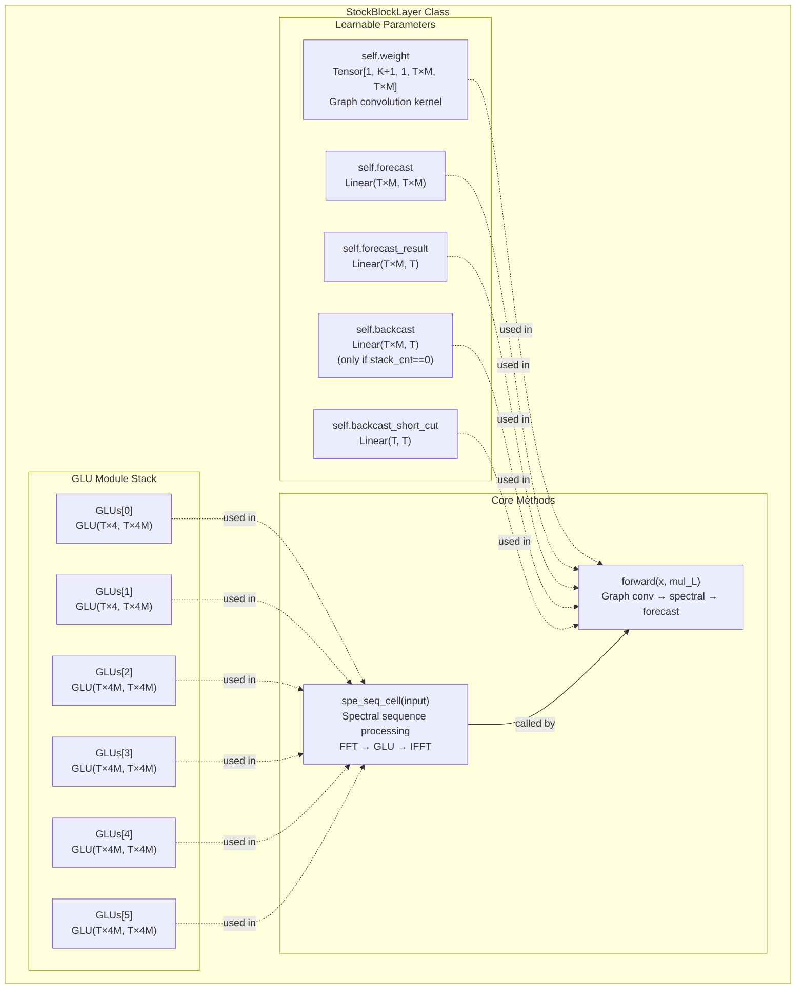
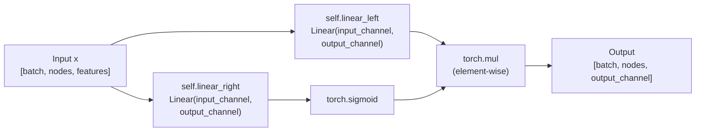
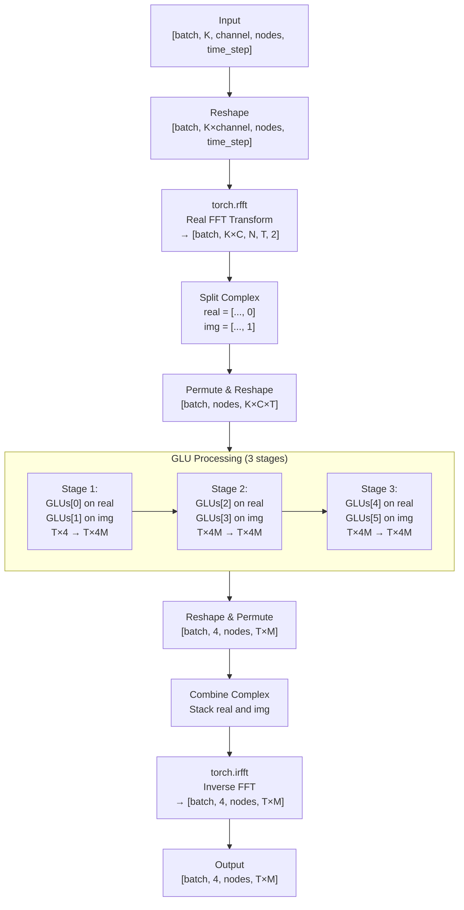
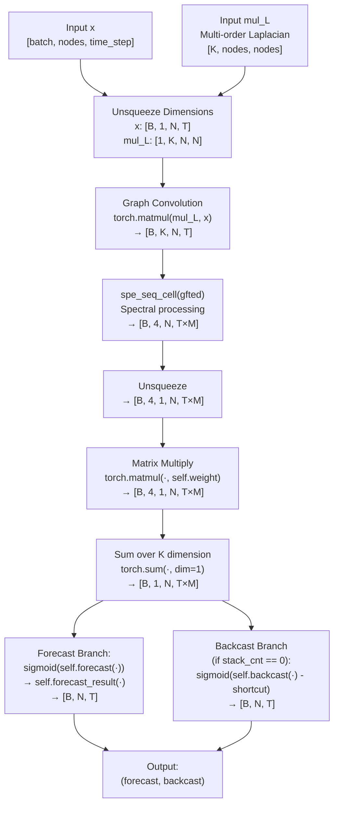
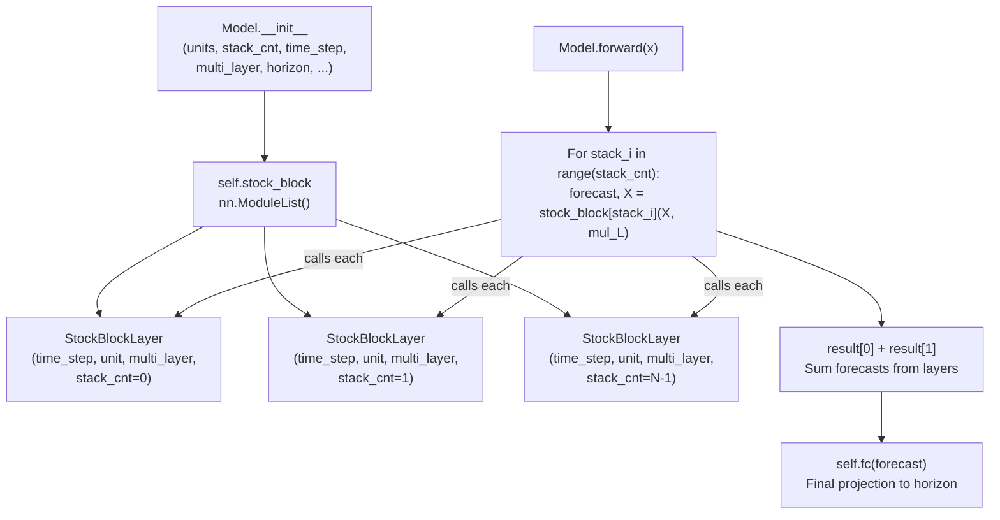

<!-- source: DeepWiki mcp.deepwiki.com · repo microsoft/StemGNN · extra page StockBlockLayer · fetched 2026-10-26 -->

# StockBlockLayer

<details>
<summary>Relevant source files</summary>

The following files were used as context for generating this wiki page:

- [models/base_model.py](models/base_model.py)

</details>


## Purpose and Scope

This document details the `StockBlockLayer` class, which is the core building block of the STemGNN neural network architecture. The `StockBlockLayer` implements spectral-temporal feature extraction through graph convolution and frequency-domain processing using Gated Linear Units (GLUs). Multiple `StockBlockLayer` instances are stacked to form the complete forecasting model.

For information about the graph learning components that generate the input to `StockBlockLayer`, see [Graph Learning Components](#4.3.1). For the overall neural network architecture, see [Neural Network Architecture](#4.3).

---

## Architecture Overview

The `StockBlockLayer` is defined in [models/base_model.py:16-75]() and serves as a spectral-temporal processing unit that combines graph convolution with frequency-domain transformations. Each layer contains:

- **Graph convolution weights** for multi-order Chebyshev polynomial filtering
- **Spectral sequence cell** for FFT-based temporal processing
- **Six GLU units** organized in three pairs for gated activation
- **Forecast and backcast linear projections** for output generation

### StockBlockLayer Construction Parameters

| Parameter | Type | Description |
|-----------|------|-------------|
| `time_step` | int | Number of input time steps (window size) |
| `unit` | int | Hidden unit dimension |
| `multi_layer` | int | Multiplier for feature expansion |
| `stack_cnt` | int | Stack position index (0 for first layer) |

**Sources:** [models/base_model.py:17-21]()

---

## Component Architecture Diagram



**Sources:** [models/base_model.py:16-75]()

---

## Gated Linear Unit (GLU)

The `GLU` class implements a gated activation mechanism that controls information flow through the network. It is defined in [models/base_model.py:6-13]().

### GLU Architecture



The GLU computes:
```
output = linear_left(x) ⊙ σ(linear_right(x))
```
where ⊙ is element-wise multiplication and σ is the sigmoid function.

**Sources:** [models/base_model.py:6-13]()

---

## Spectral Sequence Cell

The `spe_seq_cell` method in [models/base_model.py:46-59]() implements the core spectral processing pipeline. It transforms the input into the frequency domain, applies gated transformations, and converts back to the time domain.

### Spectral Sequence Cell Processing Pipeline



### Spectral Processing Details

| Step | Operation | Code Reference | Input Shape | Output Shape |
|------|-----------|----------------|-------------|--------------|
| 1. Reshape | View as 4D tensor | [line 48]() | [B, K, C, N, T] | [B, K×C, N, T] |
| 2. FFT | Real FFT transform | [line 49]() | [B, K×C, N, T] | [B, K×C, N, T, 2] |
| 3. Split | Separate real/imaginary | [lines 50-51]() | [B, K×C, N, T, 2] | 2 × [B, N, K×C×T] |
| 4. GLU Stage 1 | First pair of GLUs | [lines 52-54]() | [B, N, T×4] | [B, N, T×4M] |
| 5. GLU Stage 2 | Second pair of GLUs | [lines 52-54]() | [B, N, T×4M] | [B, N, T×4M] |
| 6. GLU Stage 3 | Third pair of GLUs | [lines 52-54]() | [B, N, T×4M] | [B, N, T×4M] |
| 7. Reshape | Back to 4D | [lines 55-56]() | [B, N, T×4M] | [B, 4, N, T×M] |
| 8. Recombine | Stack real/imaginary | [line 57]() | 2 × [B, 4, N, T×M] | [B, 4, N, T×M, 2] |
| 9. IFFT | Inverse FFT | [line 58]() | [B, 4, N, T×M, 2] | [B, 4, N, T×M] |

**Key Insight:** The spectral sequence cell processes real and imaginary components separately through parallel GLU chains, allowing the network to learn complex frequency-domain transformations while maintaining phase information.

**Sources:** [models/base_model.py:46-59]()

---

## Forward Pass

The `forward` method in [models/base_model.py:61-75]() orchestrates the complete processing pipeline of the `StockBlockLayer`.

### Forward Pass Data Flow



### Forward Pass Code Mapping

| Code Line | Operation | Purpose |
|-----------|-----------|---------|
| [62-63]() | `mul_L.unsqueeze(1)`, `x.unsqueeze(1)` | Add batch dimension for broadcasting |
| [64]() | `torch.matmul(mul_L, x)` | Apply graph convolution with Chebyshev polynomials |
| [65]() | `self.spe_seq_cell(gfted)` | Transform to frequency domain and apply GLUs |
| [66]() | `torch.matmul(gconv_input, self.weight)` | Apply learnable graph convolution weights |
| [67]() | `torch.sum(igfted, dim=1)` | Aggregate across polynomial orders |
| [68-69]() | `self.forecast(...)`, `self.forecast_result(...)` | Generate forecast output |
| [70-73]() | `self.backcast(...)` (conditional) | Generate backcast residual for first layer |
| [75]() | Return tuple | Output forecast and optional backcast |

**Sources:** [models/base_model.py:61-75]()

---

## Integration with Model Class

The `Model` class in [models/base_model.py:78-179]() instantiates multiple `StockBlockLayer` instances and stacks them sequentially.

### StockBlockLayer Instantiation in Model



### Stack Configuration

The `stack_cnt` parameter determines how many `StockBlockLayer` instances are created. From [models/base_model.py:94-96]():

```python
self.stock_block.extend(
    [StockBlockLayer(self.time_step, self.unit, self.multi_layer, stack_cnt=i) 
     for i in range(self.stack_cnt)])
```

**Key Behavior:** Only the first layer (where `stack_cnt=0`) generates a backcast output, which serves as a residual connection. Subsequent layers only produce forecasts.

**Sources:** [models/base_model.py:94-96](), [models/base_model.py:171-175]()

---

## Parameter Initialization

The `StockBlockLayer` initializes its learnable parameters using Xavier normalization for stable training.

### Weight Tensor Structure

The primary learnable parameter is `self.weight` defined in [models/base_model.py:23-26]():

```
Shape: [1, K+1, 1, time_step × multi_layer, time_step × multi_layer]
```

Where:
- **1**: Batch dimension placeholder
- **K+1**: Number of Chebyshev polynomial orders (K=3, so K+1=4)
- **1**: Channel dimension
- **time_step × multi_layer**: Input feature dimension
- **time_step × multi_layer**: Output feature dimension

This weight tensor is initialized with Xavier normalization via `nn.init.xavier_normal_(self.weight)` at [line 26]().

### GLU Initialization Pattern

The six GLU units are initialized with progressively expanding dimensions at [models/base_model.py:35-44]():

| GLU Pair | Input Channels | Output Channels | Purpose |
|----------|---------------|-----------------|---------|
| GLUs[0], GLUs[1] | `time_step × 4` | `time_step × 4M` | Initial expansion |
| GLUs[2], GLUs[3] | `time_step × 4M` | `time_step × 4M` | Middle processing |
| GLUs[4], GLUs[5] | `time_step × 4M` | `time_step × 4M` | Final refinement |

Where `M = multi_layer` (typically 5 based on default configurations), and `output_channel = 4 × multi_layer`.

**Sources:** [models/base_model.py:23-44]()

---

## Summary

The `StockBlockLayer` is a sophisticated neural network module that combines:

1. **Graph Convolution**: Multi-order Chebyshev polynomial filtering using the learned graph Laplacian
2. **Spectral Processing**: FFT-based transformation to frequency domain
3. **Gated Activation**: Six GLU units for controlled information flow
4. **Dual Outputs**: Forecast predictions and (optionally) backcast residuals

This architecture enables the network to capture both spatial (graph-based) and temporal (spectral) dependencies in multivariate time series data, making it particularly effective for forecasting tasks with complex inter-variable relationships.

**Sources:** [models/base_model.py:6-75]()

---

