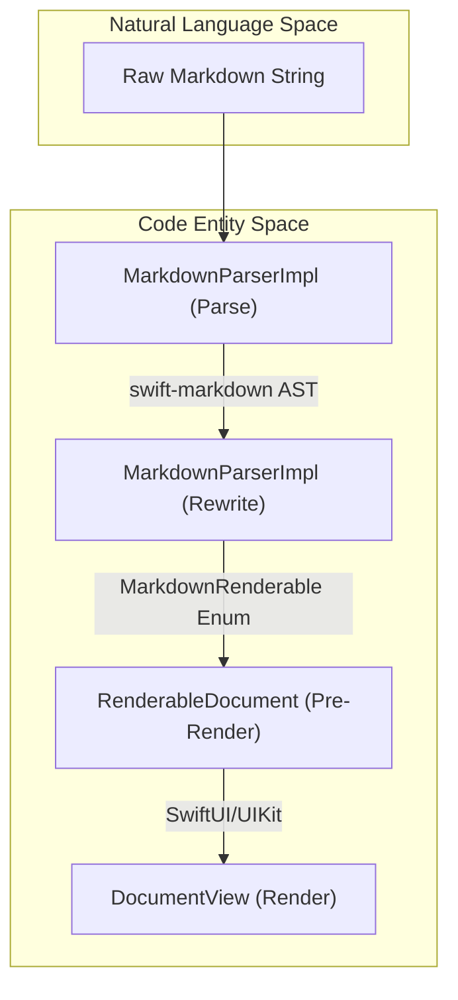
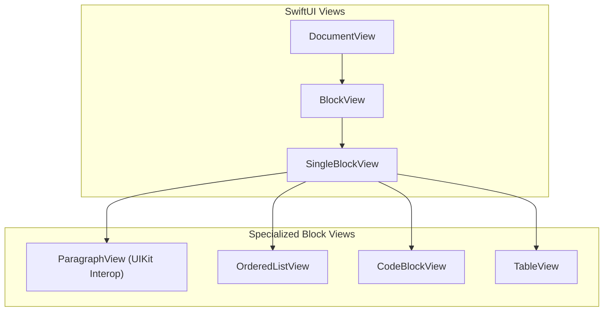

<!-- source: DeepWiki mcp.deepwiki.com · repo microsoft/SwiftStreamingMarkdown · page 1 Overview · fetched 2026-10-26 -->

# Overview

Relevant source files

The following files were used as context for generating this wiki page:

- [.gitignore](.gitignore)
- [AGENTS.md](AGENTS.md)
- [LICENSE](LICENSE)
- [Makefile](Makefile)
- [Package.resolved](Package.resolved)
- [Package.swift](Package.swift)
- [README.md](README.md)
- [Sources/MarkdownText/MarkdownView.swift](Sources/MarkdownText/MarkdownView.swift)
- [Sources/MarkdownText/StreamedMarkdownView.swift](Sources/MarkdownText/StreamedMarkdownView.swift)
- [Sources/MarkdownText/UI/BlockView.swift](Sources/MarkdownText/UI/BlockView.swift)

`SwiftStreamingMarkdown` is a high-performance iOS Markdown rendering library designed specifically for smooth streaming experiences, such as those required by LLM chat interfaces. It provides a robust pipeline for parsing, rewriting, and rendering Markdown and LaTeX content in SwiftUI and UIKit environments.

The library is distributed as a Swift Package and supports iOS 16+ with Xcode 16+ [Package.swift:1-9]().

### Key Capabilities

*   **Streaming-First Architecture**: Optimized for incremental updates where content grows over time without UI stalls or "jitter" [README.md:11-11](), [AGENTS.md:63-66]().
*   **LaTeX Support**: Native rendering for inline `\( … \)` and block `$$ … $$` math [README.md:102-103]().
*   **Rich Inline Elements**: Supports interactive inline citation pills for source-grounded responses [README.md:69-74]().
*   **Configurable UI**: Deeply customizable typography, theming, and context menu interactions [README.md:14-15]().

Sources: [README.md:1-16](), [Package.swift:1-9](), [AGENTS.md:5-20]()

---

## System Architecture

The library processes Markdown through a multi-phase pipeline to ensure that the main thread remains responsive even during heavy streaming workloads.

### Rendering Pipeline Flow

The diagram below illustrates how a raw Markdown string is transformed into a rendered view.

**Markdown Processing Pipeline**

Sources: [AGENTS.md:51-74](), [Sources/MarkdownText/StreamedMarkdownView.swift:88-91]()

### Component Interaction

The UI layer is split between SwiftUI for layout and structural blocks, and UIKit (`UITextView`) for high-performance paragraph rendering with word-by-word animations.

**UI Layer Hierarchy**

Sources: [Sources/MarkdownText/UI/BlockView.swift:9-78](), [AGENTS.md:71-74]()

---

## Core Components

### 1. View Entry Points
The library provides two primary views for integration:
*   `MarkdownView`: For rendering static Markdown strings [Sources/MarkdownText/MarkdownView.swift:13-15]().
*   `StreamedMarkdownView`: For rendering content that arrives incrementally via a `StreamedMarkdownSource` [Sources/MarkdownText/StreamedMarkdownView.swift:25-35]().

For details on implementation, see [Getting Started](#1.1).

### 2. Configuration & Styling
The `MarkdownRenderConfig` object acts as the central source of truth for styling, including colors, fonts, and animation behaviors [README.md:30-30](). It uses a design token system (Typography) to ensure consistent scaling across the UI.

For details, see [Public API Reference](#1.2).

### 3. Parsing & Rewriting
The system leverages `swift-markdown` and `cmark-gfm` for robust parsing [AGENTS.md:59-61](). A "Rewriting" phase speculatively closes open tags (like emphasis) during streaming to prevent visual jitter [AGENTS.md:63-66]().

### 4. Interactive Citations
Citations are handled via a dedicated `CitationCoder` that translates specific Markdown link patterns into interactive pills within the text [README.md:104-104]().

---

## Child Pages

*   [Getting Started](#1.1) — How to integrate via SPM, requirements, and basic usage examples.
*   [Public API Reference](#1.2) — Detailed documentation for `MarkdownView`, `StreamedMarkdownView`, and the configuration APIs.

Sources: [README.md:147-208](), [Sources/MarkdownText/MarkdownView.swift:1-45](), [Sources/MarkdownText/StreamedMarkdownView.swift:1-60]()

---

