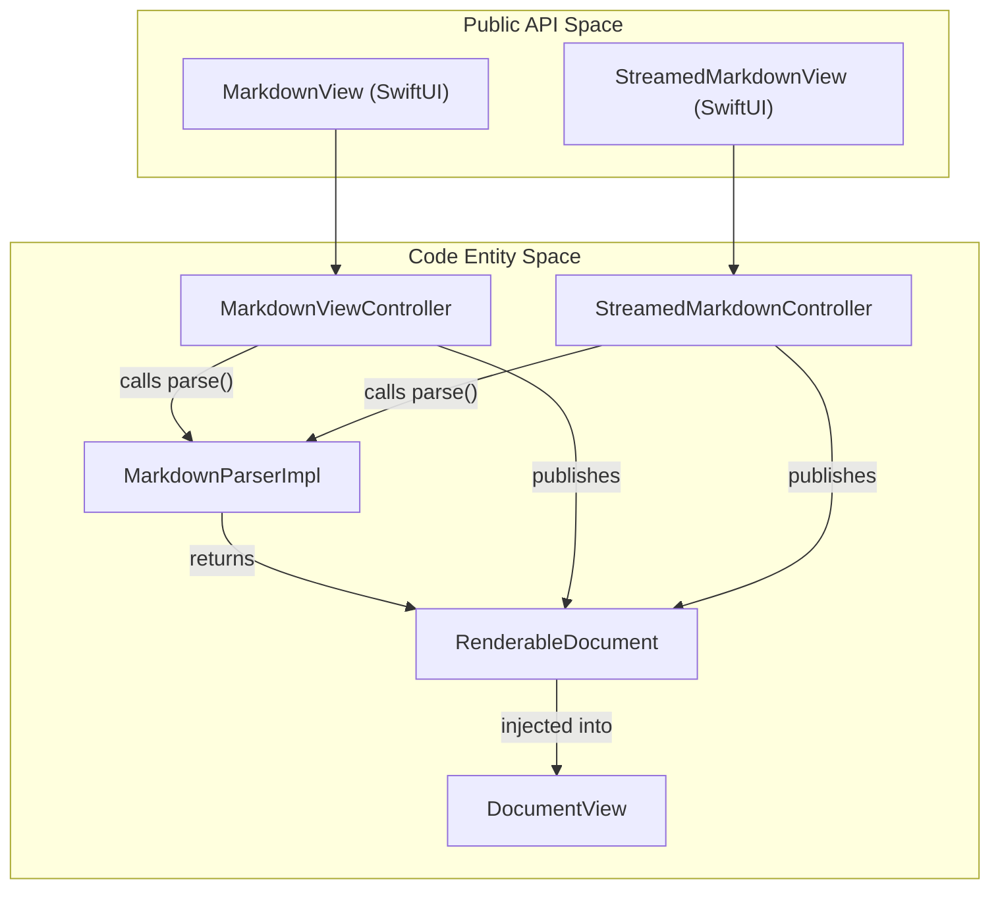
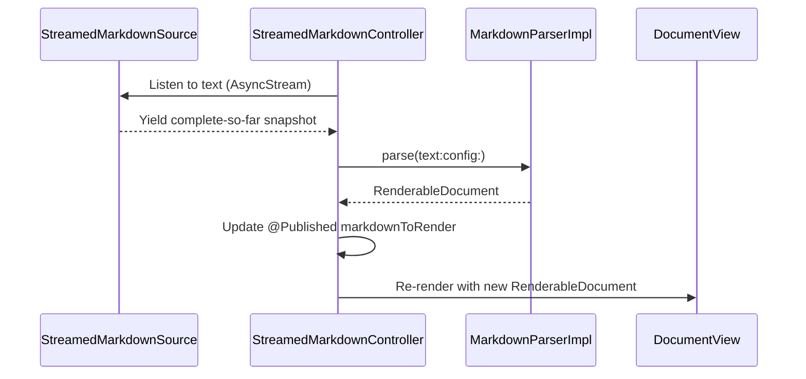

<!-- source: DeepWiki mcp.deepwiki.com · repo microsoft/SwiftStreamingMarkdown · page 1.1 Getting Started · fetched 2026-10-26 -->

# Getting Started

<details>
<summary>Relevant source files</summary>

The following files were used as context for generating this wiki page:

- [.github/workflows/ci.yml](.github/workflows/ci.yml)
- [CONTRIBUTING.md](CONTRIBUTING.md)
- [Package.resolved](Package.resolved)
- [Package.swift](Package.swift)
- [README.md](README.md)
- [Sources/MarkdownText/MarkdownView.swift](Sources/MarkdownText/MarkdownView.swift)
- [Sources/MarkdownText/StreamedMarkdownView.swift](Sources/MarkdownText/StreamedMarkdownView.swift)
- [Sources/MarkdownText/UI/BlockView.swift](Sources/MarkdownText/UI/BlockView.swift)
- [scripts/dev-setup.sh](scripts/dev-setup.sh)

</details>


SwiftStreamingMarkdown is a high-performance Markdown rendering library for iOS designed specifically for streaming content, such as real-time responses from Large Language Models (LLMs). It provides smooth transitions, native LaTeX support, and interactive citation pills while maintaining a highly configurable UI layer.

## Minimum Requirements

The library leverages modern Swift and SwiftUI features, requiring the following environment:

| Requirement | Minimum Version |
| :--- | :--- |
| **iOS** | 16.0+ [Package.swift:9]() |
| **Swift** | 5.9+ [Package.swift:1]() |
| **Xcode** | 16.0+ (as enforced by `.xcode-version`) [scripts/dev-setup.sh:99-118]() |

## Installation

### Swift Package Manager (SPM)

You can integrate SwiftStreamingMarkdown into your project via SPM in two ways:

#### 1. Via Xcode
1. Navigate to **File ▸ Add Package Dependencies...**
2. Enter the repository URL: `https://github.com/microsoft/SwiftStreamingMarkdown` [README.md:154]()
3. Set the Dependency Rule to **Up to Next Minor** or **Branch: main**.

#### 2. Via `Package.swift`
Add the package to your dependencies and target:

```swift
// dependencies
.package(url: "https://github.com/microsoft/SwiftStreamingMarkdown", from: "0.1.0"),

// target dependencies
.target(
  name: "YourApp",
  dependencies: [
    .product(name: "SwiftStreamingMarkdown", package: "SwiftStreamingMarkdown")
  ]
)
```
Sources: [README.md:160-171]()

### Binary Size Impact
Integrating this library adds approximately **3 MB** to the final App Store download size. This includes the rendering engine and its core dependencies: `swift-markdown`, `iosMath`, and `HighlightSwift`. [README.md:173-176]()

---

## Quick Start Examples

The library provides two primary entry points depending on whether your content is static or arriving incrementally.

### Static Rendering: `MarkdownView`
Use `MarkdownView` for standard, non-streaming Markdown strings. It handles parsing and rendering internally.

```swift
import SwiftUI
import SwiftStreamingMarkdown

struct StaticContentView: View {
    var body: some View {
        MarkdownView(text: """
        # Hello World
        This is **static** markdown.
        """)
        .padding()
    }
}
```
Sources: [MarkdownView.swift:13-32](), [README.md:182-202]()

### Streaming Rendering: `StreamedMarkdownView`
For LLM chat interfaces, use `StreamedMarkdownView`. It requires a `StreamedMarkdownSource` that yields a sequence of "complete-so-far" snapshots.

```swift
import SwiftUI
import SwiftStreamingMarkdown

struct StreamingContentView: View {
    // MySource must conform to StreamedMarkdownSource
    @State var source = MySource() 

    var body: some View {
        StreamedMarkdownView(source: source)
    }
}
```
Sources: [StreamedMarkdownView.swift:25-45](), [README.md:207-209]()

---

## Implementation Overview

The following diagrams illustrate how the high-level views interact with the underlying controller and parsing logic.

### Entity Relationship: View to Controller
This diagram bridges the SwiftUI views to their respective logic controllers and the shared parsing infrastructure.


Sources: [MarkdownView.swift:13-68](), [StreamedMarkdownView.swift:25-101](), [UI/BlockView.swift:9-78]()

### Data Flow: Streaming Lifecycle
The flow of data from an asynchronous source through the parser to the final UI update.


Sources: [StreamedMarkdownView.swift:15-17](), [StreamedMarkdownView.swift:82-95](), [StreamedMarkdownView.swift:48-52]()

---

## Key Components

| Component | File | Role |
| :--- | :--- | :--- |
| `MarkdownView` | [MarkdownView.swift]() | The simplest entry point for static text. |
| `StreamedMarkdownView` | [StreamedMarkdownView.swift]() | Handles `AsyncStream` inputs for real-time text growth. |
| `MarkdownParserImpl` | [MarkdownView.swift:53]() | The engine that converts raw String into an AST and then into `RenderableDocument`. |
| `DocumentView` | [StreamedMarkdownView.swift:48]() | The internal SwiftUI view that iterates over `MarkdownRenderable` blocks. |
| `MarkdownRenderConfig` | [StreamedMarkdownView.swift:27]() | Central configuration for fonts, colors, and animation settings. |

Sources: [MarkdownView.swift:13-68](), [StreamedMarkdownView.swift:25-101](), [UI/BlockView.swift:9-78]()

---

