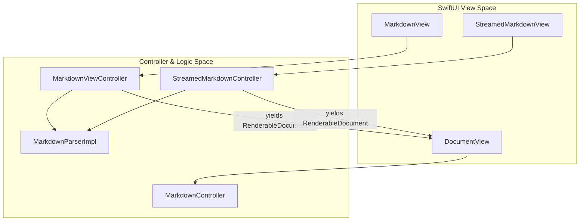
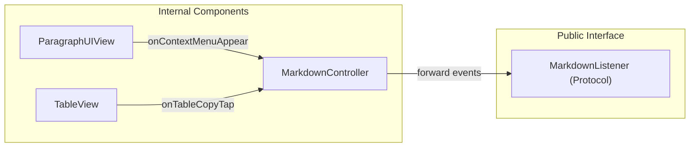

<!-- source: DeepWiki mcp.deepwiki.com · repo microsoft/SwiftStreamingMarkdown · page 1.2 Public API Reference · fetched 2026-10-26 -->

# Public API Reference

Relevant source files

The following files were used as context for generating this wiki page:

- [README.md](README.md)
- [Sources/MarkdownText/MarkdownView.swift](Sources/MarkdownText/MarkdownView.swift)
- [Sources/MarkdownText/Models/MarkdownRenderConfig+Builders.swift](Sources/MarkdownText/Models/MarkdownRenderConfig+Builders.swift)
- [Sources/MarkdownText/Models/MarkdownRenderConfig.swift](Sources/MarkdownText/Models/MarkdownRenderConfig.swift)
- [Sources/MarkdownText/StreamedMarkdownView.swift](Sources/MarkdownText/StreamedMarkdownView.swift)
- [Sources/MarkdownText/UI/DocumentView.swift](Sources/MarkdownText/UI/DocumentView.swift)
- [Sources/MarkdownText/Utilities/MarkdownListener.swift](Sources/MarkdownText/Utilities/MarkdownListener.swift)

This page provides a detailed technical reference for the public surface of the `SwiftStreamingMarkdown` library. It covers the primary SwiftUI views, the protocols used for data sourcing and event handling, and the configuration system for styling and behavior.

## Core View Components

The library provides three primary entry points for rendering Markdown, depending on whether the source is static, streaming, or already pre-parsed.

### MarkdownView
`MarkdownView` is the simplest entry point. It accepts a raw Markdown string, manages its own internal `MarkdownParserImpl`, and handles the asynchronous parsing lifecycle [Sources/MarkdownText/MarkdownView.swift:13-15]().

### StreamedMarkdownView
`StreamedMarkdownView` is designed for chat-style interfaces where Markdown content arrives incrementally. It consumes a `StreamedMarkdownSource` and re-parses the content as new snapshots arrive [Sources/MarkdownText/StreamedMarkdownView.swift:25-28]().

### DocumentView
`DocumentView` is the low-level rendering component. It accepts a pre-parsed `RenderableDocument` and is used internally by both `MarkdownView` and `StreamedMarkdownView` [Sources/MarkdownText/UI/DocumentView.swift:15-18]().

### View Hierarchy and Data Flow
The following diagram illustrates how these components relate to the internal controllers and the parsing logic.

**View to Entity Mapping: Rendering Pipeline**

Sources: [Sources/MarkdownText/MarkdownView.swift:13-18](), [Sources/MarkdownText/StreamedMarkdownView.swift:25-29](), [Sources/MarkdownText/UI/DocumentView.swift:15-19](), [Sources/MarkdownText/StreamedMarkdownView.swift:62-70]()

---

## Protocols and Interfaces

The library uses protocols to decouple the UI from data sources and to provide hooks for application-level logic.

### StreamedMarkdownSource
To use `StreamedMarkdownView`, you must provide an object conforming to `StreamedMarkdownSource`.
*   **`text: AsyncStream<String>`**: This stream must yield *complete snapshots* of the Markdown source so far (growing prefixes), not incremental deltas [Sources/MarkdownText/StreamedMarkdownView.swift:15-17]().

### MarkdownListener
The `MarkdownListener` protocol allows the host application to respond to rendering updates and user interactions [Sources/MarkdownText/Utilities/MarkdownListener.swift:8-14]().

| Function | Description |
| :--- | :--- |
| `onRender(markdown:)` | Called whenever a new `RenderableDocument` is processed and ready for display. |
| `onTableCopyTap(content:)` | Triggered when a user taps the copy button on a Markdown table. |
| `onTableDownloadTap(content:)` | Triggered when a user taps the download button on a Markdown table. |
| `onContextMenuAppear(id:selectedContent:)` | Triggered when a custom context menu is displayed on text selection. |
| `onContextMenuTap(id:selectedContent:)` | Triggered when a user selects an action from the custom context menu. |

**Code Entity Interaction: Listener Flow**

Sources: [Sources/MarkdownText/Utilities/MarkdownListener.swift:8-14](), [Sources/MarkdownText/Utilities/MarkdownListener.swift:56-78]()

---

## MarkdownRenderConfig

`MarkdownRenderConfig` is the central configuration object. It uses a builder-style API for incremental overrides of the default theme [Sources/MarkdownText/Models/MarkdownRenderConfig.swift:16-35]().

### Configuration Properties
The configuration is composed of several sub-structs targeting specific Markdown elements:

| Property | Type | Description |
| :--- | :--- | :--- |
| `shouldAnimateText` | `Bool` | If true, new text fades in using a word-by-word animation [Sources/MarkdownText/Models/MarkdownRenderConfig.swift:18](). |
| `paragraphStyle` | `MarkdownTextStyle` | Font and color for standard text [Sources/MarkdownText/Models/MarkdownRenderConfig.swift:26](). |
| `headingStyle` | `MarkdownHeadingTextStyle` | Per-level (H1-H6) font configurations [Sources/MarkdownText/Models/MarkdownRenderConfig.swift:22](). |
| `tableStyle` | `MarkdownTableTextStyle` | Colors for borders, headers, and action buttons [Sources/MarkdownText/Models/MarkdownRenderConfig.swift:28](). |
| `inlineStyle` | `MarkdownInlineTextStyle` | Styling for bold, links, and inline code spans [Sources/MarkdownText/Models/MarkdownRenderConfig.swift:30](). |
| `citationConfig` | `CitationConfig` | Controls `CitationCoder` and chip appearance [Sources/MarkdownText/Models/MarkdownRenderConfig.swift:35](). |
| `textContextMenu` | `TextContextMenu?` | Customizes the iOS edit menu on text selection [Sources/MarkdownText/Models/MarkdownRenderConfig.swift:33](). |

### Builder API
`MarkdownRenderConfig` provides `with...` methods to create modified copies of a configuration:
*   `withShouldAnimateText(value:)` [Sources/MarkdownText/Models/MarkdownRenderConfig+Builders.swift:10-21]()
*   `withParagraphStyle(value:)` [Sources/MarkdownText/Models/MarkdownRenderConfig+Builders.swift:66-77]()
*   `withHeadingStyle(value:)` [Sources/MarkdownText/Models/MarkdownRenderConfig+Builders.swift:38-49]()
*   `withTextContextMenu(value:)` [Sources/MarkdownText/Models/MarkdownRenderConfig+Builders.swift:109-120]()

### Environment Injection
The configuration is injected into the SwiftUI environment, allowing deep child views (like `ParagraphView` or `CodeBlockView`) to access styling without explicit prop-drilling [Sources/MarkdownText/UI/DocumentView.swift:52-58]().

Sources: [Sources/MarkdownText/Models/MarkdownRenderConfig.swift:10-35](), [Sources/MarkdownText/Models/MarkdownRenderConfig+Builders.swift:8-121](), [Sources/MarkdownText/UI/DocumentView.swift:36-39]()

---

