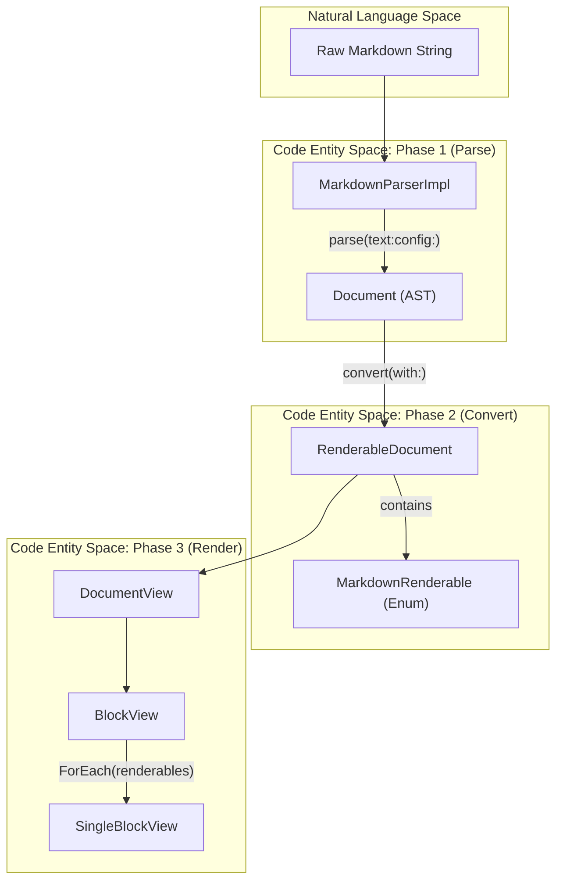
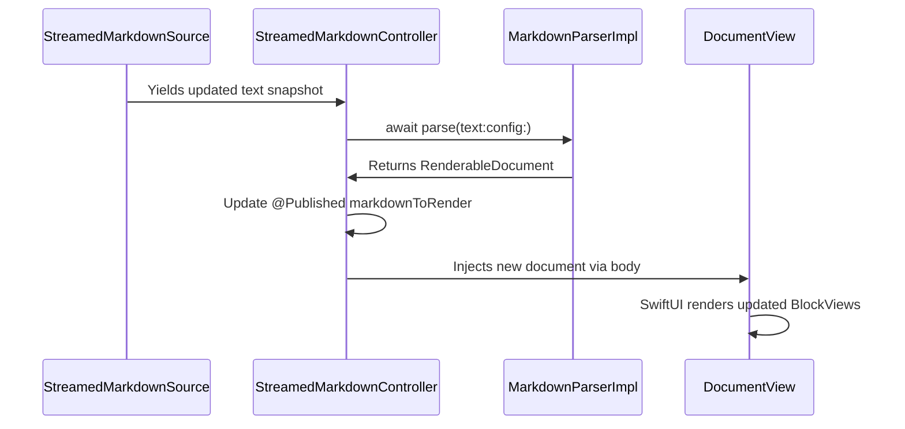

<!-- source: DeepWiki mcp.deepwiki.com · repo microsoft/SwiftStreamingMarkdown · page 2 Core Architecture · fetched 2026-10-26 -->

# Core Architecture

Relevant source files

The following files were used as context for generating this wiki page:

- [Package.resolved](Package.resolved)
- [Package.swift](Package.swift)
- [README.md](README.md)
- [Sources/MarkdownText/MarkdownView.swift](Sources/MarkdownText/MarkdownView.swift)
- [Sources/MarkdownText/Models/RenderableDocument.swift](Sources/MarkdownText/Models/RenderableDocument.swift)
- [Sources/MarkdownText/Parser/MarkdownParser.swift](Sources/MarkdownText/Parser/MarkdownParser.swift)
- [Sources/MarkdownText/StreamedMarkdownView.swift](Sources/MarkdownText/StreamedMarkdownView.swift)
- [Sources/MarkdownText/Style/Colors+Static.swift](Sources/MarkdownText/Style/Colors+Static.swift)
- [Sources/MarkdownText/Style/Colors+Theme.swift](Sources/MarkdownText/Style/Colors+Theme.swift)
- [Sources/MarkdownText/UI/BlockView.swift](Sources/MarkdownText/UI/BlockView.swift)

The `SwiftStreamingMarkdown` library employs a decoupled, three-phase pipeline to transform raw Markdown strings into a fluid, animated SwiftUI interface. This architecture is specifically optimized for **streaming**—where content arrives incrementally—by ensuring that re-parsing and re-rendering are efficient enough to maintain 60 FPS on iOS devices [README.md:119-124]().

## The Rendering Pipeline

The transition from a raw string to pixels follows a linear flow. Each stage is isolated to allow for independent testing and optimization.

### 1. Parsing Phase
The `MarkdownParser` [Sources/MarkdownText/Parser/MarkdownParser.swift:9-16]() receives a `String` snapshot. In a streaming context, this is typically a progressively larger prefix of the full response [Sources/MarkdownText/StreamedMarkdownView.swift:12-14](). The parser handles LaTeX pre-processing and uses the `swift-markdown` engine to produce an Abstract Syntax Tree (AST).

### 2. Conversion Phase
The AST is traversed and converted into a `RenderableDocument` [Sources/MarkdownText/Models/RenderableDocument.swift:13-34](). During this phase, Markdown nodes are mapped to a flat array of `MarkdownRenderable` enum cases. This is where styling from `MarkdownRenderConfig` is baked into `NSAttributedString` instances, including font resolution and color application [Sources/MarkdownText/Models/RenderableDocument.swift:39-49]().

### 3. Rendering Phase
The `DocumentView` consumes the `RenderableDocument`. It iterates through the renderables and dispatches them to specialized SwiftUI views (e.g., `ParagraphView`, `TableView`, `CodeBlockView`) [Sources/MarkdownText/UI/BlockView.swift:36-78]().

### Data Flow Overview

The following diagram illustrates the lifecycle of a single Markdown update within the system.

**Pipeline Entity Mapping**

Sources: [Sources/MarkdownText/Parser/MarkdownParser.swift:9-38](), [Sources/MarkdownText/Models/RenderableDocument.swift:13-34](), [Sources/MarkdownText/UI/BlockView.swift:9-24]()

---

## Component Breakdown

### Parsing Pipeline
The parsing stage is abstracted by the `MarkdownParser` protocol. The primary implementation, `MarkdownParserImpl`, manages the complexities of partial Markdown (e.g., unclosed code blocks or incomplete LaTeX markers) to ensure the UI doesn't flicker or break during streaming.

For details, see [Parsing Pipeline](#2.1).

### AST-to-Renderable Conversion
This phase bridges the gap between a generic Markdown tree and an iOS-optimized data structure. It utilizes `BlockConvertible` and `InlineConvertible` protocols to transform `swift-markdown` nodes. Crucially, it propagates typography settings (like letter spacing and line height) into the underlying text storage.

For details, see [AST-to-Renderable Conversion](#2.2).

### RenderableDocument and Data Models
The `RenderableDocument` serves as the "Source of Truth" for the UI. It is an immutable, `Sendable` snapshot that represents a fully prepared document [Sources/MarkdownText/Models/RenderableDocument.swift:13](). By performing the heavyweight work of attribute calculation and layout preparation in this model, the library keeps the SwiftUI view body execution extremely lightweight.

For details, see [RenderableDocument and Data Models](#2.3).

---

## System Integration

The architecture is exposed via two primary SwiftUI entry points that manage the pipeline's lifecycle:

| View | Use Case | Controller |
| :--- | :--- | :--- |
| `MarkdownView` | Static content or infrequent updates. | `MarkdownViewController` |
| `StreamedMarkdownView` | Real-time streaming (e.g., LLM chat). | `StreamedMarkdownController` |

**Streaming Controller Logic**
The `StreamedMarkdownController` manages an `AsyncStream` of text, triggering a new parse-convert cycle on every emission and updating the `@Published` `markdownToRender` property on the `MainActor` [Sources/MarkdownText/StreamedMarkdownView.swift:82-95]().

**Controller-to-View Interaction**

Sources: [Sources/MarkdownText/StreamedMarkdownView.swift:62-101](), [Sources/MarkdownText/MarkdownView.swift:48-68]()

---

