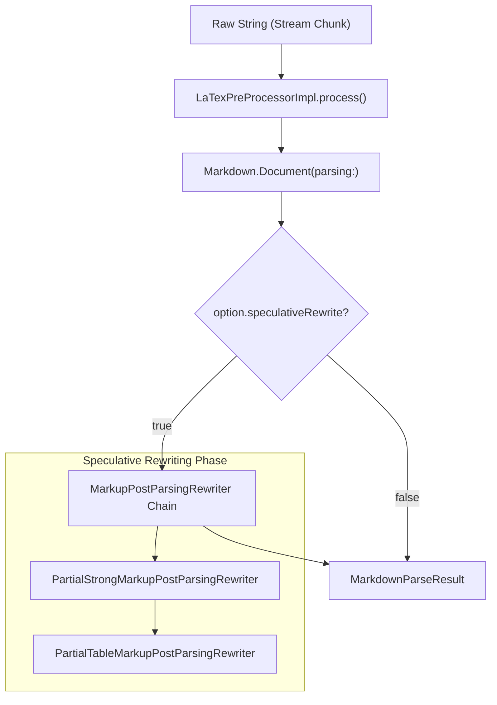
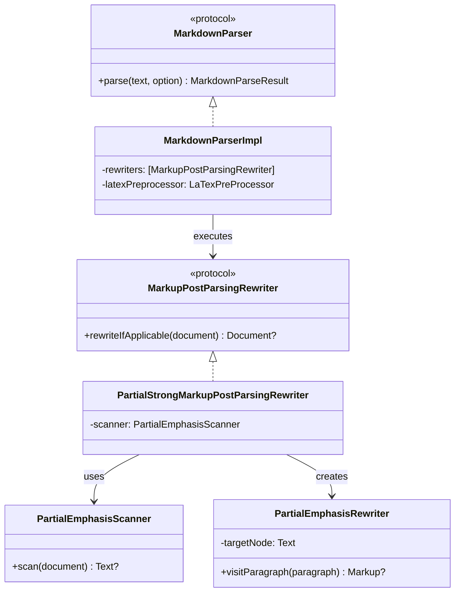

<!-- source: DeepWiki mcp.deepwiki.com · repo microsoft/SwiftStreamingMarkdown · page 2.1 Parsing Pipeline · fetched 2026-10-26 -->

# Parsing Pipeline

Relevant source files

The following files were used as context for generating this wiki page:

- [Sources/MarkdownText/Parser/LaTexPreProcessor.swift](Sources/MarkdownText/Parser/LaTexPreProcessor.swift)
- [Sources/MarkdownText/Parser/MarkdownParseOption.swift](Sources/MarkdownText/Parser/MarkdownParseOption.swift)
- [Sources/MarkdownText/Parser/MarkdownParseResult.swift](Sources/MarkdownText/Parser/MarkdownParseResult.swift)
- [Sources/MarkdownText/Parser/MarkdownParser.swift](Sources/MarkdownText/Parser/MarkdownParser.swift)
- [Sources/MarkdownText/Parser/MarkdownParserImpl.swift](Sources/MarkdownText/Parser/MarkdownParserImpl.swift)
- [Sources/MarkdownText/Parser/Rewriters/PartialEmphasisRewriter.swift](Sources/MarkdownText/Parser/Rewriters/PartialEmphasisRewriter.swift)
- [Sources/MarkdownText/Parser/Rewriters/PartialTableRewriter.swift](Sources/MarkdownText/Parser/Rewriters/PartialTableRewriter.swift)
- [Sources/MarkdownText/Parser/Scanners/MarkupPostParsingRewriter.swift](Sources/MarkdownText/Parser/Scanners/MarkupPostParsingRewriter.swift)
- [Sources/MarkdownText/Parser/Scanners/MarkupScanner.swift](Sources/MarkdownText/Parser/Scanners/MarkupScanner.swift)
- [Sources/MarkdownText/Parser/Scanners/PartialEmphasisScanner.swift](Sources/MarkdownText/Parser/Scanners/PartialEmphasisScanner.swift)
- [Sources/MarkdownText/Parser/Scanners/PartialTableScanner.swift](Sources/MarkdownText/Parser/Scanners/PartialTableScanner.swift)

The parsing pipeline in `SwiftStreamingMarkdown` is responsible for transforming raw input strings—often arriving in incomplete chunks during a stream—into a structured `Document` AST. This process involves three distinct stages: LaTeX pre-processing, standard Markdown parsing via `swift-markdown`, and speculative rewriting to handle partial syntax.

## Overview of the Pipeline

The entry point for all parsing operations is the `MarkdownParser` protocol [Sources/MarkdownText/Parser/MarkdownParser.swift:9-16](). The default implementation, `MarkdownParserImpl`, orchestrates the flow of data through the pre-processor and optional rewriters.

### Data Flow Diagram
This diagram illustrates the sequence of operations within `MarkdownParserImpl.parse(text:option:)` [Sources/MarkdownText/Parser/MarkdownParserImpl.swift:24-40]().

Title: Markdown Parsing Data Flow

Sources: [Sources/MarkdownText/Parser/MarkdownParserImpl.swift:11-40](), [Sources/MarkdownText/Parser/MarkdownParseOption.swift:7-10]()

## LaTeX Pre-processing

Because standard CommonMark does not support LaTeX, the library uses `LaTexPreProcessorImpl` to identify math delimiters before the main parser runs [Sources/MarkdownText/Parser/LaTexPreProcessor.swift:21-139](). 

### Block and Inline Handling
1.  **Block LaTeX**: Delimiters like `$$` or `\[ ... \]` are converted into a special Fenced Code Block with the language identifier `blockmath` [Sources/MarkdownText/Parser/LaTexPreProcessor.swift:142-160](). This prevents the Markdown parser from escaping characters like `_` or `*` inside the equation [Sources/MarkdownText/Parser/LaTexPreProcessor.swift:141-141]().
2.  **Inline LaTeX**: Delimiters like `\(` are wrapped in inline code backticks (e.g., `` `\(...\)` ``) to preserve the LaTeX string [Sources/MarkdownText/Parser/LaTexPreProcessor.swift:163-169]().

### Syntax Normalization
The pre-processor also performs "filtering" to map unsupported LaTeX commands to supported ones (e.g., `\dfrac` → `\frac`, `\overrightarrow` → `\vec`) [Sources/MarkdownText/Parser/LaTexPreProcessor.swift:190-237]().

Sources: [Sources/MarkdownText/Parser/LaTexPreProcessor.swift:142-186](), [Sources/MarkdownText/Parser/LaTexPreProcessor.swift:208-237]()

## Speculative Rewriting

When streaming Markdown from an LLM, the text often cuts off mid-syntax (e.g., `**Bold text`). Standard parsers treat this as literal text until the closing delimiter arrives. Speculative rewriting detects these partial states and "fixes" them in the AST so the UI can render the intended style immediately.

### Scanners and Rewriters
The system uses a **Scanner-Rewriter** pattern:
*   **Scanner**: Inspects the `Document` to find a specific "incomplete" node [Sources/MarkdownText/Parser/Scanners/MarkupScanner.swift:8-16]().
*   **Rewriter**: A `MarkupRewriter` subclass that modifies the AST to close the partial syntax [Sources/MarkdownText/Parser/Rewriters/PartialEmphasisRewriter.swift:8-114]().

### Supported Partial Syntaxes

| Feature | Scanner | Rewriter | Logic |
| :--- | :--- | :--- | :--- |
| **Emphasis** | `PartialEmphasisScanner` | `PartialEmphasisRewriter` | Detects trailing `*` or `_` and wraps the following text in a `Strong` or `Emphasis` node [Sources/MarkdownText/Parser/Rewriters/PartialEmphasisRewriter.swift:43-68](). |
| **Tables** | `PartialTableScanner` | `PartialTableRewriter` | Detects lines starting with `\|` that haven't been recognized as a table yet, and hides them until the delimiter row is complete to avoid "jumping" text [Sources/MarkdownText/Parser/Scanners/PartialTableScanner.swift:13-64](). |

Sources: [Sources/MarkdownText/Parser/Scanners/MarkupPostParsingRewriter.swift:19-53](), [Sources/MarkdownText/Parser/Rewriters/PartialEmphasisRewriter.swift:8-36](), [Sources/MarkdownText/Parser/Scanners/PartialTableScanner.swift:9-65]()

## Implementation Details

### Class Relationships
This diagram bridges the abstract protocols to their concrete implementations and the specific scanning logic used for streaming.

Title: Parser Implementation and Scanning

Sources: [Sources/MarkdownText/Parser/MarkdownParser.swift:9-16](), [Sources/MarkdownText/Parser/MarkdownParserImpl.swift:9-21](), [Sources/MarkdownText/Parser/Scanners/MarkupPostParsingRewriter.swift:14-35](), [Sources/MarkdownText/Parser/Rewriters/PartialEmphasisRewriter.swift:8-23]()

### Handling Table Edge Cases
`PartialTableScanner` is particularly complex because it must differentiate between a standard paragraph and a "table-in-progress." It looks for specific patterns in the `Paragraph` children:
1.  A single `Text` node starting with `|` [Sources/MarkdownText/Parser/Scanners/PartialTableScanner.swift:31-35]().
2.  A `Text` node followed by a `SoftBreak` [Sources/MarkdownText/Parser/Scanners/PartialTableScanner.swift:42-48]().
3.  A header, a break, and a partial delimiter row (e.g., `| :--`) [Sources/MarkdownText/Parser/Scanners/PartialTableScanner.swift:55-61]().

If these patterns are found, `PartialTableRewriter` clears the children of the paragraph to prevent the raw table pipe syntax from flickering on screen before the full table is rendered [Sources/MarkdownText/Parser/Rewriters/PartialTableRewriter.swift:16-24]().

Sources: [Sources/MarkdownText/Parser/Scanners/PartialTableScanner.swift:13-65](), [Sources/MarkdownText/Parser/Rewriters/PartialTableRewriter.swift:8-25]()

---

