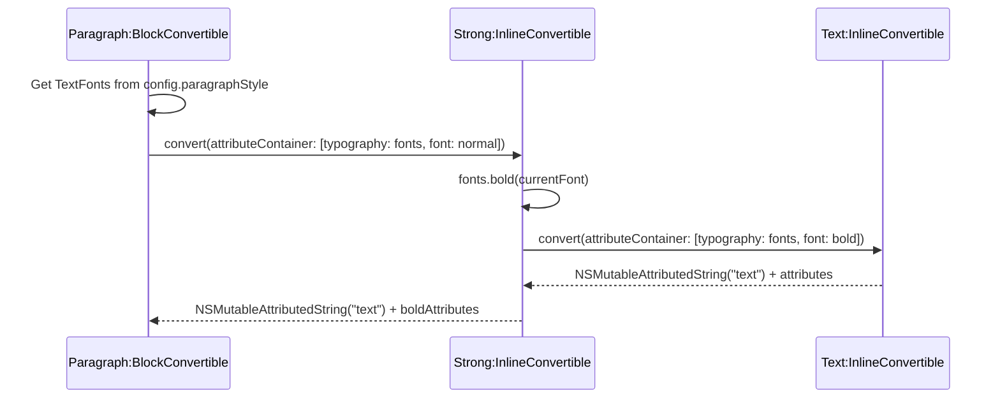

<!-- source: DeepWiki mcp.deepwiki.com · repo microsoft/SwiftStreamingMarkdown · page 2.2 AST-to-Renderable Conversion · fetched 2026-10-26 -->

# AST-to-Renderable Conversion

<details>
<summary>Relevant source files</summary>

The following files were used as context for generating this wiki page:

- [Examples/SwiftStreamingMarkdownSample/SwiftStreamingMarkdownSample/RobotoTheme.swift](Examples/SwiftStreamingMarkdownSample/SwiftStreamingMarkdownSample/RobotoTheme.swift)
- [Sources/MarkdownText/Block/BlockConvertible.swift](Sources/MarkdownText/Block/BlockConvertible.swift)
- [Sources/MarkdownText/Block/BlockQuote+.swift](Sources/MarkdownText/Block/BlockQuote+.swift)
- [Sources/MarkdownText/Block/CodeBlock+.swift](Sources/MarkdownText/Block/CodeBlock+.swift)
- [Sources/MarkdownText/Block/Document+.swift](Sources/MarkdownText/Block/Document+.swift)
- [Sources/MarkdownText/Block/Heading+.swift](Sources/MarkdownText/Block/Heading+.swift)
- [Sources/MarkdownText/Block/OrderedList+.swift](Sources/MarkdownText/Block/OrderedList+.swift)
- [Sources/MarkdownText/Block/Paragraph+.swift](Sources/MarkdownText/Block/Paragraph+.swift)
- [Sources/MarkdownText/Block/Table+.swift](Sources/MarkdownText/Block/Table+.swift)
- [Sources/MarkdownText/Block/ThematicBreak+.swift](Sources/MarkdownText/Block/ThematicBreak+.swift)
- [Sources/MarkdownText/Block/UnorderedList+.swift](Sources/MarkdownText/Block/UnorderedList+.swift)
- [Sources/MarkdownText/Inline/InlineConvertible.swift](Sources/MarkdownText/Inline/InlineConvertible.swift)
- [Sources/MarkdownText/Inline/Markdown+InlineConvertible.swift](Sources/MarkdownText/Inline/Markdown+InlineConvertible.swift)
- [Sources/MarkdownText/Inline/Markup+.swift](Sources/MarkdownText/Inline/Markup+.swift)
- [Sources/MarkdownText/Models/ListItem+.swift](Sources/MarkdownText/Models/ListItem+.swift)
- [Sources/MarkdownText/Models/MarkdownRenderable.swift](Sources/MarkdownText/Models/MarkdownRenderable.swift)
- [Sources/MarkdownText/Models/Markup+ID.swift](Sources/MarkdownText/Models/Markup+ID.swift)
- [Tests/MarkdownTextTests/TypographyPropagationTests.swift](Tests/MarkdownTextTests/TypographyPropagationTests.swift)

</details>


The AST-to-Renderable conversion phase is the second stage of the rendering pipeline. It transforms the hierarchical `Markdown.Document` tree produced by the `swift-markdown` parser into a flat or semi-flat collection of `MarkdownRenderable` enum cases. This process is driven by two primary protocols: `BlockConvertible` and `InlineConvertible`.

## Conversion Architecture

The conversion process recursively traverses the AST. Block-level nodes (like Paragraphs and Headings) are converted into `MarkdownRenderable` cases, while inline nodes (like Text, Strong, and Link) are converted into `NSAttributedString` fragments that are aggregated into those blocks.

### The Conversion Pipeline

The entry point for conversion is `Markdown.Document.convert(with:)` [[Sources/MarkdownText/Block/Document+.swift:10-17]](). It iterates through its children, casting them to `BlockConvertible` to initiate the transformation.

### Code Entity Space: Conversion Protocols

The following diagram illustrates how the `swift-markdown` AST nodes map to the library's internal protocols and final renderable output.

**AST Mapping to Renderable Entities**
```mermaid
graph TD
    subgraph "Swift-Markdown AST"
        AST_Doc["Markdown.Document"]
        AST_Para["Markdown.Paragraph"]
        AST_Strong["Markdown.Strong"]
        AST_Text["Markdown.Text"]
    end

    subgraph "Conversion Protocols"
        BC["BlockConvertible"]
        IC["InlineConvertible"]
    end

    subgraph "Renderable Output"
        MR["MarkdownRenderable.paragraph"]
        NSAttr["NSMutableAttributedString"]
    end

    AST_Doc -->|iterates children| BC
    AST_Para -.->|conforms| BC
    BC -->|calls buildParagraphContent| IC
    AST_Strong -.->|conforms| IC
    AST_Text -.->|conforms| IC
    
    IC -->|convert()| NSAttr
    BC -->|convert()| MR
    NSAttr -->|appended to| MR
```
Sources: [[Sources/MarkdownText/Block/BlockConvertible.swift:12-19]](), [[Sources/MarkdownText/Inline/InlineConvertible.swift:17-24]](), [[Sources/MarkdownText/Block/Document+.swift:12-16]]()

---

## Block Conversion

Each block-level element implements `BlockConvertible.convert(attributeContainer:config:)`. This method is responsible for:
1. Determining the initial styling (font, color, kerning) from the `MarkdownRenderConfig`.
2. Initializing an `NSAttributeContainer` (a typealias for `[NSAttributedString.Key: Any]`).
3. Calling `buildParagraphContent` to process inline children.

### Implementation Details by Block Type

| Block Type | Logic Highlights | Source |
| :--- | :--- | :--- |
| `Paragraph` | Sets default paragraph font and color; propagates `TextFonts` via `.typography` key. | [[Sources/MarkdownText/Block/Paragraph+.swift:10-23]]() |
| `Heading` | Selects font (H1-H6) based on `level` property; applies heading-specific colors. | [[Sources/MarkdownText/Block/Heading+.swift:10-40]]() |
| `Table` | Separately processes `head` and `body`; maps rows to nested arrays of attributed strings. | [[Sources/MarkdownText/Block/Table+.swift:10-43]]() |
| `OrderedList` | Maps children to `MarkdownListItem` and detects if items start with `Strong` nodes. | [[Sources/MarkdownText/Block/OrderedList+.swift:10-20]]() |
| `BlockQuote` | Recursively extracts plain text to determine nesting depth and quote types. | [[Sources/MarkdownText/Block/BlockQuote+.swift:10-30]]() |

Sources: [[Sources/MarkdownText/Block/Paragraph+.swift:10-23]](), [[Sources/MarkdownText/Block/Heading+.swift:10-40]](), [[Sources/MarkdownText/Block/Table+.swift:10-43]]()

---

## Inline Conversion and Typography Propagation

The `InlineConvertible` protocol handles the transformation of leaf nodes and spans into `NSMutableAttributedString`. A key feature of this system is **Typography Propagation**, which allows nested styles (like Bold inside a Heading) to resolve to the correct font variant.

### Typography Propagation Mechanism

The library uses a custom `NSAttributedString.Key` called `.typography` [[Sources/MarkdownText/Inline/InlineConvertible.swift:12-13]](). This key carries a `TextFonts` object down the conversion tree.

When an `Emphasis` (italic) or `Strong` (bold) node is encountered:
1. It looks for the `.typography` object in the current `attributeContainer`.
2. It uses the `italicize(font:)` or `bold(font:)` methods of the `TextFonts` object to derive the new font from the current one [[Sources/MarkdownText/Inline/Markdown+InlineConvertible.swift:24-26]](), [[Sources/MarkdownText/Inline/Markdown+InlineConvertible.swift:42-44]]().
3. If no typography is found, it falls back to the global `MarkdownRenderConfig` defaults [[Sources/MarkdownText/Inline/Markdown+InlineConvertible.swift:28-29]]().

**Typography Propagation Flow**

Sources: [[Sources/MarkdownText/Inline/Markdown+InlineConvertible.swift:37-56]](), [[Sources/MarkdownText/Block/Paragraph+.swift:12-22]](), [[Tests/MarkdownTextTests/TypographyPropagationTests.swift:59-85]]()

### Special Inline Handling

*   **Links & Citations**: The `Link` conversion first checks `isInlineCitation(coder:)`. If true, it returns an `NSMutableAttributedString` containing an `InlineCitationAttachment` instead of a standard link [[Sources/MarkdownText/Inline/Markdown+InlineConvertible.swift:108-118]]().
*   **Inline LaTeX**: `InlineCode` nodes are inspected for LaTeX delimiters. If found, they are converted into a `LatexAttachmentData` payload and wrapped in an `NSTextAttachment` [[Sources/MarkdownText/Inline/Markdown+InlineConvertible.swift:154-173]]().
*   **Line Breaks**: Both `SoftBreak` and `LineBreak` are converted to simple `\n` characters while maintaining inherited attributes [[Sources/MarkdownText/Inline/Markdown+InlineConvertible.swift:132-144]]().

Sources: [[Sources/MarkdownText/Inline/Markdown+InlineConvertible.swift:72-130]](), [[Sources/MarkdownText/Inline/Markdown+InlineConvertible.swift:146-175]]()

---

## Data Flow Summary

The following table summarizes the transformation from AST node to the final `MarkdownRenderable` enum used by the UI layer.

| AST Node | Conversion Method | Resulting `MarkdownRenderable` Case |
| :--- | :--- | :--- |
| `Markdown.Paragraph` | `Paragraph.convert(...)` | `.paragraph(id:content:)` |
| `Markdown.Heading` | `Heading.convert(...)` | `.heading(id:level:content:)` |
| `Markdown.Table` | `Table.convert(...)` | `.table(id:headers:rows:rawMarkdown:)` |
| `Markdown.OrderedList` | `OrderedList.convert(...)` | `.orderedList(id:items:)` |
| `Markdown.BlockQuote` | `BlockQuote.convert(...)` | `.blockQuote(id:item:)` |
| `Markdown.CodeBlock` | `CodeBlock.convert(...)` | `.codeBlock(id:code:language:)` |

Sources: [[Sources/MarkdownText/Block/Paragraph+.swift:21]](), [[Sources/MarkdownText/Block/Heading+.swift:38]](), [[Sources/MarkdownText/Block/Table+.swift:41]](), [[Sources/MarkdownText/Block/OrderedList+.swift:19]](), [[Sources/MarkdownText/Block/BlockQuote+.swift:28]]()

---

