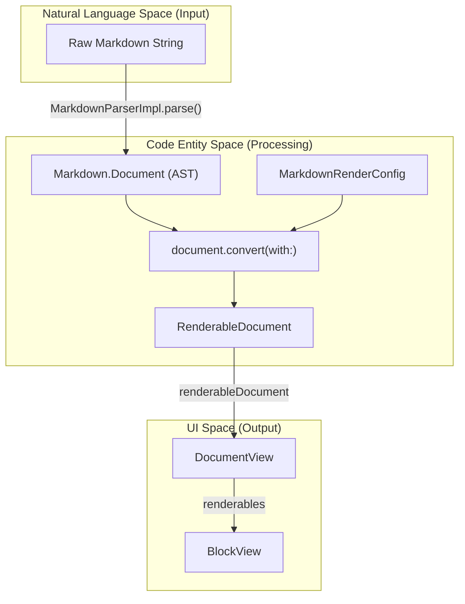
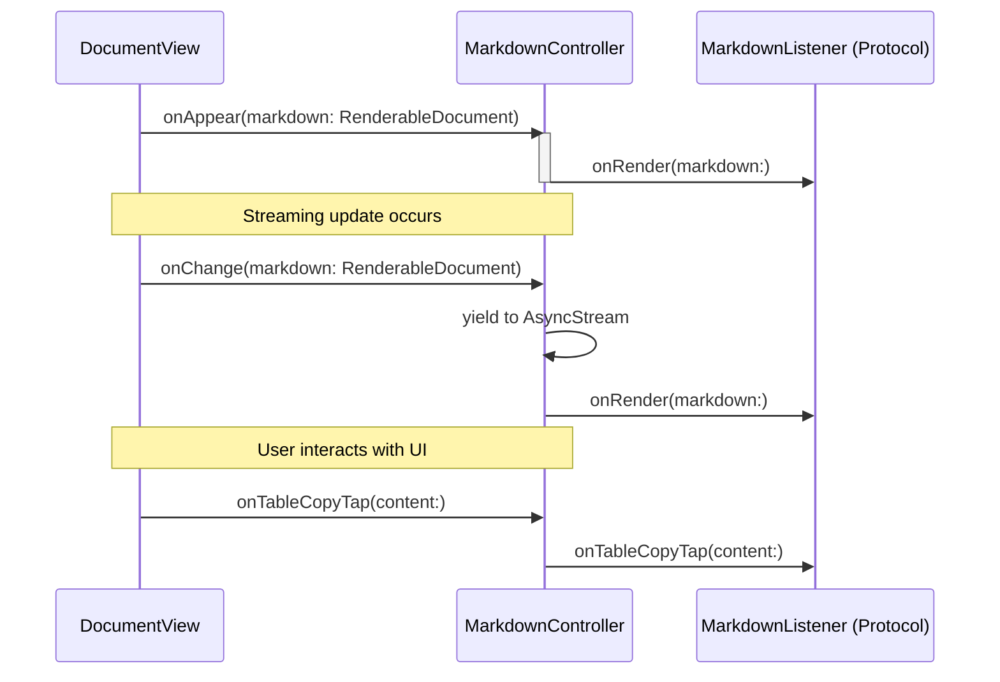

<!-- source: DeepWiki mcp.deepwiki.com · repo microsoft/SwiftStreamingMarkdown · page 2.3 RenderableDocument and Data Models · fetched 2026-10-26 -->

# RenderableDocument and Data Models

Relevant source files

The following files were used as context for generating this wiki page:

- [Sources/MarkdownText/Models/ListItem+.swift](Sources/MarkdownText/Models/ListItem+.swift)
- [Sources/MarkdownText/Models/MarkdownRenderConfig+Builders.swift](Sources/MarkdownText/Models/MarkdownRenderConfig+Builders.swift)
- [Sources/MarkdownText/Models/MarkdownRenderable.swift](Sources/MarkdownText/Models/MarkdownRenderable.swift)
- [Sources/MarkdownText/Models/RenderableDocument.swift](Sources/MarkdownText/Models/RenderableDocument.swift)
- [Sources/MarkdownText/Style/Colors+Static.swift](Sources/MarkdownText/Style/Colors+Static.swift)
- [Sources/MarkdownText/Style/Colors+Theme.swift](Sources/MarkdownText/Style/Colors+Theme.swift)
- [Sources/MarkdownText/UI/DocumentView.swift](Sources/MarkdownText/UI/DocumentView.swift)
- [Sources/MarkdownText/Utilities/MarkdownListener.swift](Sources/MarkdownText/Utilities/MarkdownListener.swift)

This page describes the intermediate representation used by SwiftStreamingMarkdown to bridge the gap between a raw Markdown Abstract Syntax Tree (AST) and the SwiftUI view layer. It covers the `RenderableDocument` container, the `MarkdownRenderable` enum, and the data flow through the `MarkdownController`.

## RenderableDocument

`RenderableDocument` is a thread-safe, `Equatable` snapshot of a parsed Markdown document [Sources/MarkdownText/Models/RenderableDocument.swift:13-13](). It serves as the final output of the conversion phase and the primary input for the rendering phase. Producing a `RenderableDocument` is considered the "heavyweight" step of the pipeline because it involves resolving styles, typography, and generating `NSAttributedString` instances; once produced, rendering it via SwiftUI is highly efficient [Sources/MarkdownText/Models/RenderableDocument.swift:10-12]().

### Initialization and Conversion

The document is typically initialized asynchronously from a `Markdown.Document` (the AST) and a `MarkdownRenderConfig` [Sources/MarkdownText/Models/RenderableDocument.swift:32-34]().

| Initializer | Purpose |
| :--- | :--- |
| `init(document:config:)` | The standard entry point. It calls `document.convert(with: config)` to transform AST nodes into renderable cases [Sources/MarkdownText/Models/RenderableDocument.swift:32-34](). |
| `init(plainText:config:)` | A convenience initializer for non-markdown text. It wraps the string in a single styled paragraph, avoiding the overhead of the full parser [Sources/MarkdownText/Models/RenderableDocument.swift:39-49](). |
| `init(renderables:)` | Internal memberwise initializer [Sources/MarkdownText/Models/RenderableDocument.swift:51-53](). |

### Logical Flow: AST to View

The following diagram illustrates how the `RenderableDocument` bridges the gap between the parsing logic and the UI components.

**Data Transformation Pipeline**

Sources: [Sources/MarkdownText/Models/RenderableDocument.swift:32-34](), [Sources/MarkdownText/UI/DocumentView.swift:15-37]()

## MarkdownRenderable Enum

`MarkdownRenderable` is an indirect enum that represents individual structural elements of a document [Sources/MarkdownText/Models/MarkdownRenderable.swift:12-12](). Each case is designed to be mapped directly to a SwiftUI view (e.g., `ParagraphView`, `TableView`).

### Supported Cases
All cases include a unique `id: String` for stable identification in SwiftUI lists [Sources/MarkdownText/Models/MarkdownRenderable.swift:41-53]().

*   `paragraph(id:content:)`: Contains an `NSMutableAttributedString` with resolved typography [Sources/MarkdownText/Models/MarkdownRenderable.swift:15-15]().
*   `latex(id:content:)`: Represents math formatting [Sources/MarkdownText/Models/MarkdownRenderable.swift:18-18]().
*   `heading(id:level:content:)`: Includes the heading depth (1-6) [Sources/MarkdownText/Models/MarkdownRenderable.swift:21-21]().
*   `orderedList(id:items:)` & `unorderedList(id:items:nestedLevel:)`: Contain `MarkdownListItem` objects, which recursively hold more `MarkdownRenderable` elements [Sources/MarkdownText/Models/MarkdownRenderable.swift:24-27](), [Sources/MarkdownText/Models/MarkdownRenderable.swift:70-73]().
*   `codeBlock(id:language:code:)`: Raw code string and optional language identifier [Sources/MarkdownText/Models/MarkdownRenderable.swift:30-30]().
*   `table(id:headers:rows:rawMarkdown:)`: Grid data with an array of header strings and a 2D array of row strings [Sources/MarkdownText/Models/MarkdownRenderable.swift:33-33]().
*   `blockQuote(id:item:)`: Encapsulates nested content for quotes [Sources/MarkdownText/Models/MarkdownRenderable.swift:39-39]().
*   `thematicBreak(id:)`: A horizontal rule [Sources/MarkdownText/Models/MarkdownRenderable.swift:36-36]().

Sources: [Sources/MarkdownText/Models/MarkdownRenderable.swift:12-73]()

## Consumption by DocumentView

`DocumentView` is the primary consumer of `RenderableDocument`. It manages the lifecycle of the document and coordinates with the `MarkdownController` to handle events and streaming updates [Sources/MarkdownText/UI/DocumentView.swift:15-34]().

### MarkdownController and Listener
The `MarkdownController` is an `ObservableObject` injected into the SwiftUI environment [Sources/MarkdownText/UI/DocumentView.swift:57-57](). It acts as a bridge to a `MarkdownListener` [Sources/MarkdownText/Utilities/MarkdownListener.swift:16-24]().

**Event Distribution and Lifecycle**

Sources: [Sources/MarkdownText/UI/DocumentView.swift:40-45](), [Sources/MarkdownText/Utilities/MarkdownListener.swift:26-50](), [Sources/MarkdownText/Utilities/MarkdownListener.swift:56-60]()

### Key Methods and Properties

| Entity | Role |
| :--- | :--- |
| `DocumentView.body` | Injects `markdownConfig` and `markdownController` into the environment and renders the `BlockView` [Sources/MarkdownText/UI/DocumentView.swift:36-49](). |
| `MarkdownController.onAppear` | Sets up an `AsyncStream` to deliver document updates to the listener [Sources/MarkdownText/Utilities/MarkdownListener.swift:26-46](). |
| `RenderableDocument.attributedStrings` | A computed property that flattens the document's content into a list of `NSAttributedString` objects, useful for indexing or plain-text extraction [Sources/MarkdownText/Models/RenderableDocument.swift:61-64](). |
| `ListItem.startsWithBold` | A helper used during conversion to detect if a list item starts with a `Strong` AST node, allowing for specialized styling [Sources/MarkdownText/Models/ListItem+.swift:9-13](). |

Sources: [Sources/MarkdownText/UI/DocumentView.swift:36-49](), [Sources/MarkdownText/Utilities/MarkdownListener.swift:26-46](), [Sources/MarkdownText/Models/RenderableDocument.swift:61-64](), [Sources/MarkdownText/Models/ListItem+.swift:9-13]()

---

