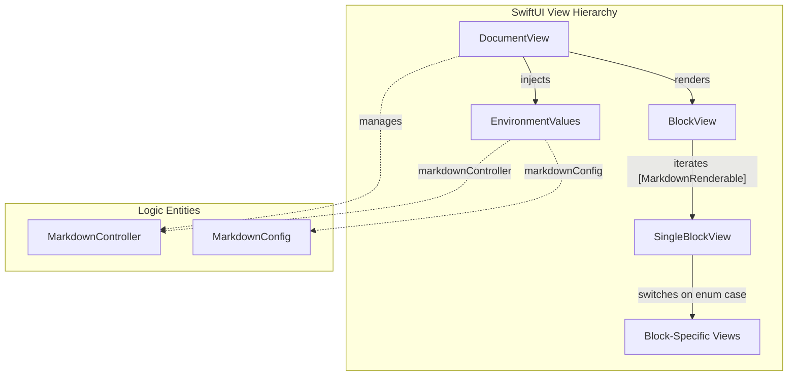
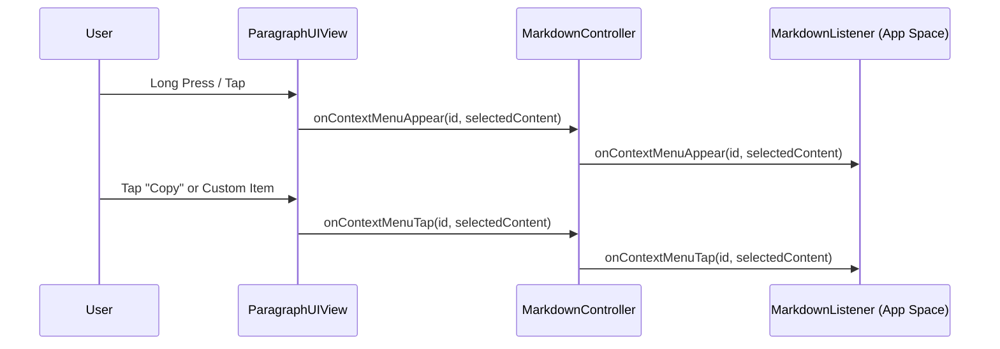

<!-- source: DeepWiki mcp.deepwiki.com · repo microsoft/SwiftStreamingMarkdown · page 3 UI Layer · fetched 2026-10-26 -->

# UI Layer

Relevant source files

The following files were used as context for generating this wiki page:

- [Package.resolved](Package.resolved)
- [Package.swift](Package.swift)
- [Sources/MarkdownText/Models/MarkdownRenderConfig+Builders.swift](Sources/MarkdownText/Models/MarkdownRenderConfig+Builders.swift)
- [Sources/MarkdownText/UI/BlockView.swift](Sources/MarkdownText/UI/BlockView.swift)
- [Sources/MarkdownText/UI/DocumentView.swift](Sources/MarkdownText/UI/DocumentView.swift)
- [Sources/MarkdownText/Utilities/MarkdownListener.swift](Sources/MarkdownText/Utilities/MarkdownListener.swift)

The UI Layer is responsible for transforming a `RenderableDocument` into a responsive, accessible SwiftUI view hierarchy. It leverages a specialized dispatching system to handle different Markdown block types, while utilizing `UIViewRepresentable` for high-performance text rendering and animations.

### View Hierarchy Overview

The rendering process begins with `DocumentView`, which serves as the entry point for a pre-parsed document. It manages the lifecycle of the `MarkdownController` and propagates configuration via the SwiftUI environment.

### Code-to-System Mapping: View Entry Points
The following diagram illustrates how the public-facing `DocumentView` initializes the internal block-dispatching system.

**Sources:** [Sources/MarkdownText/UI/DocumentView.swift:15-58](), [Sources/MarkdownText/UI/BlockView.swift:9-78]()

---

## 3.1 Document and Block Views
The UI layer uses a recursive-style dispatching mechanism. `BlockView` acts as a container that iterates through the list of `MarkdownRenderable` items [Sources/MarkdownText/UI/BlockView.swift:18-23](). For each item, `SingleBlockView` performs a pattern match on the `MarkdownRenderable` enum to determine which specialized view to instantiate [Sources/MarkdownText/UI/BlockView.swift:37-76]().

Key components include:
- **Environment Management**: `DocumentView` injects `MarkdownRenderConfig` and `MarkdownController` into the environment, ensuring all child blocks (like tables and paragraphs) can access styling and event listeners [Sources/MarkdownText/UI/DocumentView.swift:38-39]().
- **Specialized Blocks**: The system provides tailored views for various Markdown features:
    - `ParagraphView` for standard text and headings.
    - `TableView` for complex data grids.
    - `BlockMathView` for LaTeX rendering.
    - `CodeBlockView` for syntax-highlighted code.
    - `OrderedListView` and `UnorderedListView` for lists.

For details, see [Document and Block Views](#3.1).

**Sources:** [Sources/MarkdownText/UI/DocumentView.swift:15-50](), [Sources/MarkdownText/UI/BlockView.swift:37-78]()

---

## 3.2 Paragraph Rendering and Text Animations
Text rendering in `SwiftStreamingMarkdown` is handled by `ParagraphView`, which wraps a `ParagraphUIView` (a `UITextView` subclass) [Sources/MarkdownText/UI/BlockView.swift:41-48](). This approach is chosen over native SwiftUI `Text` to support:
- **Streaming Animations**: A word-by-word fade-in effect driven by `CADisplayLink`.
- **High Performance**: Size caching for smooth scrolling within `LazyVStack`.
- **iOS 18 Transitions**: Support for `FadeInTextTransition`.

For details, see [Paragraph Rendering and Text Animations](#3.2).

**Sources:** [Sources/MarkdownText/UI/BlockView.swift:41-48](), [Sources/MarkdownText/Models/MarkdownRenderConfig+Builders.swift:10-21]()

---

## 3.3 Context Menus and Text Interaction
Interaction with rendered Markdown is facilitated by the `MarkdownController`. When a user interacts with specialized components or custom context menus, the UI layer forwards these events to the `MarkdownListener` [Sources/MarkdownText/Utilities/MarkdownListener.swift:56-78]().

### Interaction Flow
The diagram below shows how UI interactions are routed from the low-level `UITextView` back to the consumer's listener.

The system supports custom context menu groups and items defined in `MarkdownRenderConfig`, allowing developers to extend the standard iOS edit menu with domain-specific actions.

For details, see [Context Menus and Text Interaction](#3.3).

**Sources:** [Sources/MarkdownText/Utilities/MarkdownListener.swift:8-14](), [Sources/MarkdownText/Utilities/MarkdownListener.swift:68-78](), [Sources/MarkdownText/Models/MarkdownRenderConfig+Builders.swift:109-120]()

---

