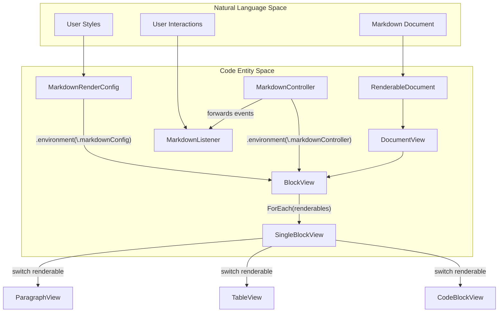
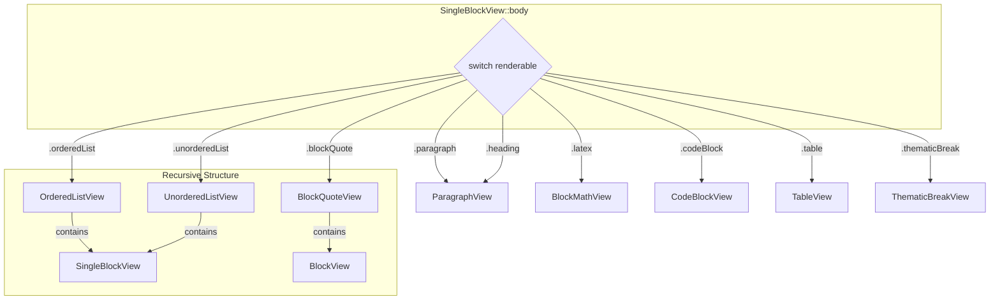

<!-- source: DeepWiki mcp.deepwiki.com · repo microsoft/SwiftStreamingMarkdown · page 3.1 Document and Block Views · fetched 2026-10-26 -->

# Document and Block Views

Relevant source files

The following files were used as context for generating this wiki page:

- [Examples/SwiftStreamingMarkdownSample/SwiftStreamingMarkdownSample/Resources/Fixtures/kitchen-sink.md](Examples/SwiftStreamingMarkdownSample/SwiftStreamingMarkdownSample/Resources/Fixtures/kitchen-sink.md)
- [Package.resolved](Package.resolved)
- [Package.swift](Package.swift)
- [Sources/MarkdownText/Models/MarkdownRenderConfig+Builders.swift](Sources/MarkdownText/Models/MarkdownRenderConfig+Builders.swift)
- [Sources/MarkdownText/UI/BlockMathView.swift](Sources/MarkdownText/UI/BlockMathView.swift)
- [Sources/MarkdownText/UI/BlockQuoteView.swift](Sources/MarkdownText/UI/BlockQuoteView.swift)
- [Sources/MarkdownText/UI/BlockView.swift](Sources/MarkdownText/UI/BlockView.swift)
- [Sources/MarkdownText/UI/CodeBlockView+CSS.swift](Sources/MarkdownText/UI/CodeBlockView+CSS.swift)
- [Sources/MarkdownText/UI/CodeBlockView.swift](Sources/MarkdownText/UI/CodeBlockView.swift)
- [Sources/MarkdownText/UI/DocumentView.swift](Sources/MarkdownText/UI/DocumentView.swift)
- [Sources/MarkdownText/UI/EdgeBorder.swift](Sources/MarkdownText/UI/EdgeBorder.swift)
- [Sources/MarkdownText/UI/OrderedListView.swift](Sources/MarkdownText/UI/OrderedListView.swift)
- [Sources/MarkdownText/UI/TableView.swift](Sources/MarkdownText/UI/TableView.swift)
- [Sources/MarkdownText/UI/ThematicBreakView.swift](Sources/MarkdownText/UI/ThematicBreakView.swift)
- [Sources/MarkdownText/UI/UnorderedListView.swift](Sources/MarkdownText/UI/UnorderedListView.swift)
- [Sources/MarkdownText/Utilities/MarkdownListener.swift](Sources/MarkdownText/Utilities/MarkdownListener.swift)
- [Tests/MarkdownTextTests/MarkdownTextSnapshotTests.swift](Tests/MarkdownTextTests/MarkdownTextSnapshotTests.swift)
- [Tests/MarkdownTextTests/TableViewTests.swift](Tests/MarkdownTextTests/TableViewTests.swift)
- [Tests/MarkdownTextTests/UnorderedListViewTests.swift](Tests/MarkdownTextTests/UnorderedListViewTests.swift)

The UI layer of `SwiftStreamingMarkdown` is built using a recursive SwiftUI composition pattern. At the root, `DocumentView` receives a `RenderableDocument` and initiates the rendering process. The rendering logic then descends into `BlockView` and `SingleBlockView`, which act as a central dispatch hub for specific block-level components.

## View Hierarchy and Injection

The rendering pipeline relies on the SwiftUI environment to propagate configuration and event handling capabilities. `DocumentView` injects two primary objects into the environment: `MarkdownRenderConfig` and `MarkdownController`.

### Data Flow and Environment Injection

| Entity | Role | File Reference |
| :--- | :--- | :--- |
| `DocumentView` | The public entry point for pre-parsed documents. It manages the `MarkdownController` lifecycle. | [Sources/MarkdownText/UI/DocumentView.swift:15-34]() |
| `MarkdownRenderConfig` | A configuration object containing styles for headings, tables, lists, and code blocks. | [Sources/MarkdownText/UI/DocumentView.swift:54-54]() |
| `MarkdownController` | An `ObservableObject` that bridges UI interactions (like table copies) back to a `MarkdownListener`. | [Sources/MarkdownText/Utilities/MarkdownListener.swift:16-46]() |
| `BlockView` | A container that iterates over an array of `MarkdownRenderable` items and renders them in a `VStack`. | [Sources/MarkdownText/UI/BlockView.swift:9-24]() |
| `SingleBlockView` | A switch-based dispatcher that maps `MarkdownRenderable` enum cases to specific SwiftUI views. | [Sources/MarkdownText/UI/BlockView.swift:26-78]() |

### System Entity Mapping

The following diagram illustrates how the high-level Markdown concepts map to the internal view hierarchy and environment state.

**View Dispatch and Environment Mapping**

**Sources:** [Sources/MarkdownText/UI/DocumentView.swift:36-50](), [Sources/MarkdownText/UI/BlockView.swift:36-76](), [Sources/MarkdownText/Utilities/MarkdownListener.swift:56-78]()

---

## Block-Level Components

Each block type defined in the `MarkdownRenderable` enum has a corresponding specialized view.

### Paragraph and Headings
Paragraphs and headings are both rendered using `ParagraphView`. In the case of headings, `SingleBlockView` applies `.accessibilityAddTraits(.isHeader)` to the container [Sources/MarkdownText/UI/BlockView.swift:39-45](). `ParagraphView` is a `UIViewRepresentable` that handles complex text layouts, including inline citations and animations.

### Lists (Ordered and Unordered)
Lists are handled by `OrderedListView` and `UnorderedListView`. Both views utilize a `ListItemContentWrapper` to ensure proper baseline alignment between the bullet/number and the text content [Sources/MarkdownText/UI/OrderedListView.swift:45-59]().

*   **OrderedListView**: Automatically generates numbers based on the item index [Sources/MarkdownText/UI/OrderedListView.swift:16-21]().
*   **UnorderedListView**: Alternates between filled and hollow circles based on the `nestedLevel` [Sources/MarkdownText/UI/UnorderedListView.swift:41-57]().

### Tables
`TableView` provides a horizontally scrollable grid for Markdown tables.
*   **Layout**: Uses a custom `TableLayout` to calculate column widths [Sources/MarkdownText/UI/TableView.swift:72-82]().
*   **Interactions**: When tapped, the table can expand to show "Copy" and "Download" actions, which are forwarded via the `MarkdownController` [Sources/MarkdownText/UI/TableView.swift:132-154]().
*   **Content**: Cells can contain either plain `AttributedString` or `NSAttributedString` (if they contain attachments like citations) [Sources/MarkdownText/UI/TableView.swift:9-12]().

### Code Blocks
`CodeBlockView` renders fenced code blocks with syntax highlighting.
*   **Highlighting**: Uses the `HighlightSwift` package. To prevent `JSContext` OOM crashes, highlighting tasks are serialized through a `HighlightTaskManager` actor [Sources/MarkdownText/UI/CodeBlockView.swift:10-48]().
*   **UI**: Includes a header with the language name and a copy button that interacts with `UIPasteboard` [Sources/MarkdownText/UI/CodeBlockView.swift:97-131]().

### Mathematical Expressions
`BlockMathView` renders LaTeX using the `iosMath` library. It is wrapped in a horizontal `ScrollView` within `SingleBlockView` to handle long equations [Sources/MarkdownText/UI/BlockView.swift:53-59]().

### Other Blocks
*   **BlockQuoteView**: Renders quoted content with a leading vertical bar [Sources/MarkdownText/UI/BlockView.swift:73-74]().
*   **ThematicBreakView**: Renders a horizontal separator [Sources/MarkdownText/UI/ThematicBreakView.swift:10-20]().

---

## Component Dispatch Logic

The `SingleBlockView` acts as the primary router. It determines which SwiftUI component to instantiate based on the `MarkdownRenderable` type.

**Block View Dispatch Logic**

**Sources:** [Sources/MarkdownText/UI/BlockView.swift:38-75](), [Sources/MarkdownText/UI/OrderedListView.swift:26-30](), [Sources/MarkdownText/UI/UnorderedListView.swift:23-27]()

### Implementation Detail: Baseline Alignment
One technical challenge in list rendering is aligning the bullet or number with the first line of a `UIViewRepresentable` (the `ParagraphView`). The library solves this using a custom `VerticalAlignment.centerOfFirstLine` and an `extractFirstFont()` helper to calculate the exact offset based on the font used in the first character of the paragraph [Sources/MarkdownText/UI/OrderedListView.swift:56-74]().

**Sources:**
- [Sources/MarkdownText/UI/DocumentView.swift:15-58]()
- [Sources/MarkdownText/UI/BlockView.swift:9-78]()
- [Sources/MarkdownText/UI/TableView.swift:9-154]()
- [Sources/MarkdownText/UI/OrderedListView.swift:9-102]()
- [Sources/MarkdownText/UI/UnorderedListView.swift:9-69]()
- [Sources/MarkdownText/UI/CodeBlockView.swift:10-162]()
- [Sources/MarkdownText/Utilities/MarkdownListener.swift:16-86]()

---

