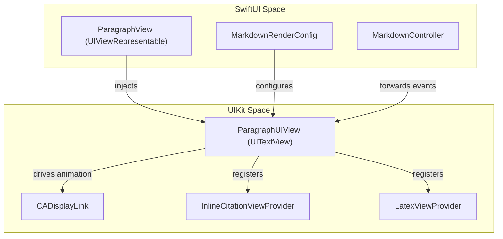
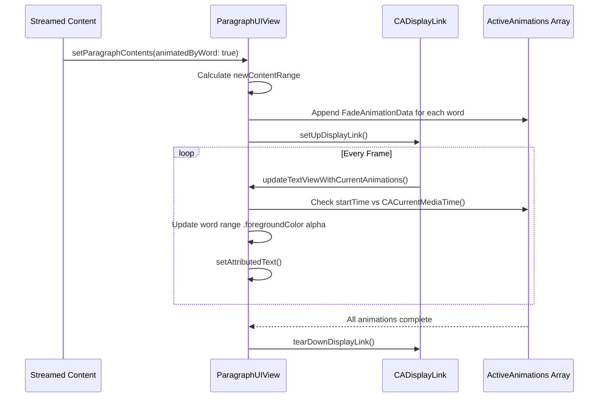

<!-- source: DeepWiki mcp.deepwiki.com · repo microsoft/SwiftStreamingMarkdown · page 3.2 Paragraph Rendering and Text Animations · fetched 2026-10-26 -->

# Paragraph Rendering and Text Animations

Relevant source files

The following files were used as context for generating this wiki page:

- [Sources/MarkdownText/ContextMenu/TextContextMenu.swift](Sources/MarkdownText/ContextMenu/TextContextMenu.swift)
- [Sources/MarkdownText/ContextMenu/TextContextMenuGroup.swift](Sources/MarkdownText/ContextMenu/TextContextMenuGroup.swift)
- [Sources/MarkdownText/ContextMenu/TextContextMenuItem.swift](Sources/MarkdownText/ContextMenu/TextContextMenuItem.swift)
- [Sources/MarkdownText/TextTransition/FadeInTextTransition.swift](Sources/MarkdownText/TextTransition/FadeInTextTransition.swift)
- [Sources/MarkdownText/TextTransition/FadeInTextTransitionViewModifier.swift](Sources/MarkdownText/TextTransition/FadeInTextTransitionViewModifier.swift)
- [Sources/MarkdownText/UI/ParagraphView.swift](Sources/MarkdownText/UI/ParagraphView.swift)
- [Sources/MarkdownText/UI/UIKit/ParagraphUIView.swift](Sources/MarkdownText/UI/UIKit/ParagraphUIView.swift)
- [Sources/MarkdownText/UI/UIKit/ParagraphUIViewCache.swift](Sources/MarkdownText/UI/UIKit/ParagraphUIViewCache.swift)
- [Tests/MarkdownTextTests/ParagraphViewTests.swift](Tests/MarkdownTextTests/ParagraphViewTests.swift)

The `ParagraphView` and its underlying `ParagraphUIView` form the primary rendering engine for text-heavy content in SwiftStreamingMarkdown. This subsystem is designed to handle the complexities of streaming text delivery, including word-by-word fade animations, performance-optimized size caching for `LazyVStack`, and integration with modern iOS 18 text transition APIs.

## ParagraphView Architecture

`ParagraphView` is a `UIViewRepresentable` [Sources/MarkdownText/UI/ParagraphView.swift:8]() that bridges SwiftUI to a specialized `UITextView` subclass. It manages the lifecycle of the text view, including its participation in the `ParagraphUIViewCache` [Sources/MarkdownText/UI/UIKit/ParagraphUIViewCache.swift:8-14]().

### Data Flow and Update Logic
The view receives `contents` as an `NSMutableAttributedString` and an optional `lineSpacing`. When the SwiftUI state updates, `updateUIView` determines if an animation should trigger based on whether the view is currently visible in a window and if `shouldAnimateText` is enabled in the `MarkdownRenderConfig` [Sources/MarkdownText/UI/ParagraphView.swift:38-45]().

### Size Caching for Performance
To prevent redundant layout passes—especially critical when embedded in a `LazyVStack`—`ParagraphView` implements a sophisticated caching mechanism in its `Coordinator` [Sources/MarkdownText/UI/ParagraphView.swift:78-83]().

1.  **Cache Key**: The width is rounded to one decimal place to avoid floating-point precision misses [Sources/MarkdownText/UI/ParagraphView.swift:60-61]().
2.  **Invalidation**: The cache is cleared whenever `contents` or `lineSpacing` change [Sources/MarkdownText/UI/ParagraphView.swift:53-58]().
3.  **Calculation**: It uses `uiView.sizeThatFits` and rounds the height up to ensure pixel-perfect alignment [Sources/MarkdownText/UI/ParagraphView.swift:68-75]().

**Sources:**
- `Sources/MarkdownText/UI/ParagraphView.swift`
- `Sources/MarkdownText/UI/UIKit/ParagraphUIViewCache.swift`

## ParagraphUIView: The Core Text Engine

`ParagraphUIView` is a `UITextView` subclass [Sources/MarkdownText/UI/UIKit/ParagraphUIView.swift:28]() configured for high-performance Markdown rendering.

### Implementation Details
- **Non-Editable/Selectable**: It is configured as `isEditable = false` but `isSelectable = true` to allow user interaction with links and context menus [Sources/MarkdownText/UI/UIKit/ParagraphUIView.swift:187-188]().
- **Attachment Providers**: It registers `LatexViewProvider` and `InlineCitationViewProvider` to handle math and citation pills embedded in the text [Sources/MarkdownText/UI/UIKit/ParagraphUIView.swift:179-185]().
- **Memory Safety**: It clears selections and tears down its `CADisplayLink` when moving out of a window to prevent crashes or memory leaks during scrolling [Sources/MarkdownText/UI/UIKit/ParagraphUIView.swift:56-67]().

### Component Relationship Diagram
This diagram illustrates how `ParagraphUIView` coordinates between the SwiftUI environment and UIKit rendering components.

**Sources:**
- `Sources/MarkdownText/UI/UIKit/ParagraphUIView.swift`
- `Sources/MarkdownText/UI/ParagraphView.swift`

## Word-by-Word Animation System

When streaming new content, `ParagraphUIView` can animate text word-by-word to simulate a "typing" or "thinking" effect.

### Implementation with CADisplayLink
The system calculates the delta between the old and new string lengths. If `animatedByWord` is true, it performs the following steps:

1.  **Word Splitting**: Uses `splitIntoWords` to identify NSRanges for each new word [Sources/MarkdownText/UI/UIKit/ParagraphUIView.swift:145-146]().
2.  **Timing Calculation**: Distributes a delay between words (0.1s total spread) and assigns a fixed `animationDuration` (0.5s) per word [Sources/MarkdownText/UI/UIKit/ParagraphUIView.swift:30, 148-157]().
3.  **Display Link**: A `CADisplayLink` calls `updateTextViewWithCurrentAnimations` on every frame [Sources/MarkdownText/UI/UIKit/ParagraphUIView.swift:159-163]().
4.  **Attribute Manipulation**: On each tick, the view updates the `foregroundColor` of the `attributedText`, calculating an alpha value based on the elapsed time relative to each word's `startTime` [Sources/MarkdownText/UI/UIKit/ParagraphUIView.swift:16-21]().

### Animation Logic Diagram

**Sources:**
- `Sources/MarkdownText/UI/UIKit/ParagraphUIView.swift`

## iOS 18 FadeInTextTransition

For devices running iOS 18+, the library provides a native `TextRenderer` implementation for high-quality text transitions.

### TextRenderer and Transition
The library defines `VariableDurationFadeInTextRenderer` and `FixedDurationFadeInTextRenderer` [Sources/MarkdownText/TextTransition/FadeInTextTransition.swift:75, 105](). These implement the `TextRenderer` protocol to manipulate the drawing context of individual glyph slices.

- **Glyph Slicing**: The renderer iterates through `layout.flattenedRunSlices` [Sources/MarkdownText/TextTransition/FadeInTextTransition.swift:96, 137]().
- **Opacity Curve**: It applies a `UnitCurve.easeOut` to the `GraphicsContext.opacity` based on the `elapsedTime` [Sources/MarkdownText/TextTransition/FadeInTextTransition.swift:98, 114]().
- **View Modifier**: The `fadeInTextTransition` modifier wraps these transitions, falling back to a standard `.opacity` transition on older iOS versions [Sources/MarkdownText/TextTransition/FadeInTextTransitionViewModifier.swift:9-30]().

**Sources:**
- `Sources/MarkdownText/TextTransition/FadeInTextTransition.swift`
- `Sources/MarkdownText/TextTransition/FadeInTextTransitionViewModifier.swift`

## Context Menus and Interaction

`ParagraphUIView` integrates with the iOS edit menu to provide custom actions.

- **Menu Building**: It uses `TextContextMenu` to merge system actions (like Copy) with custom `menuGroups` [Sources/MarkdownText/ContextMenu/TextContextMenu.swift:27-60]().
- **Event Forwarding**: When a custom item is tapped, the `MarkdownController` forwards the event to the `MarkdownListener` with the `id` of the item and the currently `selectedContent` [Sources/MarkdownText/ContextMenu/TextContextMenu.swift:40]().
- **Interaction Configuration**: The view sets `isSelectable = true` and `isEditable = false` to ensure the system menu behaves correctly for static Markdown content [Sources/MarkdownText/UI/UIKit/ParagraphUIView.swift:187-188]().

**Sources:**
- `Sources/MarkdownText/ContextMenu/TextContextMenu.swift`
- `Sources/MarkdownText/UI/UIKit/ParagraphUIView.swift`

---

