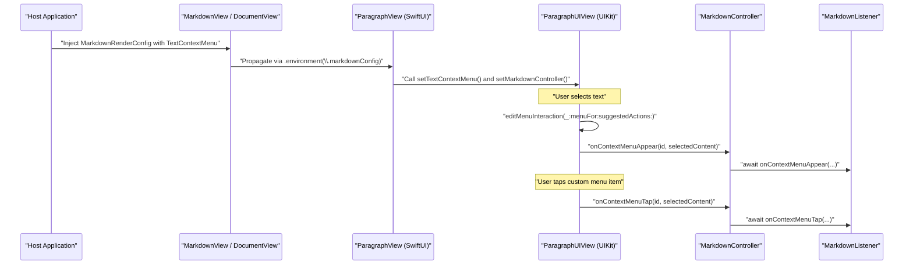
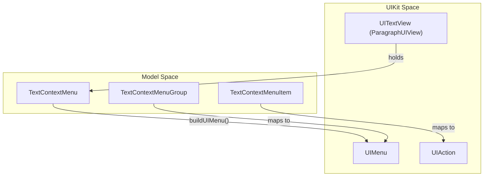

<!-- source: DeepWiki mcp.deepwiki.com · repo microsoft/SwiftStreamingMarkdown · page 3.3 Context Menus and Text Interaction · fetched 2026-10-26 -->

# Context Menus and Text Interaction

Relevant source files

The following files were used as context for generating this wiki page:

- [Sources/MarkdownText/ContextMenu/TextContextMenu.swift](Sources/MarkdownText/ContextMenu/TextContextMenu.swift)
- [Sources/MarkdownText/ContextMenu/TextContextMenuGroup.swift](Sources/MarkdownText/ContextMenu/TextContextMenuGroup.swift)
- [Sources/MarkdownText/ContextMenu/TextContextMenuItem.swift](Sources/MarkdownText/ContextMenu/TextContextMenuItem.swift)
- [Sources/MarkdownText/Models/MarkdownRenderConfig+Builders.swift](Sources/MarkdownText/Models/MarkdownRenderConfig+Builders.swift)
- [Sources/MarkdownText/Models/MarkdownRenderConfig.swift](Sources/MarkdownText/Models/MarkdownRenderConfig.swift)
- [Sources/MarkdownText/UI/DocumentView.swift](Sources/MarkdownText/UI/DocumentView.swift)
- [Sources/MarkdownText/UI/ParagraphView.swift](Sources/MarkdownText/UI/ParagraphView.swift)
- [Sources/MarkdownText/UI/UIKit/ParagraphUIView.swift](Sources/MarkdownText/UI/UIKit/ParagraphUIView.swift)
- [Sources/MarkdownText/Utilities/MarkdownListener.swift](Sources/MarkdownText/Utilities/MarkdownListener.swift)

This section describes the implementation of custom text interaction in `SwiftStreamingMarkdown`, specifically focusing on how context menus are defined, injected into the `UITextView` layer, and how selection events are bubbled back to the host application.

## Overview

The library allows developers to augment or replace the standard iOS text selection "Edit Menu" with custom actions. This is achieved through a structured configuration model (`TextContextMenu`) that is passed down the SwiftUI environment and eventually consumed by `ParagraphUIView`, a specialized `UITextView` subclass.

### Interaction Flow

The following diagram illustrates the data flow from the initial configuration in SwiftUI to the event callback in the `MarkdownListener`.

**Selection Interaction Sequence**

**Sources:** [Sources/MarkdownText/UI/DocumentView.swift:36-49](), [Sources/MarkdownText/UI/UIKit/ParagraphUIView.swift:38-39](), [Sources/MarkdownText/ContextMenu/TextContextMenu.swift:27-41]()

---

## Data Models

The context menu is defined using three primary structures, providing a hierarchical representation of the desired UI.

### TextContextMenu
The root container for the custom menu. It holds an array of `TextContextMenuGroup` objects [Sources/MarkdownText/ContextMenu/TextContextMenu.swift:9-11](). Its primary responsibility is building the `UIMenu` by merging custom groups with the standard system edit actions [Sources/MarkdownText/ContextMenu/TextContextMenu.swift:27-62]().

### TextContextMenuGroup
A grouping of related items that can be rendered either as a submenu or an inline section within the menu [Sources/MarkdownText/ContextMenu/TextContextMenuGroup.swift:10-18]().
- `displayInline`: If `true`, the items appear in the parent menu separated by dividers. If `false`, they are nested in a submenu [Sources/MarkdownText/ContextMenu/TextContextMenuGroup.swift:15-16]().

### TextContextMenuItem
Represents a single tappable action. It includes a stable `id` which is passed back to the listener when the item is tapped [Sources/MarkdownText/ContextMenu/TextContextMenuItem.swift:9-18]().

| Property | Type | Description |
| :--- | :--- | :--- |
| `id` | `String` | Stable identifier for the action. |
| `title` | `String` | The primary text displayed for the menu item. |
| `subtitle` | `String?` | Optional secondary text displayed below the title. |
| `image` | `UIImage?` | Optional icon displayed next to the title. |

**Sources:** [Sources/MarkdownText/ContextMenu/TextContextMenu.swift:9-16](), [Sources/MarkdownText/ContextMenu/TextContextMenuGroup.swift:10-31](), [Sources/MarkdownText/ContextMenu/TextContextMenuItem.swift:9-31]()

---

## Menu Injection and ParagraphUIView

The actual rendering of the context menu occurs within `ParagraphUIView`, which overrides the standard UIKit menu behavior.

### Configuration Injection
`ParagraphView` (the `UIViewRepresentable` wrapper) extracts the `TextContextMenu` from the `MarkdownRenderConfig` and the `MarkdownController` from the environment [Sources/MarkdownText/UI/ParagraphView.swift:10-11](). It then passes these to the `ParagraphUIView` instance [Sources/MarkdownText/UI/ParagraphView.swift:25-26]().

### Building the UIMenu
`ParagraphUIView` uses the `UIEditMenuInteraction` (or the older `canPerformAction` / `targetRect` system depending on iOS version) to present the menu. When the menu is requested, `TextContextMenu.buildUIMenu` is called [Sources/MarkdownText/ContextMenu/TextContextMenu.swift:27-31]().

The implementation filters the `suggestedActions` to retain only standard edit commands (like Copy) before appending the custom groups [Sources/MarkdownText/ContextMenu/TextContextMenu.swift:54-61]().

**Entity Mapping: UIKit to Context Menu Models**

**Sources:** [Sources/MarkdownText/UI/ParagraphView.swift:20-35](), [Sources/MarkdownText/ContextMenu/TextContextMenu.swift:27-61](), [Sources/MarkdownText/UI/UIKit/ParagraphUIView.swift:38-39]()

---

## Event Forwarding

Interaction events are decoupled from the UI layer via the `MarkdownListener` protocol.

### MarkdownController
The `MarkdownController` acts as the intermediary. It is injected into the SwiftUI environment by `DocumentView` [Sources/MarkdownText/UI/DocumentView.swift:39]().

### Event Flow
1. **Appearance**: When the context menu is about to appear, `ParagraphUIView` triggers `onContextMenuAppear` via the controller [Sources/MarkdownText/Utilities/MarkdownListener.swift:68-72]().
2. **Taps**: When a `UIAction` created from a `TextContextMenuItem` is executed, the closure calls `markdownController.onContextMenuTap(id:item.id, selectedContent:selectedText)` [Sources/MarkdownText/ContextMenu/TextContextMenu.swift:39-41]().
3. **Listener Notification**: The controller wraps these calls in a `Task` and forwards them to the provided `MarkdownListener` [Sources/MarkdownText/Utilities/MarkdownListener.swift:74-78]().

### MarkdownListener Protocol
The host application implements this protocol to handle the interactions:
- `onContextMenuAppear(id:selectedContent:)`: Triggered when the menu opens for a specific selection [Sources/MarkdownText/Utilities/MarkdownListener.swift:12]().
- `onContextMenuTap(id:selectedContent:)`: Triggered when the user selects a custom action [Sources/MarkdownText/Utilities/MarkdownListener.swift:13]().

**Sources:** [Sources/MarkdownText/Utilities/MarkdownListener.swift:8-14](), [Sources/MarkdownText/Utilities/MarkdownListener.swift:68-78](), [Sources/MarkdownText/ContextMenu/TextContextMenu.swift:39-41](), [Sources/MarkdownText/UI/DocumentView.swift:52-58]()

---

