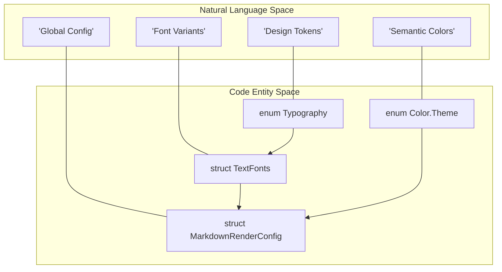
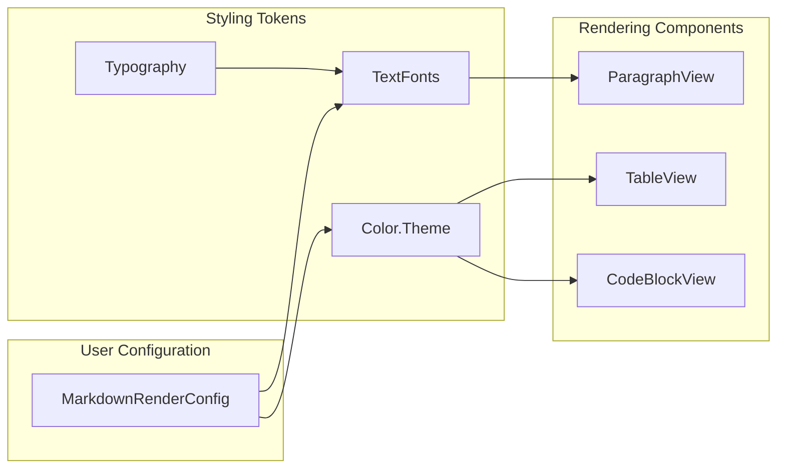

<!-- source: DeepWiki mcp.deepwiki.com · repo microsoft/SwiftStreamingMarkdown · page 4 Configuration and Styling · fetched 2026-10-26 -->

# Configuration and Styling

Relevant source files

The following files were used as context for generating this wiki page:

- [Sources/MarkdownText/Models/MarkdownRenderConfig.swift](Sources/MarkdownText/Models/MarkdownRenderConfig.swift)
- [Sources/MarkdownText/Models/RenderableDocument.swift](Sources/MarkdownText/Models/RenderableDocument.swift)
- [Sources/MarkdownText/Style/Colors+Static.swift](Sources/MarkdownText/Style/Colors+Static.swift)
- [Sources/MarkdownText/Style/Colors+Theme.swift](Sources/MarkdownText/Style/Colors+Theme.swift)
- [Sources/MarkdownText/Style/TextFonts.swift](Sources/MarkdownText/Style/TextFonts.swift)
- [Sources/MarkdownText/Style/Typography.swift](Sources/MarkdownText/Style/Typography.swift)

The `SwiftStreamingMarkdown` library uses a centralized configuration and design token system to ensure consistent styling across all Markdown components. This system decouples the structural parsing of Markdown from its visual representation, allowing developers to customize fonts, colors, and animations through a single interface.

### The Styling Architecture

The architecture is built around three primary pillars:
1.  **MarkdownRenderConfig**: The root configuration object that defines the look and feel of the document.
2.  **Typography & Design Tokens**: A system of semantic font bundles (`TextFonts`) and size tokens (`Typography`) that support Dynamic Type and font variants.
3.  **Color Themes**: A hierarchical semantic color system that separates functional roles (e.g., `Theme.Foreground.Primary`) from raw values.

#### Design System to Code Mapping

The following diagram illustrates how abstract design concepts map to specific code entities within the library.

**Sources:** [Sources/MarkdownText/Style/Typography.swift:10-43](), [Sources/MarkdownText/Style/TextFonts.swift:12-36](), [Sources/MarkdownText/Style/Colors+Theme.swift:10-77](), [Sources/MarkdownText/Models/MarkdownRenderConfig.swift:16-36]()

---

### MarkdownRenderConfig

`MarkdownRenderConfig` is the central source of truth for the rendering pipeline. It is passed into the `RenderableDocument` during the conversion phase [Sources/MarkdownText/Models/RenderableDocument.swift:32-34]() and subsequently injected into the SwiftUI environment for use by individual view components.

It organizes styling into functional sub-structs:
*   **MarkdownTextStyle**: Basic font and color pairing used for paragraphs, block quotes, and lists [Sources/MarkdownText/Models/MarkdownRenderConfig.swift:38-49]().
*   **MarkdownHeadingTextStyle**: Specific `TextFonts` for every heading level (H1-H6) [Sources/MarkdownText/Models/MarkdownRenderConfig.swift:79-105]().
*   **MarkdownTableTextStyle**: Detailed configuration for headers, borders, and table action buttons [Sources/MarkdownText/Models/MarkdownRenderConfig.swift:53-76]().
*   **MarkdownInlineTextStyle**: Styling for bold text, links, and inline code spans [Sources/MarkdownText/Models/MarkdownRenderConfig.swift:108-134]().
*   **CitationConfig**: Controls the appearance and parsing logic for inline citations [Sources/MarkdownText/Models/MarkdownRenderConfig.swift:137-168]().

For a complete reference of all properties and the builder API, see **[MarkdownRenderConfig](#4.1)**.

---

### Typography and TextFonts

The library avoids using raw `UIFont` or `Font` objects directly in the configuration. Instead, it uses `TextFonts`, a bundle that encapsulates the four standard variants (normal, bold, italic, and bold-italic) [Sources/MarkdownText/Style/TextFonts.swift:12-25]().

The `Typography` enum acts as a design token generator, providing pre-configured `TextFonts` instances (e.g., `.baseTextFonts`, `.largeTextFonts`) that automatically handle:
*   **Dynamic Type Scaling**: Sizes are scaled using `UIFontMetrics` [Sources/MarkdownText/Style/Typography.swift:81-93]().
*   **Line Height & Kerning**: Preferred spacing is baked into the tokens to ensure readability [Sources/MarkdownText/Style/Typography.swift:132-141]().
*   **Variant Resolution**: Logic to find the correct bold-italic variant when multiple traits are applied [Sources/MarkdownText/Style/TextFonts.swift:40-53]().

For details on customizing fonts and dynamic scaling, see **[Typography and Color System](#4.2)**.

---

### Color Theme Architecture

Colors are managed through semantic extensions on `Color`, divided into `Theme` and `Static` categories.

| Category | Description | Examples |
| :--- | :--- | :--- |
| **Theme** | Semantic roles that adapt to context. | `Theme.Foreground.Primary`, `Theme.Component.CodeBlock.Background` |
| **Static** | Fixed palette values that do not change based on role. | `Static.Stone.Stone350` |

The `Theme` system is highly granular, providing specific colors for components like buttons, tables, and code blocks [Sources/MarkdownText/Style/Colors+Theme.swift:24-48](). These are typically backed by assets in the library's bundle [Sources/MarkdownText/Style/Colors+Theme.swift:13-13]().

#### Configuration Data Flow

The diagram below shows how configuration objects flow from the public API down to the internal styling tokens.

**Sources:** [Sources/MarkdownText/Models/MarkdownRenderConfig.swift:16-36](), [Sources/MarkdownText/Style/Typography.swift:99-175](), [Sources/MarkdownText/Models/RenderableDocument.swift:39-49]()

For details on the full color palette and how to override it, see **[Typography and Color System](#4.2)**.

---

