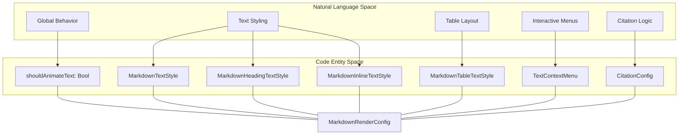
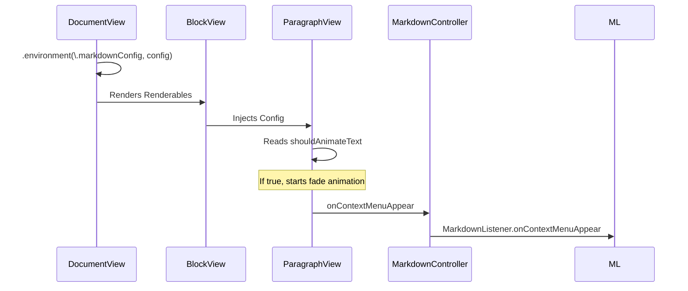

<!-- source: DeepWiki mcp.deepwiki.com · repo microsoft/SwiftStreamingMarkdown · page 4.1 MarkdownRenderConfig · fetched 2026-10-26 -->

# MarkdownRenderConfig

Relevant source files

The following files were used as context for generating this wiki page:

- [Sources/MarkdownText/Models/MarkdownRenderConfig+Builders.swift](Sources/MarkdownText/Models/MarkdownRenderConfig+Builders.swift)
- [Sources/MarkdownText/Models/MarkdownRenderConfig.swift](Sources/MarkdownText/Models/MarkdownRenderConfig.swift)
- [Sources/MarkdownText/UI/DocumentView.swift](Sources/MarkdownText/UI/DocumentView.swift)
- [Sources/MarkdownText/Utilities/MarkdownListener.swift](Sources/MarkdownText/Utilities/MarkdownListener.swift)

`MarkdownRenderConfig` is the central configuration object for the `SwiftStreamingMarkdown` library. It encapsulates all visual styling, behavioral flags, and interaction providers used during the conversion and rendering phases. It is designed to be immutable and `Sendable`, utilizing a builder pattern for incremental customization.

### Sources:
- [Sources/MarkdownText/Models/MarkdownRenderConfig.swift:10-16]()

---

## Configuration Architecture

The configuration is injected into the SwiftUI view hierarchy via the `EnvironmentValues.markdownConfig` key. `DocumentView` serves as the entry point for this injection, ensuring all descendant block views (e.g., `ParagraphView`, `TableView`) have access to the same styling tokens.

### Data Flow and Entity Mapping

The following diagram maps the high-level configuration concepts to the specific code entities that implement them.

**Diagram: Configuration Entity Mapping**

### Sources:
- [Sources/MarkdownText/Models/MarkdownRenderConfig.swift:16-35]()
- [Sources/MarkdownText/UI/DocumentView.swift:38-38]()
- [Sources/MarkdownText/UI/DocumentView.swift:53-54]()

---

## Sub-structs and Styling Details

`MarkdownRenderConfig` delegates specific styling concerns to specialized sub-structs. These structs typically combine `TextFonts` (design tokens for typography) with `UIColor` values.

### MarkdownTextStyle
Used for standard blocks like paragraphs, block quotes, and list items. It defines a uniform font set and foreground color.
- **Properties**: `textFonts`, `textColor`.
- [Sources/MarkdownText/Models/MarkdownRenderConfig.swift:38-49]()

### MarkdownHeadingTextStyle
Provides per-level font configurations for Markdown headings (H1 through H6) while sharing a single foreground color across all levels.
- **Properties**: `h1Font` through `h6Font`, `textColor`.
- [Sources/MarkdownText/Models/MarkdownRenderConfig.swift:79-105]()

### MarkdownTableTextStyle
Controls the complex styling required for tables, including header/body differentiation and UI chrome.
- **Properties**: `headerBackgroundColor`, `borderColor`, `actionButtonColor` (for the "View Full Table" button).
- [Sources/MarkdownText/Models/MarkdownRenderConfig.swift:53-76]()

### MarkdownInlineTextStyle
Handles styles that are applied within a text run, often overriding the base block style.
- **Properties**: `boldTextColor`, `linkTextColor`, `codeBackgroundColor`, `codeUnderlineColor`.
- [Sources/MarkdownText/Models/MarkdownRenderConfig.swift:108-134]()

### CitationConfig
Determines how inline citations are handled. It includes a `CitationCoder` for parsing/encoding and styling for the resulting "pill" or "chip" UI.
- **Properties**: `isEnabled`, `coder`, `font`, `textColor`, `backgroundColor`.
- [Sources/MarkdownText/Models/MarkdownRenderConfig.swift:137-168]()

---

## Text Animation and Interaction

### shouldAnimateText
A boolean flag that controls the "streaming" visual effect. When set to `true`, `ParagraphView` uses a `CADisplayLink` or the iOS 18 `FadeInTextTransition` to animate newly appended characters as they arrive from a stream.
- [Sources/MarkdownText/Models/MarkdownRenderConfig.swift:18-18]()

### textContextMenu
An optional `TextContextMenu` provider. If provided, the library replaces the standard system edit menu in `UITextView` with custom actions. Interactions with these actions are forwarded to the `MarkdownListener` via `MarkdownController`.
- [Sources/MarkdownText/Models/MarkdownRenderConfig.swift:31-33]()
- [Sources/MarkdownText/Utilities/MarkdownListener.swift:68-78]()

**Diagram: Configuration to View Interaction**

### Sources:
- [Sources/MarkdownText/UI/DocumentView.swift:37-45]()
- [Sources/MarkdownText/Models/MarkdownRenderConfig.swift:18-33]()
- [Sources/MarkdownText/Utilities/MarkdownListener.swift:16-24]()

---

## Builder API

`MarkdownRenderConfig` uses a "with" builder pattern to allow for easy modification of the default configuration without needing to initialize the entire struct manually.

| Function | Returns | Purpose |
| :--- | :--- | :--- |
| `withShouldAnimateText(value:)` | `MarkdownRenderConfig` | Toggles text fade-in animation. |
| `withBlockQuoteStyle(value:)` | `MarkdownRenderConfig` | Updates block quote styling. |
| `withHeadingStyle(value:)` | `MarkdownRenderConfig` | Updates H1-H6 typography. |
| `withParagraphStyle(value:)` | `MarkdownRenderConfig` | Updates standard text styling. |
| `withTableStyle(value:)` | `MarkdownRenderConfig` | Updates table borders and colors. |
| `withInlineStyle(value:)` | `MarkdownRenderConfig` | Updates link and code span styles. |
| `withTextContextMenu(value:)` | `MarkdownRenderConfig` | Injects or removes custom menus. |

### Sources:
- [Sources/MarkdownText/Models/MarkdownRenderConfig+Builders.swift:8-121]()

---

