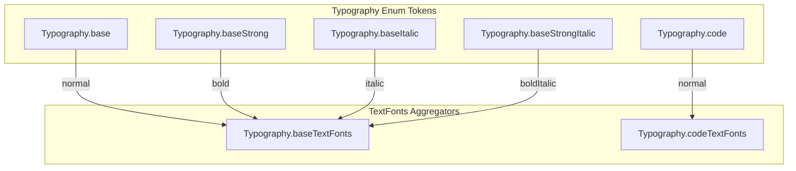
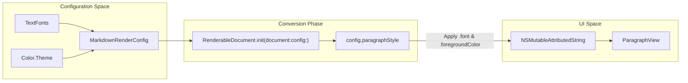

<!-- source: DeepWiki mcp.deepwiki.com · repo microsoft/SwiftStreamingMarkdown · page 4.2 Typography and Color System · fetched 2026-10-26 -->

# Typography and Color System

Relevant source files

The following files were used as context for generating this wiki page:

- [Sources/MarkdownText/Models/RenderableDocument.swift](Sources/MarkdownText/Models/RenderableDocument.swift)
- [Sources/MarkdownText/Resources/Localizable.xcstrings](Sources/MarkdownText/Resources/Localizable.xcstrings)
- [Sources/MarkdownText/Style/Colors+Static.swift](Sources/MarkdownText/Style/Colors+Static.swift)
- [Sources/MarkdownText/Style/Colors+Theme.swift](Sources/MarkdownText/Style/Colors+Theme.swift)
- [Sources/MarkdownText/Style/TextFonts.swift](Sources/MarkdownText/Style/TextFonts.swift)
- [Sources/MarkdownText/Style/Typography.swift](Sources/MarkdownText/Style/Typography.swift)

The typography and color systems in SwiftStreamingMarkdown provide a robust set of design tokens and styling primitives that bridge the gap between standard Markdown elements and the visual requirements of a modern SwiftUI application. The system is built around the `TextFonts` container for font variants and the `Typography` enum for standardized sizing and weight tokens.

## Typography System

The typography system is designed to handle the complexities of Markdown rendering, where a single logical style (e.g., "Body" or "Heading 1") must resolve into multiple physical font variants (Normal, Bold, Italic, Bold-Italic) while respecting iOS Dynamic Type scaling.

### TextFonts Struct
The `TextFonts` struct is the primary data structure used by `MarkdownRenderConfig` to define a font family and its associated characteristics. It encapsulates four `UIFont` variants and optional layout overrides.

| Property | Type | Description |
| :--- | :--- | :--- |
| `normal` | `UIFont` | The base font variant. Required. |
| `italic` | `UIFont?` | Used for `*emphasis*` runs. Falls back to `normal`. |
| `bold` | `UIFont?` | Used for `**strong**` runs. Falls back to `normal`. |
| `boldItalic` | `UIFont?` | Used for `***combined***` runs. Falls back to `bold` then `italic`. |
| `preferredLetterSpacing` | `CGFloat?` | Applied via `NSAttributedString.Key.kern`. |
| `preferredLineHeight` | `CGFloat?` | Used to calculate extra line spacing in SwiftUI and `UITextView`. |

**Sources:** [Sources/MarkdownText/Style/TextFonts.swift:12-36]()

### Typography Enum
The `Typography` enum serves as the design token repository. It defines a set of semantic sizes (from `extraSmall` to `extraLarge`) and maps them to concrete `UIFont` instances with Dynamic Type support.

#### Scaling and Resolution logic
The system uses `UIFontMetrics.default.scaledValue(for:)` to ensure that all fixed point sizes defined in the tokens scale correctly when a user changes their system text size [Sources/MarkdownText/Style/Typography.swift:81-88]().

#### Mapping Tokens to Code Entities
The following diagram illustrates how the `Typography` tokens are aggregated into `TextFonts` bundles for consumption by the rendering engine.

**Typography to TextFonts Mapping**

**Sources:** [Sources/MarkdownText/Style/Typography.swift:10-43](), [Sources/MarkdownText/Style/Typography.swift:132-141](), [Sources/MarkdownText/Style/Typography.swift:165-174]()

### Font Variant Resolution
`TextFonts` provides internal logic to resolve the correct variant when applying nested styles (e.g., applying a bold trait to an already italicized font).

- **`italicize(font:)`**: If the current font is already `bold`, it attempts to return `boldItalic`; otherwise, it returns `italic` [Sources/MarkdownText/Style/TextFonts.swift:40-45]().
- **`bold(font:)`**: If the current font is already `italic`, it attempts to return `boldItalic`; otherwise, it returns `bold` [Sources/MarkdownText/Style/TextFonts.swift:47-52]().

## Color System

The color system is split into two namespaces: `Color.Theme` for semantic, theme-dependent colors and `Color.Static` for fixed values that do not change based on context.

### Semantic Colors (Color.Theme)
Semantic colors are organized by their functional role in the UI (Background, Foreground, Component, etc.). These colors are typically backed by assets in the module's asset catalog [Sources/MarkdownText/Style/Colors+Theme.swift:10-77]().

| Category | Sub-Category | Key Entities | Purpose |
| :--- | :--- | :--- | :--- |
| **Foreground** | `Primary` | `Primary450` ... `Primary800` | Standard text colors with varying contrast levels. |
| **Component** | `CodeBlock` | `Background750`, `Header` | Styling for code block containers and syntax highlighting. |
| **Component** | `Table` | `Background.Header` | Background color for table header cells. |
| **Stroke** | `Default` | `Default250`, `Default300` | Border colors for tables and block quotes. |

### Fixed Colors (Color.Static)
Static colors are used for specific elements that require a consistent appearance regardless of the active theme, such as specific stone-colored accents [Sources/MarkdownText/Style/Colors+Static.swift:11-16]().

## Implementation and Data Flow

Typography and colors are resolved during the **Conversion Phase** when a `Document` is transformed into a `RenderableDocument`.

**Styling Data Flow**

### Applying Styles to Text
Styles are applied to `NSAttributedString` runs using the values extracted from `TextFonts`. For example, when creating a `RenderableDocument` from plain text:
1. The `normal` font is retrieved from the config's paragraph style [Sources/MarkdownText/Models/RenderableDocument.swift:41]().
2. The `textColor` is retrieved [Sources/MarkdownText/Models/RenderableDocument.swift:42]().
3. `preferredLetterSpacing` is applied as `.kern` if present [Sources/MarkdownText/Models/RenderableDocument.swift:44-46]().

### SwiftUI Integration
A helper extension on `View` allows for easy application of `TextFonts` to SwiftUI components. It automatically handles:
- **Variant Selection**: Choosing between normal, bold, italic, or boldItalic based on boolean flags [Sources/MarkdownText/Style/TextFonts.swift:58-67]().
- **Kerning**: Applying `preferredLetterSpacing` [Sources/MarkdownText/Style/TextFonts.swift:74]().
- **Line Spacing**: Calculating the difference between `preferredLineHeight` and the font's natural line height to apply as `.lineSpacing` [Sources/MarkdownText/Style/TextFonts.swift:69-71]().

**Sources:**
- [Sources/MarkdownText/Style/TextFonts.swift:12-77]()
- [Sources/MarkdownText/Style/Typography.swift:10-175]()
- [Sources/MarkdownText/Style/Colors+Theme.swift:10-77]()
- [Sources/MarkdownText/Models/RenderableDocument.swift:32-50]()

---

