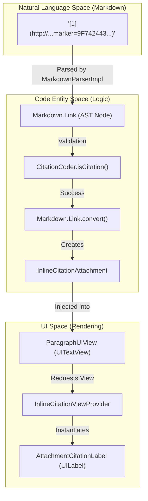

<!-- source: DeepWiki mcp.deepwiki.com · repo microsoft/SwiftStreamingMarkdown · page 5 Inline Citations · fetched 2026-10-26 -->

# Inline Citations

Relevant source files

The following files were used as context for generating this wiki page:

- [Sources/MarkdownText/Citation/CitationCoder.swift](Sources/MarkdownText/Citation/CitationCoder.swift)
- [Sources/MarkdownText/Citation/InlineCitationAttachment.swift](Sources/MarkdownText/Citation/InlineCitationAttachment.swift)
- [Sources/MarkdownText/Citation/InlineCitationViewProvider.swift](Sources/MarkdownText/Citation/InlineCitationViewProvider.swift)
- [Sources/MarkdownText/Inline/Markdown+InlineConvertible.swift](Sources/MarkdownText/Inline/Markdown+InlineConvertible.swift)
- [Sources/MarkdownText/Utilities/String+.swift](Sources/MarkdownText/Utilities/String+.swift)
- [Tests/MarkdownTextTests/MarkdownTextTests.swift](Tests/MarkdownTextTests/MarkdownTextTests.swift)
- [Tests/MarkdownTextTests/OrderedListViewTests.swift](Tests/MarkdownTextTests/OrderedListViewTests.swift)

The inline citation system allows Markdown links to be rendered as interactive, styled "pills" (attachments) rather than standard blue underlined text. This is commonly used in AI-generated content to provide source attribution that is visually distinct and accessible.

## Overview

The citation system operates by intercepting standard Markdown links that match a specific "on-the-wire" format. When a link is identified as a citation, it is converted into an `NSTextAttachment` and rendered using a specialized `UIView` inside the text container.

### System Architecture

The following diagram illustrates the lifecycle of a citation from a raw Markdown string to a rendered UI component:

**Citation Processing Pipeline**

**Sources:** [Sources/MarkdownText/Inline/Markdown+InlineConvertible.swift:72-130](), [Sources/MarkdownText/Citation/CitationCoder.swift:8-13](), [Sources/MarkdownText/Citation/InlineCitationViewProvider.swift:55-69]()

---

## The On-Wire Format

Citations are encoded as standard Markdown links to ensure backward compatibility with parsers that do not support the citation system. A link is recognized as a citation if:
1. The **Link Text** matches the `citationMarker` (e.g., a specific UUID).
2. The **URL** contains a query parameter where the key is `citationMarkerQueryParam` and the value matches the `citationMarker`.

The data required to render the citation (the display title and accessibility label) is extracted from additional URL query parameters.

| Parameter Purpose | Default Key | Description |
|:---|:---|:---|
| **Marker** | `citationMarker` | Identifies the link as a citation. |
| **Display Title** | `citationTitle` | The short text shown inside the pill (e.g., "1" or "Source"). |
| **Accessibility** | `citationA11yValue` | The descriptive text read by VoiceOver. |

For details on customizing these keys and the detection logic, see **[CitationCoder and On-Wire Format](#5.1)**.

**Sources:** [Sources/MarkdownText/Citation/CitationCoder.swift:13-40](), [Sources/MarkdownText/Citation/CitationCoder.swift:85-93]()

---

## Rendering and Interaction

When the `Markdown.Link.convert()` method detects a citation, it returns an `NSAttributedString` containing an `InlineCitationAttachment` instead of a standard link [Sources/MarkdownText/Inline/Markdown+InlineConvertible.swift:107-118]().

### Visual Appearance
Citations are rendered as rounded rectangles (pills) with configurable colors and fonts defined in `MarkdownRenderConfig.CitationConfig`.
* **Static Previews:** To maintain performance during scrolling, the system pre-renders light and dark mode images of the citation pill using `UIGraphicsImageRenderer` [Sources/MarkdownText/Citation/InlineCitationAttachment.swift:122-161]().
* **Live Views:** When a citation becomes visible, `InlineCitationViewProvider` promotes the static image to a live `UILabel` (specifically `AttachmentCitationLabel`) to support high-quality rendering and interactions [Sources/MarkdownText/Citation/InlineCitationViewProvider.swift:71-85]().

### Accessibility
Citations are treated as links in the accessibility tree. While the internal `UILabel` is hidden from linear VoiceOver navigation to prevent clutter, the parent `UITextView` exposes the citation via the "Links" rotor, using the `accessibilityLabel` provided in the URL [Sources/MarkdownText/Citation/InlineCitationViewProvider.swift:30-33]().

For details on the rendering lifecycle and accessibility implementation, see **[Citation Rendering and Accessibility](#5.2)**.

**Sources:** [Sources/MarkdownText/Citation/InlineCitationAttachment.swift:10-18](), [Sources/MarkdownText/Citation/InlineCitationViewProvider.swift:9-33](), [Sources/MarkdownText/Utilities/String+.swift:27-35]()

---

## Plain Text Extraction

The library provides utilities to strip Markdown and convert documents to plain text. The `extractPlainText` logic is "citation-aware": instead of leaving the raw UUID marker or the URL in the text, it extracts the `citationTitle` from the URL parameters so that the resulting string remains human-readable (e.g., "See source [1]" instead of "See source [9F742443]") [Sources/MarkdownText/Utilities/String+.swift:100-107]().

**Sources:** [Sources/MarkdownText/Utilities/String+.swift:77-115]()

---

