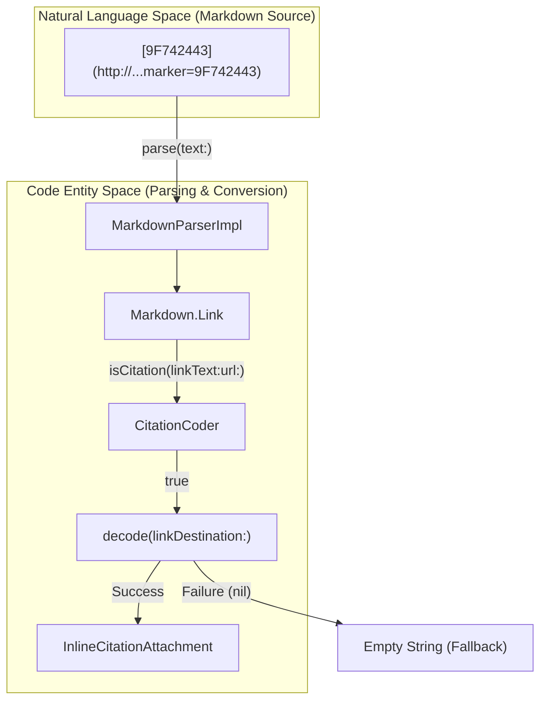
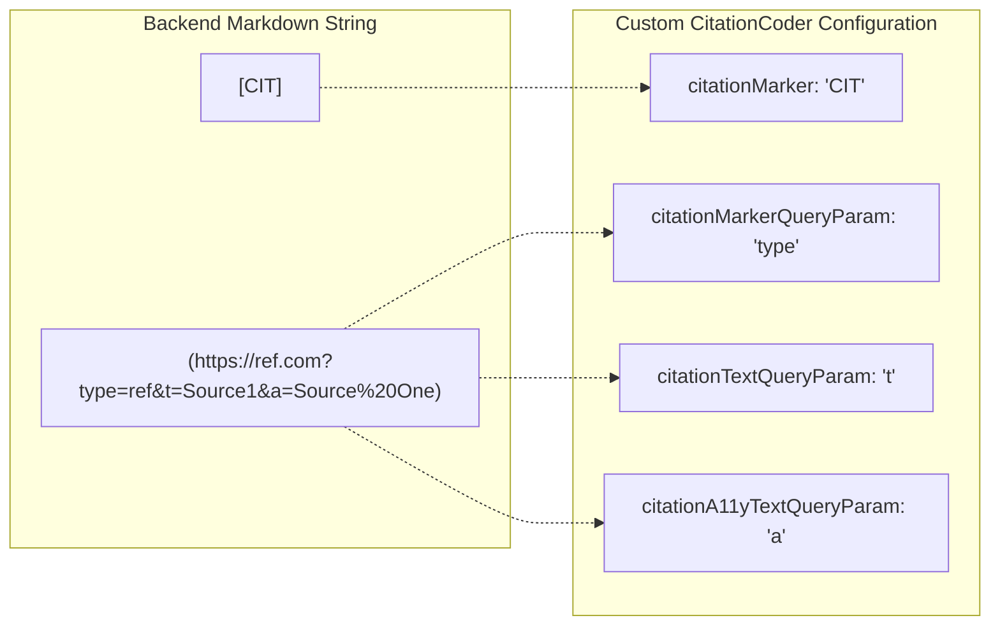

<!-- source: DeepWiki mcp.deepwiki.com · repo microsoft/SwiftStreamingMarkdown · page 5.1 CitationCoder and On-Wire Format · fetched 2026-10-26 -->

# CitationCoder and On-Wire Format

<details>
<summary>Relevant source files</summary>

The following files were used as context for generating this wiki page:

- [Sources/MarkdownText/Citation/CitationCoder.swift](Sources/MarkdownText/Citation/CitationCoder.swift)
- [Sources/MarkdownText/Citation/InlineCitationAttachment.swift](Sources/MarkdownText/Citation/InlineCitationAttachment.swift)
- [Sources/MarkdownText/Citation/InlineCitationViewProvider.swift](Sources/MarkdownText/Citation/InlineCitationViewProvider.swift)
- [Sources/MarkdownText/Utilities/String+.swift](Sources/MarkdownText/Utilities/String+.swift)
- [Tests/MarkdownTextTests/MarkdownTextTests.swift](Tests/MarkdownTextTests/MarkdownTextTests.swift)
- [Tests/MarkdownTextTests/OrderedListViewTests.swift](Tests/MarkdownTextTests/OrderedListViewTests.swift)

</details>


This page details the `CitationCoder` structure, which defines the "on-wire" protocol for representing interactive citations within Markdown. It explains how the library identifies citations in a stream of Markdown links, decodes their metadata, and allows for backend-specific customization of the citation format.

## Overview

In `SwiftStreamingMarkdown`, citations are not a native CommonMark element. Instead, they are encoded as standard Markdown links that follow a specific schema. The `CitationCoder` acts as the translation layer between the raw Markdown AST and the specialized `InlineCitationAttachment` used for rendering.

### The Citation Schema
A valid citation is represented as:
`[<citationMarker>](<url>?citationMarker=<citationMarker>&citationTitle=<title>&citationA11yValue=<label>)`

*   **Link Text**: Must match the `citationMarker` exactly [Sources/MarkdownText/Citation/CitationCoder.swift:45-47]().
*   **URL Parameters**: Must contain a key-value pair where the key matches `citationMarkerQueryParam` and the value matches `citationMarker` [Sources/MarkdownText/Citation/CitationCoder.swift:50-55]().

## Data Flow: From Link to Citation

The following diagram illustrates how a `Markdown.Link` node is processed into a citation or a standard link.

### Citation Detection and Decoding Flow

**Sources:** [Sources/MarkdownText/Citation/CitationCoder.swift:59-61](), [Sources/MarkdownText/Citation/CitationCoder.swift:67-82](), [Tests/MarkdownTextTests/MarkdownTextTests.swift:148-162]()

## The CitationCoder Struct

The `CitationCoder` is a `Sendable` and `Hashable` struct that encapsulates the identification logic [Sources/MarkdownText/Citation/CitationCoder.swift:13]().

| Property | Type | Description |
| :--- | :--- | :--- |
| `citationMarker` | `String` | The literal text expected inside the brackets `[]`. |
| `citationMarkerQueryParam` | `String` | The URL query key used to verify the link is a citation. |
| `citationTextQueryParam` | `String` | The URL query key carrying the visible text (e.g., "1", "Source"). |
| `citationA11yTextQueryParam`| `String` | The URL query key carrying the accessibility label. |

**Sources:** [Sources/MarkdownText/Citation/CitationCoder.swift:18-26]()

### Default Implementation
The library provides a default instance used by the rendering pipeline unless overridden. This uses a historical UUID marker.

```swift
public static let `default` = CitationCoder(
  citationMarker: "9F742443",
  citationMarkerQueryParam: "citationMarker",
  citationTextQueryParam: "citationTitle",
  citationA11yTextQueryParam: "citationA11yValue"
)
```
**Sources:** [Sources/MarkdownText/Citation/CitationCoder.swift:87-92]()

## Key Methods

### Detection Logic
The `isCitation(linkText:url:)` method performs a two-factor check:
1.  **Text Match**: Does the link's display text match `citationMarker`? [Sources/MarkdownText/Citation/CitationCoder.swift:45-47]()
2.  **URL Match**: Does the URL contain a query parameter where `key == citationMarkerQueryParam` and `value == citationMarker`? [Sources/MarkdownText/Citation/CitationCoder.swift:50-55]()

Both must be true for the link to be treated as an interactive citation pill [Sources/MarkdownText/Citation/CitationCoder.swift:59-61]().

### Decoding Logic
The `decode(linkDestination:)` method extracts the payload into an `InlineAttachmentData` object. It requires both the title and accessibility label parameters to be present; otherwise, it returns `nil` [Sources/MarkdownText/Citation/CitationCoder.swift:67-75]().

### Plain Text Extraction
When converting Markdown to plain text (e.g., for sharing or accessibility), the `extractPlainText` extension on `Markup` uses the `CitationCoder` to ensure that citations show their display title (like "Microsoft") rather than the internal UUID marker [Sources/MarkdownText/Utilities/String+.swift:100-107]().

## Customization for Different Backends

To support different backend formats, you can initialize a custom `CitationCoder` and provide it to the `MarkdownParser` or utility functions.

### On-Wire Schema Mapping

**Sources:** [Sources/MarkdownText/Citation/CitationCoder.swift:30-40]()

## Implementation Details & Fallbacks

*   **Malformed Citations**: If a link is identified as a citation (matches the marker) but the `decode()` method fails (e.g., missing query params), the system returns an empty string. This prevents showing confusing internal UUIDs to the user [Tests/MarkdownTextTests/MarkdownTextTests.swift:158-162]().
*   **Regular Links**: If a link does not match the citation marker, it is rendered as a standard blue tappable link, preserving its original text [Tests/MarkdownTextTests/MarkdownTextTests.swift:45-58]().

**Sources:** [Sources/MarkdownText/Citation/CitationCoder.swift:1-94](), [Sources/MarkdownText/Utilities/String+.swift:1-217](), [Tests/MarkdownTextTests/MarkdownTextTests.swift:1-190]()

---

