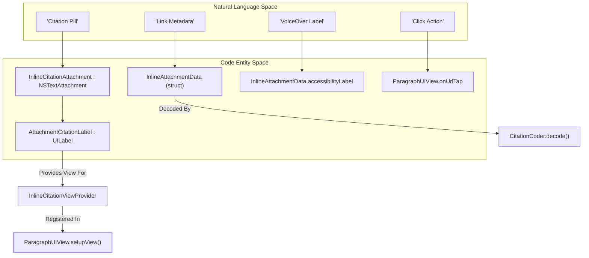
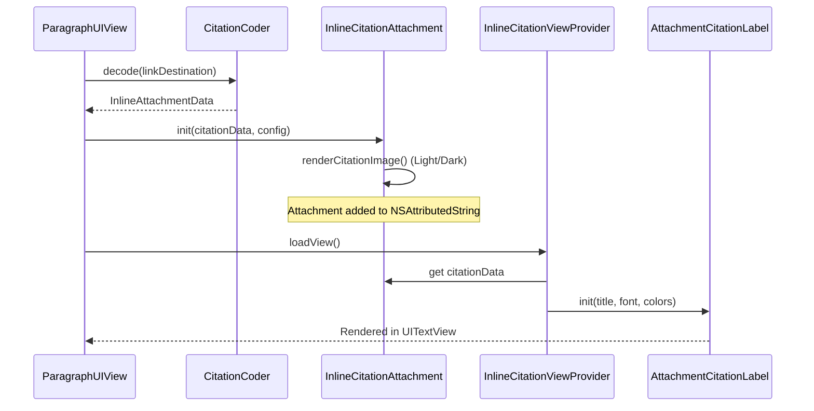

<!-- source: DeepWiki mcp.deepwiki.com · repo microsoft/SwiftStreamingMarkdown · page 5.2 Citation Rendering and Accessibility · fetched 2026-10-26 -->

# Citation Rendering and Accessibility

Relevant source files

The following files were used as context for generating this wiki page:

- [Sources/MarkdownText/Citation/CitationCoder.swift](Sources/MarkdownText/Citation/CitationCoder.swift)
- [Sources/MarkdownText/Citation/InlineCitationAttachment.swift](Sources/MarkdownText/Citation/InlineCitationAttachment.swift)
- [Sources/MarkdownText/Citation/InlineCitationViewProvider.swift](Sources/MarkdownText/Citation/InlineCitationViewProvider.swift)
- [Sources/MarkdownText/ContextMenu/TextContextMenu.swift](Sources/MarkdownText/ContextMenu/TextContextMenu.swift)
- [Sources/MarkdownText/ContextMenu/TextContextMenuGroup.swift](Sources/MarkdownText/ContextMenu/TextContextMenuGroup.swift)
- [Sources/MarkdownText/ContextMenu/TextContextMenuItem.swift](Sources/MarkdownText/ContextMenu/TextContextMenuItem.swift)
- [Sources/MarkdownText/UI/ParagraphView.swift](Sources/MarkdownText/UI/ParagraphView.swift)
- [Sources/MarkdownText/UI/UIKit/ParagraphUIView.swift](Sources/MarkdownText/UI/UIKit/ParagraphUIView.swift)
- [Sources/MarkdownText/Utilities/String+.swift](Sources/MarkdownText/Utilities/String+.swift)
- [Tests/MarkdownTextTests/MarkdownTextTests.swift](Tests/MarkdownTextTests/MarkdownTextTests.swift)
- [Tests/MarkdownTextTests/OrderedListViewTests.swift](Tests/MarkdownTextTests/OrderedListViewTests.swift)

Inline citations in `SwiftStreamingMarkdown` are rendered as interactive, pill-shaped UI elements embedded directly within the text flow of a `ParagraphUIView`. This system bridges the gap between standard Markdown link syntax and rich, accessible UI components by utilizing `NSTextAttachment` and custom view providers.

## Implementation Overview

Citations follow a specialized rendering path when the `CitationCoder` detects a link that matches the citation format. Instead of a standard blue hyperlink, the system generates an `InlineCitationAttachment` which is then handled by the iOS TextKit 2 engine.

### Data Flow: From Markdown to Pill

The transformation from a Markdown string to a rendered pill involves several layers of the architecture:

1.  **Detection**: During AST conversion, `Markdown.Link.isInlineCitation(coder:)` checks if the link text and URL parameters match the configured `CitationCoder` [Sources/MarkdownText/Citation/CitationCoder.swift:59-61]().
2.  **Decoding**: The link destination is decoded into `InlineAttachmentData` containing the title, accessibility label, and destination URL [Sources/MarkdownText/Citation/CitationCoder.swift:67-82]().
3.  **Attachment Creation**: An `InlineCitationAttachment` is initialized with this data and the current `CitationConfig` [Sources/MarkdownText/Citation/InlineCitationAttachment.swift:73-81]().
4.  **Registration**: `ParagraphUIView` registers `InlineCitationViewProvider` as the handler for the `UTType.url` identifier [Sources/MarkdownText/UI/UIKit/ParagraphUIView.swift:183-185]().
5.  **View Hosting**: When the `UITextView` renders, it calls the provider to load an `AttachmentCitationLabel` [Sources/MarkdownText/Citation/InlineCitationViewProvider.swift:71-85]().

### Technical Entity Map

The following diagram maps the logical concepts of a citation to their specific code implementations.

**Diagram: Citation System Entity Mapping**

Sources: [Sources/MarkdownText/Citation/InlineCitationAttachment.swift:10-12](), [Sources/MarkdownText/Citation/InlineCitationViewProvider.swift:9-11, 55-56](), [Sources/MarkdownText/Citation/CitationCoder.swift:67-68](), [Sources/MarkdownText/UI/UIKit/ParagraphUIView.swift:178-185]()

---

## Rendering Architecture

### InlineCitationAttachment
`InlineCitationAttachment` is a subclass of `NSTextAttachment` that manages the lifecycle of the citation's visual state. To ensure performance during scrolling and streaming, it pre-renders static images of the citation for both light and dark modes during initialization on a background thread [Sources/MarkdownText/Citation/InlineCitationAttachment.swift:82-96]().

*   **Interface Style Tracking**: The class maintains a static `currentInterfaceStyle` which is updated by `ParagraphUIView` whenever the system trait collection changes [Sources/MarkdownText/Citation/InlineCitationAttachment.swift:29-33]().
*   **Static Preview**: The `image` property returns a precomputed `UIGraphicsImageRenderer` output based on the current theme, providing a placeholder before the live `UIView` is swapped in by the provider [Sources/MarkdownText/Citation/InlineCitationAttachment.swift:61-69]().

### InlineCitationViewProvider
This class conforms to `NSTextAttachmentViewProvider` (TextKit 2). Its primary role is to instantiate the `AttachmentCitationLabel` when the attachment enters the visible viewport [Sources/MarkdownText/Citation/InlineCitationViewProvider.swift:71-85](). It uses `tracksTextAttachmentViewBounds = true` to ensure the hosted view stays aligned with the text layout [Sources/MarkdownText/Citation/InlineCitationViewProvider.swift:68-68]().

### AttachmentCitationLabel
A private `UILabel` subclass that implements the specific styling of the citation:
*   **Styling**: Applies `cornerRadius` (default 6) and `textInsets` (top: 2, left: 4, bottom: 2, right: 4) [Sources/MarkdownText/Citation/InlineCitationAttachment.swift:58-59]().
*   **Layout**: Overrides `intrinsicContentSize` and `drawText(in:)` to account for the custom padding around the citation title [Sources/MarkdownText/Citation/InlineCitationViewProvider.swift:41-52]().

**Diagram: Rendering Data Flow**

Sources: [Sources/MarkdownText/Citation/CitationCoder.swift:67-82](), [Sources/MarkdownText/Citation/InlineCitationAttachment.swift:73-96](), [Sources/MarkdownText/Citation/InlineCitationViewProvider.swift:71-84]()

---

## Accessibility Implementation

Accessibility for citations is handled with a dual-strategy to balance linear VoiceOver navigation with the need for rich interaction.

### VoiceOver Strategy
1.  **Hidden Internal Elements**: The `AttachmentCitationLabel` sets `isAccessibilityElement = false` [Sources/MarkdownText/Citation/InlineCitationViewProvider.swift:32-32](). This prevents the VoiceOver cursor from stopping on every individual citation pill during a "swipe right" gesture through a paragraph, which would disrupt the reading flow.
2.  **Text-Level Integration**: The citation's `accessibilityLabel` (e.g., "Open ESPN Sports, link") is generated by `String.openCitation(citationLabel:)` [Sources/MarkdownText/Utilities/String+.swift:27-35]().
3.  **Rotor Navigation**: Because the citation is technically a link within the `UITextView`, it remains discoverable via the VoiceOver "Links" rotor, allowing users to jump specifically to citations [Sources/MarkdownText/Citation/InlineCitationViewProvider.swift:31-31]().

### Plain Text Extraction
When the content needs to be copied or shared as plain text (e.g., via `extractPlainText`), the system replaces the attachment with the citation's `title` instead of the internal UUID marker [Sources/MarkdownText/Utilities/String+.swift:101-107](). This ensures that a citation like `[9F742443](...)` appears as `[1]` or `[Microsoft]` in the clipboard.

Sources: [Sources/MarkdownText/Citation/InlineCitationViewProvider.swift:30-33](), [Sources/MarkdownText/Utilities/String+.swift:27-35, 101-107]()

---

## Key Functions and Classes

| Entity | Role | File Reference |
| :--- | :--- | :--- |
| `InlineCitationAttachment` | `NSTextAttachment` subclass holding pre-rendered images and decoded data. | [Sources/MarkdownText/Citation/InlineCitationAttachment.swift:10]() |
| `InlineCitationViewProvider` | TextKit 2 provider that bridges the attachment to a live `UIView`. | [Sources/MarkdownText/Citation/InlineCitationViewProvider.swift:55]() |
| `AttachmentCitationLabel` | The actual `UILabel` rendered inside the text view. | [Sources/MarkdownText/Citation/InlineCitationViewProvider.swift:9]() |
| `updateInterfaceStyle(_:)` | Static method to synchronize all citations with the current Light/Dark mode. | [Sources/MarkdownText/Citation/InlineCitationAttachment.swift:29]() |
| `renderCitationImage(...)` | Core Graphics function for background-thread rasterization of citation pills. | [Sources/MarkdownText/Citation/InlineCitationAttachment.swift:122]() |

Sources: [Sources/MarkdownText/Citation/InlineCitationAttachment.swift:10, 29, 122](), [Sources/MarkdownText/Citation/InlineCitationViewProvider.swift:9, 55]()

---

