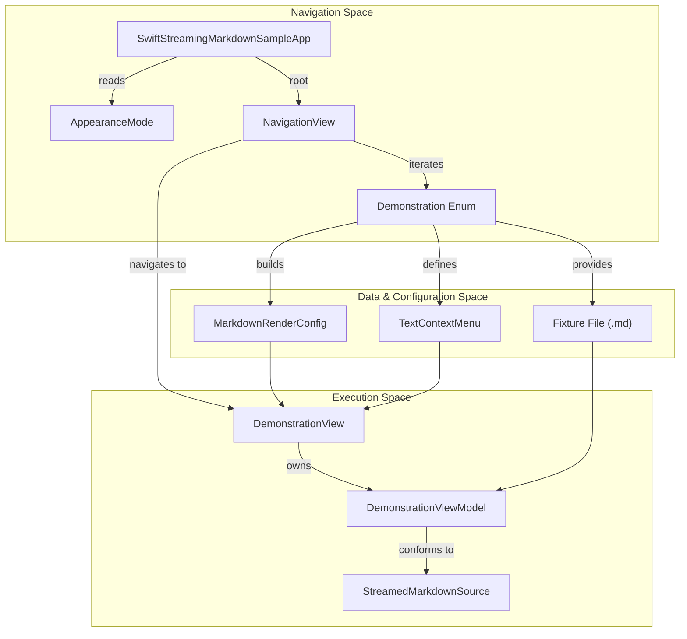
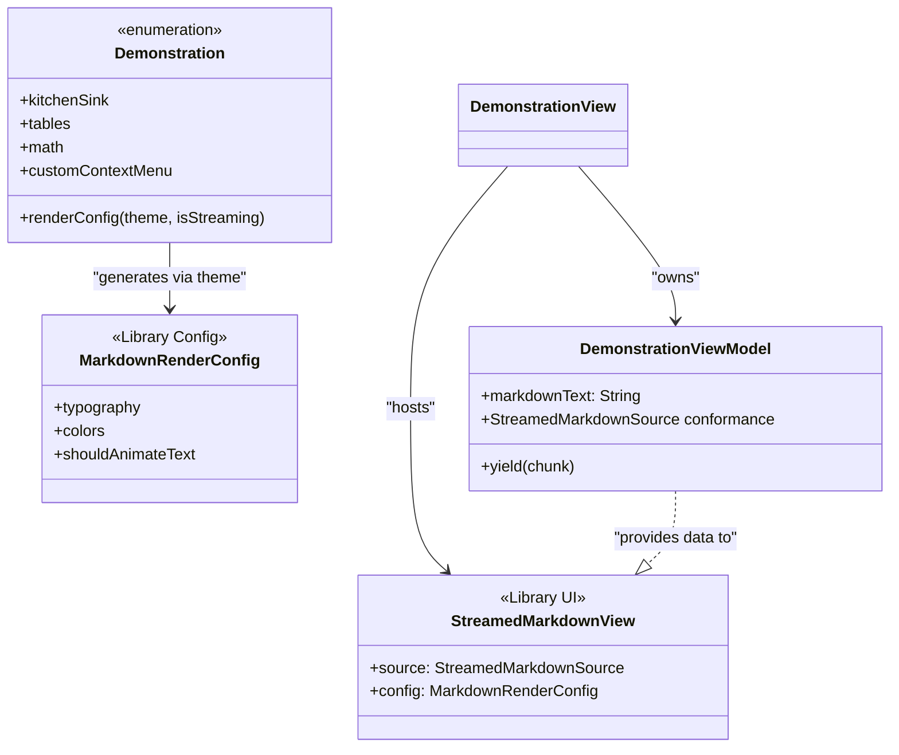

<!-- source: DeepWiki mcp.deepwiki.com · repo microsoft/SwiftStreamingMarkdown · page 6 Sample Application · fetched 2026-10-26 -->

# Sample Application

Relevant source files

The following files were used as context for generating this wiki page:

- [.swiftlint.yml](.swiftlint.yml)
- [Examples/SwiftStreamingMarkdownSample/SwiftStreamingMarkdownSample/Demonstrations.swift](Examples/SwiftStreamingMarkdownSample/SwiftStreamingMarkdownSample/Demonstrations.swift)
- [Examples/SwiftStreamingMarkdownSample/SwiftStreamingMarkdownSample/NavigationView.swift](Examples/SwiftStreamingMarkdownSample/SwiftStreamingMarkdownSample/NavigationView.swift)
- [Examples/SwiftStreamingMarkdownSample/SwiftStreamingMarkdownSample/Resources/Images/streaming-markdown.svg](Examples/SwiftStreamingMarkdownSample/SwiftStreamingMarkdownSample/Resources/Images/streaming-markdown.svg)
- [Examples/SwiftStreamingMarkdownSample/SwiftStreamingMarkdownSample/SwiftStreamingMarkdownSampleApp.swift](Examples/SwiftStreamingMarkdownSample/SwiftStreamingMarkdownSample/SwiftStreamingMarkdownSampleApp.swift)
- [Examples/SwiftStreamingMarkdownSample/project.yml](Examples/SwiftStreamingMarkdownSample/project.yml)

The `SwiftStreamingMarkdownSample` app serves as the primary demonstration and performance harness for the library. It is designed to showcase the library's ability to handle complex Markdown structures, real-time streaming simulations, and highly customized visual themes.

## Purpose and Scope

The sample application targets developers who need to understand how to integrate `StreamedMarkdownView` into a SwiftUI lifecycle. It provides a suite of pre-defined "fixtures" (Markdown files) that exercise different aspects of the rendering engine, such as LaTeX math, GitHub Flavored Markdown (GFM) tables, and custom context menus [Examples/SwiftStreamingMarkdownSample/SwiftStreamingMarkdownSample/Demonstrations.swift:10-17]().

The app demonstrates:
1.  **Live Streaming Simulation**: How to use `AsyncStream` to feed data into the library chunk-by-chunk.
2.  **Configuration Injection**: Applying different `MarkdownRenderConfig` instances to the same content.
3.  **Interaction Handling**: Implementing `MarkdownListener` to respond to UI events like context menu taps.
4.  **Performance Telemetry**: Real-time tracking of rendering latency and chunk processing.

### Application Architecture

The application follows a standard SwiftUI `NavigationStack` pattern, where a central list of demonstrations leads to a detail view containing the markdown renderer.

#### System Relationship: Navigation to Rendering
This diagram maps the high-level UI flow to the underlying code entities that manage the demonstration state.

Sources: [Examples/SwiftStreamingMarkdownSample/SwiftStreamingMarkdownSample/SwiftStreamingMarkdownSampleApp.swift:9-18](), [Examples/SwiftStreamingMarkdownSample/SwiftStreamingMarkdownSample/NavigationView.swift:10-15](), [Examples/SwiftStreamingMarkdownSample/SwiftStreamingMarkdownSample/Demonstrations.swift:10-71]()

---

## Main Components

### Navigation and Fixtures
The `NavigationView` serves as the entry point, loading Markdown content from the app bundle's resources [Examples/SwiftStreamingMarkdownSample/SwiftStreamingMarkdownSample/NavigationView.swift:57-78](). It maps each `Demonstration` case to a specific `.md` file, such as `kitchen-sink.md` or `math.md` [Examples/SwiftStreamingMarkdownSample/SwiftStreamingMarkdownSample/Demonstrations.swift:37-46]().

| Feature | Description | File Pointer |
| :--- | :--- | :--- |
| **Kitchen Sink** | Comprehensive test of all supported Markdown dialects. | `kitchen-sink.md` |
| **Math** | Exercises LaTeX pre-processing and `BlockMathView`. | `math.md` |
| **Tables** | Demonstrates GFM table alignment and rendering. | `tables.md` |
| **Roboto Theme** | Shows custom font integration and color palettes. | `roboto.md` |

### Demonstration View
The `DemonstrationView` is the primary host for the `StreamedMarkdownView`. It manages the lifecycle of a streaming session, allowing users to start, pause, or fast-forward the simulated stream. It also integrates a telemetry overlay to monitor the library's performance during active rendering.

For details, see [Demonstration View and Streaming Simulation](#6.1).

### Themes and Settings
The sample app includes a robust settings system powered by `@AppStorage` [Examples/SwiftStreamingMarkdownSample/SwiftStreamingMarkdownSample/SwiftStreamingMarkdownSampleApp.swift:10](). Users can toggle between light/dark/system appearance modes and select from several pre-defined themes (e.g., Midnight, Sepia, or the custom Roboto theme).

For details, see [Themes, Settings, and Fixtures](#6.2).

---

## Code-to-System Mapping

The following diagram bridges the gap between the conceptual "Demonstration" and the specific library protocols and configurations being exercised.

Sources: [Examples/SwiftStreamingMarkdownSample/SwiftStreamingMarkdownSample/Demonstrations.swift:10-71](), [Examples/SwiftStreamingMarkdownSample/SwiftStreamingMarkdownSample/NavigationView.swift:37-42]()

---

## Child Pages

*   **[Demonstration View and Streaming Simulation](#6.1)**: Deep dive into the `DemonstrationViewModel`'s implementation of `StreamedMarkdownSource`, chunked delivery logic, and the telemetry dashboard.
*   **[Themes, Settings, and Fixtures](#6.2)**: Detailed look at the `SampleMarkdownTheme` enum, how `SettingsView` persists user preferences, and the integration of custom assets like the Roboto font.

---

