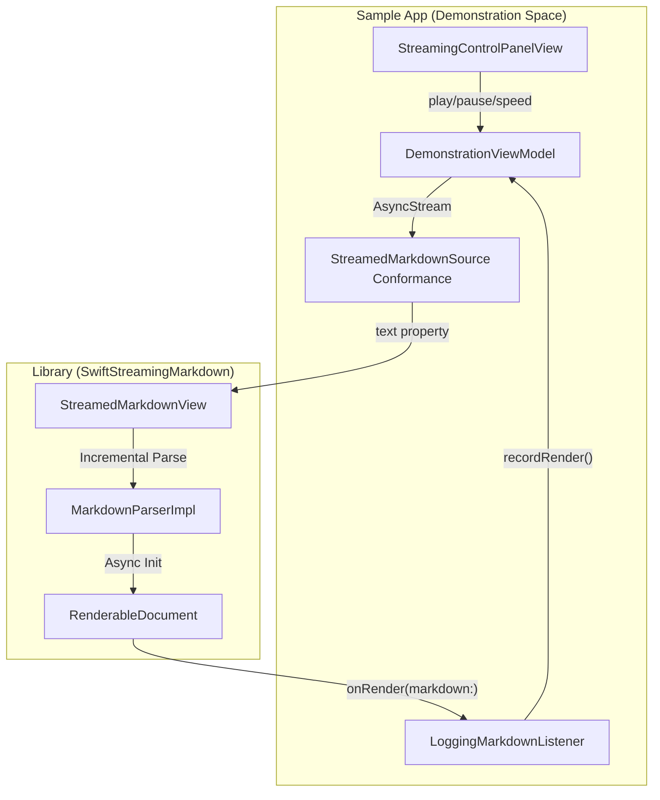

<!-- source: DeepWiki mcp.deepwiki.com · repo microsoft/SwiftStreamingMarkdown · page 6.1 Demonstration View and Streaming Simulation · fetched 2026-10-26 -->

# Demonstration View and Streaming Simulation

<details>
<summary>Relevant source files</summary>

The following files were used as context for generating this wiki page:

- [Examples/SwiftStreamingMarkdownSample/SwiftStreamingMarkdownSample/DemonstrationView.swift](Examples/SwiftStreamingMarkdownSample/SwiftStreamingMarkdownSample/DemonstrationView.swift)
- [Examples/SwiftStreamingMarkdownSample/SwiftStreamingMarkdownSample/DemonstrationViewModel.swift](Examples/SwiftStreamingMarkdownSample/SwiftStreamingMarkdownSample/DemonstrationViewModel.swift)
- [Examples/SwiftStreamingMarkdownSample/SwiftStreamingMarkdownSample/Demonstrations.swift](Examples/SwiftStreamingMarkdownSample/SwiftStreamingMarkdownSample/Demonstrations.swift)
- [Examples/SwiftStreamingMarkdownSample/SwiftStreamingMarkdownSample/LoggingMarkdownListener.swift](Examples/SwiftStreamingMarkdownSample/SwiftStreamingMarkdownSample/LoggingMarkdownListener.swift)
- [Examples/SwiftStreamingMarkdownSample/SwiftStreamingMarkdownSample/SampleMarkdownTheme.swift](Examples/SwiftStreamingMarkdownSample/SwiftStreamingMarkdownSample/SampleMarkdownTheme.swift)
- [Examples/SwiftStreamingMarkdownSample/SwiftStreamingMarkdownSample/StreamingControlPanelView.swift](Examples/SwiftStreamingMarkdownSample/SwiftStreamingMarkdownSample/StreamingControlPanelView.swift)
- [Examples/SwiftStreamingMarkdownSample/SwiftStreamingMarkdownSample/StreamingSpeed.swift](Examples/SwiftStreamingMarkdownSample/SwiftStreamingMarkdownSample/StreamingSpeed.swift)
- [scripts/default-ios-destination.sh](scripts/default-ios-destination.sh)

</details>


The `DemonstrationView` and its associated view model provide a robust harness for exercising the `SwiftStreamingMarkdown` library. It simulates a real-world LLM streaming environment by delivering Markdown content in chunks via `AsyncStream`, while providing controls to pause, fast-forward, and adjust the simulation speed.

## Overview and Data Flow

The demonstration system bridges static Markdown fixtures with the `StreamedMarkdownView` component. It uses a simulation loop that yields progressively larger substrings of a fixture file to mimic an incremental network delivery.

### System Architecture Diagram

This diagram illustrates the relationship between the sample app's simulation logic and the library's streaming components.

**Streaming Simulation Architecture**

**Sources:** [Examples/SwiftStreamingMarkdownSample/SwiftStreamingMarkdownSample/DemonstrationViewModel.swift:17-211](), [Examples/SwiftStreamingMarkdownSample/SwiftStreamingMarkdownSample/DemonstrationView.swift:30-34](), [Examples/SwiftStreamingMarkdownSample/SwiftStreamingMarkdownSample/LoggingMarkdownListener.swift:24-31]()

---

## DemonstrationViewModel

The `DemonstrationViewModel` is the central "source of truth" for the simulation. It implements `StreamedMarkdownSource`, which requires a `text` property of type `AsyncStream<String>` [Examples/SwiftStreamingMarkdownSample/SwiftStreamingMarkdownSample/DemonstrationViewModel.swift:154-211]().

### Streaming Lifecycle
The simulation loop follows these steps:
1.  **Initialization**: The view model is initialized with a full Markdown string and a `chunkSize` (default 48 characters) [Examples/SwiftStreamingMarkdownSample/SwiftStreamingMarkdownSample/DemonstrationViewModel.swift:51-59]().
2.  **Reset**: Before streaming begins, metrics are cleared via `reset(totalCharacters:mode:)` [Examples/SwiftStreamingMarkdownSample/SwiftStreamingMarkdownSample/DemonstrationViewModel.swift:113-126]().
3.  **Iteration**: Inside the `AsyncStream` closure, a `Task` iterates through the text indices [Examples/SwiftStreamingMarkdownSample/SwiftStreamingMarkdownSample/DemonstrationViewModel.swift:160-208]().
4.  **Yielding**: It calculates a `snapshot` (substring from start to current `endIndex`) and yields it to the stream [Examples/SwiftStreamingMarkdownSample/SwiftStreamingMarkdownSample/DemonstrationViewModel.swift:184-185]().
5.  **Telemetry**: After each yield, it calls `recordChunk()` to update character counts and timestamps [Examples/SwiftStreamingMarkdownSample/SwiftStreamingMarkdownSample/DemonstrationViewModel.swift:186-189]().
6.  **Throttling**: The loop waits based on `chunkInterval` and the selected `StreamingSpeed` [Examples/SwiftStreamingMarkdownSample/SwiftStreamingMarkdownSample/DemonstrationViewModel.swift:193-205]().

### Playback Controls
The view model supports several playback states that affect the `AsyncStream` loop:
*   **Pause/Play**: Controlled via `isPlaying`. The loop calls `waitUntilPlaying()` to suspend execution when paused [Examples/SwiftStreamingMarkdownSample/SwiftStreamingMarkdownSample/DemonstrationViewModel.swift:105-109]().
*   **Fast Forward**: Setting `isFastForwarding` to true causes the loop to immediately jump to the `fullText.endIndex` and finish [Examples/SwiftStreamingMarkdownSample/SwiftStreamingMarkdownSample/DemonstrationViewModel.swift:180-182]().
*   **Speed**: The `StreamingSpeed` enum modifies the `baseInterval` (e.g., `slow` is 1.5x, `fast` is 0.35x) [Examples/SwiftStreamingMarkdownSample/SwiftStreamingMarkdownSample/StreamingSpeed.swift:27-35]().

**Sources:** [Examples/SwiftStreamingMarkdownSample/SwiftStreamingMarkdownSample/DemonstrationViewModel.swift:83-103](), [Examples/SwiftStreamingMarkdownSample/SwiftStreamingMarkdownSample/StreamingSpeed.swift:8-36]()

---

## DemonstrationView

`DemonstrationView` is the primary container view. It switches between a static `MarkdownView` and a `StreamedMarkdownView` based on the `@AppStorage` setting `preferStreamedMarkdown` [Examples/SwiftStreamingMarkdownSample/SwiftStreamingMarkdownSample/DemonstrationView.swift:9-12]().

### Auto-Scrolling Logic
To provide a smooth "chat-like" experience, the view uses `LoggingMarkdownListener` to manage scroll positions:
*   **Follow Scrolling**: When `followsStreamingMarkdown` is enabled, the listener triggers a scroll to the bottom every time `onRender` is called [Examples/SwiftStreamingMarkdownSample/SwiftStreamingMarkdownSample/LoggingMarkdownListener.swift:24-31]().
*   **Animation**: Scrolling uses a linear animation with a duration of 0.16 seconds to match the typical delivery cadence of LLM tokens [Examples/SwiftStreamingMarkdownSample/SwiftStreamingMarkdownSample/LoggingMarkdownListener.swift:12-15]().
*   **Safe Interaction**: The listener includes a `pendingStreamingScroll` flag to prevent "scroll yanking" if multiple renders happen faster than the animation duration [Examples/SwiftStreamingMarkdownSample/SwiftStreamingMarkdownSample/LoggingMarkdownListener.swift:42-55]().

**Sources:** [Examples/SwiftStreamingMarkdownSample/SwiftStreamingMarkdownSample/DemonstrationView.swift:25-65](), [Examples/SwiftStreamingMarkdownSample/SwiftStreamingMarkdownSample/LoggingMarkdownListener.swift:11-55]()

---

## Streaming Control Panel and Telemetry

The `StreamingControlPanelView` provides a UI for interacting with the `DemonstrationViewModel` and viewing real-time performance metrics.

### UI Components
| Component | Functionality | Code Reference |
| :--- | :--- | :--- |
| **Playback Buttons** | Replay, Play/Pause, Fast Forward | [StreamingControlPanelView.swift:135-167]() |
| **Speed Picker** | Tortoise (Slow), Walk (Normal), Hare (Fast) | [StreamingControlPanelView.swift:184-191]() |
| **Follow Toggle** | Toggles auto-scroll behavior in `LoggingMarkdownListener` | [StreamingControlPanelView.swift:169-183]() |
| **Progress Bar** | Visual representation of `streamedCharacters / totalCharacters` | [StreamingControlPanelView.swift:84]() |

### Real-time Telemetry
The panel displays a grid of metrics calculated by the `DemonstrationViewModel`:
*   **Chunks**: Total number of increments yielded by the stream [Examples/SwiftStreamingMarkdownSample/SwiftStreamingMarkdownSample/DemonstrationViewModel.swift:42]().
*   **Renders**: Number of times `MarkdownListener.onRender` was triggered [Examples/SwiftStreamingMarkdownSample/SwiftStreamingMarkdownSample/DemonstrationViewModel.swift:43]().
*   **Render Lag**: The time difference between the last chunk being yielded and the subsequent render completion [Examples/SwiftStreamingMarkdownSample/SwiftStreamingMarkdownSample/DemonstrationViewModel.swift:49]().
*   **Throughput**: Characters per second and Chunks per second [Examples/SwiftStreamingMarkdownSample/SwiftStreamingMarkdownSample/DemonstrationViewModel.swift:71-79]().

**Sources:** [Examples/SwiftStreamingMarkdownSample/SwiftStreamingMarkdownSample/StreamingControlPanelView.swift:86-95](), [Examples/SwiftStreamingMarkdownSample/SwiftStreamingMarkdownSample/DemonstrationViewModel.swift:39-50]()

---

## Technical Interaction Diagram

This diagram maps the UI interaction in the Control Panel to the underlying ViewModel logic and the resulting Stream behavior.

**Interaction Logic**
```mermaid
sequenceDiagram
    participant User
    participant CP as "StreamingControlPanelView"
    participant VM as "DemonstrationViewModel"
    participant Loop as "AsyncStream Loop"
    participant SMV as "StreamedMarkdownView"

    User->>CP: Tap "Pause"
    CP->>VM: togglePlayback()
    VM->>VM: isPlaying = false
    Loop->>VM: waitUntilPlaying()
    Note over Loop: Thread Suspends (await)

    User->>CP: Tap "Fast Forward"
    CP->>VM: fastForward()
    VM->>VM: isFastForwarding = true
    VM->>VM: isPlaying = true
    Loop->>VM: resumes from waitUntilPlaying()
    Loop->>VM: check isFastForwarding
    Loop->>Loop: endIndex = fullText.endIndex
    Loop->>SMV: yield(fullText)
    Note over Loop: Loop Terminates
```
**Sources:** [Examples/SwiftStreamingMarkdownSample/SwiftStreamingMarkdownSample/DemonstrationViewModel.swift:83-109](), [Examples/SwiftStreamingMarkdownSample/SwiftStreamingMarkdownSample/DemonstrationViewModel.swift:174-206](), [Examples/SwiftStreamingMarkdownSample/SwiftStreamingMarkdownSample/StreamingControlPanelView.swift:146-165]()

---

