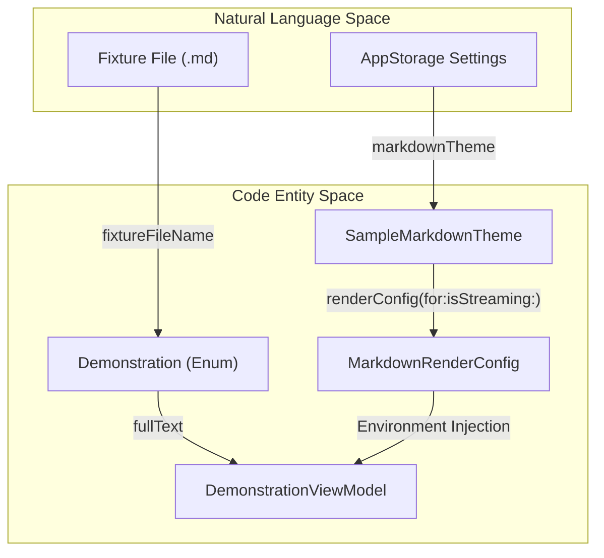
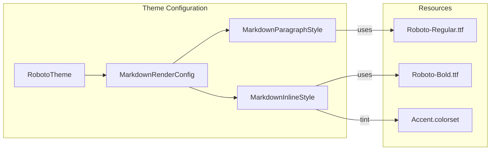

<!-- source: DeepWiki mcp.deepwiki.com · repo microsoft/SwiftStreamingMarkdown · page 6.2 Themes, Settings, and Fixtures · fetched 2026-10-26 -->

# Themes, Settings, and Fixtures

Relevant source files

The following files were used as context for generating this wiki page:

- [.claude/hooks/swiftlint-edited.sh](.claude/hooks/swiftlint-edited.sh)
- [.claude/settings.json](.claude/settings.json)
- [Examples/SwiftStreamingMarkdownSample/SwiftStreamingMarkdownSample/DemonstrationViewModel.swift](Examples/SwiftStreamingMarkdownSample/SwiftStreamingMarkdownSample/DemonstrationViewModel.swift)
- [Examples/SwiftStreamingMarkdownSample/SwiftStreamingMarkdownSample/Demonstrations.swift](Examples/SwiftStreamingMarkdownSample/SwiftStreamingMarkdownSample/Demonstrations.swift)
- [Examples/SwiftStreamingMarkdownSample/SwiftStreamingMarkdownSample/Resources/Assets.xcassets/RobotoTheme/Accent.colorset/Contents.json](Examples/SwiftStreamingMarkdownSample/SwiftStreamingMarkdownSample/Resources/Assets.xcassets/RobotoTheme/Accent.colorset/Contents.json)
- [Examples/SwiftStreamingMarkdownSample/SwiftStreamingMarkdownSample/Resources/Assets.xcassets/RobotoTheme/AccentSoft.colorset/Contents.json](Examples/SwiftStreamingMarkdownSample/SwiftStreamingMarkdownSample/Resources/Assets.xcassets/RobotoTheme/AccentSoft.colorset/Contents.json)
- [Examples/SwiftStreamingMarkdownSample/SwiftStreamingMarkdownSample/Resources/Assets.xcassets/RobotoTheme/BoldEmphasis.colorset/Contents.json](Examples/SwiftStreamingMarkdownSample/SwiftStreamingMarkdownSample/Resources/Assets.xcassets/RobotoTheme/BoldEmphasis.colorset/Contents.json)
- [Examples/SwiftStreamingMarkdownSample/SwiftStreamingMarkdownSample/Resources/Assets.xcassets/RobotoTheme/CodeBackground.colorset/Contents.json](Examples/SwiftStreamingMarkdownSample/SwiftStreamingMarkdownSample/Resources/Assets.xcassets/RobotoTheme/CodeBackground.colorset/Contents.json)
- [Examples/SwiftStreamingMarkdownSample/SwiftStreamingMarkdownSample/Resources/Assets.xcassets/RobotoTheme/CodeForeground.colorset/Contents.json](Examples/SwiftStreamingMarkdownSample/SwiftStreamingMarkdownSample/Resources/Assets.xcassets/RobotoTheme/CodeForeground.colorset/Contents.json)
- [Examples/SwiftStreamingMarkdownSample/SwiftStreamingMarkdownSample/Resources/Assets.xcassets/RobotoTheme/CodeUnderline.colorset/Contents.json](Examples/SwiftStreamingMarkdownSample/SwiftStreamingMarkdownSample/Resources/Assets.xcassets/RobotoTheme/CodeUnderline.colorset/Contents.json)
- [Examples/SwiftStreamingMarkdownSample/SwiftStreamingMarkdownSample/Resources/Assets.xcassets/RobotoTheme/Contents.json](Examples/SwiftStreamingMarkdownSample/SwiftStreamingMarkdownSample/Resources/Assets.xcassets/RobotoTheme/Contents.json)
- [Examples/SwiftStreamingMarkdownSample/SwiftStreamingMarkdownSample/Resources/Fixtures/kitchen-sink.md](Examples/SwiftStreamingMarkdownSample/SwiftStreamingMarkdownSample/Resources/Fixtures/kitchen-sink.md)
- [Examples/SwiftStreamingMarkdownSample/SwiftStreamingMarkdownSample/Resources/Fixtures/math.md](Examples/SwiftStreamingMarkdownSample/SwiftStreamingMarkdownSample/Resources/Fixtures/math.md)
- [Examples/SwiftStreamingMarkdownSample/SwiftStreamingMarkdownSample/Resources/Fixtures/tables.md](Examples/SwiftStreamingMarkdownSample/SwiftStreamingMarkdownSample/Resources/Fixtures/tables.md)
- [Examples/SwiftStreamingMarkdownSample/SwiftStreamingMarkdownSample/Resources/Fonts/Roboto-Bold.ttf](Examples/SwiftStreamingMarkdownSample/SwiftStreamingMarkdownSample/Resources/Fonts/Roboto-Bold.ttf)
- [Examples/SwiftStreamingMarkdownSample/SwiftStreamingMarkdownSample/RobotoTheme.swift](Examples/SwiftStreamingMarkdownSample/SwiftStreamingMarkdownSample/RobotoTheme.swift)
- [Examples/SwiftStreamingMarkdownSample/SwiftStreamingMarkdownSample/SampleMarkdownTheme.swift](Examples/SwiftStreamingMarkdownSample/SwiftStreamingMarkdownSample/SampleMarkdownTheme.swift)
- [Examples/SwiftStreamingMarkdownSample/SwiftStreamingMarkdownSample/SampleSettings.swift](Examples/SwiftStreamingMarkdownSample/SwiftStreamingMarkdownSample/SampleSettings.swift)
- [Examples/SwiftStreamingMarkdownSample/SwiftStreamingMarkdownSample/SettingsView.swift](Examples/SwiftStreamingMarkdownSample/SwiftStreamingMarkdownSample/SettingsView.swift)
- [Examples/SwiftStreamingMarkdownSample/SwiftStreamingMarkdownSample/StreamingControlPanelView.swift](Examples/SwiftStreamingMarkdownSample/SwiftStreamingMarkdownSample/StreamingControlPanelView.swift)
- [Examples/SwiftStreamingMarkdownSample/SwiftStreamingMarkdownSample/StreamingSpeed.swift](Examples/SwiftStreamingMarkdownSample/SwiftStreamingMarkdownSample/StreamingSpeed.swift)
- [Sources/MarkdownText/Block/BlockConvertible.swift](Sources/MarkdownText/Block/BlockConvertible.swift)
- [Sources/MarkdownText/Block/BlockQuote+.swift](Sources/MarkdownText/Block/BlockQuote+.swift)
- [Sources/MarkdownText/Block/CodeBlock+.swift](Sources/MarkdownText/Block/CodeBlock+.swift)
- [Sources/MarkdownText/Block/Document+.swift](Sources/MarkdownText/Block/Document+.swift)
- [Sources/MarkdownText/Block/OrderedList+.swift](Sources/MarkdownText/Block/OrderedList+.swift)
- [Sources/MarkdownText/UI/UnorderedListView.swift](Sources/MarkdownText/UI/UnorderedListView.swift)
- [Tests/MarkdownTextTests/TableViewTests.swift](Tests/MarkdownTextTests/TableViewTests.swift)
- [Tests/MarkdownTextTests/UnorderedListViewTests.swift](Tests/MarkdownTextTests/UnorderedListViewTests.swift)
- [Tests/MarkdownTextTests/__Snapshots__/UnorderedListViewTests/testNestedUnorderedListView.iPadPro11-light-US-en.png](Tests/MarkdownTextTests/__Snapshots__/UnorderedListViewTests/testNestedUnorderedListView.iPadPro11-light-US-en.png)
- [Tests/MarkdownTextTests/__Snapshots__/UnorderedListViewTests/testNestedUnorderedListView.iPadPro11Landscape-dark-US-en.png](Tests/MarkdownTextTests/__Snapshots__/UnorderedListViewTests/testNestedUnorderedListView.iPadPro11Landscape-dark-US-en.png)
- [scripts/default-ios-destination.sh](scripts/default-ios-destination.sh)

This section details the customization and demonstration infrastructure within the `SwiftStreamingMarkdownSample` application. It covers the thematic styling system, user-controlled settings persistence, and the fixture-based testing/demonstration content used to exercise the library's rendering capabilities.

## Thematic Styling System

The sample application employs a robust theme architecture that abstracts `MarkdownRenderConfig` generation through the `SampleMarkdownTheme` enum. This allows the application to switch between various visual identities, including high-contrast "Midnight" and "Sepia" modes, as well as specialized configurations like "Roboto".

### SampleMarkdownTheme
The `SampleMarkdownTheme` enum defines the available visual palettes and provides logic to resolve the final `MarkdownRenderConfig` used by the renderer [Examples/SwiftStreamingMarkdownSample/SwiftStreamingMarkdownSample/SampleMarkdownTheme.swift:10-17]().

| Theme | Description | Implementation Detail |
| :--- | :--- | :--- |
| `automatic` | Dynamically selects a theme based on the active `Demonstration`. | [Examples/SwiftStreamingMarkdownSample/SwiftStreamingMarkdownSample/SampleMarkdownTheme.swift:54-64]() |
| `system` | Uses the library's default system-standard styling. | [Examples/SwiftStreamingMarkdownSample/SwiftStreamingMarkdownSample/SampleMarkdownTheme.swift:68-69]() |
| `roboto` | A custom theme utilizing the Roboto font family and a teal-on-purple palette. | [Examples/SwiftStreamingMarkdownSample/SwiftStreamingMarkdownSample/RobotoTheme.swift:1-10]() |
| `presentation` | High-contrast light/dark palette optimized for display. | [Examples/SwiftStreamingMarkdownSample/SwiftStreamingMarkdownSample/SampleMarkdownTheme.swift:145-156]() |
| `midnight` | Deep dark mode with blue-accented headings. | [Examples/SwiftStreamingMarkdownSample/SwiftStreamingMarkdownSample/SampleMarkdownTheme.swift:158-169]() |
| `sepia` | Warm, book-like reading theme. | [Examples/SwiftStreamingMarkdownSample/SwiftStreamingMarkdownSample/SampleMarkdownTheme.swift:171-182]() |

### Palette and Configuration Resolution
Themes are constructed using a private `Palette` struct that defines semantic colors for background, foreground, headings, accents, and code blocks [Examples/SwiftStreamingMarkdownSample/SwiftStreamingMarkdownSample/SampleMarkdownTheme.swift:133-143](). These palettes are converted into `MarkdownRenderConfig` objects via the `paletteConfig(_:)` function [Examples/SwiftStreamingMarkdownSample/SwiftStreamingMarkdownSample/SampleMarkdownTheme.swift:81-130]().

**Theme Resolution Logic:**
1.  The UI requests a configuration for a specific `Demonstration`.
2.  `resolvedTheme(for:)` determines if a specific theme is forced or if `automatic` logic should apply [Examples/SwiftStreamingMarkdownSample/SwiftStreamingMarkdownSample/SampleMarkdownTheme.swift:54-64]().
3.  `renderConfig(for:isStreaming:)` applies the theme-specific colors and injects contextual settings like `shouldAnimateText` and custom context menus [Examples/SwiftStreamingMarkdownSample/SwiftStreamingMarkdownSample/SampleMarkdownTheme.swift:48-52]().

**Sources:** 
- [Examples/SwiftStreamingMarkdownSample/SwiftStreamingMarkdownSample/SampleMarkdownTheme.swift:10-182]()
- [Examples/SwiftStreamingMarkdownSample/SwiftStreamingMarkdownSample/Demonstrations.swift:61-63]()

## Settings and Persistence

The application uses `AppStorage` to persist user preferences across sessions. These settings are managed through `SettingsView` and keyed by constants in `SampleSettings`.

### AppearanceMode
The `AppearanceMode` enum handles the application's color scheme (Light, Dark, or System/Device) [Examples/SwiftStreamingMarkdownSample/SwiftStreamingMarkdownSample/SampleSettings.swift:14-17](). It provides a `colorScheme` property that returns the appropriate SwiftUI `ColorScheme` [Examples/SwiftStreamingMarkdownSample/SwiftStreamingMarkdownSample/SampleSettings.swift:29-35]().

### SettingsView
The `SettingsView` provides a `Form`-based interface for three primary toggles:
*   **Streaming Preference:** `preferStreamedMarkdown` (Boolean) [Examples/SwiftStreamingMarkdownSample/SwiftStreamingMarkdownSample/SettingsView.swift:9]().
*   **Markdown Theme:** Selection of `SampleMarkdownTheme` [Examples/SwiftStreamingMarkdownSample/SwiftStreamingMarkdownSample/SettingsView.swift:11]().
*   **Appearance:** Selection of `AppearanceMode` [Examples/SwiftStreamingMarkdownSample/SwiftStreamingMarkdownSample/SettingsView.swift:10]().

**Sources:**
- [Examples/SwiftStreamingMarkdownSample/SwiftStreamingMarkdownSample/SettingsView.swift:8-32]()
- [Examples/SwiftStreamingMarkdownSample/SwiftStreamingMarkdownSample/SampleSettings.swift:8-36]()

## Demonstration Fixtures

The sample app includes several `.md` fixture files used to test specific Markdown features and streaming edge cases. These are mapped to the `Demonstration` enum [Examples/SwiftStreamingMarkdownSample/SwiftStreamingMarkdownSample/Demonstrations.swift:10-16]().

### Fixture Catalog
| Fixture | File Name | Primary Purpose |
| :--- | :--- | :--- |
| **Kitchen Sink** | `kitchen-sink.md` | Comprehensive test of all supported features, including nested lists, citations, and mixed block types [Examples/SwiftStreamingMarkdownSample/SwiftStreamingMarkdownSample/Resources/Fixtures/kitchen-sink.md:1-10]() |
| **Math** | `math.md` | Exercises LaTeX pre-processing and `BlockMathView` / `InlineMath` rendering [Examples/SwiftStreamingMarkdownSample/SwiftStreamingMarkdownSample/Resources/Fixtures/math.md:1-40]() |
| **Tables** | `tables.md` | Tests complex table layouts and alignment. |
| **Roboto** | `roboto.md` | Used specifically to demonstrate custom font and color overrides [Examples/SwiftStreamingMarkdownSample/SwiftStreamingMarkdownSample/Demonstrations.swift:43-45]() |

### Data Flow: Fixture to View
The `Demonstration` enum acts as the bridge between the raw file content and the UI layer.

Title: "Demonstration Data Flow"

**Sources:**
- [Examples/SwiftStreamingMarkdownSample/SwiftStreamingMarkdownSample/Demonstrations.swift:10-71]()
- [Examples/SwiftStreamingMarkdownSample/SwiftStreamingMarkdownSample/DemonstrationViewModel.swift:17-59]()

## Custom Font Integration: RobotoTheme

The `RobotoTheme` serves as a blueprint for implementing fully custom font-driven themes. It integrates the Roboto font family (stored in `Resources/Fonts/`) into the `MarkdownRenderConfig` [Examples/SwiftStreamingMarkdownSample/SwiftStreamingMarkdownSample/Demonstrations.swift:30-31]().

### Font Resolution
The theme defines specific font weights and sizes for headings and body text, ensuring that the `Typography` tokens used by the library resolve to the custom `UIFont` instances instead of system defaults.

### Semantic Color Mapping
The Roboto theme utilizes specific color sets defined in the asset catalog (e.g., `CodeForeground.colorset`, `AccentSoft.colorset`) to ensure accessibility and visual consistency in both light and dark modes [Examples/SwiftStreamingMarkdownSample/SwiftStreamingMarkdownSample/SampleMarkdownTheme.swift:37-38]().

Title: "Theme and Font Mapping"

**Sources:**
- [Examples/SwiftStreamingMarkdownSample/SwiftStreamingMarkdownSample/SampleMarkdownTheme.swift:70-71]()
- [Examples/SwiftStreamingMarkdownSample/SwiftStreamingMarkdownSample/Demonstrations.swift:65-69]()
- [Examples/SwiftStreamingMarkdownSample/SwiftStreamingMarkdownSample/Resources/Fonts/Roboto-Bold.ttf]() (Reference)

---

