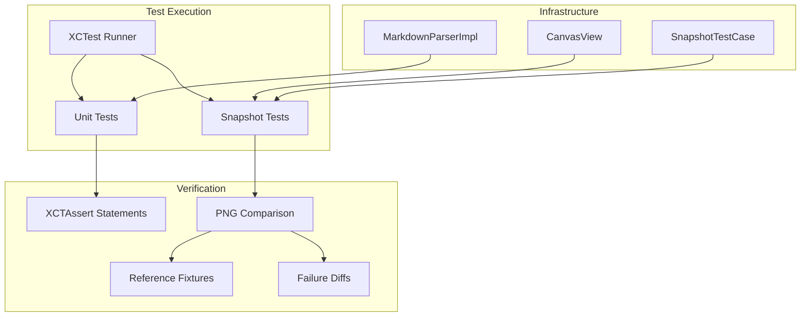
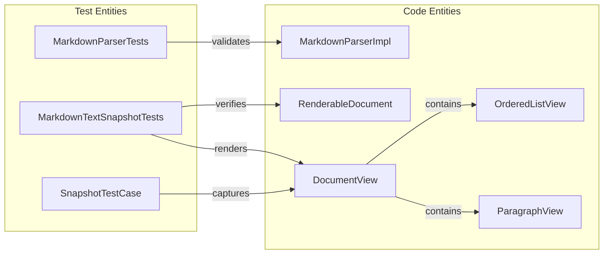

<!-- source: DeepWiki mcp.deepwiki.com · repo microsoft/SwiftStreamingMarkdown · page 7 Testing · fetched 2026-10-26 -->

# Testing

Relevant source files

The following files were used as context for generating this wiki page:

- [.agents/skills/snapshot-tests/SKILL.md](.agents/skills/snapshot-tests/SKILL.md)
- [Sources/MarkdownText/Citation/InlineAttachmentData.swift](Sources/MarkdownText/Citation/InlineAttachmentData.swift)
- [Sources/MarkdownText/UI/OrderedListView.swift](Sources/MarkdownText/UI/OrderedListView.swift)
- [Sources/MarkdownText/Utilities/TaskExtensions.swift](Sources/MarkdownText/Utilities/TaskExtensions.swift)
- [Tests/MarkdownTextTests/MarkdownParserTests.swift](Tests/MarkdownTextTests/MarkdownParserTests.swift)
- [Tests/MarkdownTextTests/MarkdownTextSnapshotTests.swift](Tests/MarkdownTextTests/MarkdownTextSnapshotTests.swift)

The SwiftStreamingMarkdown test suite provides comprehensive coverage across the rendering pipeline, from raw Markdown parsing to pixel-perfect UI verification. The suite is divided into unit tests for logic validation and snapshot tests for visual regression testing.

## Overview of Test Infrastructure

The testing strategy utilizes `XCTest` for logic and a custom snapshot testing framework for UI components.

| Category | Primary Objective | Key Tools |
| :--- | :--- | :--- |
| **Unit Tests** | Logic, Parsing, and Data Models | `XCTest`, `MarkdownParserImpl` |
| **Snapshot Tests** | Visual Regression and Layout | `SnapshotTestCase`, `diff-image`, `ImageMagick` |

### Testing Workflow
The project includes specialized developer tooling to manage the test lifecycle, including a `Makefile` for running tests and a recording toggle for visual fixtures [Tests/MarkdownTextTests/SnapshotTestFoundation/SnapshotTestCase.swift:18-18]().

Sources: [Tests/MarkdownTextTests/MarkdownParserTests.swift:17-19](), [Tests/MarkdownTextTests/MarkdownTextSnapshotTests.swift:13-15](), [.agents/skills/snapshot-tests/SKILL.md:21-28]()

---

## [Unit Tests](#7.1)

Unit tests focus on the non-UI components of the library, ensuring that Markdown strings are correctly transformed into internal data structures.

### Key Coverage Areas
*   **Markdown Parsing**: Validating `MarkdownParserImpl` behavior, including speculative rewriting for incomplete Markdown streams [Tests/MarkdownTextTests/MarkdownParserTests.swift:21-34]().
*   **Latex Pre-processing**: Ensuring math delimiters are correctly identified and handled before the main AST conversion.
*   **Citation Decoding**: Verifying `CitationCoder` logic for extracting citation metadata from specialized link formats.
*   **Typography Propagation**: Testing how `NSAttributeContainer` styles are passed through the document hierarchy.

For a detailed breakdown of specific test suites and coverage metrics, see [Unit Tests](#7.1).

Sources: [Tests/MarkdownTextTests/MarkdownParserTests.swift:17-35]()

---

## [Snapshot Tests](#7.2)

Snapshot tests provide visual verification of the SwiftUI views by rendering them into PNG images and comparing them against established references.

### Snapshot Infrastructure
The infrastructure relies on `SnapshotTestCase`, which manages the recording and validation states [Tests/MarkdownTextTests/SnapshotTestFoundation/SnapshotTestCase.swift:13-18](). Views are hosted in a `CanvasView` to ensure consistent sizing and padding during the capture process [Tests/MarkdownTextTests/MarkdownTextSnapshotTests.swift:34-36]().

### Visual Regression Process
1.  **Capture**: The view (e.g., `DocumentView`) is rendered into a `UIImage`.
2.  **Comparison**: The image is compared against a reference PNG stored in `__Snapshots__`.
3.  **Diffing**: If a mismatch occurs, `diff-image` or `ImageMagick` is used to generate a visual diff highlighting the discrepancies [.agents/skills/snapshot-tests/SKILL.md:26-34]().

### Test Suites
Snapshot tests cover various complex rendering scenarios:
*   **Lists**: Ordered and unordered list layouts [Tests/MarkdownTextTests/MarkdownTextSnapshotTests.swift:17-38]().
*   **LaTeX**: Display and inline math formulas [Tests/MarkdownTextTests/MarkdownTextSnapshotTests.swift:40-108]().
*   **Tables**: Complex grid layouts and alignment.
*   **Typography**: Verification of bold, italic, and code styling within paragraphs.

For details on the snapshot framework and how to record new references, see [Snapshot Tests](#7.2).

Sources: [Tests/MarkdownTextTests/MarkdownTextSnapshotTests.swift:12-108](), [.agents/skills/snapshot-tests/SKILL.md:1-40]()

---

## Test-to-Code Mapping

The following diagram maps major test components to the primary classes and protocols they exercise within the codebase.

Sources: [Tests/MarkdownTextTests/MarkdownParserTests.swift:19-19](), [Tests/MarkdownTextTests/MarkdownTextSnapshotTests.swift:32-35](), [Sources/MarkdownText/UI/OrderedListView.swift:9-9]()

---

