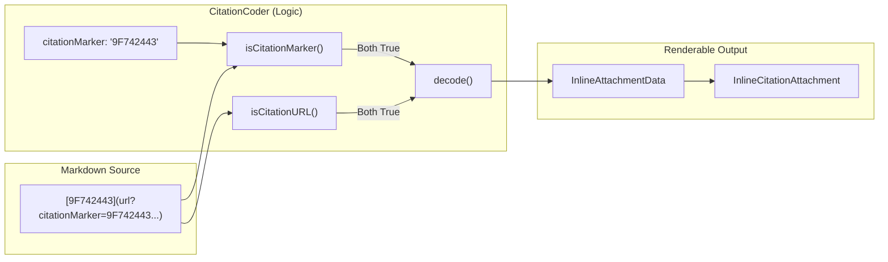

<!-- source: DeepWiki mcp.deepwiki.com · repo microsoft/SwiftStreamingMarkdown · page 7.1 Unit Tests · fetched 2026-10-26 -->

# Unit Tests

<details>
<summary>Relevant source files</summary>

The following files were used as context for generating this wiki page:

- [Examples/SwiftStreamingMarkdownSample/SwiftStreamingMarkdownSample/Resources/Fixtures/kitchen-sink.md](Examples/SwiftStreamingMarkdownSample/SwiftStreamingMarkdownSample/Resources/Fixtures/kitchen-sink.md)
- [Sources/MarkdownText/Block/Heading+.swift](Sources/MarkdownText/Block/Heading+.swift)
- [Sources/MarkdownText/Block/Table+.swift](Sources/MarkdownText/Block/Table+.swift)
- [Sources/MarkdownText/Citation/CitationCoder.swift](Sources/MarkdownText/Citation/CitationCoder.swift)
- [Sources/MarkdownText/Citation/InlineAttachmentData.swift](Sources/MarkdownText/Citation/InlineAttachmentData.swift)
- [Sources/MarkdownText/Inline/InlineConvertible.swift](Sources/MarkdownText/Inline/InlineConvertible.swift)
- [Sources/MarkdownText/UI/UnorderedListView.swift](Sources/MarkdownText/UI/UnorderedListView.swift)
- [Sources/MarkdownText/Utilities/String+.swift](Sources/MarkdownText/Utilities/String+.swift)
- [Sources/MarkdownText/Utilities/TaskExtensions.swift](Sources/MarkdownText/Utilities/TaskExtensions.swift)
- [Tests/MarkdownTextTests/ExtractPlainTextTests.swift](Tests/MarkdownTextTests/ExtractPlainTextTests.swift)
- [Tests/MarkdownTextTests/LaTexPreProcessorTests.swift](Tests/MarkdownTextTests/LaTexPreProcessorTests.swift)
- [Tests/MarkdownTextTests/MarkdownParserTests.swift](Tests/MarkdownTextTests/MarkdownParserTests.swift)
- [Tests/MarkdownTextTests/MarkdownTextTests.swift](Tests/MarkdownTextTests/MarkdownTextTests.swift)
- [Tests/MarkdownTextTests/OrderedListViewTests.swift](Tests/MarkdownTextTests/OrderedListViewTests.swift)
- [Tests/MarkdownTextTests/ParagraphViewTests.swift](Tests/MarkdownTextTests/ParagraphViewTests.swift)
- [Tests/MarkdownTextTests/PartialMarkdownRewriterTests.swift](Tests/MarkdownTextTests/PartialMarkdownRewriterTests.swift)
- [Tests/MarkdownTextTests/TableViewTests.swift](Tests/MarkdownTextTests/TableViewTests.swift)
- [Tests/MarkdownTextTests/TypographyPropagationTests.swift](Tests/MarkdownTextTests/TypographyPropagationTests.swift)
- [Tests/MarkdownTextTests/UnorderedListViewTests.swift](Tests/MarkdownTextTests/UnorderedListViewTests.swift)

</details>


The SwiftStreamingMarkdown test suite ensures the reliability of the parsing pipeline, the accuracy of UI component rendering, and the correctness of data transformations. It combines functional unit tests with visual regression (snapshot) tests to validate the end-to-end rendering of complex Markdown structures.

## Core Parser and Rewriter Tests

These tests validate the `MarkdownParserImpl` and its ability to handle both complete and streaming (partial) Markdown input.

### MarkdownParserTests
Validates the `speculativeRewrite` logic within `MarkdownParserImpl`. It ensures that when `speculativeRewrite` is enabled, the parser correctly identifies and closes unclosed Markdown tokens (like bold markers `**`) to prevent broken AST structures during streaming.
- **Key Function**: `test_rewrite()` [Tests/MarkdownTextTests/MarkdownParserTests.swift:21-34]().

### PartialMarkdownRewriterTests
Focuses on the `PartialMarkdownRewriter` class, which handles the mutation of raw Markdown strings. It ensures that unclosed syntax at the end of a stream is appended with necessary closing tags before being passed to the underlying `swift-markdown` parser.

### LaTexPreProcessorTests
Validates the `LaTexPreProcessor`, which identifies LaTeX math delimiters (e.g., `\( ... \)` and `\[ ... \]`) and protects them from being misinterpreted by the standard Markdown parser as literal parentheses or brackets.

**Sources:**
- `[Tests/MarkdownTextTests/MarkdownParserTests.swift:17-35]()`
- `[Tests/MarkdownTextTests/PartialMarkdownRewriterTests.swift]()`
- `[Tests/MarkdownTextTests/LaTexPreProcessorTests.swift]()`

---

## Typography and Conversion Tests

These tests ensure that styling tokens (design tokens) are correctly propagated from the `MarkdownRenderConfig` through the AST conversion process into the final `NSAttributedString`.

### TypographyPropagationTests
Checks if nested styles (e.g., italics inside a heading) correctly resolve to the expected `UIFont` variant.
- **Implementation**: It asserts that a `Heading` node converted via `Heading.convert(attributeContainer:config:)` [Sources/MarkdownText/Block/Heading+.swift:12-39]() maintains the correct `TextFonts` variant (normal, bold, italic, or boldItalic) across its children [Tests/MarkdownTextTests/TypographyPropagationTests.swift:15-85]().

### ExtractPlainTextTests
Validates the `extractPlainText` extension on `Markdown.Document` and `Markup`. It ensures that the library can produce a clean string representation for accessibility or search, specifically handling the extraction of citation titles instead of their internal UUID markers.
- **Key Function**: `Markup.extractPlainText(removeHeading:coder:)` [Sources/MarkdownText/Utilities/String+.swift:79-217]().

**Sources:**
- `[Tests/MarkdownTextTests/TypographyPropagationTests.swift:12-86]()`
- `[Sources/MarkdownText/Block/Heading+.swift:10-40]()`
- `[Sources/MarkdownText/Utilities/String+.swift:64-217]()`

---

## Component-Specific Tests

These tests exercise individual SwiftUI views and their associated `MarkdownRenderable` conversion logic.

### ParagraphViewTests
Validates `ParagraphView` (the primary rendering engine for text). These tests focus on the integration of `InlineCitationAttachment` within the text flow.
- **Scenarios**: Testing citations in isolation, citations mixed with regular text, and multiple citations within a single paragraph [Tests/MarkdownTextTests/ParagraphViewTests.swift:50-177]().

### List View Tests (`OrderedListViewTests` & `UnorderedListViewTests`)
These tests verify the rendering of `OrderedListView` and `UnorderedListView`. They utilize `SnapshotTestCase` to ensure bullet alignment and indentation are correct.
- **Unordered List**: Validates `UnorderedListView` with nested levels and citations [Tests/MarkdownTextTests/UnorderedListViewTests.swift:14-94]().
- **Ordered List**: Validates that `OrderedListView` correctly handles large lists (up to 40 items) and maintains font consistency when citations are present [Tests/MarkdownTextTests/OrderedListViewTests.swift:15-63]().

### TableViewTests
Tests the `TableView` component, ensuring that complex inline content (links, bold text, citations) renders correctly within `Table.Cell` structures.

**Sources:**
- `[Tests/MarkdownTextTests/ParagraphViewTests.swift:13-177]()`
- `[Tests/MarkdownTextTests/UnorderedListViewTests.swift:11-95]()`
- `[Tests/MarkdownTextTests/OrderedListViewTests.swift:11-64]()`
- `[Tests/MarkdownTextTests/TableViewTests.swift]()`

---

## Citation System Tests

The citation system involves complex encoding/decoding logic that must remain stable to avoid breaking backend integrations.

### CitationCoder Tests
Validates the `CitationCoder` struct. It ensures that `isCitation(linkText:url:)` [Sources/MarkdownText/Citation/CitationCoder.swift:59-61]() correctly identifies citation links and that `decode(linkDestination:)` [Sources/MarkdownText/Citation/CitationCoder.swift:67-82]() extracts `InlineAttachmentData` accurately from URL query parameters.

### MarkdownTextTests (Citation Integration)
Specifically tests the "on-the-wire" format of citations.
- **Regular Format**: Ensures standard links are not treated as citations [Tests/MarkdownTextTests/MarkdownTextTests.swift:18-63]().
- **Attachment Format**: Ensures links with the specific `citationMarker` UUID are converted into `InlineCitationAttachment` [Tests/MarkdownTextTests/MarkdownTextTests.swift:66-117]().
- **Fallback**: Ensures malformed citation URLs fail gracefully by returning an empty string instead of showing raw UUIDs to the user [Tests/MarkdownTextTests/MarkdownTextTests.swift:120-163]().

**Sources:**
- `[Sources/MarkdownText/Citation/CitationCoder.swift:13-93]()`
- `[Tests/MarkdownTextTests/MarkdownTextTests.swift:13-193]()`

---

## Data Flow: From Markdown to Renderable

The following diagram illustrates how the test suite validates the transformation of a Markdown string into a `MarkdownRenderable` enum, which is the input for the UI components.

### Conversion Pipeline Data Flow
```mermaid
graph TD
    subgraph "Natural Language Space"
        Input["Raw Markdown String"]
    end

    subgraph "Code Entity Space"
        Parser["MarkdownParserImpl.parse()"]
        AST["Markdown.Document (AST)"]
        Converter["BlockConvertible / InlineConvertible"]
        Renderable["MarkdownRenderable (Enum)"]
        
        Input -->|text| Parser
        Parser -->|speculativeRewrite| AST
        AST -->|convert(with:config:)| Converter
        Converter -->|output| Renderable
    end

    subgraph "Verification (Tests)"
        T1["MarkdownParserTests"]
        T2["TypographyPropagationTests"]
        
        T1 -.->|validates| Parser
        T2 -.->|validates| Renderable
    end
```
**Sources:**
- `[Tests/MarkdownTextTests/MarkdownParserTests.swift:19-34]()`
- `[Tests/MarkdownTextTests/TypographyPropagationTests.swift:31-33]()`
- `[Sources/MarkdownText/Block/Heading+.swift:12-38]()`

---

## Citation Decoding Logic

The citation system bridges the gap between Markdown link syntax and interactive SwiftUI/UIKit attachments.

### Citation Recognition Logic

**Sources:**
- `[Sources/MarkdownText/Citation/CitationCoder.swift:45-82]()`
- `[Tests/MarkdownTextTests/MarkdownTextTests.swift:66-117]()`
- `[Sources/MarkdownText/Citation/InlineAttachmentData.swift]()`

---

