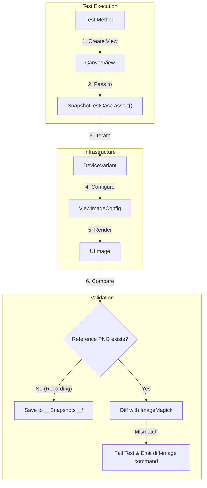
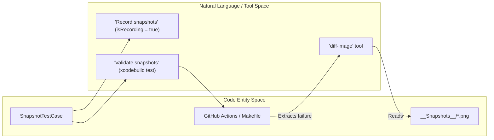

<!-- source: DeepWiki mcp.deepwiki.com · repo microsoft/SwiftStreamingMarkdown · page 7.2 Snapshot Tests · fetched 2026-10-26 -->

# Snapshot Tests

Relevant source files

The following files were used as context for generating this wiki page:

- [.agents/skills/snapshot-tests/SKILL.md](.agents/skills/snapshot-tests/SKILL.md)
- [Sources/MarkdownText/UI/OrderedListView.swift](Sources/MarkdownText/UI/OrderedListView.swift)
- [Tests/MarkdownTextTests/BlockQuoteViewSnapshotTests.swift](Tests/MarkdownTextTests/BlockQuoteViewSnapshotTests.swift)
- [Tests/MarkdownTextTests/MarkdownTextSnapshotTests.swift](Tests/MarkdownTextTests/MarkdownTextSnapshotTests.swift)
- [Tests/MarkdownTextTests/SnapshotTestFoundation/CanvasView.swift](Tests/MarkdownTextTests/SnapshotTestFoundation/CanvasView.swift)
- [Tests/MarkdownTextTests/SnapshotTestFoundation/DeviceVariant.swift](Tests/MarkdownTextTests/SnapshotTestFoundation/DeviceVariant.swift)
- [Tests/MarkdownTextTests/SnapshotTestFoundation/SnapshotTestCase.swift](Tests/MarkdownTextTests/SnapshotTestFoundation/SnapshotTestCase.swift)
- [Tests/MarkdownTextTests/TableViewSnapshotTests.swift](Tests/MarkdownTextTests/TableViewSnapshotTests.swift)
- [Tests/MarkdownTextTests/ViewImageConfig.swift](Tests/MarkdownTextTests/ViewImageConfig.swift)
- [Tests/MarkdownTextTests/__Snapshots__/MarkdownTextSnapshotTests/testCompositeLatex.iPadPro11Landscape-dark-US-en.png](Tests/MarkdownTextTests/__Snapshots__/MarkdownTextSnapshotTests/testCompositeLatex.iPadPro11Landscape-dark-US-en.png)
- [Tests/MarkdownTextTests/__Snapshots__/MarkdownTextSnapshotTests/testCompositeLatex.iPhone16-dark-US-en.png](Tests/MarkdownTextTests/__Snapshots__/MarkdownTextSnapshotTests/testCompositeLatex.iPhone16-dark-US-en.png)
- [Tests/MarkdownTextTests/__Snapshots__/MarkdownTextSnapshotTests/testLatexInTable.iPadPro11Landscape-dark-US-en.png](Tests/MarkdownTextTests/__Snapshots__/MarkdownTextSnapshotTests/testLatexInTable.iPadPro11Landscape-dark-US-en.png)
- [Tests/MarkdownTextTests/__Snapshots__/MarkdownTextSnapshotTests/testLatexInTable.iPhone16-dark-US-en.png](Tests/MarkdownTextTests/__Snapshots__/MarkdownTextSnapshotTests/testLatexInTable.iPhone16-dark-US-en.png)
- [Tests/MarkdownTextTests/__Snapshots__/MarkdownTextSnapshotTests/testLatexWithSpecificSymbols.iPadPro11Landscape-dark-US-en.png](Tests/MarkdownTextTests/__Snapshots__/MarkdownTextSnapshotTests/testLatexWithSpecificSymbols.iPadPro11Landscape-dark-US-en.png)
- [Tests/MarkdownTextTests/__Snapshots__/MarkdownTextSnapshotTests/testLatexWithSpecificSymbols.iPhone16-dark-US-en.png](Tests/MarkdownTextTests/__Snapshots__/MarkdownTextSnapshotTests/testLatexWithSpecificSymbols.iPhone16-dark-US-en.png)

The `SwiftStreamingMarkdown` library utilizes a visual regression testing suite to ensure rendering consistency across different device sizes, color themes, and Markdown components. These tests capture the rendered output of SwiftUI views as PNG images and compare them against established reference fixtures.

## Snapshot Infrastructure

The testing infrastructure is built on top of `swift-snapshot-testing` but includes custom wrappers to handle the specific needs of the library, such as disabling animations and managing multiple device variants.

### SnapshotTestCase
`SnapshotTestCase` is the base class for all snapshot tests in the repository [Tests/MarkdownTextTests/SnapshotTestFoundation/SnapshotTestCase.swift:13-14](). It configures the global `SnapshotTesting.diffTool` to use `diff-image` for visual comparisons [Tests/MarkdownTextTests/SnapshotTestFoundation/SnapshotTestCase.swift:17]().

Key features include:
*   **Recording Mode**: A toggle `isRecording` (manually uncommented during development) allows for the generation of new reference PNGs [Tests/MarkdownTextTests/SnapshotTestFoundation/SnapshotTestCase.swift:18]().
*   **Assertion Logic**: The `assert` function renders the provided view across a matrix of `DeviceVariant` options (e.g., iPhone 16, iPad Pro 11) [Tests/MarkdownTextTests/SnapshotTestFoundation/SnapshotTestCase.swift:42-45]().

### CanvasView
`CanvasView` is a container used to host SwiftUI views during testing [Tests/MarkdownTextTests/SnapshotTestFoundation/CanvasView.swift:12](). Its primary role is to provide a consistent background (`Color.Theme.Background.Page.Chat.Flat`) and **disable all animations** via a transaction to ensure snapshots are deterministic [Tests/MarkdownTextTests/SnapshotTestFoundation/CanvasView.swift:26-27]().

### Device and View Configuration
The system uses `DeviceVariant` to define specific hardware profiles (iPhone, iPad) and orientations [Tests/MarkdownTextTests/SnapshotTestFoundation/DeviceVariant.swift:10](). These variants map to `ViewImageConfig`, which defines the precise screen dimensions and safe area insets for the renderer.

### Infrastructure Data Flow
The following diagram illustrates how a test view is processed into a snapshot.

**Snapshot Generation Flow**

Sources: [Tests/MarkdownTextTests/SnapshotTestFoundation/SnapshotTestCase.swift:42-60](), [Tests/MarkdownTextTests/SnapshotTestFoundation/CanvasView.swift:20-28](), [.agents/skills/snapshot-tests/SKILL.md:21-35]()

---

## Test Execution and Comparison

The suite relies on external tools for precise image comparison. When a test fails, the output log provides a specific command to visualize the difference.

### Image Comparison Tools
*   **diff-image**: A utility configured in `SnapshotTestCase` to generate comparison data [.agents/skills/snapshot-tests/SKILL.md:26]().
*   **ImageMagick**: Used by the CI pipeline to perform the actual pixel-by-pixel comparison and generate diff masks.

### Failure Resolution Workflow
If a snapshot fails, the test runner emits a command in the following format:
`diff-image <reference-png-path> <failed-png-path>` [.agents/skills/snapshot-tests/SKILL.md:34]().

**Visual Regression Pipeline**

Sources: [.agents/skills/snapshot-tests/SKILL.md:3-37](), [Tests/MarkdownTextTests/SnapshotTestFoundation/SnapshotTestCase.swift:13-20]()

---

## Existing Test Suites

The codebase includes specialized suites for complex Markdown components to ensure layout stability.

### MarkdownTextSnapshotTests
This is the primary suite for end-to-end rendering tests. It covers:
*   **Complex Lists**: Validating nested ordered and unordered lists [Tests/MarkdownTextTests/MarkdownTextSnapshotTests.swift:17-38]().
*   **LaTeX Integration**: Testing block math (`$$...$$`) and inline math (`\(...\)`) within paragraphs and headings [Tests/MarkdownTextTests/MarkdownTextSnapshotTests.swift:40-108]().
*   **Indentation and Alignment**: Ensuring math formulas and lists align correctly when indented [Tests/MarkdownTextTests/MarkdownTextSnapshotTests.swift:159-184]().

### TableViewSnapshotTests
Focuses on the complex layout requirements of `TableView`.
*   **Mixed Content**: Tests cells containing a mix of plain text, citations, and LaTeX [Tests/MarkdownTextTests/TableViewSnapshotTests.swift:61-97]().
*   **Wrapping**: Validates how long text and multiple citations wrap within constrained table columns [Tests/MarkdownTextTests/TableViewSnapshotTests.swift:129-147]().
*   **Alignment Guides**: Uses `ListItemContentWrapper` logic to ensure baseline alignment between text and attachments [Sources/MarkdownText/UI/OrderedListView.swift:45-60]().

### BlockQuoteViewSnapshotTests
Validates the recursive rendering of blockquotes.
*   **Nesting Levels**: Tests from level 0 (root) up to deep nesting (level 3+) [Tests/MarkdownTextTests/BlockQuoteViewSnapshotTests.swift:19-120]().
*   **Mixed Nesting**: Ensures that alternating between text and nested quotes renders the correct vertical indentation bars [Tests/MarkdownTextTests/BlockQuoteViewSnapshotTests.swift:122-152]().

### UnorderedListViewTests
Validates bullet point rendering, specifically focusing on custom bullet styles and the spacing between the bullet and the `ListItemContentWrapper` [Sources/MarkdownText/UI/OrderedListView.swift:25-32]().

| Suite | Focus Area | Key Code Entities |
| :--- | :--- | :--- |
| `MarkdownTextSnapshotTests` | Full Document Rendering | `DocumentView`, `MarkdownParserImpl` |
| `TableViewSnapshotTests` | Grid Layout & Cell Content | `TableView`, `CitationCoder` |
| `BlockQuoteViewSnapshotTests` | Recursive Indentation | `BlockQuoteView`, `BlockQuoteRenderable` |
| `UnorderedListViewTests` | List Markers & Spacing | `UnorderedListView`, `ListItemContentWrapper` |

Sources: [Tests/MarkdownTextTests/MarkdownTextSnapshotTests.swift:13-17]() [Tests/MarkdownTextTests/TableViewSnapshotTests.swift:14-56](), [Tests/MarkdownTextTests/BlockQuoteViewSnapshotTests.swift:17-25](), [Sources/MarkdownText/UI/OrderedListView.swift:9-42]()

---

