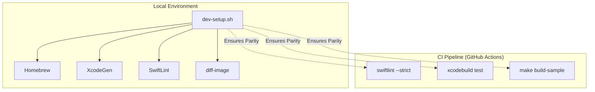
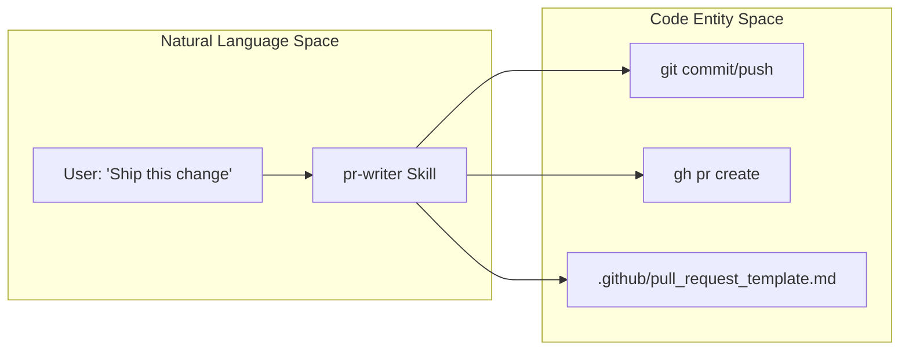

<!-- source: DeepWiki mcp.deepwiki.com · repo microsoft/SwiftStreamingMarkdown · page 8 Developer Tooling and CI · fetched 2026-10-26 -->

# Developer Tooling and CI

Relevant source files

The following files were used as context for generating this wiki page:

- [.agents/skills/pr-writer/SKILL.md](.agents/skills/pr-writer/SKILL.md)
- [.github/ISSUE_TEMPLATE/bug_report.yml](.github/ISSUE_TEMPLATE/bug_report.yml)
- [.github/ISSUE_TEMPLATE/config.yml](.github/ISSUE_TEMPLATE/config.yml)
- [.github/copilot-instructions.md](.github/copilot-instructions.md)
- [.github/dependabot.yml](.github/dependabot.yml)
- [.github/pull_request_template.md](.github/pull_request_template.md)
- [.github/workflows/ci.yml](.github/workflows/ci.yml)
- [.gitignore](.gitignore)
- [.xcode-version](.xcode-version)
- [AGENTS.md](AGENTS.md)
- [CLAUDE.md](CLAUDE.md)
- [CODE_OF_CONDUCT.md](CODE_OF_CONDUCT.md)
- [CONTRIBUTING.md](CONTRIBUTING.md)
- [Examples/SwiftStreamingMarkdownSample/SwiftStreamingMarkdownSample/Resources/Images/streaming-markdown.svg](Examples/SwiftStreamingMarkdownSample/SwiftStreamingMarkdownSample/Resources/Images/streaming-markdown.svg)
- [Examples/SwiftStreamingMarkdownSample/project.yml](Examples/SwiftStreamingMarkdownSample/project.yml)
- [Makefile](Makefile)
- [SECURITY.md](SECURITY.md)
- [scripts/dev-setup.sh](scripts/dev-setup.sh)

This section describes the infrastructure supporting the development of `SwiftStreamingMarkdown`. It covers the local environment configuration, automated validation pipelines, and specialized tooling for AI-assisted development.

## Development Environment Setup

The project uses a combination of standard Apple development tools and third-party utilities to ensure code quality and consistency. The setup process is centralized in a shell script and a `Makefile`.

### Core Toolchain
The repository enforces a minimum Xcode version via a `.xcode-version` file [ .xcode-version:1-1 ](). Local environment validation is handled by `scripts/dev-setup.sh`, which checks for the following:
*   **Xcode**: Required for `xcodebuild` and the iOS SDK [ scripts/dev-setup.sh:105-118 ]().
*   **SwiftLint**: Enforces the project's coding standards [ scripts/dev-setup.sh:121-131 ]().
*   **XcodeGen**: Used to generate the sample app project from `project.yml` [ scripts/dev-setup.sh:133-144 ]().
*   **ImageMagick & diff-image**: Required for visual regression testing of snapshots [ scripts/dev-setup.sh:159-183 ]().

For a step-by-step walkthrough, see **[Local Development Setup](#8.1)**.

### Makefile Targets
Common developer tasks are mapped to `make` commands to ensure parity between local development and CI environments.

| Target | Description |
| :--- | :--- |
| `make dev-setup` | Runs the environment precheck script [ Makefile:27-29 ](). |
| `make project` | Resolves dependencies and opens the Swift Package in Xcode [ Makefile:35-37 ](). |
| `make sample-project` | Generates and opens the `SwiftStreamingMarkdownSample` Xcode project [ Makefile:44-46 ](). |
| `make test` | Executes the package unit and snapshot tests [ Makefile:52-57 ](). |
| `make lint` | Runs `swiftlint` in strict mode [ Makefile:48-50 ](). |
| `make ci` | Runs the full suite of local validation (lint, test, build-sample) [ Makefile:69-70 ](). |

Sources: [ Makefile:1-81 ](), [ scripts/dev-setup.sh:1-196 ](), [ AGENTS.md:21-49 ]()

## Continuous Integration

The project utilizes GitHub Actions to validate every pull request and push to the `main` branch. The CI pipeline is defined in `.github/workflows/ci.yml`.

### Pipeline Stages
The CI workflow executes three parallel jobs:
1.  **SwiftLint**: Validates code style against `.swiftlint.yml` rules [ .github/workflows/ci.yml:13-30 ]().
2.  **SPM Unit Tests**: Runs the `SwiftStreamingMarkdown` scheme tests on an iOS Simulator [ .github/workflows/ci.yml:32-46 ]().
3.  **Sample App Build**: Uses `XcodeGen` to generate the sample project and verifies it builds successfully [ .github/workflows/ci.yml:47-65 ]().

### Tooling Orchestration

Sources: [ .github/workflows/ci.yml:1-65 ](), [ Makefile:69-70 ]()

## AI Agent Integration

`SwiftStreamingMarkdown` includes first-class support for AI development agents (like Claude or GitHub Copilot). These integrations are governed by specific instruction files and "skill" scripts.

### Agent Guidelines
*   **AGENTS.md / .github/copilot-instructions.md**: Provide high-level architectural context, directory structures, and "Working Principles" (e.g., "Simplicity first", "Surgical changes") [ AGENTS.md:1-100 ]().
*   **CLAUDE.md**: Contains specific commands and context for the Claude AI agent.

### Specialized Skills
The repository includes automated skills for agents located in `.agents/skills/`:
*   **pr-writer**: A skill to automate the creation of pull requests, including generating descriptions based on the `.github/pull_request_template.md` and adhering to hyphenated branch naming conventions [ .agents/skills/pr-writer/SKILL.md:1-101 ]().
*   **snapshot-tests**: Guidance for managing visual regression fixtures.

For details on contributing and the PR workflow, see **[CI Pipeline and Contributing](#8.2)**.

### Agent Workflow Bridge

Sources: [ .agents/skills/pr-writer/SKILL.md:1-135 ](), [ AGENTS.md:1-160 ](), [ .github/pull_request_template.md:1-15 ]()

## Project Policies
*   **Security**: Vulnerabilities should be reported via the official Microsoft security channels rather than public issues [ SECURITY.md:1-14 ]().
*   **Conduct**: All contributors must adhere to the Microsoft Open Source Code of Conduct [ CODE_OF_CONDUCT.md:1-10 ]().
*   **Contributing**: Detailed guidelines on filing bugs and sending PRs are found in `CONTRIBUTING.md` [ CONTRIBUTING.md:1-39 ]().

Sources: [ SECURITY.md:1-14 ](), [ CODE_OF_CONDUCT.md:1-10 ](), [ CONTRIBUTING.md:1-39 ]()

---

