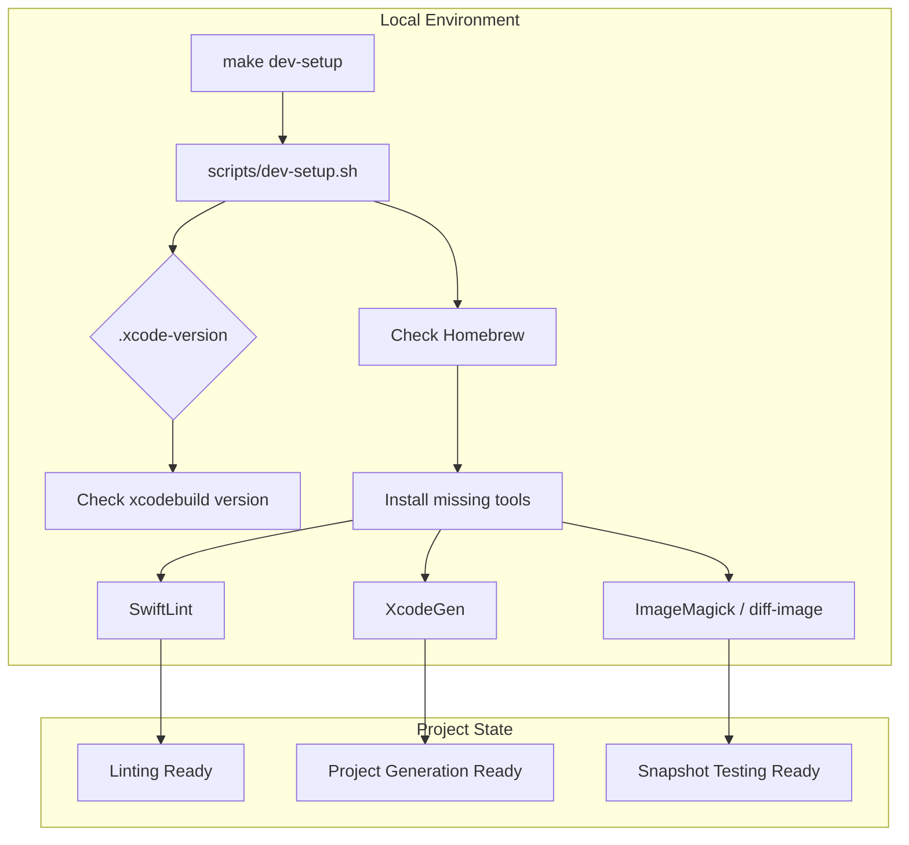
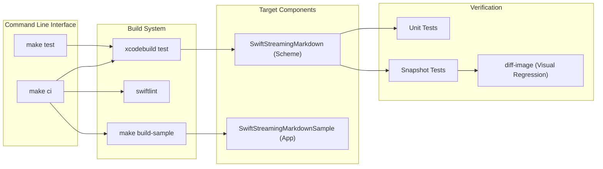

<!-- source: DeepWiki mcp.deepwiki.com · repo microsoft/SwiftStreamingMarkdown · page 8.1 Local Development Setup · fetched 2026-10-26 -->

# Local Development Setup

<details>
<summary>Relevant source files</summary>

The following files were used as context for generating this wiki page:

- [.github/workflows/ci.yml](.github/workflows/ci.yml)
- [.gitignore](.gitignore)
- [.xcode-version](.xcode-version)
- [AGENTS.md](AGENTS.md)
- [CONTRIBUTING.md](CONTRIBUTING.md)
- [Examples/SwiftStreamingMarkdownSample/SwiftStreamingMarkdownSample/Resources/Images/streaming-markdown.svg](Examples/SwiftStreamingMarkdownSample/SwiftStreamingMarkdownSample/Resources/Images/streaming-markdown.svg)
- [Examples/SwiftStreamingMarkdownSample/project.yml](Examples/SwiftStreamingMarkdownSample/project.yml)
- [Makefile](Makefile)
- [scripts/dev-setup.sh](scripts/dev-setup.sh)

</details>


This page provides a step-by-step guide for setting up a local development environment for the `SwiftStreamingMarkdown` library. The project uses a combination of Swift Package Manager (SPM), `make` for task automation, and `XcodeGen` for sample application project management.

## Prerequisites and Tooling

The development environment relies on several tools for linting, project generation, and visual regression testing. The `scripts/dev-setup.sh` script automates the verification and installation of these dependencies.

### Required Tools

| Tool | Purpose | Installation |
| :--- | :--- | :--- |
| **Homebrew** | Package manager for macOS | [brew.sh](https://brew.sh) |
| **Xcode 16.0+** | Required for iOS 18 SDK features | App Store / `xcodes` |
| **SwiftLint** | Enforces code style and conventions | `brew install swiftlint` |
| **XcodeGen** | Generates the sample app `.xcodeproj` | `brew install xcodegen` |
| **cloc** | Counts lines of code for reporting | `brew install cloc` |
| **ImageMagick** | Image processing for snapshot diffs | `brew install imagemagick` |
| **diff-image** | Git diff driver for visual snapshots | [GitHub Repository](https://github.com/ewanmellor/git-diff-image) |

### Version Enforcement
The project enforces a minimum Xcode version defined in `.xcode-version` [1:1-1](). This file is read by `scripts/dev-setup.sh` to ensure the local `xcodebuild` environment supports the iOS 18 APIs used in the library, such as `FadeInTextTransition` [scripts/dev-setup.sh:95-103](), [AGENTS.md:16-16]().

**Sources:** [scripts/dev-setup.sh:5-12](), [AGENTS.md:11-19](), [.xcode-version:1-1]()

---

## Initial Environment Setup

To prepare your machine for development, follow these steps:

1. **Clone the repository.**
2. **Run the setup script:** Execute `make dev-setup` [Makefile:27-29](). This triggers `scripts/dev-setup.sh` which performs the following:
    *   Checks for Homebrew and offers to install it [scripts/dev-setup.sh:82-89]().
    *   Validates the Xcode version against `.xcode-version` [scripts/dev-setup.sh:105-118]().
    *   Checks for `swiftlint`, `xcodegen`, and `cloc`, offering Homebrew installation if missing [scripts/dev-setup.sh:121-157]().
    *   Verifies `ImageMagick` and provides instructions for installing `diff-image` to enable visual diffs in Git [scripts/dev-setup.sh:160-183]().

### Setup Data Flow
The following diagram illustrates how the `Makefile` coordinates the setup process and tool verification.

**Tooling Verification Pipeline**

**Sources:** [Makefile:27-29](), [scripts/dev-setup.sh:15-23](), [scripts/dev-setup.sh:95-118]()

---

## Generating Projects

The repository contains two primary entry points: the Swift Package itself and a sample application.

### Swift Package
To open the library in Xcode, use:
```bash
make project
```
This command resolves package dependencies using `swift package resolve` and opens the root directory in Xcode (`xed .`) [Makefile:35-37]().

### Sample Application
The sample app located in `Examples/SwiftStreamingMarkdownSample/` does not have a checked-in `.xcodeproj` file to avoid merge conflicts [AGENTS.md:41-41](). It must be generated from `project.yml` [Examples/SwiftStreamingMarkdownSample/project.yml:1-1]().

To generate and open the sample app:
```bash
make sample-project
```
This runs `xcodegen` with the specification found at `Examples/SwiftStreamingMarkdownSample/project.yml` and opens the resulting project [Makefile:44-46](), [Makefile:39-42]().

**Sources:** [Makefile:35-46](), [AGENTS.md:41-41](), [Examples/SwiftStreamingMarkdownSample/project.yml:1-15]()

---

## Running Tests Locally

The project includes unit tests and snapshot tests. Snapshot tests use `swift-snapshot-testing` and require `diff-image` for meaningful Git diffs [scripts/dev-setup.sh:10-11]().

### Executing Tests
Tests are executed via `xcodebuild` targeting the library scheme.

| Command | Action |
| :--- | :--- |
| `make test` | Runs all unit and snapshot tests for the `SwiftStreamingMarkdown` scheme [Makefile:52-57](). |
| `make lint` | Runs `swiftlint --strict` to validate code style [Makefile:48-50](). |
| `make build-sample` | Generates the project and builds the sample app to ensure integration works [Makefile:59-67](). |
| `make ci` | Runs `lint`, `test`, and `build-sample` sequentially, mimicking the GitHub Actions pipeline [Makefile:69-70](). |

### Testing Infrastructure Logic
The test suite interacts with the package targets and the sample app to ensure compatibility.

**Test Execution Flow**

**Sources:** [Makefile:48-70](), [.github/workflows/ci.yml:12-65](), [CONTRIBUTING.md:25-34]()

---

## Continuous Integration (CI) Parity

The local `make ci` command is designed to match the `.github/workflows/ci.yml` configuration. The CI pipeline runs on `macos-15` (or latest) and performs:
1.  **SwiftLint**: Validates rules in `.swiftlint.yml` [.github/workflows/ci.yml:13-30]().
2.  **SPM Unit Tests**: Runs tests using `xcodebuild` on an iOS Simulator (e.g., iPhone 15) [.github/workflows/ci.yml:32-46]().
3.  **Sample App Build**: Installs `XcodeGen`, generates the project, and builds the sample app [.github/workflows/ci.yml:47-65]().

**Sources:** [.github/workflows/ci.yml:1-65](), [Makefile:69-70]()

---

