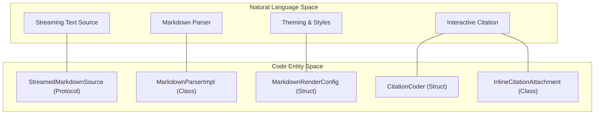
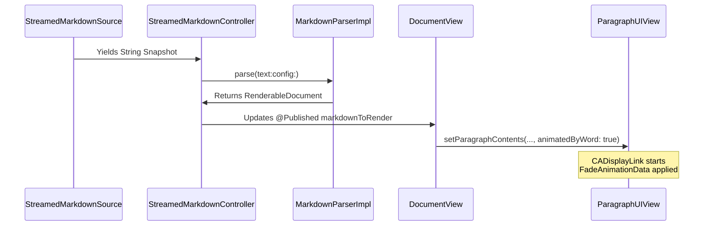

<!-- source: DeepWiki mcp.deepwiki.com · repo microsoft/SwiftStreamingMarkdown · page 9 Glossary · fetched 2026-10-26 -->

# Glossary

Relevant source files

The following files were used as context for generating this wiki page:

- [Examples/SwiftStreamingMarkdownSample/SwiftStreamingMarkdownSample/DemonstrationViewModel.swift](Examples/SwiftStreamingMarkdownSample/SwiftStreamingMarkdownSample/DemonstrationViewModel.swift)
- [Examples/SwiftStreamingMarkdownSample/SwiftStreamingMarkdownSample/Resources/Fixtures/kitchen-sink.md](Examples/SwiftStreamingMarkdownSample/SwiftStreamingMarkdownSample/Resources/Fixtures/kitchen-sink.md)
- [Examples/SwiftStreamingMarkdownSample/SwiftStreamingMarkdownSample/SampleMarkdownTheme.swift](Examples/SwiftStreamingMarkdownSample/SwiftStreamingMarkdownSample/SampleMarkdownTheme.swift)
- [Examples/SwiftStreamingMarkdownSample/SwiftStreamingMarkdownSample/StreamingControlPanelView.swift](Examples/SwiftStreamingMarkdownSample/SwiftStreamingMarkdownSample/StreamingControlPanelView.swift)
- [Examples/SwiftStreamingMarkdownSample/SwiftStreamingMarkdownSample/StreamingSpeed.swift](Examples/SwiftStreamingMarkdownSample/SwiftStreamingMarkdownSample/StreamingSpeed.swift)
- [Package.resolved](Package.resolved)
- [Package.swift](Package.swift)
- [README.md](README.md)
- [Sources/MarkdownText/Citation/CitationCoder.swift](Sources/MarkdownText/Citation/CitationCoder.swift)
- [Sources/MarkdownText/ContextMenu/TextContextMenu.swift](Sources/MarkdownText/ContextMenu/TextContextMenu.swift)
- [Sources/MarkdownText/ContextMenu/TextContextMenuGroup.swift](Sources/MarkdownText/ContextMenu/TextContextMenuGroup.swift)
- [Sources/MarkdownText/ContextMenu/TextContextMenuItem.swift](Sources/MarkdownText/ContextMenu/TextContextMenuItem.swift)
- [Sources/MarkdownText/Inline/Markdown+InlineConvertible.swift](Sources/MarkdownText/Inline/Markdown+InlineConvertible.swift)
- [Sources/MarkdownText/MarkdownView.swift](Sources/MarkdownText/MarkdownView.swift)
- [Sources/MarkdownText/Models/MarkdownRenderConfig.swift](Sources/MarkdownText/Models/MarkdownRenderConfig.swift)
- [Sources/MarkdownText/Models/RenderableDocument.swift](Sources/MarkdownText/Models/RenderableDocument.swift)
- [Sources/MarkdownText/Parser/MarkdownParser.swift](Sources/MarkdownText/Parser/MarkdownParser.swift)
- [Sources/MarkdownText/StreamedMarkdownView.swift](Sources/MarkdownText/StreamedMarkdownView.swift)
- [Sources/MarkdownText/Style/Colors+Static.swift](Sources/MarkdownText/Style/Colors+Static.swift)
- [Sources/MarkdownText/Style/Colors+Theme.swift](Sources/MarkdownText/Style/Colors+Theme.swift)
- [Sources/MarkdownText/Style/TextFonts.swift](Sources/MarkdownText/Style/TextFonts.swift)
- [Sources/MarkdownText/Style/Typography.swift](Sources/MarkdownText/Style/Typography.swift)
- [Sources/MarkdownText/TextTransition/FadeInTextTransition.swift](Sources/MarkdownText/TextTransition/FadeInTextTransition.swift)
- [Sources/MarkdownText/UI/BlockView.swift](Sources/MarkdownText/UI/BlockView.swift)
- [Sources/MarkdownText/UI/ParagraphView.swift](Sources/MarkdownText/UI/ParagraphView.swift)
- [Sources/MarkdownText/UI/UIKit/ParagraphUIView.swift](Sources/MarkdownText/UI/UIKit/ParagraphUIView.swift)
- [Sources/MarkdownText/UI/UnorderedListView.swift](Sources/MarkdownText/UI/UnorderedListView.swift)
- [Sources/MarkdownText/Utilities/String+.swift](Sources/MarkdownText/Utilities/String+.swift)
- [Tests/MarkdownTextTests/MarkdownTextTests.swift](Tests/MarkdownTextTests/MarkdownTextTests.swift)
- [Tests/MarkdownTextTests/OrderedListViewTests.swift](Tests/MarkdownTextTests/OrderedListViewTests.swift)
- [Tests/MarkdownTextTests/TableViewTests.swift](Tests/MarkdownTextTests/TableViewTests.swift)
- [Tests/MarkdownTextTests/UnorderedListViewTests.swift](Tests/MarkdownTextTests/UnorderedListViewTests.swift)
- [scripts/default-ios-destination.sh](scripts/default-ios-destination.sh)

This page provides definitions for codebase-specific terms, abbreviations, and domain concepts used within `SwiftStreamingMarkdown`. It serves as a reference for onboarding engineers to understand the mapping between conceptual terminology and the actual code implementation.

## Core Concepts

### Streaming Snapshot
Unlike delta-based streaming where only new characters are sent, this library expects a **complete snapshot** of the Markdown source so far (a growing prefix) on every update.
*   **Implementation**: `StreamedMarkdownSource` yields `AsyncStream<String>` where each string is the full text to date [Sources/MarkdownText/StreamedMarkdownView.swift:10-17]().
*   **Data Flow**: `StreamedMarkdownController` listens to these snapshots, re-parses them using `MarkdownParserImpl`, and updates the `@Published` `RenderableDocument` [Sources/MarkdownText/StreamedMarkdownView.swift:84-95]().

### RenderableDocument
An intermediate representation of a parsed Markdown document. It transforms the raw `swift-markdown` AST into a flat list of `MarkdownRenderable` enums that the SwiftUI layer can iterate over.
*   **Type**: `RenderableDocument` [Sources/MarkdownText/Models/RenderableDocument.swift:1-10]().
*   **Generation**: Created via `MarkdownParser.parse(text:config:)` [Sources/MarkdownText/Parser/MarkdownParser.swift:34-37]().

### MarkdownRenderable
A high-level enum representing a distinct block of content (e.g., a paragraph, a table, or a list).
*   **Definition**: `MarkdownRenderable` [Sources/MarkdownText/Models/RenderableDocument.swift:1-20]().
*   **Usage**: Dispatched by `SingleBlockView` to specific SwiftUI components like `ParagraphView` or `TableView` [Sources/MarkdownText/UI/BlockView.swift:38-75]().

### Inline Citation
A specialized interactive UI element ("pill" or "chip") rendered inside a text block, representing a reference or source.
*   **Detection**: `Markdown.Link` nodes are checked via `isInlineCitation(coder:)` [Sources/MarkdownText/Inline/Markdown+InlineConvertible.swift:76-83]().
*   **Rendering**: Handled by `InlineCitationAttachment` (an `NSTextAttachment` subclass) and its associated `InlineCitationViewProvider` [Sources/MarkdownText/UI/UIKit/ParagraphUIView.swift:183-185]().

---

## Domain Entity Mapping

The following diagram maps natural language concepts to the specific code entities that implement them.

### Concept to Code Mapping

Sources: [Sources/MarkdownText/StreamedMarkdownView.swift:15-17](), [Sources/MarkdownText/Parser/MarkdownParser.swift:9-16](), [Sources/MarkdownText/Models/MarkdownRenderConfig.swift:16-36](), [Sources/MarkdownText/Citation/CitationCoder.swift:1-10]().

---

## Implementation Terms

### Speculative Rewriting
A process within the parser that attempts to "close" unclosed Markdown syntax (like triple backticks for code blocks or pipes for tables) in a streaming snapshot to prevent broken UI during mid-stream updates.
*   **Function**: `MarkdownParseOption.speculativeRewrite` [Sources/MarkdownText/Parser/MarkdownParser.swift:25-26]().

### Word-by-Word Fade
The animation technique used to smoothly introduce new text as it arrives from a stream.
*   **Logic**: `ParagraphUIView.setParagraphContents(_:lineSpacing:animatedByWord:)` calculates word ranges and schedules `FadeAnimationData` [Sources/MarkdownText/UI/UIKit/ParagraphUIView.swift:108-168]().
*   **Driver**: A `CADisplayLink` updates the alpha values of specific text ranges [Sources/MarkdownText/UI/UIKit/ParagraphUIView.swift:35-57]().

### Typography Tokens
Design tokens that define font families, weights, and sizes, which are then scaled according to iOS Dynamic Type.
*   **Type**: `Typography` enum and `TextFonts` struct [Sources/MarkdownText/Style/Typography.swift:1-10](), [Sources/MarkdownText/Style/TextFonts.swift:1-10]().

---

## Component Relationship

This diagram illustrates how data flows from a raw Markdown string through the system components until it is rendered on screen.

### Data Flow and Ownership

Sources: [Sources/MarkdownText/StreamedMarkdownView.swift:62-95](), [Sources/MarkdownText/UI/BlockView.swift:46-52](), [Sources/MarkdownText/UI/UIKit/ParagraphUIView.swift:108-140]().

---

## Technical Abbreviations

| Abbreviation | Meaning | Code Reference |
| :--- | :--- | :--- |
| **AST** | Abstract Syntax Tree | The `Markdown.Document` tree produced by `swift-markdown`. |
| **Gfm** | GitHub Flavored Markdown | Supported via the underlying `cmark-gfm` library [README.md:85-88](). |
| **LaTeX** | Typesetting system for math | Handled by `LaTexPreProcessorImpl` and rendered via `iosMath` [Sources/MarkdownText/Inline/Markdown+InlineConvertible.swift:146-170](). |
| **SPM** | Swift Package Manager | The exclusive distribution method [README.md:147-149](). |

Sources: [README.md:1-175](), [Sources/MarkdownText/Inline/Markdown+InlineConvertible.swift:146-170]().