# Page: Overview

# Overview

<details>
<summary>Relevant source files</summary>

The following files were used as context for generating this wiki page:

- [.gitignore](.gitignore)
- [AGENTS.md](AGENTS.md)
- [LICENSE](LICENSE)
- [Makefile](Makefile)
- [Package.resolved](Package.resolved)
- [Package.swift](Package.swift)
- [README.md](README.md)
- [Sources/MarkdownText/MarkdownView.swift](Sources/MarkdownText/MarkdownView.swift)
- [Sources/MarkdownText/StreamedMarkdownView.swift](Sources/MarkdownText/StreamedMarkdownView.swift)
- [Sources/MarkdownText/UI/BlockView.swift](Sources/MarkdownText/UI/BlockView.swift)

</details>


`SwiftStreamingMarkdown` is a high-performance iOS Markdown rendering library designed specifically for smooth streaming experiences, such as those required by LLM chat interfaces. It provides a robust pipeline for parsing, rewriting, and rendering Markdown and LaTeX content in SwiftUI and UIKit environments.

The library is distributed as a Swift Package and supports iOS 16+ with Xcode 16+ [Package.swift:1-9]().

### Key Capabilities

*   **Streaming-First Architecture**: Optimized for incremental updates where content grows over time without UI stalls or "jitter" [README.md:11-11](), [AGENTS.md:63-66]().
*   **LaTeX Support**: Native rendering for inline `\( … \)` and block `$$ … $$` math [README.md:102-103]().
*   **Rich Inline Elements**: Supports interactive inline citation pills for source-grounded responses [README.md:69-74]().
*   **Configurable UI**: Deeply customizable typography, theming, and context menu interactions [README.md:14-15]().

Sources: [README.md:1-16](), [Package.swift:1-9](), [AGENTS.md:5-20]()

---

## System Architecture

The library processes Markdown through a multi-phase pipeline to ensure that the main thread remains responsive even during heavy streaming workloads.

### Rendering Pipeline Flow

The diagram below illustrates how a raw Markdown string is transformed into a rendered view.

**Markdown Processing Pipeline**
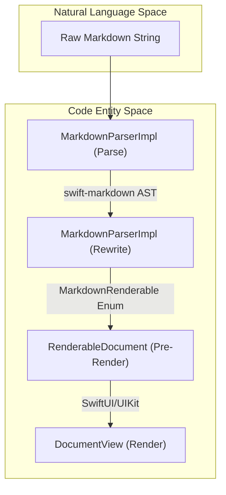
Sources: [AGENTS.md:51-74](), [Sources/MarkdownText/StreamedMarkdownView.swift:88-91]()

### Component Interaction

The UI layer is split between SwiftUI for layout and structural blocks, and UIKit (`UITextView`) for high-performance paragraph rendering with word-by-word animations.

**UI Layer Hierarchy**
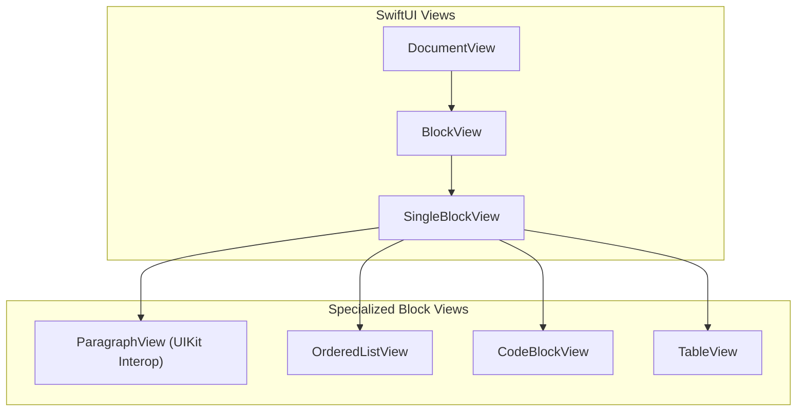
Sources: [Sources/MarkdownText/UI/BlockView.swift:9-78](), [AGENTS.md:71-74]()

---

## Core Components

### 1. View Entry Points
The library provides two primary views for integration:
*   `MarkdownView`: For rendering static Markdown strings [Sources/MarkdownText/MarkdownView.swift:13-15]().
*   `StreamedMarkdownView`: For rendering content that arrives incrementally via a `StreamedMarkdownSource` [Sources/MarkdownText/StreamedMarkdownView.swift:25-35]().

For details on implementation, see [Getting Started](#1.1).

### 2. Configuration & Styling
The `MarkdownRenderConfig` object acts as the central source of truth for styling, including colors, fonts, and animation behaviors [README.md:30-30](). It uses a design token system (Typography) to ensure consistent scaling across the UI.

For details, see [Public API Reference](#1.2).

### 3. Parsing & Rewriting
The system leverages `swift-markdown` and `cmark-gfm` for robust parsing [AGENTS.md:59-61](). A "Rewriting" phase speculatively closes open tags (like emphasis) during streaming to prevent visual jitter [AGENTS.md:63-66]().

### 4. Interactive Citations
Citations are handled via a dedicated `CitationCoder` that translates specific Markdown link patterns into interactive pills within the text [README.md:104-104]().

---

## Child Pages

*   [Getting Started](#1.1) — How to integrate via SPM, requirements, and basic usage examples.
*   [Public API Reference](#1.2) — Detailed documentation for `MarkdownView`, `StreamedMarkdownView`, and the configuration APIs.

Sources: [README.md:147-208](), [Sources/MarkdownText/MarkdownView.swift:1-45](), [Sources/MarkdownText/StreamedMarkdownView.swift:1-60]()

---

# Page: Getting Started

# Getting Started

<details>
<summary>Relevant source files</summary>

The following files were used as context for generating this wiki page:

- [.github/workflows/ci.yml](.github/workflows/ci.yml)
- [CONTRIBUTING.md](CONTRIBUTING.md)
- [Package.resolved](Package.resolved)
- [Package.swift](Package.swift)
- [README.md](README.md)
- [Sources/MarkdownText/MarkdownView.swift](Sources/MarkdownText/MarkdownView.swift)
- [Sources/MarkdownText/StreamedMarkdownView.swift](Sources/MarkdownText/StreamedMarkdownView.swift)
- [Sources/MarkdownText/UI/BlockView.swift](Sources/MarkdownText/UI/BlockView.swift)
- [scripts/dev-setup.sh](scripts/dev-setup.sh)

</details>


SwiftStreamingMarkdown is a high-performance Markdown rendering library for iOS designed specifically for streaming content, such as real-time responses from Large Language Models (LLMs). It provides smooth transitions, native LaTeX support, and interactive citation pills while maintaining a highly configurable UI layer.

## Minimum Requirements

The library leverages modern Swift and SwiftUI features, requiring the following environment:

| Requirement | Minimum Version |
| :--- | :--- |
| **iOS** | 16.0+ [Package.swift:9]() |
| **Swift** | 5.9+ [Package.swift:1]() |
| **Xcode** | 16.0+ (as enforced by `.xcode-version`) [scripts/dev-setup.sh:99-118]() |

## Installation

### Swift Package Manager (SPM)

You can integrate SwiftStreamingMarkdown into your project via SPM in two ways:

#### 1. Via Xcode
1. Navigate to **File ▸ Add Package Dependencies...**
2. Enter the repository URL: `https://github.com/microsoft/SwiftStreamingMarkdown` [README.md:154]()
3. Set the Dependency Rule to **Up to Next Minor** or **Branch: main**.

#### 2. Via `Package.swift`
Add the package to your dependencies and target:

```swift
// dependencies
.package(url: "https://github.com/microsoft/SwiftStreamingMarkdown", from: "0.1.0"),

// target dependencies
.target(
  name: "YourApp",
  dependencies: [
    .product(name: "SwiftStreamingMarkdown", package: "SwiftStreamingMarkdown")
  ]
)
```
Sources: [README.md:160-171]()

### Binary Size Impact
Integrating this library adds approximately **3 MB** to the final App Store download size. This includes the rendering engine and its core dependencies: `swift-markdown`, `iosMath`, and `HighlightSwift`. [README.md:173-176]()

---

## Quick Start Examples

The library provides two primary entry points depending on whether your content is static or arriving incrementally.

### Static Rendering: `MarkdownView`
Use `MarkdownView` for standard, non-streaming Markdown strings. It handles parsing and rendering internally.

```swift
import SwiftUI
import SwiftStreamingMarkdown

struct StaticContentView: View {
    var body: some View {
        MarkdownView(text: """
        # Hello World
        This is **static** markdown.
        """)
        .padding()
    }
}
```
Sources: [MarkdownView.swift:13-32](), [README.md:182-202]()

### Streaming Rendering: `StreamedMarkdownView`
For LLM chat interfaces, use `StreamedMarkdownView`. It requires a `StreamedMarkdownSource` that yields a sequence of "complete-so-far" snapshots.

```swift
import SwiftUI
import SwiftStreamingMarkdown

struct StreamingContentView: View {
    // MySource must conform to StreamedMarkdownSource
    @State var source = MySource() 

    var body: some View {
        StreamedMarkdownView(source: source)
    }
}
```
Sources: [StreamedMarkdownView.swift:25-45](), [README.md:207-209]()

---

## Implementation Overview

The following diagrams illustrate how the high-level views interact with the underlying controller and parsing logic.

### Entity Relationship: View to Controller
This diagram bridges the SwiftUI views to their respective logic controllers and the shared parsing infrastructure.

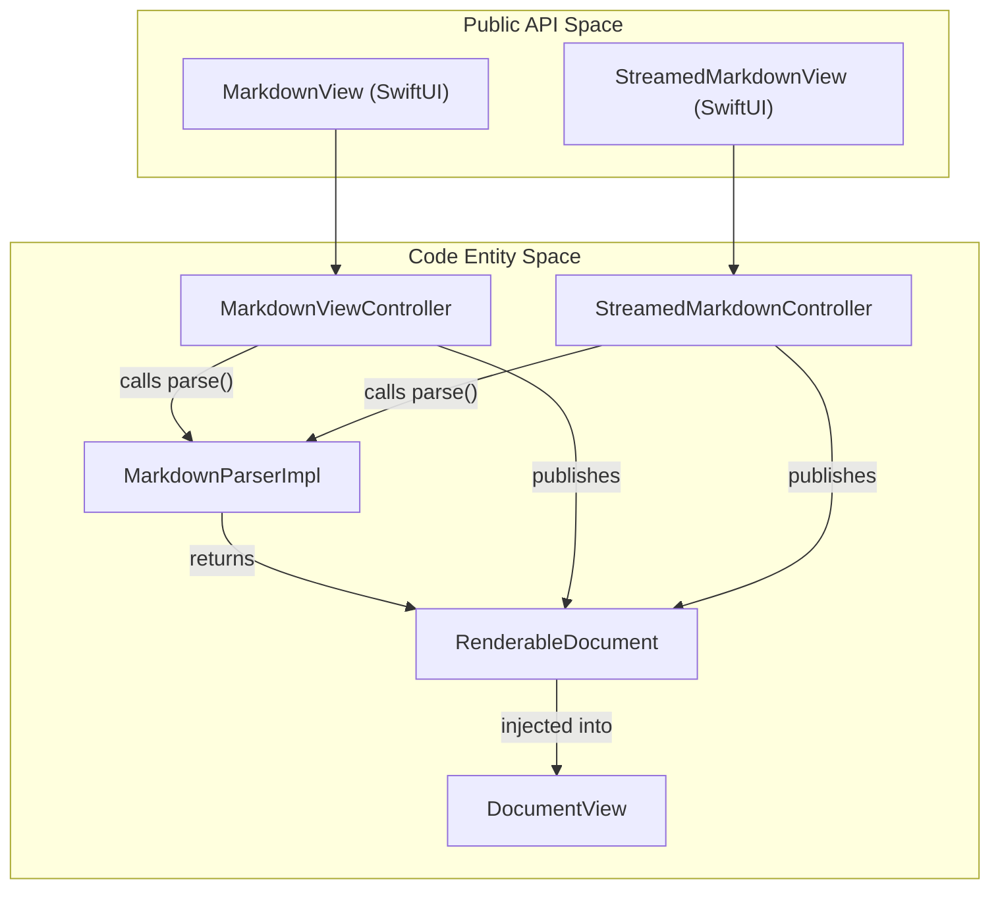
Sources: [MarkdownView.swift:13-68](), [StreamedMarkdownView.swift:25-101](), [UI/BlockView.swift:9-78]()

### Data Flow: Streaming Lifecycle
The flow of data from an asynchronous source through the parser to the final UI update.

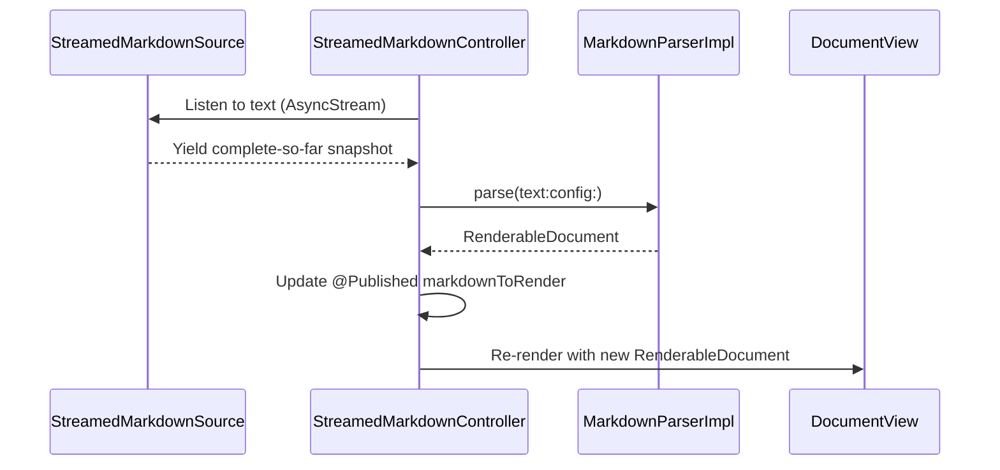
Sources: [StreamedMarkdownView.swift:15-17](), [StreamedMarkdownView.swift:82-95](), [StreamedMarkdownView.swift:48-52]()

---

## Key Components

| Component | File | Role |
| :--- | :--- | :--- |
| `MarkdownView` | [MarkdownView.swift]() | The simplest entry point for static text. |
| `StreamedMarkdownView` | [StreamedMarkdownView.swift]() | Handles `AsyncStream` inputs for real-time text growth. |
| `MarkdownParserImpl` | [MarkdownView.swift:53]() | The engine that converts raw String into an AST and then into `RenderableDocument`. |
| `DocumentView` | [StreamedMarkdownView.swift:48]() | The internal SwiftUI view that iterates over `MarkdownRenderable` blocks. |
| `MarkdownRenderConfig` | [StreamedMarkdownView.swift:27]() | Central configuration for fonts, colors, and animation settings. |

Sources: [MarkdownView.swift:13-68](), [StreamedMarkdownView.swift:25-101](), [UI/BlockView.swift:9-78]()

---

# Page: Public API Reference

# Public API Reference

<details>
<summary>Relevant source files</summary>

The following files were used as context for generating this wiki page:

- [README.md](README.md)
- [Sources/MarkdownText/MarkdownView.swift](Sources/MarkdownText/MarkdownView.swift)
- [Sources/MarkdownText/Models/MarkdownRenderConfig+Builders.swift](Sources/MarkdownText/Models/MarkdownRenderConfig+Builders.swift)
- [Sources/MarkdownText/Models/MarkdownRenderConfig.swift](Sources/MarkdownText/Models/MarkdownRenderConfig.swift)
- [Sources/MarkdownText/StreamedMarkdownView.swift](Sources/MarkdownText/StreamedMarkdownView.swift)
- [Sources/MarkdownText/UI/DocumentView.swift](Sources/MarkdownText/UI/DocumentView.swift)
- [Sources/MarkdownText/Utilities/MarkdownListener.swift](Sources/MarkdownText/Utilities/MarkdownListener.swift)

</details>


This page provides a detailed technical reference for the public surface of the `SwiftStreamingMarkdown` library. It covers the primary SwiftUI views, the protocols used for data sourcing and event handling, and the configuration system for styling and behavior.

## Core View Components

The library provides three primary entry points for rendering Markdown, depending on whether the source is static, streaming, or already pre-parsed.

### MarkdownView
`MarkdownView` is the simplest entry point. It accepts a raw Markdown string, manages its own internal `MarkdownParserImpl`, and handles the asynchronous parsing lifecycle [Sources/MarkdownText/MarkdownView.swift:13-15]().

### StreamedMarkdownView
`StreamedMarkdownView` is designed for chat-style interfaces where Markdown content arrives incrementally. It consumes a `StreamedMarkdownSource` and re-parses the content as new snapshots arrive [Sources/MarkdownText/StreamedMarkdownView.swift:25-28]().

### DocumentView
`DocumentView` is the low-level rendering component. It accepts a pre-parsed `RenderableDocument` and is used internally by both `MarkdownView` and `StreamedMarkdownView` [Sources/MarkdownText/UI/DocumentView.swift:15-18]().

### View Hierarchy and Data Flow
The following diagram illustrates how these components relate to the internal controllers and the parsing logic.

**View to Entity Mapping: Rendering Pipeline**
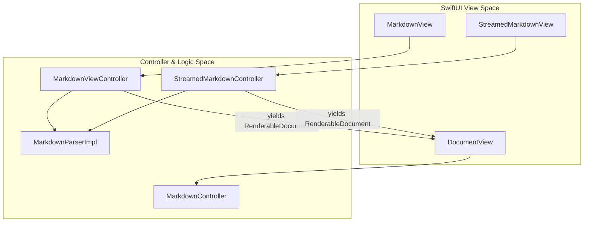
Sources: [Sources/MarkdownText/MarkdownView.swift:13-18](), [Sources/MarkdownText/StreamedMarkdownView.swift:25-29](), [Sources/MarkdownText/UI/DocumentView.swift:15-19](), [Sources/MarkdownText/StreamedMarkdownView.swift:62-70]()

---

## Protocols and Interfaces

The library uses protocols to decouple the UI from data sources and to provide hooks for application-level logic.

### StreamedMarkdownSource
To use `StreamedMarkdownView`, you must provide an object conforming to `StreamedMarkdownSource`.
*   **`text: AsyncStream<String>`**: This stream must yield *complete snapshots* of the Markdown source so far (growing prefixes), not incremental deltas [Sources/MarkdownText/StreamedMarkdownView.swift:15-17]().

### MarkdownListener
The `MarkdownListener` protocol allows the host application to respond to rendering updates and user interactions [Sources/MarkdownText/Utilities/MarkdownListener.swift:8-14]().

| Function | Description |
| :--- | :--- |
| `onRender(markdown:)` | Called whenever a new `RenderableDocument` is processed and ready for display. |
| `onTableCopyTap(content:)` | Triggered when a user taps the copy button on a Markdown table. |
| `onTableDownloadTap(content:)` | Triggered when a user taps the download button on a Markdown table. |
| `onContextMenuAppear(id:selectedContent:)` | Triggered when a custom context menu is displayed on text selection. |
| `onContextMenuTap(id:selectedContent:)` | Triggered when a user selects an action from the custom context menu. |

**Code Entity Interaction: Listener Flow**
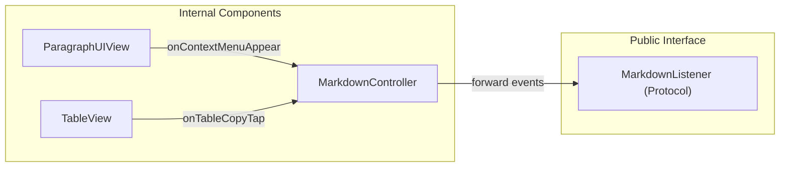
Sources: [Sources/MarkdownText/Utilities/MarkdownListener.swift:8-14](), [Sources/MarkdownText/Utilities/MarkdownListener.swift:56-78]()

---

## MarkdownRenderConfig

`MarkdownRenderConfig` is the central configuration object. It uses a builder-style API for incremental overrides of the default theme [Sources/MarkdownText/Models/MarkdownRenderConfig.swift:16-35]().

### Configuration Properties
The configuration is composed of several sub-structs targeting specific Markdown elements:

| Property | Type | Description |
| :--- | :--- | :--- |
| `shouldAnimateText` | `Bool` | If true, new text fades in using a word-by-word animation [Sources/MarkdownText/Models/MarkdownRenderConfig.swift:18](). |
| `paragraphStyle` | `MarkdownTextStyle` | Font and color for standard text [Sources/MarkdownText/Models/MarkdownRenderConfig.swift:26](). |
| `headingStyle` | `MarkdownHeadingTextStyle` | Per-level (H1-H6) font configurations [Sources/MarkdownText/Models/MarkdownRenderConfig.swift:22](). |
| `tableStyle` | `MarkdownTableTextStyle` | Colors for borders, headers, and action buttons [Sources/MarkdownText/Models/MarkdownRenderConfig.swift:28](). |
| `inlineStyle` | `MarkdownInlineTextStyle` | Styling for bold, links, and inline code spans [Sources/MarkdownText/Models/MarkdownRenderConfig.swift:30](). |
| `citationConfig` | `CitationConfig` | Controls `CitationCoder` and chip appearance [Sources/MarkdownText/Models/MarkdownRenderConfig.swift:35](). |
| `textContextMenu` | `TextContextMenu?` | Customizes the iOS edit menu on text selection [Sources/MarkdownText/Models/MarkdownRenderConfig.swift:33](). |

### Builder API
`MarkdownRenderConfig` provides `with...` methods to create modified copies of a configuration:
*   `withShouldAnimateText(value:)` [Sources/MarkdownText/Models/MarkdownRenderConfig+Builders.swift:10-21]()
*   `withParagraphStyle(value:)` [Sources/MarkdownText/Models/MarkdownRenderConfig+Builders.swift:66-77]()
*   `withHeadingStyle(value:)` [Sources/MarkdownText/Models/MarkdownRenderConfig+Builders.swift:38-49]()
*   `withTextContextMenu(value:)` [Sources/MarkdownText/Models/MarkdownRenderConfig+Builders.swift:109-120]()

### Environment Injection
The configuration is injected into the SwiftUI environment, allowing deep child views (like `ParagraphView` or `CodeBlockView`) to access styling without explicit prop-drilling [Sources/MarkdownText/UI/DocumentView.swift:52-58]().

Sources: [Sources/MarkdownText/Models/MarkdownRenderConfig.swift:10-35](), [Sources/MarkdownText/Models/MarkdownRenderConfig+Builders.swift:8-121](), [Sources/MarkdownText/UI/DocumentView.swift:36-39]()

---

# Page: Core Architecture

# Core Architecture

<details>
<summary>Relevant source files</summary>

The following files were used as context for generating this wiki page:

- [Package.resolved](Package.resolved)
- [Package.swift](Package.swift)
- [README.md](README.md)
- [Sources/MarkdownText/MarkdownView.swift](Sources/MarkdownText/MarkdownView.swift)
- [Sources/MarkdownText/Models/RenderableDocument.swift](Sources/MarkdownText/Models/RenderableDocument.swift)
- [Sources/MarkdownText/Parser/MarkdownParser.swift](Sources/MarkdownText/Parser/MarkdownParser.swift)
- [Sources/MarkdownText/StreamedMarkdownView.swift](Sources/MarkdownText/StreamedMarkdownView.swift)
- [Sources/MarkdownText/Style/Colors+Static.swift](Sources/MarkdownText/Style/Colors+Static.swift)
- [Sources/MarkdownText/Style/Colors+Theme.swift](Sources/MarkdownText/Style/Colors+Theme.swift)
- [Sources/MarkdownText/UI/BlockView.swift](Sources/MarkdownText/UI/BlockView.swift)

</details>


The `SwiftStreamingMarkdown` library employs a decoupled, three-phase pipeline to transform raw Markdown strings into a fluid, animated SwiftUI interface. This architecture is specifically optimized for **streaming**—where content arrives incrementally—by ensuring that re-parsing and re-rendering are efficient enough to maintain 60 FPS on iOS devices [README.md:119-124]().

## The Rendering Pipeline

The transition from a raw string to pixels follows a linear flow. Each stage is isolated to allow for independent testing and optimization.

### 1. Parsing Phase
The `MarkdownParser` [Sources/MarkdownText/Parser/MarkdownParser.swift:9-16]() receives a `String` snapshot. In a streaming context, this is typically a progressively larger prefix of the full response [Sources/MarkdownText/StreamedMarkdownView.swift:12-14](). The parser handles LaTeX pre-processing and uses the `swift-markdown` engine to produce an Abstract Syntax Tree (AST).

### 2. Conversion Phase
The AST is traversed and converted into a `RenderableDocument` [Sources/MarkdownText/Models/RenderableDocument.swift:13-34](). During this phase, Markdown nodes are mapped to a flat array of `MarkdownRenderable` enum cases. This is where styling from `MarkdownRenderConfig` is baked into `NSAttributedString` instances, including font resolution and color application [Sources/MarkdownText/Models/RenderableDocument.swift:39-49]().

### 3. Rendering Phase
The `DocumentView` consumes the `RenderableDocument`. It iterates through the renderables and dispatches them to specialized SwiftUI views (e.g., `ParagraphView`, `TableView`, `CodeBlockView`) [Sources/MarkdownText/UI/BlockView.swift:36-78]().

### Data Flow Overview

The following diagram illustrates the lifecycle of a single Markdown update within the system.

**Pipeline Entity Mapping**
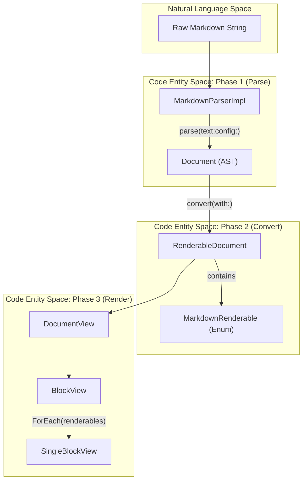
Sources: [Sources/MarkdownText/Parser/MarkdownParser.swift:9-38](), [Sources/MarkdownText/Models/RenderableDocument.swift:13-34](), [Sources/MarkdownText/UI/BlockView.swift:9-24]()

---

## Component Breakdown

### Parsing Pipeline
The parsing stage is abstracted by the `MarkdownParser` protocol. The primary implementation, `MarkdownParserImpl`, manages the complexities of partial Markdown (e.g., unclosed code blocks or incomplete LaTeX markers) to ensure the UI doesn't flicker or break during streaming.

For details, see [Parsing Pipeline](#2.1).

### AST-to-Renderable Conversion
This phase bridges the gap between a generic Markdown tree and an iOS-optimized data structure. It utilizes `BlockConvertible` and `InlineConvertible` protocols to transform `swift-markdown` nodes. Crucially, it propagates typography settings (like letter spacing and line height) into the underlying text storage.

For details, see [AST-to-Renderable Conversion](#2.2).

### RenderableDocument and Data Models
The `RenderableDocument` serves as the "Source of Truth" for the UI. It is an immutable, `Sendable` snapshot that represents a fully prepared document [Sources/MarkdownText/Models/RenderableDocument.swift:13](). By performing the heavyweight work of attribute calculation and layout preparation in this model, the library keeps the SwiftUI view body execution extremely lightweight.

For details, see [RenderableDocument and Data Models](#2.3).

---

## System Integration

The architecture is exposed via two primary SwiftUI entry points that manage the pipeline's lifecycle:

| View | Use Case | Controller |
| :--- | :--- | :--- |
| `MarkdownView` | Static content or infrequent updates. | `MarkdownViewController` |
| `StreamedMarkdownView` | Real-time streaming (e.g., LLM chat). | `StreamedMarkdownController` |

**Streaming Controller Logic**
The `StreamedMarkdownController` manages an `AsyncStream` of text, triggering a new parse-convert cycle on every emission and updating the `@Published` `markdownToRender` property on the `MainActor` [Sources/MarkdownText/StreamedMarkdownView.swift:82-95]().

**Controller-to-View Interaction**
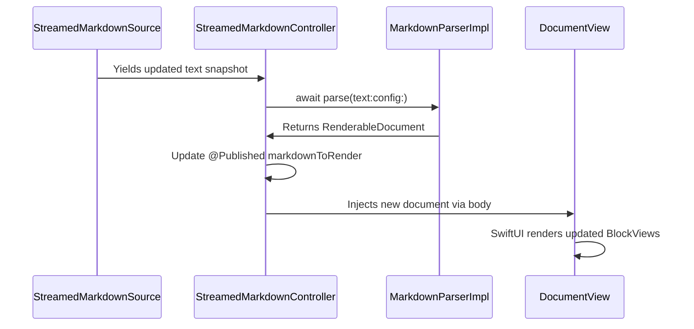
Sources: [Sources/MarkdownText/StreamedMarkdownView.swift:62-101](), [Sources/MarkdownText/MarkdownView.swift:48-68]()

---

# Page: Parsing Pipeline

# Parsing Pipeline

<details>
<summary>Relevant source files</summary>

The following files were used as context for generating this wiki page:

- [Sources/MarkdownText/Parser/LaTexPreProcessor.swift](Sources/MarkdownText/Parser/LaTexPreProcessor.swift)
- [Sources/MarkdownText/Parser/MarkdownParseOption.swift](Sources/MarkdownText/Parser/MarkdownParseOption.swift)
- [Sources/MarkdownText/Parser/MarkdownParseResult.swift](Sources/MarkdownText/Parser/MarkdownParseResult.swift)
- [Sources/MarkdownText/Parser/MarkdownParser.swift](Sources/MarkdownText/Parser/MarkdownParser.swift)
- [Sources/MarkdownText/Parser/MarkdownParserImpl.swift](Sources/MarkdownText/Parser/MarkdownParserImpl.swift)
- [Sources/MarkdownText/Parser/Rewriters/PartialEmphasisRewriter.swift](Sources/MarkdownText/Parser/Rewriters/PartialEmphasisRewriter.swift)
- [Sources/MarkdownText/Parser/Rewriters/PartialTableRewriter.swift](Sources/MarkdownText/Parser/Rewriters/PartialTableRewriter.swift)
- [Sources/MarkdownText/Parser/Scanners/MarkupPostParsingRewriter.swift](Sources/MarkdownText/Parser/Scanners/MarkupPostParsingRewriter.swift)
- [Sources/MarkdownText/Parser/Scanners/MarkupScanner.swift](Sources/MarkdownText/Parser/Scanners/MarkupScanner.swift)
- [Sources/MarkdownText/Parser/Scanners/PartialEmphasisScanner.swift](Sources/MarkdownText/Parser/Scanners/PartialEmphasisScanner.swift)
- [Sources/MarkdownText/Parser/Scanners/PartialTableScanner.swift](Sources/MarkdownText/Parser/Scanners/PartialTableScanner.swift)

</details>


The parsing pipeline in `SwiftStreamingMarkdown` is responsible for transforming raw input strings—often arriving in incomplete chunks during a stream—into a structured `Document` AST. This process involves three distinct stages: LaTeX pre-processing, standard Markdown parsing via `swift-markdown`, and speculative rewriting to handle partial syntax.

## Overview of the Pipeline

The entry point for all parsing operations is the `MarkdownParser` protocol [Sources/MarkdownText/Parser/MarkdownParser.swift:9-16](). The default implementation, `MarkdownParserImpl`, orchestrates the flow of data through the pre-processor and optional rewriters.

### Data Flow Diagram
This diagram illustrates the sequence of operations within `MarkdownParserImpl.parse(text:option:)` [Sources/MarkdownText/Parser/MarkdownParserImpl.swift:24-40]().

Title: Markdown Parsing Data Flow
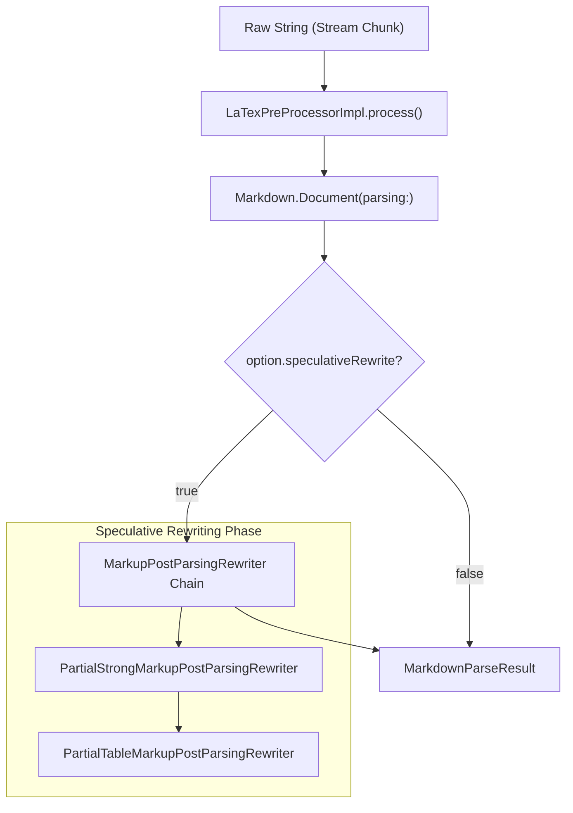
Sources: [Sources/MarkdownText/Parser/MarkdownParserImpl.swift:11-40](), [Sources/MarkdownText/Parser/MarkdownParseOption.swift:7-10]()

## LaTeX Pre-processing

Because standard CommonMark does not support LaTeX, the library uses `LaTexPreProcessorImpl` to identify math delimiters before the main parser runs [Sources/MarkdownText/Parser/LaTexPreProcessor.swift:21-139](). 

### Block and Inline Handling
1.  **Block LaTeX**: Delimiters like `$$` or `\[ ... \]` are converted into a special Fenced Code Block with the language identifier `blockmath` [Sources/MarkdownText/Parser/LaTexPreProcessor.swift:142-160](). This prevents the Markdown parser from escaping characters like `_` or `*` inside the equation [Sources/MarkdownText/Parser/LaTexPreProcessor.swift:141-141]().
2.  **Inline LaTeX**: Delimiters like `\(` are wrapped in inline code backticks (e.g., `` `\(...\)` ``) to preserve the LaTeX string [Sources/MarkdownText/Parser/LaTexPreProcessor.swift:163-169]().

### Syntax Normalization
The pre-processor also performs "filtering" to map unsupported LaTeX commands to supported ones (e.g., `\dfrac` → `\frac`, `\overrightarrow` → `\vec`) [Sources/MarkdownText/Parser/LaTexPreProcessor.swift:190-237]().

Sources: [Sources/MarkdownText/Parser/LaTexPreProcessor.swift:142-186](), [Sources/MarkdownText/Parser/LaTexPreProcessor.swift:208-237]()

## Speculative Rewriting

When streaming Markdown from an LLM, the text often cuts off mid-syntax (e.g., `**Bold text`). Standard parsers treat this as literal text until the closing delimiter arrives. Speculative rewriting detects these partial states and "fixes" them in the AST so the UI can render the intended style immediately.

### Scanners and Rewriters
The system uses a **Scanner-Rewriter** pattern:
*   **Scanner**: Inspects the `Document` to find a specific "incomplete" node [Sources/MarkdownText/Parser/Scanners/MarkupScanner.swift:8-16]().
*   **Rewriter**: A `MarkupRewriter` subclass that modifies the AST to close the partial syntax [Sources/MarkdownText/Parser/Rewriters/PartialEmphasisRewriter.swift:8-114]().

### Supported Partial Syntaxes

| Feature | Scanner | Rewriter | Logic |
| :--- | :--- | :--- | :--- |
| **Emphasis** | `PartialEmphasisScanner` | `PartialEmphasisRewriter` | Detects trailing `*` or `_` and wraps the following text in a `Strong` or `Emphasis` node [Sources/MarkdownText/Parser/Rewriters/PartialEmphasisRewriter.swift:43-68](). |
| **Tables** | `PartialTableScanner` | `PartialTableRewriter` | Detects lines starting with `\|` that haven't been recognized as a table yet, and hides them until the delimiter row is complete to avoid "jumping" text [Sources/MarkdownText/Parser/Scanners/PartialTableScanner.swift:13-64](). |

Sources: [Sources/MarkdownText/Parser/Scanners/MarkupPostParsingRewriter.swift:19-53](), [Sources/MarkdownText/Parser/Rewriters/PartialEmphasisRewriter.swift:8-36](), [Sources/MarkdownText/Parser/Scanners/PartialTableScanner.swift:9-65]()

## Implementation Details

### Class Relationships
This diagram bridges the abstract protocols to their concrete implementations and the specific scanning logic used for streaming.

Title: Parser Implementation and Scanning
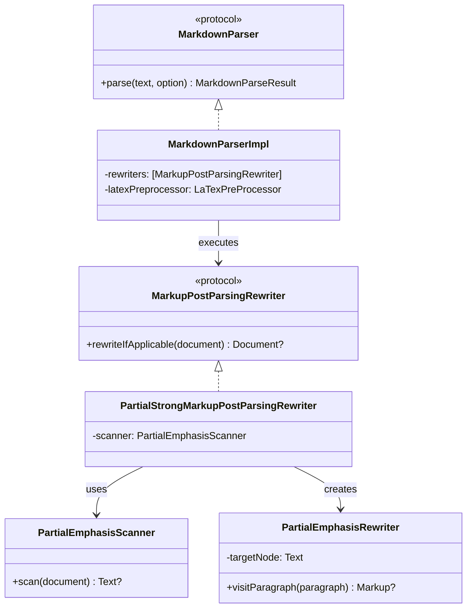
Sources: [Sources/MarkdownText/Parser/MarkdownParser.swift:9-16](), [Sources/MarkdownText/Parser/MarkdownParserImpl.swift:9-21](), [Sources/MarkdownText/Parser/Scanners/MarkupPostParsingRewriter.swift:14-35](), [Sources/MarkdownText/Parser/Rewriters/PartialEmphasisRewriter.swift:8-23]()

### Handling Table Edge Cases
`PartialTableScanner` is particularly complex because it must differentiate between a standard paragraph and a "table-in-progress." It looks for specific patterns in the `Paragraph` children:
1.  A single `Text` node starting with `|` [Sources/MarkdownText/Parser/Scanners/PartialTableScanner.swift:31-35]().
2.  A `Text` node followed by a `SoftBreak` [Sources/MarkdownText/Parser/Scanners/PartialTableScanner.swift:42-48]().
3.  A header, a break, and a partial delimiter row (e.g., `| :--`) [Sources/MarkdownText/Parser/Scanners/PartialTableScanner.swift:55-61]().

If these patterns are found, `PartialTableRewriter` clears the children of the paragraph to prevent the raw table pipe syntax from flickering on screen before the full table is rendered [Sources/MarkdownText/Parser/Rewriters/PartialTableRewriter.swift:16-24]().

Sources: [Sources/MarkdownText/Parser/Scanners/PartialTableScanner.swift:13-65](), [Sources/MarkdownText/Parser/Rewriters/PartialTableRewriter.swift:8-25]()

---

# Page: AST-to-Renderable Conversion

# AST-to-Renderable Conversion

<details>
<summary>Relevant source files</summary>

The following files were used as context for generating this wiki page:

- [Examples/SwiftStreamingMarkdownSample/SwiftStreamingMarkdownSample/RobotoTheme.swift](Examples/SwiftStreamingMarkdownSample/SwiftStreamingMarkdownSample/RobotoTheme.swift)
- [Sources/MarkdownText/Block/BlockConvertible.swift](Sources/MarkdownText/Block/BlockConvertible.swift)
- [Sources/MarkdownText/Block/BlockQuote+.swift](Sources/MarkdownText/Block/BlockQuote+.swift)
- [Sources/MarkdownText/Block/CodeBlock+.swift](Sources/MarkdownText/Block/CodeBlock+.swift)
- [Sources/MarkdownText/Block/Document+.swift](Sources/MarkdownText/Block/Document+.swift)
- [Sources/MarkdownText/Block/Heading+.swift](Sources/MarkdownText/Block/Heading+.swift)
- [Sources/MarkdownText/Block/OrderedList+.swift](Sources/MarkdownText/Block/OrderedList+.swift)
- [Sources/MarkdownText/Block/Paragraph+.swift](Sources/MarkdownText/Block/Paragraph+.swift)
- [Sources/MarkdownText/Block/Table+.swift](Sources/MarkdownText/Block/Table+.swift)
- [Sources/MarkdownText/Block/ThematicBreak+.swift](Sources/MarkdownText/Block/ThematicBreak+.swift)
- [Sources/MarkdownText/Block/UnorderedList+.swift](Sources/MarkdownText/Block/UnorderedList+.swift)
- [Sources/MarkdownText/Inline/InlineConvertible.swift](Sources/MarkdownText/Inline/InlineConvertible.swift)
- [Sources/MarkdownText/Inline/Markdown+InlineConvertible.swift](Sources/MarkdownText/Inline/Markdown+InlineConvertible.swift)
- [Sources/MarkdownText/Inline/Markup+.swift](Sources/MarkdownText/Inline/Markup+.swift)
- [Sources/MarkdownText/Models/ListItem+.swift](Sources/MarkdownText/Models/ListItem+.swift)
- [Sources/MarkdownText/Models/MarkdownRenderable.swift](Sources/MarkdownText/Models/MarkdownRenderable.swift)
- [Sources/MarkdownText/Models/Markup+ID.swift](Sources/MarkdownText/Models/Markup+ID.swift)
- [Tests/MarkdownTextTests/TypographyPropagationTests.swift](Tests/MarkdownTextTests/TypographyPropagationTests.swift)

</details>


The AST-to-Renderable conversion phase is the second stage of the rendering pipeline. It transforms the hierarchical `Markdown.Document` tree produced by the `swift-markdown` parser into a flat or semi-flat collection of `MarkdownRenderable` enum cases. This process is driven by two primary protocols: `BlockConvertible` and `InlineConvertible`.

## Conversion Architecture

The conversion process recursively traverses the AST. Block-level nodes (like Paragraphs and Headings) are converted into `MarkdownRenderable` cases, while inline nodes (like Text, Strong, and Link) are converted into `NSAttributedString` fragments that are aggregated into those blocks.

### The Conversion Pipeline

The entry point for conversion is `Markdown.Document.convert(with:)` [[Sources/MarkdownText/Block/Document+.swift:10-17]](). It iterates through its children, casting them to `BlockConvertible` to initiate the transformation.

### Code Entity Space: Conversion Protocols

The following diagram illustrates how the `swift-markdown` AST nodes map to the library's internal protocols and final renderable output.

**AST Mapping to Renderable Entities**
```mermaid
graph TD
    subgraph "Swift-Markdown AST"
        AST_Doc["Markdown.Document"]
        AST_Para["Markdown.Paragraph"]
        AST_Strong["Markdown.Strong"]
        AST_Text["Markdown.Text"]
    end

    subgraph "Conversion Protocols"
        BC["BlockConvertible"]
        IC["InlineConvertible"]
    end

    subgraph "Renderable Output"
        MR["MarkdownRenderable.paragraph"]
        NSAttr["NSMutableAttributedString"]
    end

    AST_Doc -->|iterates children| BC
    AST_Para -.->|conforms| BC
    BC -->|calls buildParagraphContent| IC
    AST_Strong -.->|conforms| IC
    AST_Text -.->|conforms| IC
    
    IC -->|convert()| NSAttr
    BC -->|convert()| MR
    NSAttr -->|appended to| MR
```
Sources: [[Sources/MarkdownText/Block/BlockConvertible.swift:12-19]](), [[Sources/MarkdownText/Inline/InlineConvertible.swift:17-24]](), [[Sources/MarkdownText/Block/Document+.swift:12-16]]()

---

## Block Conversion

Each block-level element implements `BlockConvertible.convert(attributeContainer:config:)`. This method is responsible for:
1. Determining the initial styling (font, color, kerning) from the `MarkdownRenderConfig`.
2. Initializing an `NSAttributeContainer` (a typealias for `[NSAttributedString.Key: Any]`).
3. Calling `buildParagraphContent` to process inline children.

### Implementation Details by Block Type

| Block Type | Logic Highlights | Source |
| :--- | :--- | :--- |
| `Paragraph` | Sets default paragraph font and color; propagates `TextFonts` via `.typography` key. | [[Sources/MarkdownText/Block/Paragraph+.swift:10-23]]() |
| `Heading` | Selects font (H1-H6) based on `level` property; applies heading-specific colors. | [[Sources/MarkdownText/Block/Heading+.swift:10-40]]() |
| `Table` | Separately processes `head` and `body`; maps rows to nested arrays of attributed strings. | [[Sources/MarkdownText/Block/Table+.swift:10-43]]() |
| `OrderedList` | Maps children to `MarkdownListItem` and detects if items start with `Strong` nodes. | [[Sources/MarkdownText/Block/OrderedList+.swift:10-20]]() |
| `BlockQuote` | Recursively extracts plain text to determine nesting depth and quote types. | [[Sources/MarkdownText/Block/BlockQuote+.swift:10-30]]() |

Sources: [[Sources/MarkdownText/Block/Paragraph+.swift:10-23]](), [[Sources/MarkdownText/Block/Heading+.swift:10-40]](), [[Sources/MarkdownText/Block/Table+.swift:10-43]]()

---

## Inline Conversion and Typography Propagation

The `InlineConvertible` protocol handles the transformation of leaf nodes and spans into `NSMutableAttributedString`. A key feature of this system is **Typography Propagation**, which allows nested styles (like Bold inside a Heading) to resolve to the correct font variant.

### Typography Propagation Mechanism

The library uses a custom `NSAttributedString.Key` called `.typography` [[Sources/MarkdownText/Inline/InlineConvertible.swift:12-13]](). This key carries a `TextFonts` object down the conversion tree.

When an `Emphasis` (italic) or `Strong` (bold) node is encountered:
1. It looks for the `.typography` object in the current `attributeContainer`.
2. It uses the `italicize(font:)` or `bold(font:)` methods of the `TextFonts` object to derive the new font from the current one [[Sources/MarkdownText/Inline/Markdown+InlineConvertible.swift:24-26]](), [[Sources/MarkdownText/Inline/Markdown+InlineConvertible.swift:42-44]]().
3. If no typography is found, it falls back to the global `MarkdownRenderConfig` defaults [[Sources/MarkdownText/Inline/Markdown+InlineConvertible.swift:28-29]]().

**Typography Propagation Flow**
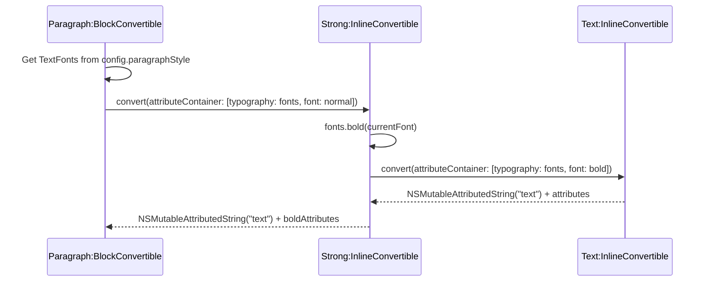
Sources: [[Sources/MarkdownText/Inline/Markdown+InlineConvertible.swift:37-56]](), [[Sources/MarkdownText/Block/Paragraph+.swift:12-22]](), [[Tests/MarkdownTextTests/TypographyPropagationTests.swift:59-85]]()

### Special Inline Handling

*   **Links & Citations**: The `Link` conversion first checks `isInlineCitation(coder:)`. If true, it returns an `NSMutableAttributedString` containing an `InlineCitationAttachment` instead of a standard link [[Sources/MarkdownText/Inline/Markdown+InlineConvertible.swift:108-118]]().
*   **Inline LaTeX**: `InlineCode` nodes are inspected for LaTeX delimiters. If found, they are converted into a `LatexAttachmentData` payload and wrapped in an `NSTextAttachment` [[Sources/MarkdownText/Inline/Markdown+InlineConvertible.swift:154-173]]().
*   **Line Breaks**: Both `SoftBreak` and `LineBreak` are converted to simple `\n` characters while maintaining inherited attributes [[Sources/MarkdownText/Inline/Markdown+InlineConvertible.swift:132-144]]().

Sources: [[Sources/MarkdownText/Inline/Markdown+InlineConvertible.swift:72-130]](), [[Sources/MarkdownText/Inline/Markdown+InlineConvertible.swift:146-175]]()

---

## Data Flow Summary

The following table summarizes the transformation from AST node to the final `MarkdownRenderable` enum used by the UI layer.

| AST Node | Conversion Method | Resulting `MarkdownRenderable` Case |
| :--- | :--- | :--- |
| `Markdown.Paragraph` | `Paragraph.convert(...)` | `.paragraph(id:content:)` |
| `Markdown.Heading` | `Heading.convert(...)` | `.heading(id:level:content:)` |
| `Markdown.Table` | `Table.convert(...)` | `.table(id:headers:rows:rawMarkdown:)` |
| `Markdown.OrderedList` | `OrderedList.convert(...)` | `.orderedList(id:items:)` |
| `Markdown.BlockQuote` | `BlockQuote.convert(...)` | `.blockQuote(id:item:)` |
| `Markdown.CodeBlock` | `CodeBlock.convert(...)` | `.codeBlock(id:code:language:)` |

Sources: [[Sources/MarkdownText/Block/Paragraph+.swift:21]](), [[Sources/MarkdownText/Block/Heading+.swift:38]](), [[Sources/MarkdownText/Block/Table+.swift:41]](), [[Sources/MarkdownText/Block/OrderedList+.swift:19]](), [[Sources/MarkdownText/Block/BlockQuote+.swift:28]]()

---

# Page: RenderableDocument and Data Models

# RenderableDocument and Data Models

<details>
<summary>Relevant source files</summary>

The following files were used as context for generating this wiki page:

- [Sources/MarkdownText/Models/ListItem+.swift](Sources/MarkdownText/Models/ListItem+.swift)
- [Sources/MarkdownText/Models/MarkdownRenderConfig+Builders.swift](Sources/MarkdownText/Models/MarkdownRenderConfig+Builders.swift)
- [Sources/MarkdownText/Models/MarkdownRenderable.swift](Sources/MarkdownText/Models/MarkdownRenderable.swift)
- [Sources/MarkdownText/Models/RenderableDocument.swift](Sources/MarkdownText/Models/RenderableDocument.swift)
- [Sources/MarkdownText/Style/Colors+Static.swift](Sources/MarkdownText/Style/Colors+Static.swift)
- [Sources/MarkdownText/Style/Colors+Theme.swift](Sources/MarkdownText/Style/Colors+Theme.swift)
- [Sources/MarkdownText/UI/DocumentView.swift](Sources/MarkdownText/UI/DocumentView.swift)
- [Sources/MarkdownText/Utilities/MarkdownListener.swift](Sources/MarkdownText/Utilities/MarkdownListener.swift)

</details>


This page describes the intermediate representation used by SwiftStreamingMarkdown to bridge the gap between a raw Markdown Abstract Syntax Tree (AST) and the SwiftUI view layer. It covers the `RenderableDocument` container, the `MarkdownRenderable` enum, and the data flow through the `MarkdownController`.

## RenderableDocument

`RenderableDocument` is a thread-safe, `Equatable` snapshot of a parsed Markdown document [Sources/MarkdownText/Models/RenderableDocument.swift:13-13](). It serves as the final output of the conversion phase and the primary input for the rendering phase. Producing a `RenderableDocument` is considered the "heavyweight" step of the pipeline because it involves resolving styles, typography, and generating `NSAttributedString` instances; once produced, rendering it via SwiftUI is highly efficient [Sources/MarkdownText/Models/RenderableDocument.swift:10-12]().

### Initialization and Conversion

The document is typically initialized asynchronously from a `Markdown.Document` (the AST) and a `MarkdownRenderConfig` [Sources/MarkdownText/Models/RenderableDocument.swift:32-34]().

| Initializer | Purpose |
| :--- | :--- |
| `init(document:config:)` | The standard entry point. It calls `document.convert(with: config)` to transform AST nodes into renderable cases [Sources/MarkdownText/Models/RenderableDocument.swift:32-34](). |
| `init(plainText:config:)` | A convenience initializer for non-markdown text. It wraps the string in a single styled paragraph, avoiding the overhead of the full parser [Sources/MarkdownText/Models/RenderableDocument.swift:39-49](). |
| `init(renderables:)` | Internal memberwise initializer [Sources/MarkdownText/Models/RenderableDocument.swift:51-53](). |

### Logical Flow: AST to View

The following diagram illustrates how the `RenderableDocument` bridges the gap between the parsing logic and the UI components.

**Data Transformation Pipeline**
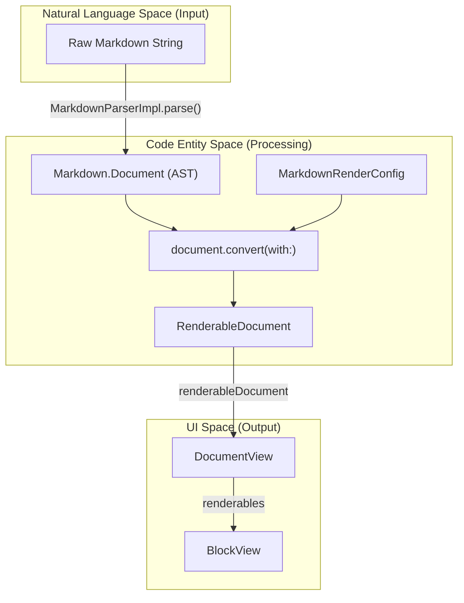
Sources: [Sources/MarkdownText/Models/RenderableDocument.swift:32-34](), [Sources/MarkdownText/UI/DocumentView.swift:15-37]()

## MarkdownRenderable Enum

`MarkdownRenderable` is an indirect enum that represents individual structural elements of a document [Sources/MarkdownText/Models/MarkdownRenderable.swift:12-12](). Each case is designed to be mapped directly to a SwiftUI view (e.g., `ParagraphView`, `TableView`).

### Supported Cases
All cases include a unique `id: String` for stable identification in SwiftUI lists [Sources/MarkdownText/Models/MarkdownRenderable.swift:41-53]().

*   `paragraph(id:content:)`: Contains an `NSMutableAttributedString` with resolved typography [Sources/MarkdownText/Models/MarkdownRenderable.swift:15-15]().
*   `latex(id:content:)`: Represents math formatting [Sources/MarkdownText/Models/MarkdownRenderable.swift:18-18]().
*   `heading(id:level:content:)`: Includes the heading depth (1-6) [Sources/MarkdownText/Models/MarkdownRenderable.swift:21-21]().
*   `orderedList(id:items:)` & `unorderedList(id:items:nestedLevel:)`: Contain `MarkdownListItem` objects, which recursively hold more `MarkdownRenderable` elements [Sources/MarkdownText/Models/MarkdownRenderable.swift:24-27](), [Sources/MarkdownText/Models/MarkdownRenderable.swift:70-73]().
*   `codeBlock(id:language:code:)`: Raw code string and optional language identifier [Sources/MarkdownText/Models/MarkdownRenderable.swift:30-30]().
*   `table(id:headers:rows:rawMarkdown:)`: Grid data with an array of header strings and a 2D array of row strings [Sources/MarkdownText/Models/MarkdownRenderable.swift:33-33]().
*   `blockQuote(id:item:)`: Encapsulates nested content for quotes [Sources/MarkdownText/Models/MarkdownRenderable.swift:39-39]().
*   `thematicBreak(id:)`: A horizontal rule [Sources/MarkdownText/Models/MarkdownRenderable.swift:36-36]().

Sources: [Sources/MarkdownText/Models/MarkdownRenderable.swift:12-73]()

## Consumption by DocumentView

`DocumentView` is the primary consumer of `RenderableDocument`. It manages the lifecycle of the document and coordinates with the `MarkdownController` to handle events and streaming updates [Sources/MarkdownText/UI/DocumentView.swift:15-34]().

### MarkdownController and Listener
The `MarkdownController` is an `ObservableObject` injected into the SwiftUI environment [Sources/MarkdownText/UI/DocumentView.swift:57-57](). It acts as a bridge to a `MarkdownListener` [Sources/MarkdownText/Utilities/MarkdownListener.swift:16-24]().

**Event Distribution and Lifecycle**
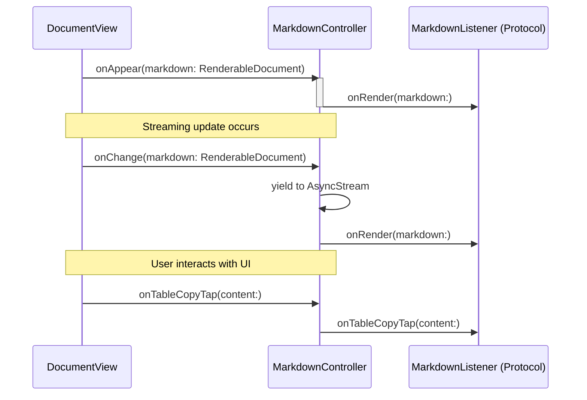
Sources: [Sources/MarkdownText/UI/DocumentView.swift:40-45](), [Sources/MarkdownText/Utilities/MarkdownListener.swift:26-50](), [Sources/MarkdownText/Utilities/MarkdownListener.swift:56-60]()

### Key Methods and Properties

| Entity | Role |
| :--- | :--- |
| `DocumentView.body` | Injects `markdownConfig` and `markdownController` into the environment and renders the `BlockView` [Sources/MarkdownText/UI/DocumentView.swift:36-49](). |
| `MarkdownController.onAppear` | Sets up an `AsyncStream` to deliver document updates to the listener [Sources/MarkdownText/Utilities/MarkdownListener.swift:26-46](). |
| `RenderableDocument.attributedStrings` | A computed property that flattens the document's content into a list of `NSAttributedString` objects, useful for indexing or plain-text extraction [Sources/MarkdownText/Models/RenderableDocument.swift:61-64](). |
| `ListItem.startsWithBold` | A helper used during conversion to detect if a list item starts with a `Strong` AST node, allowing for specialized styling [Sources/MarkdownText/Models/ListItem+.swift:9-13](). |

Sources: [Sources/MarkdownText/UI/DocumentView.swift:36-49](), [Sources/MarkdownText/Utilities/MarkdownListener.swift:26-46](), [Sources/MarkdownText/Models/RenderableDocument.swift:61-64](), [Sources/MarkdownText/Models/ListItem+.swift:9-13]()

---

# Page: UI Layer

# UI Layer

<details>
<summary>Relevant source files</summary>

The following files were used as context for generating this wiki page:

- [Package.resolved](Package.resolved)
- [Package.swift](Package.swift)
- [Sources/MarkdownText/Models/MarkdownRenderConfig+Builders.swift](Sources/MarkdownText/Models/MarkdownRenderConfig+Builders.swift)
- [Sources/MarkdownText/UI/BlockView.swift](Sources/MarkdownText/UI/BlockView.swift)
- [Sources/MarkdownText/UI/DocumentView.swift](Sources/MarkdownText/UI/DocumentView.swift)
- [Sources/MarkdownText/Utilities/MarkdownListener.swift](Sources/MarkdownText/Utilities/MarkdownListener.swift)

</details>


The UI Layer is responsible for transforming a `RenderableDocument` into a responsive, accessible SwiftUI view hierarchy. It leverages a specialized dispatching system to handle different Markdown block types, while utilizing `UIViewRepresentable` for high-performance text rendering and animations.

### View Hierarchy Overview

The rendering process begins with `DocumentView`, which serves as the entry point for a pre-parsed document. It manages the lifecycle of the `MarkdownController` and propagates configuration via the SwiftUI environment.

### Code-to-System Mapping: View Entry Points
The following diagram illustrates how the public-facing `DocumentView` initializes the internal block-dispatching system.

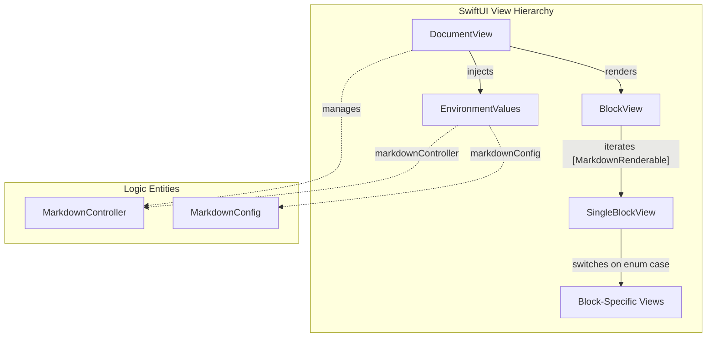
**Sources:** [Sources/MarkdownText/UI/DocumentView.swift:15-58](), [Sources/MarkdownText/UI/BlockView.swift:9-78]()

---

## 3.1 Document and Block Views
The UI layer uses a recursive-style dispatching mechanism. `BlockView` acts as a container that iterates through the list of `MarkdownRenderable` items [Sources/MarkdownText/UI/BlockView.swift:18-23](). For each item, `SingleBlockView` performs a pattern match on the `MarkdownRenderable` enum to determine which specialized view to instantiate [Sources/MarkdownText/UI/BlockView.swift:37-76]().

Key components include:
- **Environment Management**: `DocumentView` injects `MarkdownRenderConfig` and `MarkdownController` into the environment, ensuring all child blocks (like tables and paragraphs) can access styling and event listeners [Sources/MarkdownText/UI/DocumentView.swift:38-39]().
- **Specialized Blocks**: The system provides tailored views for various Markdown features:
    - `ParagraphView` for standard text and headings.
    - `TableView` for complex data grids.
    - `BlockMathView` for LaTeX rendering.
    - `CodeBlockView` for syntax-highlighted code.
    - `OrderedListView` and `UnorderedListView` for lists.

For details, see [Document and Block Views](#3.1).

**Sources:** [Sources/MarkdownText/UI/DocumentView.swift:15-50](), [Sources/MarkdownText/UI/BlockView.swift:37-78]()

---

## 3.2 Paragraph Rendering and Text Animations
Text rendering in `SwiftStreamingMarkdown` is handled by `ParagraphView`, which wraps a `ParagraphUIView` (a `UITextView` subclass) [Sources/MarkdownText/UI/BlockView.swift:41-48](). This approach is chosen over native SwiftUI `Text` to support:
- **Streaming Animations**: A word-by-word fade-in effect driven by `CADisplayLink`.
- **High Performance**: Size caching for smooth scrolling within `LazyVStack`.
- **iOS 18 Transitions**: Support for `FadeInTextTransition`.

For details, see [Paragraph Rendering and Text Animations](#3.2).

**Sources:** [Sources/MarkdownText/UI/BlockView.swift:41-48](), [Sources/MarkdownText/Models/MarkdownRenderConfig+Builders.swift:10-21]()

---

## 3.3 Context Menus and Text Interaction
Interaction with rendered Markdown is facilitated by the `MarkdownController`. When a user interacts with specialized components or custom context menus, the UI layer forwards these events to the `MarkdownListener` [Sources/MarkdownText/Utilities/MarkdownListener.swift:56-78]().

### Interaction Flow
The diagram below shows how UI interactions are routed from the low-level `UITextView` back to the consumer's listener.

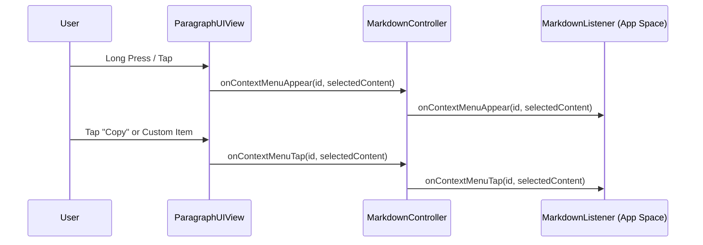

The system supports custom context menu groups and items defined in `MarkdownRenderConfig`, allowing developers to extend the standard iOS edit menu with domain-specific actions.

For details, see [Context Menus and Text Interaction](#3.3).

**Sources:** [Sources/MarkdownText/Utilities/MarkdownListener.swift:8-14](), [Sources/MarkdownText/Utilities/MarkdownListener.swift:68-78](), [Sources/MarkdownText/Models/MarkdownRenderConfig+Builders.swift:109-120]()

---

# Page: Document and Block Views

# Document and Block Views

<details>
<summary>Relevant source files</summary>

The following files were used as context for generating this wiki page:

- [Examples/SwiftStreamingMarkdownSample/SwiftStreamingMarkdownSample/Resources/Fixtures/kitchen-sink.md](Examples/SwiftStreamingMarkdownSample/SwiftStreamingMarkdownSample/Resources/Fixtures/kitchen-sink.md)
- [Package.resolved](Package.resolved)
- [Package.swift](Package.swift)
- [Sources/MarkdownText/Models/MarkdownRenderConfig+Builders.swift](Sources/MarkdownText/Models/MarkdownRenderConfig+Builders.swift)
- [Sources/MarkdownText/UI/BlockMathView.swift](Sources/MarkdownText/UI/BlockMathView.swift)
- [Sources/MarkdownText/UI/BlockQuoteView.swift](Sources/MarkdownText/UI/BlockQuoteView.swift)
- [Sources/MarkdownText/UI/BlockView.swift](Sources/MarkdownText/UI/BlockView.swift)
- [Sources/MarkdownText/UI/CodeBlockView+CSS.swift](Sources/MarkdownText/UI/CodeBlockView+CSS.swift)
- [Sources/MarkdownText/UI/CodeBlockView.swift](Sources/MarkdownText/UI/CodeBlockView.swift)
- [Sources/MarkdownText/UI/DocumentView.swift](Sources/MarkdownText/UI/DocumentView.swift)
- [Sources/MarkdownText/UI/EdgeBorder.swift](Sources/MarkdownText/UI/EdgeBorder.swift)
- [Sources/MarkdownText/UI/OrderedListView.swift](Sources/MarkdownText/UI/OrderedListView.swift)
- [Sources/MarkdownText/UI/TableView.swift](Sources/MarkdownText/UI/TableView.swift)
- [Sources/MarkdownText/UI/ThematicBreakView.swift](Sources/MarkdownText/UI/ThematicBreakView.swift)
- [Sources/MarkdownText/UI/UnorderedListView.swift](Sources/MarkdownText/UI/UnorderedListView.swift)
- [Sources/MarkdownText/Utilities/MarkdownListener.swift](Sources/MarkdownText/Utilities/MarkdownListener.swift)
- [Tests/MarkdownTextTests/MarkdownTextSnapshotTests.swift](Tests/MarkdownTextTests/MarkdownTextSnapshotTests.swift)
- [Tests/MarkdownTextTests/TableViewTests.swift](Tests/MarkdownTextTests/TableViewTests.swift)
- [Tests/MarkdownTextTests/UnorderedListViewTests.swift](Tests/MarkdownTextTests/UnorderedListViewTests.swift)

</details>


The UI layer of `SwiftStreamingMarkdown` is built using a recursive SwiftUI composition pattern. At the root, `DocumentView` receives a `RenderableDocument` and initiates the rendering process. The rendering logic then descends into `BlockView` and `SingleBlockView`, which act as a central dispatch hub for specific block-level components.

## View Hierarchy and Injection

The rendering pipeline relies on the SwiftUI environment to propagate configuration and event handling capabilities. `DocumentView` injects two primary objects into the environment: `MarkdownRenderConfig` and `MarkdownController`.

### Data Flow and Environment Injection

| Entity | Role | File Reference |
| :--- | :--- | :--- |
| `DocumentView` | The public entry point for pre-parsed documents. It manages the `MarkdownController` lifecycle. | [Sources/MarkdownText/UI/DocumentView.swift:15-34]() |
| `MarkdownRenderConfig` | A configuration object containing styles for headings, tables, lists, and code blocks. | [Sources/MarkdownText/UI/DocumentView.swift:54-54]() |
| `MarkdownController` | An `ObservableObject` that bridges UI interactions (like table copies) back to a `MarkdownListener`. | [Sources/MarkdownText/Utilities/MarkdownListener.swift:16-46]() |
| `BlockView` | A container that iterates over an array of `MarkdownRenderable` items and renders them in a `VStack`. | [Sources/MarkdownText/UI/BlockView.swift:9-24]() |
| `SingleBlockView` | A switch-based dispatcher that maps `MarkdownRenderable` enum cases to specific SwiftUI views. | [Sources/MarkdownText/UI/BlockView.swift:26-78]() |

### System Entity Mapping

The following diagram illustrates how the high-level Markdown concepts map to the internal view hierarchy and environment state.

**View Dispatch and Environment Mapping**
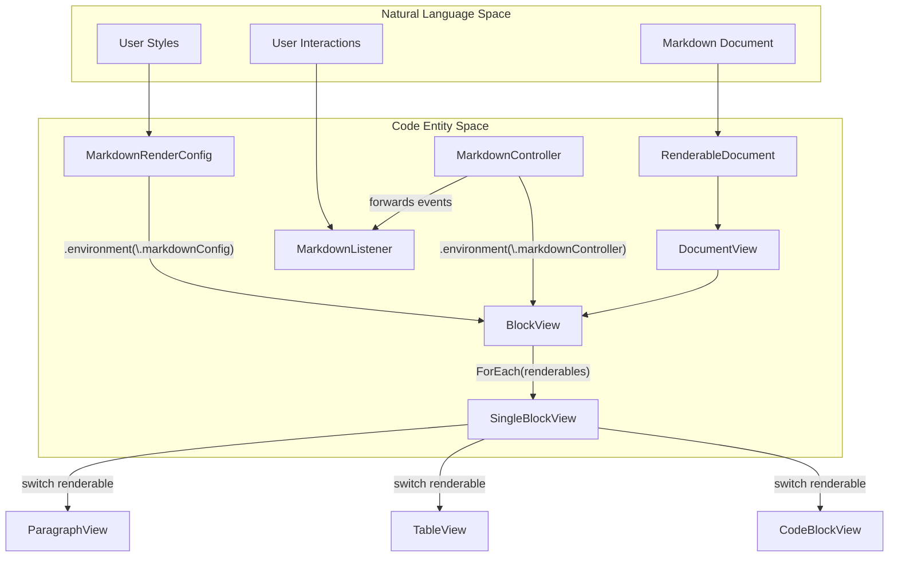
**Sources:** [Sources/MarkdownText/UI/DocumentView.swift:36-50](), [Sources/MarkdownText/UI/BlockView.swift:36-76](), [Sources/MarkdownText/Utilities/MarkdownListener.swift:56-78]()

---

## Block-Level Components

Each block type defined in the `MarkdownRenderable` enum has a corresponding specialized view.

### Paragraph and Headings
Paragraphs and headings are both rendered using `ParagraphView`. In the case of headings, `SingleBlockView` applies `.accessibilityAddTraits(.isHeader)` to the container [Sources/MarkdownText/UI/BlockView.swift:39-45](). `ParagraphView` is a `UIViewRepresentable` that handles complex text layouts, including inline citations and animations.

### Lists (Ordered and Unordered)
Lists are handled by `OrderedListView` and `UnorderedListView`. Both views utilize a `ListItemContentWrapper` to ensure proper baseline alignment between the bullet/number and the text content [Sources/MarkdownText/UI/OrderedListView.swift:45-59]().

*   **OrderedListView**: Automatically generates numbers based on the item index [Sources/MarkdownText/UI/OrderedListView.swift:16-21]().
*   **UnorderedListView**: Alternates between filled and hollow circles based on the `nestedLevel` [Sources/MarkdownText/UI/UnorderedListView.swift:41-57]().

### Tables
`TableView` provides a horizontally scrollable grid for Markdown tables.
*   **Layout**: Uses a custom `TableLayout` to calculate column widths [Sources/MarkdownText/UI/TableView.swift:72-82]().
*   **Interactions**: When tapped, the table can expand to show "Copy" and "Download" actions, which are forwarded via the `MarkdownController` [Sources/MarkdownText/UI/TableView.swift:132-154]().
*   **Content**: Cells can contain either plain `AttributedString` or `NSAttributedString` (if they contain attachments like citations) [Sources/MarkdownText/UI/TableView.swift:9-12]().

### Code Blocks
`CodeBlockView` renders fenced code blocks with syntax highlighting.
*   **Highlighting**: Uses the `HighlightSwift` package. To prevent `JSContext` OOM crashes, highlighting tasks are serialized through a `HighlightTaskManager` actor [Sources/MarkdownText/UI/CodeBlockView.swift:10-48]().
*   **UI**: Includes a header with the language name and a copy button that interacts with `UIPasteboard` [Sources/MarkdownText/UI/CodeBlockView.swift:97-131]().

### Mathematical Expressions
`BlockMathView` renders LaTeX using the `iosMath` library. It is wrapped in a horizontal `ScrollView` within `SingleBlockView` to handle long equations [Sources/MarkdownText/UI/BlockView.swift:53-59]().

### Other Blocks
*   **BlockQuoteView**: Renders quoted content with a leading vertical bar [Sources/MarkdownText/UI/BlockView.swift:73-74]().
*   **ThematicBreakView**: Renders a horizontal separator [Sources/MarkdownText/UI/ThematicBreakView.swift:10-20]().

---

## Component Dispatch Logic

The `SingleBlockView` acts as the primary router. It determines which SwiftUI component to instantiate based on the `MarkdownRenderable` type.

**Block View Dispatch Logic**
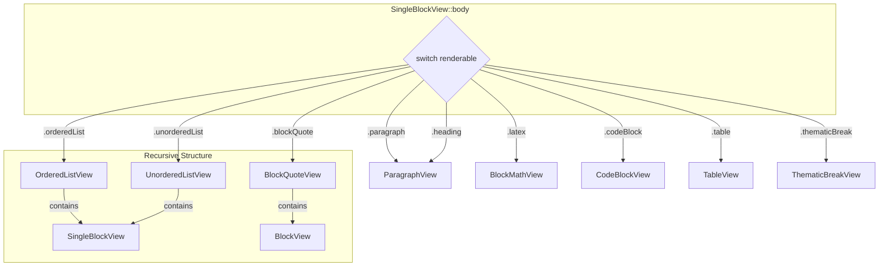
**Sources:** [Sources/MarkdownText/UI/BlockView.swift:38-75](), [Sources/MarkdownText/UI/OrderedListView.swift:26-30](), [Sources/MarkdownText/UI/UnorderedListView.swift:23-27]()

### Implementation Detail: Baseline Alignment
One technical challenge in list rendering is aligning the bullet or number with the first line of a `UIViewRepresentable` (the `ParagraphView`). The library solves this using a custom `VerticalAlignment.centerOfFirstLine` and an `extractFirstFont()` helper to calculate the exact offset based on the font used in the first character of the paragraph [Sources/MarkdownText/UI/OrderedListView.swift:56-74]().

**Sources:**
- [Sources/MarkdownText/UI/DocumentView.swift:15-58]()
- [Sources/MarkdownText/UI/BlockView.swift:9-78]()
- [Sources/MarkdownText/UI/TableView.swift:9-154]()
- [Sources/MarkdownText/UI/OrderedListView.swift:9-102]()
- [Sources/MarkdownText/UI/UnorderedListView.swift:9-69]()
- [Sources/MarkdownText/UI/CodeBlockView.swift:10-162]()
- [Sources/MarkdownText/Utilities/MarkdownListener.swift:16-86]()

---

# Page: Paragraph Rendering and Text Animations

# Paragraph Rendering and Text Animations

<details>
<summary>Relevant source files</summary>

The following files were used as context for generating this wiki page:

- [Sources/MarkdownText/ContextMenu/TextContextMenu.swift](Sources/MarkdownText/ContextMenu/TextContextMenu.swift)
- [Sources/MarkdownText/ContextMenu/TextContextMenuGroup.swift](Sources/MarkdownText/ContextMenu/TextContextMenuGroup.swift)
- [Sources/MarkdownText/ContextMenu/TextContextMenuItem.swift](Sources/MarkdownText/ContextMenu/TextContextMenuItem.swift)
- [Sources/MarkdownText/TextTransition/FadeInTextTransition.swift](Sources/MarkdownText/TextTransition/FadeInTextTransition.swift)
- [Sources/MarkdownText/TextTransition/FadeInTextTransitionViewModifier.swift](Sources/MarkdownText/TextTransition/FadeInTextTransitionViewModifier.swift)
- [Sources/MarkdownText/UI/ParagraphView.swift](Sources/MarkdownText/UI/ParagraphView.swift)
- [Sources/MarkdownText/UI/UIKit/ParagraphUIView.swift](Sources/MarkdownText/UI/UIKit/ParagraphUIView.swift)
- [Sources/MarkdownText/UI/UIKit/ParagraphUIViewCache.swift](Sources/MarkdownText/UI/UIKit/ParagraphUIViewCache.swift)
- [Tests/MarkdownTextTests/ParagraphViewTests.swift](Tests/MarkdownTextTests/ParagraphViewTests.swift)

</details>


The `ParagraphView` and its underlying `ParagraphUIView` form the primary rendering engine for text-heavy content in SwiftStreamingMarkdown. This subsystem is designed to handle the complexities of streaming text delivery, including word-by-word fade animations, performance-optimized size caching for `LazyVStack`, and integration with modern iOS 18 text transition APIs.

## ParagraphView Architecture

`ParagraphView` is a `UIViewRepresentable` [Sources/MarkdownText/UI/ParagraphView.swift:8]() that bridges SwiftUI to a specialized `UITextView` subclass. It manages the lifecycle of the text view, including its participation in the `ParagraphUIViewCache` [Sources/MarkdownText/UI/UIKit/ParagraphUIViewCache.swift:8-14]().

### Data Flow and Update Logic
The view receives `contents` as an `NSMutableAttributedString` and an optional `lineSpacing`. When the SwiftUI state updates, `updateUIView` determines if an animation should trigger based on whether the view is currently visible in a window and if `shouldAnimateText` is enabled in the `MarkdownRenderConfig` [Sources/MarkdownText/UI/ParagraphView.swift:38-45]().

### Size Caching for Performance
To prevent redundant layout passes—especially critical when embedded in a `LazyVStack`—`ParagraphView` implements a sophisticated caching mechanism in its `Coordinator` [Sources/MarkdownText/UI/ParagraphView.swift:78-83]().

1.  **Cache Key**: The width is rounded to one decimal place to avoid floating-point precision misses [Sources/MarkdownText/UI/ParagraphView.swift:60-61]().
2.  **Invalidation**: The cache is cleared whenever `contents` or `lineSpacing` change [Sources/MarkdownText/UI/ParagraphView.swift:53-58]().
3.  **Calculation**: It uses `uiView.sizeThatFits` and rounds the height up to ensure pixel-perfect alignment [Sources/MarkdownText/UI/ParagraphView.swift:68-75]().

**Sources:**
- `Sources/MarkdownText/UI/ParagraphView.swift`
- `Sources/MarkdownText/UI/UIKit/ParagraphUIViewCache.swift`

## ParagraphUIView: The Core Text Engine

`ParagraphUIView` is a `UITextView` subclass [Sources/MarkdownText/UI/UIKit/ParagraphUIView.swift:28]() configured for high-performance Markdown rendering.

### Implementation Details
- **Non-Editable/Selectable**: It is configured as `isEditable = false` but `isSelectable = true` to allow user interaction with links and context menus [Sources/MarkdownText/UI/UIKit/ParagraphUIView.swift:187-188]().
- **Attachment Providers**: It registers `LatexViewProvider` and `InlineCitationViewProvider` to handle math and citation pills embedded in the text [Sources/MarkdownText/UI/UIKit/ParagraphUIView.swift:179-185]().
- **Memory Safety**: It clears selections and tears down its `CADisplayLink` when moving out of a window to prevent crashes or memory leaks during scrolling [Sources/MarkdownText/UI/UIKit/ParagraphUIView.swift:56-67]().

### Component Relationship Diagram
This diagram illustrates how `ParagraphUIView` coordinates between the SwiftUI environment and UIKit rendering components.

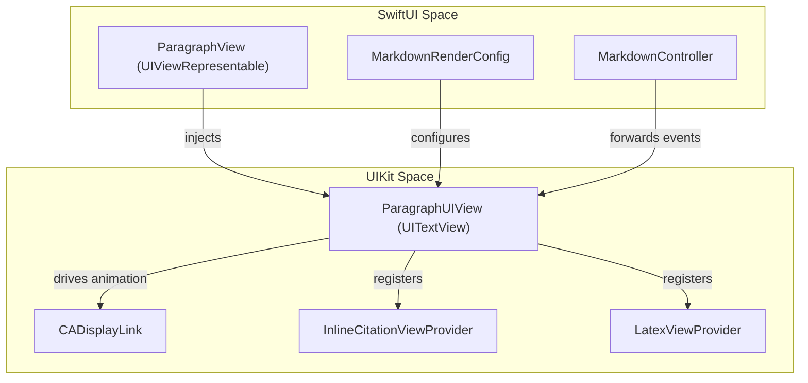
**Sources:**
- `Sources/MarkdownText/UI/UIKit/ParagraphUIView.swift`
- `Sources/MarkdownText/UI/ParagraphView.swift`

## Word-by-Word Animation System

When streaming new content, `ParagraphUIView` can animate text word-by-word to simulate a "typing" or "thinking" effect.

### Implementation with CADisplayLink
The system calculates the delta between the old and new string lengths. If `animatedByWord` is true, it performs the following steps:

1.  **Word Splitting**: Uses `splitIntoWords` to identify NSRanges for each new word [Sources/MarkdownText/UI/UIKit/ParagraphUIView.swift:145-146]().
2.  **Timing Calculation**: Distributes a delay between words (0.1s total spread) and assigns a fixed `animationDuration` (0.5s) per word [Sources/MarkdownText/UI/UIKit/ParagraphUIView.swift:30, 148-157]().
3.  **Display Link**: A `CADisplayLink` calls `updateTextViewWithCurrentAnimations` on every frame [Sources/MarkdownText/UI/UIKit/ParagraphUIView.swift:159-163]().
4.  **Attribute Manipulation**: On each tick, the view updates the `foregroundColor` of the `attributedText`, calculating an alpha value based on the elapsed time relative to each word's `startTime` [Sources/MarkdownText/UI/UIKit/ParagraphUIView.swift:16-21]().

### Animation Logic Diagram

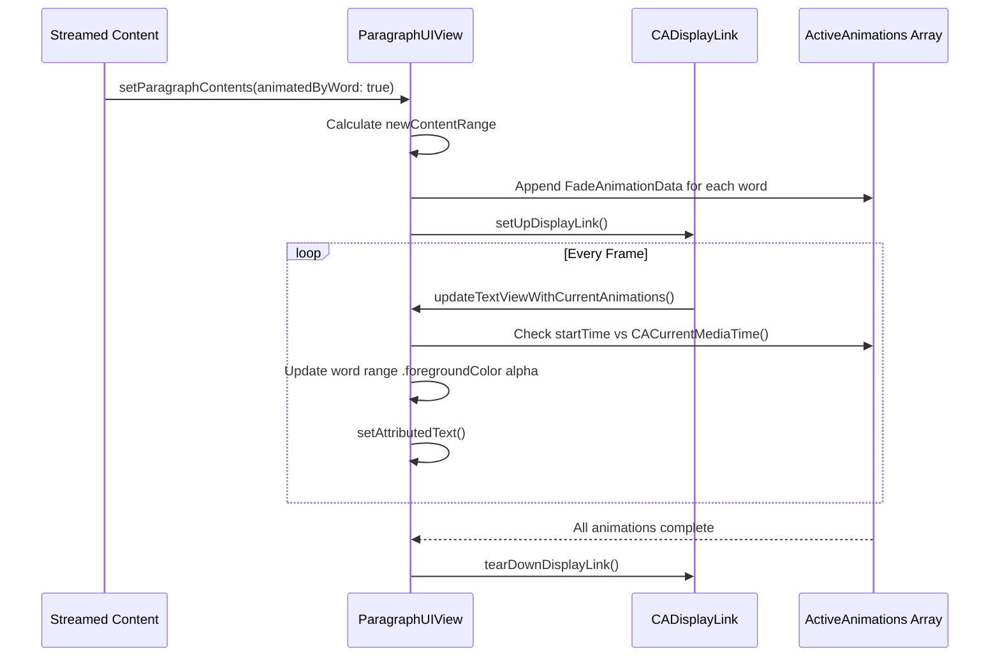
**Sources:**
- `Sources/MarkdownText/UI/UIKit/ParagraphUIView.swift`

## iOS 18 FadeInTextTransition

For devices running iOS 18+, the library provides a native `TextRenderer` implementation for high-quality text transitions.

### TextRenderer and Transition
The library defines `VariableDurationFadeInTextRenderer` and `FixedDurationFadeInTextRenderer` [Sources/MarkdownText/TextTransition/FadeInTextTransition.swift:75, 105](). These implement the `TextRenderer` protocol to manipulate the drawing context of individual glyph slices.

- **Glyph Slicing**: The renderer iterates through `layout.flattenedRunSlices` [Sources/MarkdownText/TextTransition/FadeInTextTransition.swift:96, 137]().
- **Opacity Curve**: It applies a `UnitCurve.easeOut` to the `GraphicsContext.opacity` based on the `elapsedTime` [Sources/MarkdownText/TextTransition/FadeInTextTransition.swift:98, 114]().
- **View Modifier**: The `fadeInTextTransition` modifier wraps these transitions, falling back to a standard `.opacity` transition on older iOS versions [Sources/MarkdownText/TextTransition/FadeInTextTransitionViewModifier.swift:9-30]().

**Sources:**
- `Sources/MarkdownText/TextTransition/FadeInTextTransition.swift`
- `Sources/MarkdownText/TextTransition/FadeInTextTransitionViewModifier.swift`

## Context Menus and Interaction

`ParagraphUIView` integrates with the iOS edit menu to provide custom actions.

- **Menu Building**: It uses `TextContextMenu` to merge system actions (like Copy) with custom `menuGroups` [Sources/MarkdownText/ContextMenu/TextContextMenu.swift:27-60]().
- **Event Forwarding**: When a custom item is tapped, the `MarkdownController` forwards the event to the `MarkdownListener` with the `id` of the item and the currently `selectedContent` [Sources/MarkdownText/ContextMenu/TextContextMenu.swift:40]().
- **Interaction Configuration**: The view sets `isSelectable = true` and `isEditable = false` to ensure the system menu behaves correctly for static Markdown content [Sources/MarkdownText/UI/UIKit/ParagraphUIView.swift:187-188]().

**Sources:**
- `Sources/MarkdownText/ContextMenu/TextContextMenu.swift`
- `Sources/MarkdownText/UI/UIKit/ParagraphUIView.swift`

---

# Page: Context Menus and Text Interaction

# Context Menus and Text Interaction

<details>
<summary>Relevant source files</summary>

The following files were used as context for generating this wiki page:

- [Sources/MarkdownText/ContextMenu/TextContextMenu.swift](Sources/MarkdownText/ContextMenu/TextContextMenu.swift)
- [Sources/MarkdownText/ContextMenu/TextContextMenuGroup.swift](Sources/MarkdownText/ContextMenu/TextContextMenuGroup.swift)
- [Sources/MarkdownText/ContextMenu/TextContextMenuItem.swift](Sources/MarkdownText/ContextMenu/TextContextMenuItem.swift)
- [Sources/MarkdownText/Models/MarkdownRenderConfig+Builders.swift](Sources/MarkdownText/Models/MarkdownRenderConfig+Builders.swift)
- [Sources/MarkdownText/Models/MarkdownRenderConfig.swift](Sources/MarkdownText/Models/MarkdownRenderConfig.swift)
- [Sources/MarkdownText/UI/DocumentView.swift](Sources/MarkdownText/UI/DocumentView.swift)
- [Sources/MarkdownText/UI/ParagraphView.swift](Sources/MarkdownText/UI/ParagraphView.swift)
- [Sources/MarkdownText/UI/UIKit/ParagraphUIView.swift](Sources/MarkdownText/UI/UIKit/ParagraphUIView.swift)
- [Sources/MarkdownText/Utilities/MarkdownListener.swift](Sources/MarkdownText/Utilities/MarkdownListener.swift)

</details>


This section describes the implementation of custom text interaction in `SwiftStreamingMarkdown`, specifically focusing on how context menus are defined, injected into the `UITextView` layer, and how selection events are bubbled back to the host application.

## Overview

The library allows developers to augment or replace the standard iOS text selection "Edit Menu" with custom actions. This is achieved through a structured configuration model (`TextContextMenu`) that is passed down the SwiftUI environment and eventually consumed by `ParagraphUIView`, a specialized `UITextView` subclass.

### Interaction Flow

The following diagram illustrates the data flow from the initial configuration in SwiftUI to the event callback in the `MarkdownListener`.

**Selection Interaction Sequence**
```mermaid
sequenceDiagram
    participant App as "Host Application"
    participant MV as "MarkdownView / DocumentView"
    participant PV as "ParagraphView (SwiftUI)"
    participant PUV as "ParagraphUIView (UIKit)"
    participant MC as "MarkdownController"
    participant ML as "MarkdownListener"

    App->>MV: "Inject MarkdownRenderConfig with TextContextMenu"
    MV->>PV: "Propagate via .environment(\\.markdownConfig)"
    PV->>PUV: "Call setTextContextMenu() and setMarkdownController()"
    
    Note over PUV: "User selects text"
    
    PUV->>PUV: "editMenuInteraction(_:menuFor:suggestedActions:)"
    PUV->>MC: "onContextMenuAppear(id, selectedContent)"
    MC->>ML: "await onContextMenuAppear(...)"
    
    Note over PUV: "User taps custom menu item"
    
    PUV->>MC: "onContextMenuTap(id, selectedContent)"
    MC->>ML: "await onContextMenuTap(...)"
```

**Sources:** [Sources/MarkdownText/UI/DocumentView.swift:36-49](), [Sources/MarkdownText/UI/UIKit/ParagraphUIView.swift:38-39](), [Sources/MarkdownText/ContextMenu/TextContextMenu.swift:27-41]()

---

## Data Models

The context menu is defined using three primary structures, providing a hierarchical representation of the desired UI.

### TextContextMenu
The root container for the custom menu. It holds an array of `TextContextMenuGroup` objects [Sources/MarkdownText/ContextMenu/TextContextMenu.swift:9-11](). Its primary responsibility is building the `UIMenu` by merging custom groups with the standard system edit actions [Sources/MarkdownText/ContextMenu/TextContextMenu.swift:27-62]().

### TextContextMenuGroup
A grouping of related items that can be rendered either as a submenu or an inline section within the menu [Sources/MarkdownText/ContextMenu/TextContextMenuGroup.swift:10-18]().
- `displayInline`: If `true`, the items appear in the parent menu separated by dividers. If `false`, they are nested in a submenu [Sources/MarkdownText/ContextMenu/TextContextMenuGroup.swift:15-16]().

### TextContextMenuItem
Represents a single tappable action. It includes a stable `id` which is passed back to the listener when the item is tapped [Sources/MarkdownText/ContextMenu/TextContextMenuItem.swift:9-18]().

| Property | Type | Description |
| :--- | :--- | :--- |
| `id` | `String` | Stable identifier for the action. |
| `title` | `String` | The primary text displayed for the menu item. |
| `subtitle` | `String?` | Optional secondary text displayed below the title. |
| `image` | `UIImage?` | Optional icon displayed next to the title. |

**Sources:** [Sources/MarkdownText/ContextMenu/TextContextMenu.swift:9-16](), [Sources/MarkdownText/ContextMenu/TextContextMenuGroup.swift:10-31](), [Sources/MarkdownText/ContextMenu/TextContextMenuItem.swift:9-31]()

---

## Menu Injection and ParagraphUIView

The actual rendering of the context menu occurs within `ParagraphUIView`, which overrides the standard UIKit menu behavior.

### Configuration Injection
`ParagraphView` (the `UIViewRepresentable` wrapper) extracts the `TextContextMenu` from the `MarkdownRenderConfig` and the `MarkdownController` from the environment [Sources/MarkdownText/UI/ParagraphView.swift:10-11](). It then passes these to the `ParagraphUIView` instance [Sources/MarkdownText/UI/ParagraphView.swift:25-26]().

### Building the UIMenu
`ParagraphUIView` uses the `UIEditMenuInteraction` (or the older `canPerformAction` / `targetRect` system depending on iOS version) to present the menu. When the menu is requested, `TextContextMenu.buildUIMenu` is called [Sources/MarkdownText/ContextMenu/TextContextMenu.swift:27-31]().

The implementation filters the `suggestedActions` to retain only standard edit commands (like Copy) before appending the custom groups [Sources/MarkdownText/ContextMenu/TextContextMenu.swift:54-61]().

**Entity Mapping: UIKit to Context Menu Models**
```mermaid
graph TD
    subgraph "UIKit Space"
        TV["UITextView (ParagraphUIView)"]
        UIM["UIMenu"]
        UIA["UIAction"]
    end

    subgraph "Model Space"
        TCM["TextContextMenu"]
        TCMG["TextContextMenuGroup"]
        TCMI["TextContextMenuItem"]
    end

    TCM -- "buildUIMenu()" --> UIM
    TCMG -- "maps to" --> UIM
    TCMI -- "maps to" --> UIA
    TV -- "holds" --> TCM
```

**Sources:** [Sources/MarkdownText/UI/ParagraphView.swift:20-35](), [Sources/MarkdownText/ContextMenu/TextContextMenu.swift:27-61](), [Sources/MarkdownText/UI/UIKit/ParagraphUIView.swift:38-39]()

---

## Event Forwarding

Interaction events are decoupled from the UI layer via the `MarkdownListener` protocol.

### MarkdownController
The `MarkdownController` acts as the intermediary. It is injected into the SwiftUI environment by `DocumentView` [Sources/MarkdownText/UI/DocumentView.swift:39]().

### Event Flow
1. **Appearance**: When the context menu is about to appear, `ParagraphUIView` triggers `onContextMenuAppear` via the controller [Sources/MarkdownText/Utilities/MarkdownListener.swift:68-72]().
2. **Taps**: When a `UIAction` created from a `TextContextMenuItem` is executed, the closure calls `markdownController.onContextMenuTap(id:item.id, selectedContent:selectedText)` [Sources/MarkdownText/ContextMenu/TextContextMenu.swift:39-41]().
3. **Listener Notification**: The controller wraps these calls in a `Task` and forwards them to the provided `MarkdownListener` [Sources/MarkdownText/Utilities/MarkdownListener.swift:74-78]().

### MarkdownListener Protocol
The host application implements this protocol to handle the interactions:
- `onContextMenuAppear(id:selectedContent:)`: Triggered when the menu opens for a specific selection [Sources/MarkdownText/Utilities/MarkdownListener.swift:12]().
- `onContextMenuTap(id:selectedContent:)`: Triggered when the user selects a custom action [Sources/MarkdownText/Utilities/MarkdownListener.swift:13]().

**Sources:** [Sources/MarkdownText/Utilities/MarkdownListener.swift:8-14](), [Sources/MarkdownText/Utilities/MarkdownListener.swift:68-78](), [Sources/MarkdownText/ContextMenu/TextContextMenu.swift:39-41](), [Sources/MarkdownText/UI/DocumentView.swift:52-58]()

---

# Page: Configuration and Styling

# Configuration and Styling

<details>
<summary>Relevant source files</summary>

The following files were used as context for generating this wiki page:

- [Sources/MarkdownText/Models/MarkdownRenderConfig.swift](Sources/MarkdownText/Models/MarkdownRenderConfig.swift)
- [Sources/MarkdownText/Models/RenderableDocument.swift](Sources/MarkdownText/Models/RenderableDocument.swift)
- [Sources/MarkdownText/Style/Colors+Static.swift](Sources/MarkdownText/Style/Colors+Static.swift)
- [Sources/MarkdownText/Style/Colors+Theme.swift](Sources/MarkdownText/Style/Colors+Theme.swift)
- [Sources/MarkdownText/Style/TextFonts.swift](Sources/MarkdownText/Style/TextFonts.swift)
- [Sources/MarkdownText/Style/Typography.swift](Sources/MarkdownText/Style/Typography.swift)

</details>


The `SwiftStreamingMarkdown` library uses a centralized configuration and design token system to ensure consistent styling across all Markdown components. This system decouples the structural parsing of Markdown from its visual representation, allowing developers to customize fonts, colors, and animations through a single interface.

### The Styling Architecture

The architecture is built around three primary pillars:
1.  **MarkdownRenderConfig**: The root configuration object that defines the look and feel of the document.
2.  **Typography & Design Tokens**: A system of semantic font bundles (`TextFonts`) and size tokens (`Typography`) that support Dynamic Type and font variants.
3.  **Color Themes**: A hierarchical semantic color system that separates functional roles (e.g., `Theme.Foreground.Primary`) from raw values.

#### Design System to Code Mapping

The following diagram illustrates how abstract design concepts map to specific code entities within the library.

```mermaid
graph TD
    subgraph "Natural Language Space"
        A["'Design Tokens'"]
        B["'Font Variants'"]
        C["'Semantic Colors'"]
        D["'Global Config'"]
    end

    subgraph "Code Entity Space"
        A --- E["enum Typography"]
        B --- F["struct TextFonts"]
        C --- G["enum Color.Theme"]
        D --- H["struct MarkdownRenderConfig"]
    end

    E --> F
    F --> H
    G --> H
```
**Sources:** [Sources/MarkdownText/Style/Typography.swift:10-43](), [Sources/MarkdownText/Style/TextFonts.swift:12-36](), [Sources/MarkdownText/Style/Colors+Theme.swift:10-77](), [Sources/MarkdownText/Models/MarkdownRenderConfig.swift:16-36]()

---

### MarkdownRenderConfig

`MarkdownRenderConfig` is the central source of truth for the rendering pipeline. It is passed into the `RenderableDocument` during the conversion phase [Sources/MarkdownText/Models/RenderableDocument.swift:32-34]() and subsequently injected into the SwiftUI environment for use by individual view components.

It organizes styling into functional sub-structs:
*   **MarkdownTextStyle**: Basic font and color pairing used for paragraphs, block quotes, and lists [Sources/MarkdownText/Models/MarkdownRenderConfig.swift:38-49]().
*   **MarkdownHeadingTextStyle**: Specific `TextFonts` for every heading level (H1-H6) [Sources/MarkdownText/Models/MarkdownRenderConfig.swift:79-105]().
*   **MarkdownTableTextStyle**: Detailed configuration for headers, borders, and table action buttons [Sources/MarkdownText/Models/MarkdownRenderConfig.swift:53-76]().
*   **MarkdownInlineTextStyle**: Styling for bold text, links, and inline code spans [Sources/MarkdownText/Models/MarkdownRenderConfig.swift:108-134]().
*   **CitationConfig**: Controls the appearance and parsing logic for inline citations [Sources/MarkdownText/Models/MarkdownRenderConfig.swift:137-168]().

For a complete reference of all properties and the builder API, see **[MarkdownRenderConfig](#4.1)**.

---

### Typography and TextFonts

The library avoids using raw `UIFont` or `Font` objects directly in the configuration. Instead, it uses `TextFonts`, a bundle that encapsulates the four standard variants (normal, bold, italic, and bold-italic) [Sources/MarkdownText/Style/TextFonts.swift:12-25]().

The `Typography` enum acts as a design token generator, providing pre-configured `TextFonts` instances (e.g., `.baseTextFonts`, `.largeTextFonts`) that automatically handle:
*   **Dynamic Type Scaling**: Sizes are scaled using `UIFontMetrics` [Sources/MarkdownText/Style/Typography.swift:81-93]().
*   **Line Height & Kerning**: Preferred spacing is baked into the tokens to ensure readability [Sources/MarkdownText/Style/Typography.swift:132-141]().
*   **Variant Resolution**: Logic to find the correct bold-italic variant when multiple traits are applied [Sources/MarkdownText/Style/TextFonts.swift:40-53]().

For details on customizing fonts and dynamic scaling, see **[Typography and Color System](#4.2)**.

---

### Color Theme Architecture

Colors are managed through semantic extensions on `Color`, divided into `Theme` and `Static` categories.

| Category | Description | Examples |
| :--- | :--- | :--- |
| **Theme** | Semantic roles that adapt to context. | `Theme.Foreground.Primary`, `Theme.Component.CodeBlock.Background` |
| **Static** | Fixed palette values that do not change based on role. | `Static.Stone.Stone350` |

The `Theme` system is highly granular, providing specific colors for components like buttons, tables, and code blocks [Sources/MarkdownText/Style/Colors+Theme.swift:24-48](). These are typically backed by assets in the library's bundle [Sources/MarkdownText/Style/Colors+Theme.swift:13-13]().

#### Configuration Data Flow

The diagram below shows how configuration objects flow from the public API down to the internal styling tokens.

```mermaid
graph LR
    subgraph "User Configuration"
        Config["MarkdownRenderConfig"]
    end

    subgraph "Styling Tokens"
        TF["TextFonts"]
        C["Color.Theme"]
        T["Typography"]
    end

    subgraph "Rendering Components"
        PV["ParagraphView"]
        TBV["TableView"]
        CBV["CodeBlockView"]
    end

    Config --> TF
    Config --> C
    T --> TF
    TF --> PV
    C --> TBV
    C --> CBV
```
**Sources:** [Sources/MarkdownText/Models/MarkdownRenderConfig.swift:16-36](), [Sources/MarkdownText/Style/Typography.swift:99-175](), [Sources/MarkdownText/Models/RenderableDocument.swift:39-49]()

For details on the full color palette and how to override it, see **[Typography and Color System](#4.2)**.

---

# Page: MarkdownRenderConfig

# MarkdownRenderConfig

<details>
<summary>Relevant source files</summary>

The following files were used as context for generating this wiki page:

- [Sources/MarkdownText/Models/MarkdownRenderConfig+Builders.swift](Sources/MarkdownText/Models/MarkdownRenderConfig+Builders.swift)
- [Sources/MarkdownText/Models/MarkdownRenderConfig.swift](Sources/MarkdownText/Models/MarkdownRenderConfig.swift)
- [Sources/MarkdownText/UI/DocumentView.swift](Sources/MarkdownText/UI/DocumentView.swift)
- [Sources/MarkdownText/Utilities/MarkdownListener.swift](Sources/MarkdownText/Utilities/MarkdownListener.swift)

</details>


`MarkdownRenderConfig` is the central configuration object for the `SwiftStreamingMarkdown` library. It encapsulates all visual styling, behavioral flags, and interaction providers used during the conversion and rendering phases. It is designed to be immutable and `Sendable`, utilizing a builder pattern for incremental customization.

### Sources:
- [Sources/MarkdownText/Models/MarkdownRenderConfig.swift:10-16]()

---

## Configuration Architecture

The configuration is injected into the SwiftUI view hierarchy via the `EnvironmentValues.markdownConfig` key. `DocumentView` serves as the entry point for this injection, ensuring all descendant block views (e.g., `ParagraphView`, `TableView`) have access to the same styling tokens.

### Data Flow and Entity Mapping

The following diagram maps the high-level configuration concepts to the specific code entities that implement them.

**Diagram: Configuration Entity Mapping**
```mermaid
graph TD
    subgraph "Natural Language Space"
        A["Global Behavior"]
        B["Text Styling"]
        C["Table Layout"]
        D["Interactive Menus"]
        E["Citation Logic"]
    end

    subgraph "Code Entity Space"
        A --> A1["shouldAnimateText: Bool"]
        B --> B1["MarkdownTextStyle"]
        B --> B2["MarkdownHeadingTextStyle"]
        B --> B3["MarkdownInlineTextStyle"]
        C --> C1["MarkdownTableTextStyle"]
        D --> D1["TextContextMenu"]
        E --> E1["CitationConfig"]
    end

    A1 --- CFG["MarkdownRenderConfig"]
    B1 --- CFG
    B2 --- CFG
    B3 --- CFG
    C1 --- CFG
    D1 --- CFG
    E1 --- CFG
```

### Sources:
- [Sources/MarkdownText/Models/MarkdownRenderConfig.swift:16-35]()
- [Sources/MarkdownText/UI/DocumentView.swift:38-38]()
- [Sources/MarkdownText/UI/DocumentView.swift:53-54]()

---

## Sub-structs and Styling Details

`MarkdownRenderConfig` delegates specific styling concerns to specialized sub-structs. These structs typically combine `TextFonts` (design tokens for typography) with `UIColor` values.

### MarkdownTextStyle
Used for standard blocks like paragraphs, block quotes, and list items. It defines a uniform font set and foreground color.
- **Properties**: `textFonts`, `textColor`.
- [Sources/MarkdownText/Models/MarkdownRenderConfig.swift:38-49]()

### MarkdownHeadingTextStyle
Provides per-level font configurations for Markdown headings (H1 through H6) while sharing a single foreground color across all levels.
- **Properties**: `h1Font` through `h6Font`, `textColor`.
- [Sources/MarkdownText/Models/MarkdownRenderConfig.swift:79-105]()

### MarkdownTableTextStyle
Controls the complex styling required for tables, including header/body differentiation and UI chrome.
- **Properties**: `headerBackgroundColor`, `borderColor`, `actionButtonColor` (for the "View Full Table" button).
- [Sources/MarkdownText/Models/MarkdownRenderConfig.swift:53-76]()

### MarkdownInlineTextStyle
Handles styles that are applied within a text run, often overriding the base block style.
- **Properties**: `boldTextColor`, `linkTextColor`, `codeBackgroundColor`, `codeUnderlineColor`.
- [Sources/MarkdownText/Models/MarkdownRenderConfig.swift:108-134]()

### CitationConfig
Determines how inline citations are handled. It includes a `CitationCoder` for parsing/encoding and styling for the resulting "pill" or "chip" UI.
- **Properties**: `isEnabled`, `coder`, `font`, `textColor`, `backgroundColor`.
- [Sources/MarkdownText/Models/MarkdownRenderConfig.swift:137-168]()

---

## Text Animation and Interaction

### shouldAnimateText
A boolean flag that controls the "streaming" visual effect. When set to `true`, `ParagraphView` uses a `CADisplayLink` or the iOS 18 `FadeInTextTransition` to animate newly appended characters as they arrive from a stream.
- [Sources/MarkdownText/Models/MarkdownRenderConfig.swift:18-18]()

### textContextMenu
An optional `TextContextMenu` provider. If provided, the library replaces the standard system edit menu in `UITextView` with custom actions. Interactions with these actions are forwarded to the `MarkdownListener` via `MarkdownController`.
- [Sources/MarkdownText/Models/MarkdownRenderConfig.swift:31-33]()
- [Sources/MarkdownText/Utilities/MarkdownListener.swift:68-78]()

**Diagram: Configuration to View Interaction**
```mermaid
sequenceDiagram
    participant DV as DocumentView
    participant BV as BlockView
    participant PV as ParagraphView
    participant MC as MarkdownController

    DV->>DV: .environment(\.markdownConfig, config)
    DV->>BV: Renders Renderables
    BV->>PV: Injects Config
    PV->>PV: Reads shouldAnimateText
    Note over PV: If true, starts fade animation
    PV->>MC: onContextMenuAppear
    MC->>ML: MarkdownListener.onContextMenuAppear
```

### Sources:
- [Sources/MarkdownText/UI/DocumentView.swift:37-45]()
- [Sources/MarkdownText/Models/MarkdownRenderConfig.swift:18-33]()
- [Sources/MarkdownText/Utilities/MarkdownListener.swift:16-24]()

---

## Builder API

`MarkdownRenderConfig` uses a "with" builder pattern to allow for easy modification of the default configuration without needing to initialize the entire struct manually.

| Function | Returns | Purpose |
| :--- | :--- | :--- |
| `withShouldAnimateText(value:)` | `MarkdownRenderConfig` | Toggles text fade-in animation. |
| `withBlockQuoteStyle(value:)` | `MarkdownRenderConfig` | Updates block quote styling. |
| `withHeadingStyle(value:)` | `MarkdownRenderConfig` | Updates H1-H6 typography. |
| `withParagraphStyle(value:)` | `MarkdownRenderConfig` | Updates standard text styling. |
| `withTableStyle(value:)` | `MarkdownRenderConfig` | Updates table borders and colors. |
| `withInlineStyle(value:)` | `MarkdownRenderConfig` | Updates link and code span styles. |
| `withTextContextMenu(value:)` | `MarkdownRenderConfig` | Injects or removes custom menus. |

### Sources:
- [Sources/MarkdownText/Models/MarkdownRenderConfig+Builders.swift:8-121]()

---

# Page: Typography and Color System

# Typography and Color System

<details>
<summary>Relevant source files</summary>

The following files were used as context for generating this wiki page:

- [Sources/MarkdownText/Models/RenderableDocument.swift](Sources/MarkdownText/Models/RenderableDocument.swift)
- [Sources/MarkdownText/Resources/Localizable.xcstrings](Sources/MarkdownText/Resources/Localizable.xcstrings)
- [Sources/MarkdownText/Style/Colors+Static.swift](Sources/MarkdownText/Style/Colors+Static.swift)
- [Sources/MarkdownText/Style/Colors+Theme.swift](Sources/MarkdownText/Style/Colors+Theme.swift)
- [Sources/MarkdownText/Style/TextFonts.swift](Sources/MarkdownText/Style/TextFonts.swift)
- [Sources/MarkdownText/Style/Typography.swift](Sources/MarkdownText/Style/Typography.swift)

</details>


The typography and color systems in SwiftStreamingMarkdown provide a robust set of design tokens and styling primitives that bridge the gap between standard Markdown elements and the visual requirements of a modern SwiftUI application. The system is built around the `TextFonts` container for font variants and the `Typography` enum for standardized sizing and weight tokens.

## Typography System

The typography system is designed to handle the complexities of Markdown rendering, where a single logical style (e.g., "Body" or "Heading 1") must resolve into multiple physical font variants (Normal, Bold, Italic, Bold-Italic) while respecting iOS Dynamic Type scaling.

### TextFonts Struct
The `TextFonts` struct is the primary data structure used by `MarkdownRenderConfig` to define a font family and its associated characteristics. It encapsulates four `UIFont` variants and optional layout overrides.

| Property | Type | Description |
| :--- | :--- | :--- |
| `normal` | `UIFont` | The base font variant. Required. |
| `italic` | `UIFont?` | Used for `*emphasis*` runs. Falls back to `normal`. |
| `bold` | `UIFont?` | Used for `**strong**` runs. Falls back to `normal`. |
| `boldItalic` | `UIFont?` | Used for `***combined***` runs. Falls back to `bold` then `italic`. |
| `preferredLetterSpacing` | `CGFloat?` | Applied via `NSAttributedString.Key.kern`. |
| `preferredLineHeight` | `CGFloat?` | Used to calculate extra line spacing in SwiftUI and `UITextView`. |

**Sources:** [Sources/MarkdownText/Style/TextFonts.swift:12-36]()

### Typography Enum
The `Typography` enum serves as the design token repository. It defines a set of semantic sizes (from `extraSmall` to `extraLarge`) and maps them to concrete `UIFont` instances with Dynamic Type support.

#### Scaling and Resolution logic
The system uses `UIFontMetrics.default.scaledValue(for:)` to ensure that all fixed point sizes defined in the tokens scale correctly when a user changes their system text size [Sources/MarkdownText/Style/Typography.swift:81-88]().

#### Mapping Tokens to Code Entities
The following diagram illustrates how the `Typography` tokens are aggregated into `TextFonts` bundles for consumption by the rendering engine.

**Typography to TextFonts Mapping**
```mermaid
graph TD
    subgraph "Typography Enum Tokens"
        T_Base["Typography.base"]
        T_BaseB["Typography.baseStrong"]
        T_BaseI["Typography.baseItalic"]
        T_BaseBI["Typography.baseStrongItalic"]
        T_Code["Typography.code"]
    end

    subgraph "TextFonts Aggregators"
        TF_Base["Typography.baseTextFonts"]
        TF_Code["Typography.codeTextFonts"]
    end

    T_Base -->|"normal"| TF_Base
    T_BaseB -->|"bold"| TF_Base
    T_BaseI -->|"italic"| TF_Base
    T_BaseBI -->|"boldItalic"| TF_Base
    
    T_Code -->|"normal"| TF_Code
```
**Sources:** [Sources/MarkdownText/Style/Typography.swift:10-43](), [Sources/MarkdownText/Style/Typography.swift:132-141](), [Sources/MarkdownText/Style/Typography.swift:165-174]()

### Font Variant Resolution
`TextFonts` provides internal logic to resolve the correct variant when applying nested styles (e.g., applying a bold trait to an already italicized font).

- **`italicize(font:)`**: If the current font is already `bold`, it attempts to return `boldItalic`; otherwise, it returns `italic` [Sources/MarkdownText/Style/TextFonts.swift:40-45]().
- **`bold(font:)`**: If the current font is already `italic`, it attempts to return `boldItalic`; otherwise, it returns `bold` [Sources/MarkdownText/Style/TextFonts.swift:47-52]().

## Color System

The color system is split into two namespaces: `Color.Theme` for semantic, theme-dependent colors and `Color.Static` for fixed values that do not change based on context.

### Semantic Colors (Color.Theme)
Semantic colors are organized by their functional role in the UI (Background, Foreground, Component, etc.). These colors are typically backed by assets in the module's asset catalog [Sources/MarkdownText/Style/Colors+Theme.swift:10-77]().

| Category | Sub-Category | Key Entities | Purpose |
| :--- | :--- | :--- | :--- |
| **Foreground** | `Primary` | `Primary450` ... `Primary800` | Standard text colors with varying contrast levels. |
| **Component** | `CodeBlock` | `Background750`, `Header` | Styling for code block containers and syntax highlighting. |
| **Component** | `Table` | `Background.Header` | Background color for table header cells. |
| **Stroke** | `Default` | `Default250`, `Default300` | Border colors for tables and block quotes. |

### Fixed Colors (Color.Static)
Static colors are used for specific elements that require a consistent appearance regardless of the active theme, such as specific stone-colored accents [Sources/MarkdownText/Style/Colors+Static.swift:11-16]().

## Implementation and Data Flow

Typography and colors are resolved during the **Conversion Phase** when a `Document` is transformed into a `RenderableDocument`.

**Styling Data Flow**
```mermaid
graph LR
    subgraph "Configuration Space"
        M_Config["MarkdownRenderConfig"]
        TF_Bundle["TextFonts"]
        C_Theme["Color.Theme"]
    end

    subgraph "Conversion Phase"
        RD_Init["RenderableDocument.init(document:config:)"]
        P_Style["config.paragraphStyle"]
    end

    subgraph "UI Space"
        PV["ParagraphView"]
        T_Attr["NSMutableAttributedString"]
    end

    TF_Bundle --> M_Config
    C_Theme --> M_Config
    M_Config --> RD_Init
    RD_Init --> P_Style
    P_Style -->|"Apply .font & .foregroundColor"| T_Attr
    T_Attr --> PV
```

### Applying Styles to Text
Styles are applied to `NSAttributedString` runs using the values extracted from `TextFonts`. For example, when creating a `RenderableDocument` from plain text:
1. The `normal` font is retrieved from the config's paragraph style [Sources/MarkdownText/Models/RenderableDocument.swift:41]().
2. The `textColor` is retrieved [Sources/MarkdownText/Models/RenderableDocument.swift:42]().
3. `preferredLetterSpacing` is applied as `.kern` if present [Sources/MarkdownText/Models/RenderableDocument.swift:44-46]().

### SwiftUI Integration
A helper extension on `View` allows for easy application of `TextFonts` to SwiftUI components. It automatically handles:
- **Variant Selection**: Choosing between normal, bold, italic, or boldItalic based on boolean flags [Sources/MarkdownText/Style/TextFonts.swift:58-67]().
- **Kerning**: Applying `preferredLetterSpacing` [Sources/MarkdownText/Style/TextFonts.swift:74]().
- **Line Spacing**: Calculating the difference between `preferredLineHeight` and the font's natural line height to apply as `.lineSpacing` [Sources/MarkdownText/Style/TextFonts.swift:69-71]().

**Sources:**
- [Sources/MarkdownText/Style/TextFonts.swift:12-77]()
- [Sources/MarkdownText/Style/Typography.swift:10-175]()
- [Sources/MarkdownText/Style/Colors+Theme.swift:10-77]()
- [Sources/MarkdownText/Models/RenderableDocument.swift:32-50]()

---

# Page: Inline Citations

# Inline Citations

<details>
<summary>Relevant source files</summary>

The following files were used as context for generating this wiki page:

- [Sources/MarkdownText/Citation/CitationCoder.swift](Sources/MarkdownText/Citation/CitationCoder.swift)
- [Sources/MarkdownText/Citation/InlineCitationAttachment.swift](Sources/MarkdownText/Citation/InlineCitationAttachment.swift)
- [Sources/MarkdownText/Citation/InlineCitationViewProvider.swift](Sources/MarkdownText/Citation/InlineCitationViewProvider.swift)
- [Sources/MarkdownText/Inline/Markdown+InlineConvertible.swift](Sources/MarkdownText/Inline/Markdown+InlineConvertible.swift)
- [Sources/MarkdownText/Utilities/String+.swift](Sources/MarkdownText/Utilities/String+.swift)
- [Tests/MarkdownTextTests/MarkdownTextTests.swift](Tests/MarkdownTextTests/MarkdownTextTests.swift)
- [Tests/MarkdownTextTests/OrderedListViewTests.swift](Tests/MarkdownTextTests/OrderedListViewTests.swift)

</details>


The inline citation system allows Markdown links to be rendered as interactive, styled "pills" (attachments) rather than standard blue underlined text. This is commonly used in AI-generated content to provide source attribution that is visually distinct and accessible.

## Overview

The citation system operates by intercepting standard Markdown links that match a specific "on-the-wire" format. When a link is identified as a citation, it is converted into an `NSTextAttachment` and rendered using a specialized `UIView` inside the text container.

### System Architecture

The following diagram illustrates the lifecycle of a citation from a raw Markdown string to a rendered UI component:

**Citation Processing Pipeline**
```mermaid
graph TD
    subgraph "Natural Language Space (Markdown)"
        RawMD["'[1](http://...marker=9F742443...)'"]
    end

    subgraph "Code Entity Space (Logic)"
        LinkNode["Markdown.Link (AST Node)"]
        Coder["CitationCoder.isCitation()"]
        Converter["Markdown.Link.convert()"]
        Attachment["InlineCitationAttachment"]
    end

    subgraph "UI Space (Rendering)"
        Provider["InlineCitationViewProvider"]
        Label["AttachmentCitationLabel (UILabel)"]
        Paragraph["ParagraphUIView (UITextView)"]
    end

    RawMD -->|"Parsed by MarkdownParserImpl"| LinkNode
    LinkNode -->|"Validation"| Coder
    Coder -->|"Success"| Converter
    Converter -->|"Creates"| Attachment
    Attachment -->|"Injected into"| Paragraph
    Paragraph -->|"Requests View"| Provider
    Provider -->|"Instantiates"| Label
```
**Sources:** [Sources/MarkdownText/Inline/Markdown+InlineConvertible.swift:72-130](), [Sources/MarkdownText/Citation/CitationCoder.swift:8-13](), [Sources/MarkdownText/Citation/InlineCitationViewProvider.swift:55-69]()

---

## The On-Wire Format

Citations are encoded as standard Markdown links to ensure backward compatibility with parsers that do not support the citation system. A link is recognized as a citation if:
1. The **Link Text** matches the `citationMarker` (e.g., a specific UUID).
2. The **URL** contains a query parameter where the key is `citationMarkerQueryParam` and the value matches the `citationMarker`.

The data required to render the citation (the display title and accessibility label) is extracted from additional URL query parameters.

| Parameter Purpose | Default Key | Description |
|:---|:---|:---|
| **Marker** | `citationMarker` | Identifies the link as a citation. |
| **Display Title** | `citationTitle` | The short text shown inside the pill (e.g., "1" or "Source"). |
| **Accessibility** | `citationA11yValue` | The descriptive text read by VoiceOver. |

For details on customizing these keys and the detection logic, see **[CitationCoder and On-Wire Format](#5.1)**.

**Sources:** [Sources/MarkdownText/Citation/CitationCoder.swift:13-40](), [Sources/MarkdownText/Citation/CitationCoder.swift:85-93]()

---

## Rendering and Interaction

When the `Markdown.Link.convert()` method detects a citation, it returns an `NSAttributedString` containing an `InlineCitationAttachment` instead of a standard link [Sources/MarkdownText/Inline/Markdown+InlineConvertible.swift:107-118]().

### Visual Appearance
Citations are rendered as rounded rectangles (pills) with configurable colors and fonts defined in `MarkdownRenderConfig.CitationConfig`.
* **Static Previews:** To maintain performance during scrolling, the system pre-renders light and dark mode images of the citation pill using `UIGraphicsImageRenderer` [Sources/MarkdownText/Citation/InlineCitationAttachment.swift:122-161]().
* **Live Views:** When a citation becomes visible, `InlineCitationViewProvider` promotes the static image to a live `UILabel` (specifically `AttachmentCitationLabel`) to support high-quality rendering and interactions [Sources/MarkdownText/Citation/InlineCitationViewProvider.swift:71-85]().

### Accessibility
Citations are treated as links in the accessibility tree. While the internal `UILabel` is hidden from linear VoiceOver navigation to prevent clutter, the parent `UITextView` exposes the citation via the "Links" rotor, using the `accessibilityLabel` provided in the URL [Sources/MarkdownText/Citation/InlineCitationViewProvider.swift:30-33]().

For details on the rendering lifecycle and accessibility implementation, see **[Citation Rendering and Accessibility](#5.2)**.

**Sources:** [Sources/MarkdownText/Citation/InlineCitationAttachment.swift:10-18](), [Sources/MarkdownText/Citation/InlineCitationViewProvider.swift:9-33](), [Sources/MarkdownText/Utilities/String+.swift:27-35]()

---

## Plain Text Extraction

The library provides utilities to strip Markdown and convert documents to plain text. The `extractPlainText` logic is "citation-aware": instead of leaving the raw UUID marker or the URL in the text, it extracts the `citationTitle` from the URL parameters so that the resulting string remains human-readable (e.g., "See source [1]" instead of "See source [9F742443]") [Sources/MarkdownText/Utilities/String+.swift:100-107]().

**Sources:** [Sources/MarkdownText/Utilities/String+.swift:77-115]()

---

# Page: CitationCoder and On-Wire Format

# CitationCoder and On-Wire Format

<details>
<summary>Relevant source files</summary>

The following files were used as context for generating this wiki page:

- [Sources/MarkdownText/Citation/CitationCoder.swift](Sources/MarkdownText/Citation/CitationCoder.swift)
- [Sources/MarkdownText/Citation/InlineCitationAttachment.swift](Sources/MarkdownText/Citation/InlineCitationAttachment.swift)
- [Sources/MarkdownText/Citation/InlineCitationViewProvider.swift](Sources/MarkdownText/Citation/InlineCitationViewProvider.swift)
- [Sources/MarkdownText/Utilities/String+.swift](Sources/MarkdownText/Utilities/String+.swift)
- [Tests/MarkdownTextTests/MarkdownTextTests.swift](Tests/MarkdownTextTests/MarkdownTextTests.swift)
- [Tests/MarkdownTextTests/OrderedListViewTests.swift](Tests/MarkdownTextTests/OrderedListViewTests.swift)

</details>


This page details the `CitationCoder` structure, which defines the "on-wire" protocol for representing interactive citations within Markdown. It explains how the library identifies citations in a stream of Markdown links, decodes their metadata, and allows for backend-specific customization of the citation format.

## Overview

In `SwiftStreamingMarkdown`, citations are not a native CommonMark element. Instead, they are encoded as standard Markdown links that follow a specific schema. The `CitationCoder` acts as the translation layer between the raw Markdown AST and the specialized `InlineCitationAttachment` used for rendering.

### The Citation Schema
A valid citation is represented as:
`[<citationMarker>](<url>?citationMarker=<citationMarker>&citationTitle=<title>&citationA11yValue=<label>)`

*   **Link Text**: Must match the `citationMarker` exactly [Sources/MarkdownText/Citation/CitationCoder.swift:45-47]().
*   **URL Parameters**: Must contain a key-value pair where the key matches `citationMarkerQueryParam` and the value matches `citationMarker` [Sources/MarkdownText/Citation/CitationCoder.swift:50-55]().

## Data Flow: From Link to Citation

The following diagram illustrates how a `Markdown.Link` node is processed into a citation or a standard link.

### Citation Detection and Decoding Flow
```mermaid
graph TD
    subgraph "Natural Language Space (Markdown Source)"
        RAW["[9F742443](http://...marker=9F742443)"]
    end

    subgraph "Code Entity Space (Parsing & Conversion)"
        PARSER["MarkdownParserImpl"]
        LINK_NODE["Markdown.Link"]
        CODER["CitationCoder"]
        DECODE_FUNC["decode(linkDestination:)"]
        ATTACHMENT["InlineCitationAttachment"]
    end

    RAW -->|"parse(text:)"| PARSER
    PARSER --> LINK_NODE
    LINK_NODE -->|"isCitation(linkText:url:)"| CODER
    CODER -->|"true"| DECODE_FUNC
    DECODE_FUNC -->|"Success"| ATTACHMENT
    DECODE_FUNC -->|"Failure (nil)"| EMPTY["Empty String (Fallback)"]
```
**Sources:** [Sources/MarkdownText/Citation/CitationCoder.swift:59-61](), [Sources/MarkdownText/Citation/CitationCoder.swift:67-82](), [Tests/MarkdownTextTests/MarkdownTextTests.swift:148-162]()

## The CitationCoder Struct

The `CitationCoder` is a `Sendable` and `Hashable` struct that encapsulates the identification logic [Sources/MarkdownText/Citation/CitationCoder.swift:13]().

| Property | Type | Description |
| :--- | :--- | :--- |
| `citationMarker` | `String` | The literal text expected inside the brackets `[]`. |
| `citationMarkerQueryParam` | `String` | The URL query key used to verify the link is a citation. |
| `citationTextQueryParam` | `String` | The URL query key carrying the visible text (e.g., "1", "Source"). |
| `citationA11yTextQueryParam`| `String` | The URL query key carrying the accessibility label. |

**Sources:** [Sources/MarkdownText/Citation/CitationCoder.swift:18-26]()

### Default Implementation
The library provides a default instance used by the rendering pipeline unless overridden. This uses a historical UUID marker.

```swift
public static let `default` = CitationCoder(
  citationMarker: "9F742443",
  citationMarkerQueryParam: "citationMarker",
  citationTextQueryParam: "citationTitle",
  citationA11yTextQueryParam: "citationA11yValue"
)
```
**Sources:** [Sources/MarkdownText/Citation/CitationCoder.swift:87-92]()

## Key Methods

### Detection Logic
The `isCitation(linkText:url:)` method performs a two-factor check:
1.  **Text Match**: Does the link's display text match `citationMarker`? [Sources/MarkdownText/Citation/CitationCoder.swift:45-47]()
2.  **URL Match**: Does the URL contain a query parameter where `key == citationMarkerQueryParam` and `value == citationMarker`? [Sources/MarkdownText/Citation/CitationCoder.swift:50-55]()

Both must be true for the link to be treated as an interactive citation pill [Sources/MarkdownText/Citation/CitationCoder.swift:59-61]().

### Decoding Logic
The `decode(linkDestination:)` method extracts the payload into an `InlineAttachmentData` object. It requires both the title and accessibility label parameters to be present; otherwise, it returns `nil` [Sources/MarkdownText/Citation/CitationCoder.swift:67-75]().

### Plain Text Extraction
When converting Markdown to plain text (e.g., for sharing or accessibility), the `extractPlainText` extension on `Markup` uses the `CitationCoder` to ensure that citations show their display title (like "Microsoft") rather than the internal UUID marker [Sources/MarkdownText/Utilities/String+.swift:100-107]().

## Customization for Different Backends

To support different backend formats, you can initialize a custom `CitationCoder` and provide it to the `MarkdownParser` or utility functions.

### On-Wire Schema Mapping
```mermaid
graph LR
    subgraph "Backend Markdown String"
        B_MARKER["[CIT]"]
        B_URL["(https://ref.com?type=ref&t=Source1&a=Source%20One)"]
    end

    subgraph "Custom CitationCoder Configuration"
        C_MARKER["citationMarker: 'CIT'"]
        C_M_PARAM["citationMarkerQueryParam: 'type'"]
        C_T_PARAM["citationTextQueryParam: 't'"]
        C_A_PARAM["citationA11yTextQueryParam: 'a'"]
    end

    B_MARKER -.-> C_MARKER
    B_URL -.-> C_M_PARAM
    B_URL -.-> C_T_PARAM
    B_URL -.-> C_A_PARAM
```
**Sources:** [Sources/MarkdownText/Citation/CitationCoder.swift:30-40]()

## Implementation Details & Fallbacks

*   **Malformed Citations**: If a link is identified as a citation (matches the marker) but the `decode()` method fails (e.g., missing query params), the system returns an empty string. This prevents showing confusing internal UUIDs to the user [Tests/MarkdownTextTests/MarkdownTextTests.swift:158-162]().
*   **Regular Links**: If a link does not match the citation marker, it is rendered as a standard blue tappable link, preserving its original text [Tests/MarkdownTextTests/MarkdownTextTests.swift:45-58]().

**Sources:** [Sources/MarkdownText/Citation/CitationCoder.swift:1-94](), [Sources/MarkdownText/Utilities/String+.swift:1-217](), [Tests/MarkdownTextTests/MarkdownTextTests.swift:1-190]()

---

# Page: Citation Rendering and Accessibility

# Citation Rendering and Accessibility

<details>
<summary>Relevant source files</summary>

The following files were used as context for generating this wiki page:

- [Sources/MarkdownText/Citation/CitationCoder.swift](Sources/MarkdownText/Citation/CitationCoder.swift)
- [Sources/MarkdownText/Citation/InlineCitationAttachment.swift](Sources/MarkdownText/Citation/InlineCitationAttachment.swift)
- [Sources/MarkdownText/Citation/InlineCitationViewProvider.swift](Sources/MarkdownText/Citation/InlineCitationViewProvider.swift)
- [Sources/MarkdownText/ContextMenu/TextContextMenu.swift](Sources/MarkdownText/ContextMenu/TextContextMenu.swift)
- [Sources/MarkdownText/ContextMenu/TextContextMenuGroup.swift](Sources/MarkdownText/ContextMenu/TextContextMenuGroup.swift)
- [Sources/MarkdownText/ContextMenu/TextContextMenuItem.swift](Sources/MarkdownText/ContextMenu/TextContextMenuItem.swift)
- [Sources/MarkdownText/UI/ParagraphView.swift](Sources/MarkdownText/UI/ParagraphView.swift)
- [Sources/MarkdownText/UI/UIKit/ParagraphUIView.swift](Sources/MarkdownText/UI/UIKit/ParagraphUIView.swift)
- [Sources/MarkdownText/Utilities/String+.swift](Sources/MarkdownText/Utilities/String+.swift)
- [Tests/MarkdownTextTests/MarkdownTextTests.swift](Tests/MarkdownTextTests/MarkdownTextTests.swift)
- [Tests/MarkdownTextTests/OrderedListViewTests.swift](Tests/MarkdownTextTests/OrderedListViewTests.swift)

</details>


Inline citations in `SwiftStreamingMarkdown` are rendered as interactive, pill-shaped UI elements embedded directly within the text flow of a `ParagraphUIView`. This system bridges the gap between standard Markdown link syntax and rich, accessible UI components by utilizing `NSTextAttachment` and custom view providers.

## Implementation Overview

Citations follow a specialized rendering path when the `CitationCoder` detects a link that matches the citation format. Instead of a standard blue hyperlink, the system generates an `InlineCitationAttachment` which is then handled by the iOS TextKit 2 engine.

### Data Flow: From Markdown to Pill

The transformation from a Markdown string to a rendered pill involves several layers of the architecture:

1.  **Detection**: During AST conversion, `Markdown.Link.isInlineCitation(coder:)` checks if the link text and URL parameters match the configured `CitationCoder` [Sources/MarkdownText/Citation/CitationCoder.swift:59-61]().
2.  **Decoding**: The link destination is decoded into `InlineAttachmentData` containing the title, accessibility label, and destination URL [Sources/MarkdownText/Citation/CitationCoder.swift:67-82]().
3.  **Attachment Creation**: An `InlineCitationAttachment` is initialized with this data and the current `CitationConfig` [Sources/MarkdownText/Citation/InlineCitationAttachment.swift:73-81]().
4.  **Registration**: `ParagraphUIView` registers `InlineCitationViewProvider` as the handler for the `UTType.url` identifier [Sources/MarkdownText/UI/UIKit/ParagraphUIView.swift:183-185]().
5.  **View Hosting**: When the `UITextView` renders, it calls the provider to load an `AttachmentCitationLabel` [Sources/MarkdownText/Citation/InlineCitationViewProvider.swift:71-85]().

### Technical Entity Map

The following diagram maps the logical concepts of a citation to their specific code implementations.

**Diagram: Citation System Entity Mapping**
```mermaid
graph TD
    subgraph "Natural Language Space"
        A["'Citation Pill'"]
        B["'Link Metadata'"]
        C["'VoiceOver Label'"]
        D["'Click Action'"]
    end

    subgraph "Code Entity Space"
        A --> E["InlineCitationAttachment : NSTextAttachment"]
        E --> F["AttachmentCitationLabel : UILabel"]
        B --> G["InlineAttachmentData (struct)"]
        C --> H["InlineAttachmentData.accessibilityLabel"]
        D --> I["ParagraphUIView.onUrlTap"]
    end

    F -- "Provides View For" --> J["InlineCitationViewProvider"]
    J -- "Registered In" --> K["ParagraphUIView.setupView()"]
    G -- "Decoded By" --> L["CitationCoder.decode()"]
    
    style E stroke-width:2px
    style G stroke-width:2px
    style K stroke-width:2px
```
Sources: [Sources/MarkdownText/Citation/InlineCitationAttachment.swift:10-12](), [Sources/MarkdownText/Citation/InlineCitationViewProvider.swift:9-11, 55-56](), [Sources/MarkdownText/Citation/CitationCoder.swift:67-68](), [Sources/MarkdownText/UI/UIKit/ParagraphUIView.swift:178-185]()

---

## Rendering Architecture

### InlineCitationAttachment
`InlineCitationAttachment` is a subclass of `NSTextAttachment` that manages the lifecycle of the citation's visual state. To ensure performance during scrolling and streaming, it pre-renders static images of the citation for both light and dark modes during initialization on a background thread [Sources/MarkdownText/Citation/InlineCitationAttachment.swift:82-96]().

*   **Interface Style Tracking**: The class maintains a static `currentInterfaceStyle` which is updated by `ParagraphUIView` whenever the system trait collection changes [Sources/MarkdownText/Citation/InlineCitationAttachment.swift:29-33]().
*   **Static Preview**: The `image` property returns a precomputed `UIGraphicsImageRenderer` output based on the current theme, providing a placeholder before the live `UIView` is swapped in by the provider [Sources/MarkdownText/Citation/InlineCitationAttachment.swift:61-69]().

### InlineCitationViewProvider
This class conforms to `NSTextAttachmentViewProvider` (TextKit 2). Its primary role is to instantiate the `AttachmentCitationLabel` when the attachment enters the visible viewport [Sources/MarkdownText/Citation/InlineCitationViewProvider.swift:71-85](). It uses `tracksTextAttachmentViewBounds = true` to ensure the hosted view stays aligned with the text layout [Sources/MarkdownText/Citation/InlineCitationViewProvider.swift:68-68]().

### AttachmentCitationLabel
A private `UILabel` subclass that implements the specific styling of the citation:
*   **Styling**: Applies `cornerRadius` (default 6) and `textInsets` (top: 2, left: 4, bottom: 2, right: 4) [Sources/MarkdownText/Citation/InlineCitationAttachment.swift:58-59]().
*   **Layout**: Overrides `intrinsicContentSize` and `drawText(in:)` to account for the custom padding around the citation title [Sources/MarkdownText/Citation/InlineCitationViewProvider.swift:41-52]().

**Diagram: Rendering Data Flow**
```mermaid
sequenceDiagram
    participant P as ParagraphUIView
    participant C as CitationCoder
    participant A as InlineCitationAttachment
    participant VP as InlineCitationViewProvider
    participant L as AttachmentCitationLabel

    P->>C: decode(linkDestination)
    C-->>P: InlineAttachmentData
    P->>A: init(citationData, config)
    A->>A: renderCitationImage() (Light/Dark)
    Note over A: Attachment added to NSAttributedString
    P->>VP: loadView()
    VP->>A: get citationData
    VP->>L: init(title, font, colors)
    L-->>P: Rendered in UITextView
```
Sources: [Sources/MarkdownText/Citation/CitationCoder.swift:67-82](), [Sources/MarkdownText/Citation/InlineCitationAttachment.swift:73-96](), [Sources/MarkdownText/Citation/InlineCitationViewProvider.swift:71-84]()

---

## Accessibility Implementation

Accessibility for citations is handled with a dual-strategy to balance linear VoiceOver navigation with the need for rich interaction.

### VoiceOver Strategy
1.  **Hidden Internal Elements**: The `AttachmentCitationLabel` sets `isAccessibilityElement = false` [Sources/MarkdownText/Citation/InlineCitationViewProvider.swift:32-32](). This prevents the VoiceOver cursor from stopping on every individual citation pill during a "swipe right" gesture through a paragraph, which would disrupt the reading flow.
2.  **Text-Level Integration**: The citation's `accessibilityLabel` (e.g., "Open ESPN Sports, link") is generated by `String.openCitation(citationLabel:)` [Sources/MarkdownText/Utilities/String+.swift:27-35]().
3.  **Rotor Navigation**: Because the citation is technically a link within the `UITextView`, it remains discoverable via the VoiceOver "Links" rotor, allowing users to jump specifically to citations [Sources/MarkdownText/Citation/InlineCitationViewProvider.swift:31-31]().

### Plain Text Extraction
When the content needs to be copied or shared as plain text (e.g., via `extractPlainText`), the system replaces the attachment with the citation's `title` instead of the internal UUID marker [Sources/MarkdownText/Utilities/String+.swift:101-107](). This ensures that a citation like `[9F742443](...)` appears as `[1]` or `[Microsoft]` in the clipboard.

Sources: [Sources/MarkdownText/Citation/InlineCitationViewProvider.swift:30-33](), [Sources/MarkdownText/Utilities/String+.swift:27-35, 101-107]()

---

## Key Functions and Classes

| Entity | Role | File Reference |
| :--- | :--- | :--- |
| `InlineCitationAttachment` | `NSTextAttachment` subclass holding pre-rendered images and decoded data. | [Sources/MarkdownText/Citation/InlineCitationAttachment.swift:10]() |
| `InlineCitationViewProvider` | TextKit 2 provider that bridges the attachment to a live `UIView`. | [Sources/MarkdownText/Citation/InlineCitationViewProvider.swift:55]() |
| `AttachmentCitationLabel` | The actual `UILabel` rendered inside the text view. | [Sources/MarkdownText/Citation/InlineCitationViewProvider.swift:9]() |
| `updateInterfaceStyle(_:)` | Static method to synchronize all citations with the current Light/Dark mode. | [Sources/MarkdownText/Citation/InlineCitationAttachment.swift:29]() |
| `renderCitationImage(...)` | Core Graphics function for background-thread rasterization of citation pills. | [Sources/MarkdownText/Citation/InlineCitationAttachment.swift:122]() |

Sources: [Sources/MarkdownText/Citation/InlineCitationAttachment.swift:10, 29, 122](), [Sources/MarkdownText/Citation/InlineCitationViewProvider.swift:9, 55]()

---

# Page: Sample Application

# Sample Application

<details>
<summary>Relevant source files</summary>

The following files were used as context for generating this wiki page:

- [.swiftlint.yml](.swiftlint.yml)
- [Examples/SwiftStreamingMarkdownSample/SwiftStreamingMarkdownSample/Demonstrations.swift](Examples/SwiftStreamingMarkdownSample/SwiftStreamingMarkdownSample/Demonstrations.swift)
- [Examples/SwiftStreamingMarkdownSample/SwiftStreamingMarkdownSample/NavigationView.swift](Examples/SwiftStreamingMarkdownSample/SwiftStreamingMarkdownSample/NavigationView.swift)
- [Examples/SwiftStreamingMarkdownSample/SwiftStreamingMarkdownSample/Resources/Images/streaming-markdown.svg](Examples/SwiftStreamingMarkdownSample/SwiftStreamingMarkdownSample/Resources/Images/streaming-markdown.svg)
- [Examples/SwiftStreamingMarkdownSample/SwiftStreamingMarkdownSample/SwiftStreamingMarkdownSampleApp.swift](Examples/SwiftStreamingMarkdownSample/SwiftStreamingMarkdownSample/SwiftStreamingMarkdownSampleApp.swift)
- [Examples/SwiftStreamingMarkdownSample/project.yml](Examples/SwiftStreamingMarkdownSample/project.yml)

</details>


The `SwiftStreamingMarkdownSample` app serves as the primary demonstration and performance harness for the library. It is designed to showcase the library's ability to handle complex Markdown structures, real-time streaming simulations, and highly customized visual themes.

## Purpose and Scope

The sample application targets developers who need to understand how to integrate `StreamedMarkdownView` into a SwiftUI lifecycle. It provides a suite of pre-defined "fixtures" (Markdown files) that exercise different aspects of the rendering engine, such as LaTeX math, GitHub Flavored Markdown (GFM) tables, and custom context menus [Examples/SwiftStreamingMarkdownSample/SwiftStreamingMarkdownSample/Demonstrations.swift:10-17]().

The app demonstrates:
1.  **Live Streaming Simulation**: How to use `AsyncStream` to feed data into the library chunk-by-chunk.
2.  **Configuration Injection**: Applying different `MarkdownRenderConfig` instances to the same content.
3.  **Interaction Handling**: Implementing `MarkdownListener` to respond to UI events like context menu taps.
4.  **Performance Telemetry**: Real-time tracking of rendering latency and chunk processing.

### Application Architecture

The application follows a standard SwiftUI `NavigationStack` pattern, where a central list of demonstrations leads to a detail view containing the markdown renderer.

#### System Relationship: Navigation to Rendering
This diagram maps the high-level UI flow to the underlying code entities that manage the demonstration state.

```mermaid
graph TD
  subgraph "Navigation Space"
    App["SwiftStreamingMarkdownSampleApp"] -- "reads" --> Appearance["AppearanceMode"]
    App -- "root" --> Nav["NavigationView"]
    Nav -- "iterates" --> Demos["Demonstration Enum"]
  end

  subgraph "Data & Configuration Space"
    Demos -- "provides" --> Fixture["Fixture File (.md)"]
    Demos -- "builds" --> Config["MarkdownRenderConfig"]
    Demos -- "defines" --> ContextMenu["TextContextMenu"]
  end

  subgraph "Execution Space"
    Nav -- "navigates to" --> DV["DemonstrationView"]
    DV -- "owns" --> VM["DemonstrationViewModel"]
    VM -- "conforms to" --> SMS["StreamedMarkdownSource"]
  end

  Fixture --> VM
  Config --> DV
  ContextMenu --> DV
```
Sources: [Examples/SwiftStreamingMarkdownSample/SwiftStreamingMarkdownSample/SwiftStreamingMarkdownSampleApp.swift:9-18](), [Examples/SwiftStreamingMarkdownSample/SwiftStreamingMarkdownSample/NavigationView.swift:10-15](), [Examples/SwiftStreamingMarkdownSample/SwiftStreamingMarkdownSample/Demonstrations.swift:10-71]()

---

## Main Components

### Navigation and Fixtures
The `NavigationView` serves as the entry point, loading Markdown content from the app bundle's resources [Examples/SwiftStreamingMarkdownSample/SwiftStreamingMarkdownSample/NavigationView.swift:57-78](). It maps each `Demonstration` case to a specific `.md` file, such as `kitchen-sink.md` or `math.md` [Examples/SwiftStreamingMarkdownSample/SwiftStreamingMarkdownSample/Demonstrations.swift:37-46]().

| Feature | Description | File Pointer |
| :--- | :--- | :--- |
| **Kitchen Sink** | Comprehensive test of all supported Markdown dialects. | `kitchen-sink.md` |
| **Math** | Exercises LaTeX pre-processing and `BlockMathView`. | `math.md` |
| **Tables** | Demonstrates GFM table alignment and rendering. | `tables.md` |
| **Roboto Theme** | Shows custom font integration and color palettes. | `roboto.md` |

### Demonstration View
The `DemonstrationView` is the primary host for the `StreamedMarkdownView`. It manages the lifecycle of a streaming session, allowing users to start, pause, or fast-forward the simulated stream. It also integrates a telemetry overlay to monitor the library's performance during active rendering.

For details, see [Demonstration View and Streaming Simulation](#6.1).

### Themes and Settings
The sample app includes a robust settings system powered by `@AppStorage` [Examples/SwiftStreamingMarkdownSample/SwiftStreamingMarkdownSample/SwiftStreamingMarkdownSampleApp.swift:10](). Users can toggle between light/dark/system appearance modes and select from several pre-defined themes (e.g., Midnight, Sepia, or the custom Roboto theme).

For details, see [Themes, Settings, and Fixtures](#6.2).

---

## Code-to-System Mapping

The following diagram bridges the gap between the conceptual "Demonstration" and the specific library protocols and configurations being exercised.

```mermaid
classDiagram
    class Demonstration {
        <<enumeration>>
        +kitchenSink
        +tables
        +math
        +renderConfig(theme, isStreaming)
        +customContextMenu
    }

    class DemonstrationViewModel {
        +markdownText: String
        +yield(chunk)
        +StreamedMarkdownSource conformance
    }

    class StreamedMarkdownView {
        <<Library UI>>
        +source: StreamedMarkdownSource
        +config: MarkdownRenderConfig
    }

    class MarkdownRenderConfig {
        <<Library Config>>
        +typography
        +colors
        +shouldAnimateText
    }

    Demonstration --> MarkdownRenderConfig : "generates via theme"
    DemonstrationViewModel ..|> StreamedMarkdownView : "provides data to"
    DemonstrationView --> StreamedMarkdownView : "hosts"
    DemonstrationView --> DemonstrationViewModel : "owns"
```
Sources: [Examples/SwiftStreamingMarkdownSample/SwiftStreamingMarkdownSample/Demonstrations.swift:10-71](), [Examples/SwiftStreamingMarkdownSample/SwiftStreamingMarkdownSample/NavigationView.swift:37-42]()

---

## Child Pages

*   **[Demonstration View and Streaming Simulation](#6.1)**: Deep dive into the `DemonstrationViewModel`'s implementation of `StreamedMarkdownSource`, chunked delivery logic, and the telemetry dashboard.
*   **[Themes, Settings, and Fixtures](#6.2)**: Detailed look at the `SampleMarkdownTheme` enum, how `SettingsView` persists user preferences, and the integration of custom assets like the Roboto font.

---

# Page: Demonstration View and Streaming Simulation

# Demonstration View and Streaming Simulation

<details>
<summary>Relevant source files</summary>

The following files were used as context for generating this wiki page:

- [Examples/SwiftStreamingMarkdownSample/SwiftStreamingMarkdownSample/DemonstrationView.swift](Examples/SwiftStreamingMarkdownSample/SwiftStreamingMarkdownSample/DemonstrationView.swift)
- [Examples/SwiftStreamingMarkdownSample/SwiftStreamingMarkdownSample/DemonstrationViewModel.swift](Examples/SwiftStreamingMarkdownSample/SwiftStreamingMarkdownSample/DemonstrationViewModel.swift)
- [Examples/SwiftStreamingMarkdownSample/SwiftStreamingMarkdownSample/Demonstrations.swift](Examples/SwiftStreamingMarkdownSample/SwiftStreamingMarkdownSample/Demonstrations.swift)
- [Examples/SwiftStreamingMarkdownSample/SwiftStreamingMarkdownSample/LoggingMarkdownListener.swift](Examples/SwiftStreamingMarkdownSample/SwiftStreamingMarkdownSample/LoggingMarkdownListener.swift)
- [Examples/SwiftStreamingMarkdownSample/SwiftStreamingMarkdownSample/SampleMarkdownTheme.swift](Examples/SwiftStreamingMarkdownSample/SwiftStreamingMarkdownSample/SampleMarkdownTheme.swift)
- [Examples/SwiftStreamingMarkdownSample/SwiftStreamingMarkdownSample/StreamingControlPanelView.swift](Examples/SwiftStreamingMarkdownSample/SwiftStreamingMarkdownSample/StreamingControlPanelView.swift)
- [Examples/SwiftStreamingMarkdownSample/SwiftStreamingMarkdownSample/StreamingSpeed.swift](Examples/SwiftStreamingMarkdownSample/SwiftStreamingMarkdownSample/StreamingSpeed.swift)
- [scripts/default-ios-destination.sh](scripts/default-ios-destination.sh)

</details>


The `DemonstrationView` and its associated view model provide a robust harness for exercising the `SwiftStreamingMarkdown` library. It simulates a real-world LLM streaming environment by delivering Markdown content in chunks via `AsyncStream`, while providing controls to pause, fast-forward, and adjust the simulation speed.

## Overview and Data Flow

The demonstration system bridges static Markdown fixtures with the `StreamedMarkdownView` component. It uses a simulation loop that yields progressively larger substrings of a fixture file to mimic an incremental network delivery.

### System Architecture Diagram

This diagram illustrates the relationship between the sample app's simulation logic and the library's streaming components.

**Streaming Simulation Architecture**
```mermaid
graph TD
    subgraph "Sample App (Demonstration Space)"
        VM["DemonstrationViewModel"]
        Source["StreamedMarkdownSource Conformance"]
        CP["StreamingControlPanelView"]
        Listener["LoggingMarkdownListener"]
    end

    subgraph "Library (SwiftStreamingMarkdown)"
        SMV["StreamedMarkdownView"]
        Parser["MarkdownParserImpl"]
        Document["RenderableDocument"]
    end

    VM -- "AsyncStream<String>" --> Source
    Source -- "text property" --> SMV
    SMV -- "Incremental Parse" --> Parser
    Parser -- "Async Init" --> Document
    Document -- "onRender(markdown:)" --> Listener
    Listener -- "recordRender()" --> VM
    CP -- "play/pause/speed" --> VM
```
**Sources:** [Examples/SwiftStreamingMarkdownSample/SwiftStreamingMarkdownSample/DemonstrationViewModel.swift:17-211](), [Examples/SwiftStreamingMarkdownSample/SwiftStreamingMarkdownSample/DemonstrationView.swift:30-34](), [Examples/SwiftStreamingMarkdownSample/SwiftStreamingMarkdownSample/LoggingMarkdownListener.swift:24-31]()

---

## DemonstrationViewModel

The `DemonstrationViewModel` is the central "source of truth" for the simulation. It implements `StreamedMarkdownSource`, which requires a `text` property of type `AsyncStream<String>` [Examples/SwiftStreamingMarkdownSample/SwiftStreamingMarkdownSample/DemonstrationViewModel.swift:154-211]().

### Streaming Lifecycle
The simulation loop follows these steps:
1.  **Initialization**: The view model is initialized with a full Markdown string and a `chunkSize` (default 48 characters) [Examples/SwiftStreamingMarkdownSample/SwiftStreamingMarkdownSample/DemonstrationViewModel.swift:51-59]().
2.  **Reset**: Before streaming begins, metrics are cleared via `reset(totalCharacters:mode:)` [Examples/SwiftStreamingMarkdownSample/SwiftStreamingMarkdownSample/DemonstrationViewModel.swift:113-126]().
3.  **Iteration**: Inside the `AsyncStream` closure, a `Task` iterates through the text indices [Examples/SwiftStreamingMarkdownSample/SwiftStreamingMarkdownSample/DemonstrationViewModel.swift:160-208]().
4.  **Yielding**: It calculates a `snapshot` (substring from start to current `endIndex`) and yields it to the stream [Examples/SwiftStreamingMarkdownSample/SwiftStreamingMarkdownSample/DemonstrationViewModel.swift:184-185]().
5.  **Telemetry**: After each yield, it calls `recordChunk()` to update character counts and timestamps [Examples/SwiftStreamingMarkdownSample/SwiftStreamingMarkdownSample/DemonstrationViewModel.swift:186-189]().
6.  **Throttling**: The loop waits based on `chunkInterval` and the selected `StreamingSpeed` [Examples/SwiftStreamingMarkdownSample/SwiftStreamingMarkdownSample/DemonstrationViewModel.swift:193-205]().

### Playback Controls
The view model supports several playback states that affect the `AsyncStream` loop:
*   **Pause/Play**: Controlled via `isPlaying`. The loop calls `waitUntilPlaying()` to suspend execution when paused [Examples/SwiftStreamingMarkdownSample/SwiftStreamingMarkdownSample/DemonstrationViewModel.swift:105-109]().
*   **Fast Forward**: Setting `isFastForwarding` to true causes the loop to immediately jump to the `fullText.endIndex` and finish [Examples/SwiftStreamingMarkdownSample/SwiftStreamingMarkdownSample/DemonstrationViewModel.swift:180-182]().
*   **Speed**: The `StreamingSpeed` enum modifies the `baseInterval` (e.g., `slow` is 1.5x, `fast` is 0.35x) [Examples/SwiftStreamingMarkdownSample/SwiftStreamingMarkdownSample/StreamingSpeed.swift:27-35]().

**Sources:** [Examples/SwiftStreamingMarkdownSample/SwiftStreamingMarkdownSample/DemonstrationViewModel.swift:83-103](), [Examples/SwiftStreamingMarkdownSample/SwiftStreamingMarkdownSample/StreamingSpeed.swift:8-36]()

---

## DemonstrationView

`DemonstrationView` is the primary container view. It switches between a static `MarkdownView` and a `StreamedMarkdownView` based on the `@AppStorage` setting `preferStreamedMarkdown` [Examples/SwiftStreamingMarkdownSample/SwiftStreamingMarkdownSample/DemonstrationView.swift:9-12]().

### Auto-Scrolling Logic
To provide a smooth "chat-like" experience, the view uses `LoggingMarkdownListener` to manage scroll positions:
*   **Follow Scrolling**: When `followsStreamingMarkdown` is enabled, the listener triggers a scroll to the bottom every time `onRender` is called [Examples/SwiftStreamingMarkdownSample/SwiftStreamingMarkdownSample/LoggingMarkdownListener.swift:24-31]().
*   **Animation**: Scrolling uses a linear animation with a duration of 0.16 seconds to match the typical delivery cadence of LLM tokens [Examples/SwiftStreamingMarkdownSample/SwiftStreamingMarkdownSample/LoggingMarkdownListener.swift:12-15]().
*   **Safe Interaction**: The listener includes a `pendingStreamingScroll` flag to prevent "scroll yanking" if multiple renders happen faster than the animation duration [Examples/SwiftStreamingMarkdownSample/SwiftStreamingMarkdownSample/LoggingMarkdownListener.swift:42-55]().

**Sources:** [Examples/SwiftStreamingMarkdownSample/SwiftStreamingMarkdownSample/DemonstrationView.swift:25-65](), [Examples/SwiftStreamingMarkdownSample/SwiftStreamingMarkdownSample/LoggingMarkdownListener.swift:11-55]()

---

## Streaming Control Panel and Telemetry

The `StreamingControlPanelView` provides a UI for interacting with the `DemonstrationViewModel` and viewing real-time performance metrics.

### UI Components
| Component | Functionality | Code Reference |
| :--- | :--- | :--- |
| **Playback Buttons** | Replay, Play/Pause, Fast Forward | [StreamingControlPanelView.swift:135-167]() |
| **Speed Picker** | Tortoise (Slow), Walk (Normal), Hare (Fast) | [StreamingControlPanelView.swift:184-191]() |
| **Follow Toggle** | Toggles auto-scroll behavior in `LoggingMarkdownListener` | [StreamingControlPanelView.swift:169-183]() |
| **Progress Bar** | Visual representation of `streamedCharacters / totalCharacters` | [StreamingControlPanelView.swift:84]() |

### Real-time Telemetry
The panel displays a grid of metrics calculated by the `DemonstrationViewModel`:
*   **Chunks**: Total number of increments yielded by the stream [Examples/SwiftStreamingMarkdownSample/SwiftStreamingMarkdownSample/DemonstrationViewModel.swift:42]().
*   **Renders**: Number of times `MarkdownListener.onRender` was triggered [Examples/SwiftStreamingMarkdownSample/SwiftStreamingMarkdownSample/DemonstrationViewModel.swift:43]().
*   **Render Lag**: The time difference between the last chunk being yielded and the subsequent render completion [Examples/SwiftStreamingMarkdownSample/SwiftStreamingMarkdownSample/DemonstrationViewModel.swift:49]().
*   **Throughput**: Characters per second and Chunks per second [Examples/SwiftStreamingMarkdownSample/SwiftStreamingMarkdownSample/DemonstrationViewModel.swift:71-79]().

**Sources:** [Examples/SwiftStreamingMarkdownSample/SwiftStreamingMarkdownSample/StreamingControlPanelView.swift:86-95](), [Examples/SwiftStreamingMarkdownSample/SwiftStreamingMarkdownSample/DemonstrationViewModel.swift:39-50]()

---

## Technical Interaction Diagram

This diagram maps the UI interaction in the Control Panel to the underlying ViewModel logic and the resulting Stream behavior.

**Interaction Logic**
```mermaid
sequenceDiagram
    participant User
    participant CP as "StreamingControlPanelView"
    participant VM as "DemonstrationViewModel"
    participant Loop as "AsyncStream Loop"
    participant SMV as "StreamedMarkdownView"

    User->>CP: Tap "Pause"
    CP->>VM: togglePlayback()
    VM->>VM: isPlaying = false
    Loop->>VM: waitUntilPlaying()
    Note over Loop: Thread Suspends (await)

    User->>CP: Tap "Fast Forward"
    CP->>VM: fastForward()
    VM->>VM: isFastForwarding = true
    VM->>VM: isPlaying = true
    Loop->>VM: resumes from waitUntilPlaying()
    Loop->>VM: check isFastForwarding
    Loop->>Loop: endIndex = fullText.endIndex
    Loop->>SMV: yield(fullText)
    Note over Loop: Loop Terminates
```
**Sources:** [Examples/SwiftStreamingMarkdownSample/SwiftStreamingMarkdownSample/DemonstrationViewModel.swift:83-109](), [Examples/SwiftStreamingMarkdownSample/SwiftStreamingMarkdownSample/DemonstrationViewModel.swift:174-206](), [Examples/SwiftStreamingMarkdownSample/SwiftStreamingMarkdownSample/StreamingControlPanelView.swift:146-165]()

---

# Page: Themes, Settings, and Fixtures

# Themes, Settings, and Fixtures

<details>
<summary>Relevant source files</summary>

The following files were used as context for generating this wiki page:

- [.claude/hooks/swiftlint-edited.sh](.claude/hooks/swiftlint-edited.sh)
- [.claude/settings.json](.claude/settings.json)
- [Examples/SwiftStreamingMarkdownSample/SwiftStreamingMarkdownSample/DemonstrationViewModel.swift](Examples/SwiftStreamingMarkdownSample/SwiftStreamingMarkdownSample/DemonstrationViewModel.swift)
- [Examples/SwiftStreamingMarkdownSample/SwiftStreamingMarkdownSample/Demonstrations.swift](Examples/SwiftStreamingMarkdownSample/SwiftStreamingMarkdownSample/Demonstrations.swift)
- [Examples/SwiftStreamingMarkdownSample/SwiftStreamingMarkdownSample/Resources/Assets.xcassets/RobotoTheme/Accent.colorset/Contents.json](Examples/SwiftStreamingMarkdownSample/SwiftStreamingMarkdownSample/Resources/Assets.xcassets/RobotoTheme/Accent.colorset/Contents.json)
- [Examples/SwiftStreamingMarkdownSample/SwiftStreamingMarkdownSample/Resources/Assets.xcassets/RobotoTheme/AccentSoft.colorset/Contents.json](Examples/SwiftStreamingMarkdownSample/SwiftStreamingMarkdownSample/Resources/Assets.xcassets/RobotoTheme/AccentSoft.colorset/Contents.json)
- [Examples/SwiftStreamingMarkdownSample/SwiftStreamingMarkdownSample/Resources/Assets.xcassets/RobotoTheme/BoldEmphasis.colorset/Contents.json](Examples/SwiftStreamingMarkdownSample/SwiftStreamingMarkdownSample/Resources/Assets.xcassets/RobotoTheme/BoldEmphasis.colorset/Contents.json)
- [Examples/SwiftStreamingMarkdownSample/SwiftStreamingMarkdownSample/Resources/Assets.xcassets/RobotoTheme/CodeBackground.colorset/Contents.json](Examples/SwiftStreamingMarkdownSample/SwiftStreamingMarkdownSample/Resources/Assets.xcassets/RobotoTheme/CodeBackground.colorset/Contents.json)
- [Examples/SwiftStreamingMarkdownSample/SwiftStreamingMarkdownSample/Resources/Assets.xcassets/RobotoTheme/CodeForeground.colorset/Contents.json](Examples/SwiftStreamingMarkdownSample/SwiftStreamingMarkdownSample/Resources/Assets.xcassets/RobotoTheme/CodeForeground.colorset/Contents.json)
- [Examples/SwiftStreamingMarkdownSample/SwiftStreamingMarkdownSample/Resources/Assets.xcassets/RobotoTheme/CodeUnderline.colorset/Contents.json](Examples/SwiftStreamingMarkdownSample/SwiftStreamingMarkdownSample/Resources/Assets.xcassets/RobotoTheme/CodeUnderline.colorset/Contents.json)
- [Examples/SwiftStreamingMarkdownSample/SwiftStreamingMarkdownSample/Resources/Assets.xcassets/RobotoTheme/Contents.json](Examples/SwiftStreamingMarkdownSample/SwiftStreamingMarkdownSample/Resources/Assets.xcassets/RobotoTheme/Contents.json)
- [Examples/SwiftStreamingMarkdownSample/SwiftStreamingMarkdownSample/Resources/Fixtures/kitchen-sink.md](Examples/SwiftStreamingMarkdownSample/SwiftStreamingMarkdownSample/Resources/Fixtures/kitchen-sink.md)
- [Examples/SwiftStreamingMarkdownSample/SwiftStreamingMarkdownSample/Resources/Fixtures/math.md](Examples/SwiftStreamingMarkdownSample/SwiftStreamingMarkdownSample/Resources/Fixtures/math.md)
- [Examples/SwiftStreamingMarkdownSample/SwiftStreamingMarkdownSample/Resources/Fixtures/tables.md](Examples/SwiftStreamingMarkdownSample/SwiftStreamingMarkdownSample/Resources/Fixtures/tables.md)
- [Examples/SwiftStreamingMarkdownSample/SwiftStreamingMarkdownSample/Resources/Fonts/Roboto-Bold.ttf](Examples/SwiftStreamingMarkdownSample/SwiftStreamingMarkdownSample/Resources/Fonts/Roboto-Bold.ttf)
- [Examples/SwiftStreamingMarkdownSample/SwiftStreamingMarkdownSample/RobotoTheme.swift](Examples/SwiftStreamingMarkdownSample/SwiftStreamingMarkdownSample/RobotoTheme.swift)
- [Examples/SwiftStreamingMarkdownSample/SwiftStreamingMarkdownSample/SampleMarkdownTheme.swift](Examples/SwiftStreamingMarkdownSample/SwiftStreamingMarkdownSample/SampleMarkdownTheme.swift)
- [Examples/SwiftStreamingMarkdownSample/SwiftStreamingMarkdownSample/SampleSettings.swift](Examples/SwiftStreamingMarkdownSample/SwiftStreamingMarkdownSample/SampleSettings.swift)
- [Examples/SwiftStreamingMarkdownSample/SwiftStreamingMarkdownSample/SettingsView.swift](Examples/SwiftStreamingMarkdownSample/SwiftStreamingMarkdownSample/SettingsView.swift)
- [Examples/SwiftStreamingMarkdownSample/SwiftStreamingMarkdownSample/StreamingControlPanelView.swift](Examples/SwiftStreamingMarkdownSample/SwiftStreamingMarkdownSample/StreamingControlPanelView.swift)
- [Examples/SwiftStreamingMarkdownSample/SwiftStreamingMarkdownSample/StreamingSpeed.swift](Examples/SwiftStreamingMarkdownSample/SwiftStreamingMarkdownSample/StreamingSpeed.swift)
- [Sources/MarkdownText/Block/BlockConvertible.swift](Sources/MarkdownText/Block/BlockConvertible.swift)
- [Sources/MarkdownText/Block/BlockQuote+.swift](Sources/MarkdownText/Block/BlockQuote+.swift)
- [Sources/MarkdownText/Block/CodeBlock+.swift](Sources/MarkdownText/Block/CodeBlock+.swift)
- [Sources/MarkdownText/Block/Document+.swift](Sources/MarkdownText/Block/Document+.swift)
- [Sources/MarkdownText/Block/OrderedList+.swift](Sources/MarkdownText/Block/OrderedList+.swift)
- [Sources/MarkdownText/UI/UnorderedListView.swift](Sources/MarkdownText/UI/UnorderedListView.swift)
- [Tests/MarkdownTextTests/TableViewTests.swift](Tests/MarkdownTextTests/TableViewTests.swift)
- [Tests/MarkdownTextTests/UnorderedListViewTests.swift](Tests/MarkdownTextTests/UnorderedListViewTests.swift)
- [Tests/MarkdownTextTests/__Snapshots__/UnorderedListViewTests/testNestedUnorderedListView.iPadPro11-light-US-en.png](Tests/MarkdownTextTests/__Snapshots__/UnorderedListViewTests/testNestedUnorderedListView.iPadPro11-light-US-en.png)
- [Tests/MarkdownTextTests/__Snapshots__/UnorderedListViewTests/testNestedUnorderedListView.iPadPro11Landscape-dark-US-en.png](Tests/MarkdownTextTests/__Snapshots__/UnorderedListViewTests/testNestedUnorderedListView.iPadPro11Landscape-dark-US-en.png)
- [scripts/default-ios-destination.sh](scripts/default-ios-destination.sh)

</details>


This section details the customization and demonstration infrastructure within the `SwiftStreamingMarkdownSample` application. It covers the thematic styling system, user-controlled settings persistence, and the fixture-based testing/demonstration content used to exercise the library's rendering capabilities.

## Thematic Styling System

The sample application employs a robust theme architecture that abstracts `MarkdownRenderConfig` generation through the `SampleMarkdownTheme` enum. This allows the application to switch between various visual identities, including high-contrast "Midnight" and "Sepia" modes, as well as specialized configurations like "Roboto".

### SampleMarkdownTheme
The `SampleMarkdownTheme` enum defines the available visual palettes and provides logic to resolve the final `MarkdownRenderConfig` used by the renderer [Examples/SwiftStreamingMarkdownSample/SwiftStreamingMarkdownSample/SampleMarkdownTheme.swift:10-17]().

| Theme | Description | Implementation Detail |
| :--- | :--- | :--- |
| `automatic` | Dynamically selects a theme based on the active `Demonstration`. | [Examples/SwiftStreamingMarkdownSample/SwiftStreamingMarkdownSample/SampleMarkdownTheme.swift:54-64]() |
| `system` | Uses the library's default system-standard styling. | [Examples/SwiftStreamingMarkdownSample/SwiftStreamingMarkdownSample/SampleMarkdownTheme.swift:68-69]() |
| `roboto` | A custom theme utilizing the Roboto font family and a teal-on-purple palette. | [Examples/SwiftStreamingMarkdownSample/SwiftStreamingMarkdownSample/RobotoTheme.swift:1-10]() |
| `presentation` | High-contrast light/dark palette optimized for display. | [Examples/SwiftStreamingMarkdownSample/SwiftStreamingMarkdownSample/SampleMarkdownTheme.swift:145-156]() |
| `midnight` | Deep dark mode with blue-accented headings. | [Examples/SwiftStreamingMarkdownSample/SwiftStreamingMarkdownSample/SampleMarkdownTheme.swift:158-169]() |
| `sepia` | Warm, book-like reading theme. | [Examples/SwiftStreamingMarkdownSample/SwiftStreamingMarkdownSample/SampleMarkdownTheme.swift:171-182]() |

### Palette and Configuration Resolution
Themes are constructed using a private `Palette` struct that defines semantic colors for background, foreground, headings, accents, and code blocks [Examples/SwiftStreamingMarkdownSample/SwiftStreamingMarkdownSample/SampleMarkdownTheme.swift:133-143](). These palettes are converted into `MarkdownRenderConfig` objects via the `paletteConfig(_:)` function [Examples/SwiftStreamingMarkdownSample/SwiftStreamingMarkdownSample/SampleMarkdownTheme.swift:81-130]().

**Theme Resolution Logic:**
1.  The UI requests a configuration for a specific `Demonstration`.
2.  `resolvedTheme(for:)` determines if a specific theme is forced or if `automatic` logic should apply [Examples/SwiftStreamingMarkdownSample/SwiftStreamingMarkdownSample/SampleMarkdownTheme.swift:54-64]().
3.  `renderConfig(for:isStreaming:)` applies the theme-specific colors and injects contextual settings like `shouldAnimateText` and custom context menus [Examples/SwiftStreamingMarkdownSample/SwiftStreamingMarkdownSample/SampleMarkdownTheme.swift:48-52]().

**Sources:** 
- [Examples/SwiftStreamingMarkdownSample/SwiftStreamingMarkdownSample/SampleMarkdownTheme.swift:10-182]()
- [Examples/SwiftStreamingMarkdownSample/SwiftStreamingMarkdownSample/Demonstrations.swift:61-63]()

## Settings and Persistence

The application uses `AppStorage` to persist user preferences across sessions. These settings are managed through `SettingsView` and keyed by constants in `SampleSettings`.

### AppearanceMode
The `AppearanceMode` enum handles the application's color scheme (Light, Dark, or System/Device) [Examples/SwiftStreamingMarkdownSample/SwiftStreamingMarkdownSample/SampleSettings.swift:14-17](). It provides a `colorScheme` property that returns the appropriate SwiftUI `ColorScheme` [Examples/SwiftStreamingMarkdownSample/SwiftStreamingMarkdownSample/SampleSettings.swift:29-35]().

### SettingsView
The `SettingsView` provides a `Form`-based interface for three primary toggles:
*   **Streaming Preference:** `preferStreamedMarkdown` (Boolean) [Examples/SwiftStreamingMarkdownSample/SwiftStreamingMarkdownSample/SettingsView.swift:9]().
*   **Markdown Theme:** Selection of `SampleMarkdownTheme` [Examples/SwiftStreamingMarkdownSample/SwiftStreamingMarkdownSample/SettingsView.swift:11]().
*   **Appearance:** Selection of `AppearanceMode` [Examples/SwiftStreamingMarkdownSample/SwiftStreamingMarkdownSample/SettingsView.swift:10]().

**Sources:**
- [Examples/SwiftStreamingMarkdownSample/SwiftStreamingMarkdownSample/SettingsView.swift:8-32]()
- [Examples/SwiftStreamingMarkdownSample/SwiftStreamingMarkdownSample/SampleSettings.swift:8-36]()

## Demonstration Fixtures

The sample app includes several `.md` fixture files used to test specific Markdown features and streaming edge cases. These are mapped to the `Demonstration` enum [Examples/SwiftStreamingMarkdownSample/SwiftStreamingMarkdownSample/Demonstrations.swift:10-16]().

### Fixture Catalog
| Fixture | File Name | Primary Purpose |
| :--- | :--- | :--- |
| **Kitchen Sink** | `kitchen-sink.md` | Comprehensive test of all supported features, including nested lists, citations, and mixed block types [Examples/SwiftStreamingMarkdownSample/SwiftStreamingMarkdownSample/Resources/Fixtures/kitchen-sink.md:1-10]() |
| **Math** | `math.md` | Exercises LaTeX pre-processing and `BlockMathView` / `InlineMath` rendering [Examples/SwiftStreamingMarkdownSample/SwiftStreamingMarkdownSample/Resources/Fixtures/math.md:1-40]() |
| **Tables** | `tables.md` | Tests complex table layouts and alignment. |
| **Roboto** | `roboto.md` | Used specifically to demonstrate custom font and color overrides [Examples/SwiftStreamingMarkdownSample/SwiftStreamingMarkdownSample/Demonstrations.swift:43-45]() |

### Data Flow: Fixture to View
The `Demonstration` enum acts as the bridge between the raw file content and the UI layer.

Title: "Demonstration Data Flow"
```mermaid
graph TD
    subgraph "Code Entity Space"
        A["Demonstration (Enum)"]
        B["DemonstrationViewModel"]
        C["SampleMarkdownTheme"]
        D["MarkdownRenderConfig"]
    end

    subgraph "Natural Language Space"
        E["Fixture File (.md)"]
        F["AppStorage Settings"]
    end

    E -- "fixtureFileName" --> A
    A -- "fullText" --> B
    F -- "markdownTheme" --> C
    C -- "renderConfig(for:isStreaming:)" --> D
    D -- "Environment Injection" --> B
```
**Sources:**
- [Examples/SwiftStreamingMarkdownSample/SwiftStreamingMarkdownSample/Demonstrations.swift:10-71]()
- [Examples/SwiftStreamingMarkdownSample/SwiftStreamingMarkdownSample/DemonstrationViewModel.swift:17-59]()

## Custom Font Integration: RobotoTheme

The `RobotoTheme` serves as a blueprint for implementing fully custom font-driven themes. It integrates the Roboto font family (stored in `Resources/Fonts/`) into the `MarkdownRenderConfig` [Examples/SwiftStreamingMarkdownSample/SwiftStreamingMarkdownSample/Demonstrations.swift:30-31]().

### Font Resolution
The theme defines specific font weights and sizes for headings and body text, ensuring that the `Typography` tokens used by the library resolve to the custom `UIFont` instances instead of system defaults.

### Semantic Color Mapping
The Roboto theme utilizes specific color sets defined in the asset catalog (e.g., `CodeForeground.colorset`, `AccentSoft.colorset`) to ensure accessibility and visual consistency in both light and dark modes [Examples/SwiftStreamingMarkdownSample/SwiftStreamingMarkdownSample/SampleMarkdownTheme.swift:37-38]().

Title: "Theme and Font Mapping"
```mermaid
graph LR
    subgraph "Theme Configuration"
        RT["RobotoTheme"]
        MC["MarkdownRenderConfig"]
        PS["MarkdownParagraphStyle"]
        IS["MarkdownInlineStyle"]
    end

    subgraph "Resources"
        F1["Roboto-Bold.ttf"]
        F2["Roboto-Regular.ttf"]
        C1["Accent.colorset"]
    end

    RT --> MC
    MC --> PS
    MC --> IS
    PS -- "uses" --> F2
    IS -- "uses" --> F1
    IS -- "tint" --> C1
```

**Sources:**
- [Examples/SwiftStreamingMarkdownSample/SwiftStreamingMarkdownSample/SampleMarkdownTheme.swift:70-71]()
- [Examples/SwiftStreamingMarkdownSample/SwiftStreamingMarkdownSample/Demonstrations.swift:65-69]()
- [Examples/SwiftStreamingMarkdownSample/SwiftStreamingMarkdownSample/Resources/Fonts/Roboto-Bold.ttf]() (Reference)

---

# Page: Testing

# Testing

<details>
<summary>Relevant source files</summary>

The following files were used as context for generating this wiki page:

- [.agents/skills/snapshot-tests/SKILL.md](.agents/skills/snapshot-tests/SKILL.md)
- [Sources/MarkdownText/Citation/InlineAttachmentData.swift](Sources/MarkdownText/Citation/InlineAttachmentData.swift)
- [Sources/MarkdownText/UI/OrderedListView.swift](Sources/MarkdownText/UI/OrderedListView.swift)
- [Sources/MarkdownText/Utilities/TaskExtensions.swift](Sources/MarkdownText/Utilities/TaskExtensions.swift)
- [Tests/MarkdownTextTests/MarkdownParserTests.swift](Tests/MarkdownTextTests/MarkdownParserTests.swift)
- [Tests/MarkdownTextTests/MarkdownTextSnapshotTests.swift](Tests/MarkdownTextTests/MarkdownTextSnapshotTests.swift)

</details>


The SwiftStreamingMarkdown test suite provides comprehensive coverage across the rendering pipeline, from raw Markdown parsing to pixel-perfect UI verification. The suite is divided into unit tests for logic validation and snapshot tests for visual regression testing.

## Overview of Test Infrastructure

The testing strategy utilizes `XCTest` for logic and a custom snapshot testing framework for UI components.

| Category | Primary Objective | Key Tools |
| :--- | :--- | :--- |
| **Unit Tests** | Logic, Parsing, and Data Models | `XCTest`, `MarkdownParserImpl` |
| **Snapshot Tests** | Visual Regression and Layout | `SnapshotTestCase`, `diff-image`, `ImageMagick` |

### Testing Workflow
The project includes specialized developer tooling to manage the test lifecycle, including a `Makefile` for running tests and a recording toggle for visual fixtures [Tests/MarkdownTextTests/SnapshotTestFoundation/SnapshotTestCase.swift:18-18]().

```mermaid
graph TD
    subgraph "Test Execution"
        A["XCTest Runner"] --> B["Unit Tests"]
        A --> C["Snapshot Tests"]
    end

    subgraph "Verification"
        B --> D["XCTAssert Statements"]
        C --> E["PNG Comparison"]
        E --> F["Reference Fixtures"]
        E --> G["Failure Diffs"]
    end

    subgraph "Infrastructure"
        H["MarkdownParserImpl"] --> B
        I["CanvasView"] --> C
        J["SnapshotTestCase"] --> C
    end
```
Sources: [Tests/MarkdownTextTests/MarkdownParserTests.swift:17-19](), [Tests/MarkdownTextTests/MarkdownTextSnapshotTests.swift:13-15](), [.agents/skills/snapshot-tests/SKILL.md:21-28]()

---

## [Unit Tests](#7.1)

Unit tests focus on the non-UI components of the library, ensuring that Markdown strings are correctly transformed into internal data structures.

### Key Coverage Areas
*   **Markdown Parsing**: Validating `MarkdownParserImpl` behavior, including speculative rewriting for incomplete Markdown streams [Tests/MarkdownTextTests/MarkdownParserTests.swift:21-34]().
*   **Latex Pre-processing**: Ensuring math delimiters are correctly identified and handled before the main AST conversion.
*   **Citation Decoding**: Verifying `CitationCoder` logic for extracting citation metadata from specialized link formats.
*   **Typography Propagation**: Testing how `NSAttributeContainer` styles are passed through the document hierarchy.

For a detailed breakdown of specific test suites and coverage metrics, see [Unit Tests](#7.1).

Sources: [Tests/MarkdownTextTests/MarkdownParserTests.swift:17-35]()

---

## [Snapshot Tests](#7.2)

Snapshot tests provide visual verification of the SwiftUI views by rendering them into PNG images and comparing them against established references.

### Snapshot Infrastructure
The infrastructure relies on `SnapshotTestCase`, which manages the recording and validation states [Tests/MarkdownTextTests/SnapshotTestFoundation/SnapshotTestCase.swift:13-18](). Views are hosted in a `CanvasView` to ensure consistent sizing and padding during the capture process [Tests/MarkdownTextTests/MarkdownTextSnapshotTests.swift:34-36]().

### Visual Regression Process
1.  **Capture**: The view (e.g., `DocumentView`) is rendered into a `UIImage`.
2.  **Comparison**: The image is compared against a reference PNG stored in `__Snapshots__`.
3.  **Diffing**: If a mismatch occurs, `diff-image` or `ImageMagick` is used to generate a visual diff highlighting the discrepancies [.agents/skills/snapshot-tests/SKILL.md:26-34]().

### Test Suites
Snapshot tests cover various complex rendering scenarios:
*   **Lists**: Ordered and unordered list layouts [Tests/MarkdownTextTests/MarkdownTextSnapshotTests.swift:17-38]().
*   **LaTeX**: Display and inline math formulas [Tests/MarkdownTextTests/MarkdownTextSnapshotTests.swift:40-108]().
*   **Tables**: Complex grid layouts and alignment.
*   **Typography**: Verification of bold, italic, and code styling within paragraphs.

For details on the snapshot framework and how to record new references, see [Snapshot Tests](#7.2).

Sources: [Tests/MarkdownTextTests/MarkdownTextSnapshotTests.swift:12-108](), [.agents/skills/snapshot-tests/SKILL.md:1-40]()

---

## Test-to-Code Mapping

The following diagram maps major test components to the primary classes and protocols they exercise within the codebase.

```mermaid
graph LR
    subgraph "Test Entities"
        MPT["MarkdownParserTests"]
        MTST["MarkdownTextSnapshotTests"]
        STC["SnapshotTestCase"]
    end

    subgraph "Code Entities"
        MP["MarkdownParserImpl"]
        RD["RenderableDocument"]
        DV["DocumentView"]
        OLV["OrderedListView"]
        PV["ParagraphView"]
    end

    MPT -- "validates" --> MP
    MTST -- "renders" --> DV
    MTST -- "verifies" --> RD
    DV -- "contains" --> OLV
    DV -- "contains" --> PV
    STC -- "captures" --> DV
```
Sources: [Tests/MarkdownTextTests/MarkdownParserTests.swift:19-19](), [Tests/MarkdownTextTests/MarkdownTextSnapshotTests.swift:32-35](), [Sources/MarkdownText/UI/OrderedListView.swift:9-9]()

---

# Page: Unit Tests

# Unit Tests

<details>
<summary>Relevant source files</summary>

The following files were used as context for generating this wiki page:

- [Examples/SwiftStreamingMarkdownSample/SwiftStreamingMarkdownSample/Resources/Fixtures/kitchen-sink.md](Examples/SwiftStreamingMarkdownSample/SwiftStreamingMarkdownSample/Resources/Fixtures/kitchen-sink.md)
- [Sources/MarkdownText/Block/Heading+.swift](Sources/MarkdownText/Block/Heading+.swift)
- [Sources/MarkdownText/Block/Table+.swift](Sources/MarkdownText/Block/Table+.swift)
- [Sources/MarkdownText/Citation/CitationCoder.swift](Sources/MarkdownText/Citation/CitationCoder.swift)
- [Sources/MarkdownText/Citation/InlineAttachmentData.swift](Sources/MarkdownText/Citation/InlineAttachmentData.swift)
- [Sources/MarkdownText/Inline/InlineConvertible.swift](Sources/MarkdownText/Inline/InlineConvertible.swift)
- [Sources/MarkdownText/UI/UnorderedListView.swift](Sources/MarkdownText/UI/UnorderedListView.swift)
- [Sources/MarkdownText/Utilities/String+.swift](Sources/MarkdownText/Utilities/String+.swift)
- [Sources/MarkdownText/Utilities/TaskExtensions.swift](Sources/MarkdownText/Utilities/TaskExtensions.swift)
- [Tests/MarkdownTextTests/ExtractPlainTextTests.swift](Tests/MarkdownTextTests/ExtractPlainTextTests.swift)
- [Tests/MarkdownTextTests/LaTexPreProcessorTests.swift](Tests/MarkdownTextTests/LaTexPreProcessorTests.swift)
- [Tests/MarkdownTextTests/MarkdownParserTests.swift](Tests/MarkdownTextTests/MarkdownParserTests.swift)
- [Tests/MarkdownTextTests/MarkdownTextTests.swift](Tests/MarkdownTextTests/MarkdownTextTests.swift)
- [Tests/MarkdownTextTests/OrderedListViewTests.swift](Tests/MarkdownTextTests/OrderedListViewTests.swift)
- [Tests/MarkdownTextTests/ParagraphViewTests.swift](Tests/MarkdownTextTests/ParagraphViewTests.swift)
- [Tests/MarkdownTextTests/PartialMarkdownRewriterTests.swift](Tests/MarkdownTextTests/PartialMarkdownRewriterTests.swift)
- [Tests/MarkdownTextTests/TableViewTests.swift](Tests/MarkdownTextTests/TableViewTests.swift)
- [Tests/MarkdownTextTests/TypographyPropagationTests.swift](Tests/MarkdownTextTests/TypographyPropagationTests.swift)
- [Tests/MarkdownTextTests/UnorderedListViewTests.swift](Tests/MarkdownTextTests/UnorderedListViewTests.swift)

</details>


The SwiftStreamingMarkdown test suite ensures the reliability of the parsing pipeline, the accuracy of UI component rendering, and the correctness of data transformations. It combines functional unit tests with visual regression (snapshot) tests to validate the end-to-end rendering of complex Markdown structures.

## Core Parser and Rewriter Tests

These tests validate the `MarkdownParserImpl` and its ability to handle both complete and streaming (partial) Markdown input.

### MarkdownParserTests
Validates the `speculativeRewrite` logic within `MarkdownParserImpl`. It ensures that when `speculativeRewrite` is enabled, the parser correctly identifies and closes unclosed Markdown tokens (like bold markers `**`) to prevent broken AST structures during streaming.
- **Key Function**: `test_rewrite()` [Tests/MarkdownTextTests/MarkdownParserTests.swift:21-34]().

### PartialMarkdownRewriterTests
Focuses on the `PartialMarkdownRewriter` class, which handles the mutation of raw Markdown strings. It ensures that unclosed syntax at the end of a stream is appended with necessary closing tags before being passed to the underlying `swift-markdown` parser.

### LaTexPreProcessorTests
Validates the `LaTexPreProcessor`, which identifies LaTeX math delimiters (e.g., `\( ... \)` and `\[ ... \]`) and protects them from being misinterpreted by the standard Markdown parser as literal parentheses or brackets.

**Sources:**
- `[Tests/MarkdownTextTests/MarkdownParserTests.swift:17-35]()`
- `[Tests/MarkdownTextTests/PartialMarkdownRewriterTests.swift]()`
- `[Tests/MarkdownTextTests/LaTexPreProcessorTests.swift]()`

---

## Typography and Conversion Tests

These tests ensure that styling tokens (design tokens) are correctly propagated from the `MarkdownRenderConfig` through the AST conversion process into the final `NSAttributedString`.

### TypographyPropagationTests
Checks if nested styles (e.g., italics inside a heading) correctly resolve to the expected `UIFont` variant.
- **Implementation**: It asserts that a `Heading` node converted via `Heading.convert(attributeContainer:config:)` [Sources/MarkdownText/Block/Heading+.swift:12-39]() maintains the correct `TextFonts` variant (normal, bold, italic, or boldItalic) across its children [Tests/MarkdownTextTests/TypographyPropagationTests.swift:15-85]().

### ExtractPlainTextTests
Validates the `extractPlainText` extension on `Markdown.Document` and `Markup`. It ensures that the library can produce a clean string representation for accessibility or search, specifically handling the extraction of citation titles instead of their internal UUID markers.
- **Key Function**: `Markup.extractPlainText(removeHeading:coder:)` [Sources/MarkdownText/Utilities/String+.swift:79-217]().

**Sources:**
- `[Tests/MarkdownTextTests/TypographyPropagationTests.swift:12-86]()`
- `[Sources/MarkdownText/Block/Heading+.swift:10-40]()`
- `[Sources/MarkdownText/Utilities/String+.swift:64-217]()`

---

## Component-Specific Tests

These tests exercise individual SwiftUI views and their associated `MarkdownRenderable` conversion logic.

### ParagraphViewTests
Validates `ParagraphView` (the primary rendering engine for text). These tests focus on the integration of `InlineCitationAttachment` within the text flow.
- **Scenarios**: Testing citations in isolation, citations mixed with regular text, and multiple citations within a single paragraph [Tests/MarkdownTextTests/ParagraphViewTests.swift:50-177]().

### List View Tests (`OrderedListViewTests` & `UnorderedListViewTests`)
These tests verify the rendering of `OrderedListView` and `UnorderedListView`. They utilize `SnapshotTestCase` to ensure bullet alignment and indentation are correct.
- **Unordered List**: Validates `UnorderedListView` with nested levels and citations [Tests/MarkdownTextTests/UnorderedListViewTests.swift:14-94]().
- **Ordered List**: Validates that `OrderedListView` correctly handles large lists (up to 40 items) and maintains font consistency when citations are present [Tests/MarkdownTextTests/OrderedListViewTests.swift:15-63]().

### TableViewTests
Tests the `TableView` component, ensuring that complex inline content (links, bold text, citations) renders correctly within `Table.Cell` structures.

**Sources:**
- `[Tests/MarkdownTextTests/ParagraphViewTests.swift:13-177]()`
- `[Tests/MarkdownTextTests/UnorderedListViewTests.swift:11-95]()`
- `[Tests/MarkdownTextTests/OrderedListViewTests.swift:11-64]()`
- `[Tests/MarkdownTextTests/TableViewTests.swift]()`

---

## Citation System Tests

The citation system involves complex encoding/decoding logic that must remain stable to avoid breaking backend integrations.

### CitationCoder Tests
Validates the `CitationCoder` struct. It ensures that `isCitation(linkText:url:)` [Sources/MarkdownText/Citation/CitationCoder.swift:59-61]() correctly identifies citation links and that `decode(linkDestination:)` [Sources/MarkdownText/Citation/CitationCoder.swift:67-82]() extracts `InlineAttachmentData` accurately from URL query parameters.

### MarkdownTextTests (Citation Integration)
Specifically tests the "on-the-wire" format of citations.
- **Regular Format**: Ensures standard links are not treated as citations [Tests/MarkdownTextTests/MarkdownTextTests.swift:18-63]().
- **Attachment Format**: Ensures links with the specific `citationMarker` UUID are converted into `InlineCitationAttachment` [Tests/MarkdownTextTests/MarkdownTextTests.swift:66-117]().
- **Fallback**: Ensures malformed citation URLs fail gracefully by returning an empty string instead of showing raw UUIDs to the user [Tests/MarkdownTextTests/MarkdownTextTests.swift:120-163]().

**Sources:**
- `[Sources/MarkdownText/Citation/CitationCoder.swift:13-93]()`
- `[Tests/MarkdownTextTests/MarkdownTextTests.swift:13-193]()`

---

## Data Flow: From Markdown to Renderable

The following diagram illustrates how the test suite validates the transformation of a Markdown string into a `MarkdownRenderable` enum, which is the input for the UI components.

### Conversion Pipeline Data Flow
```mermaid
graph TD
    subgraph "Natural Language Space"
        Input["Raw Markdown String"]
    end

    subgraph "Code Entity Space"
        Parser["MarkdownParserImpl.parse()"]
        AST["Markdown.Document (AST)"]
        Converter["BlockConvertible / InlineConvertible"]
        Renderable["MarkdownRenderable (Enum)"]
        
        Input -->|text| Parser
        Parser -->|speculativeRewrite| AST
        AST -->|convert(with:config:)| Converter
        Converter -->|output| Renderable
    end

    subgraph "Verification (Tests)"
        T1["MarkdownParserTests"]
        T2["TypographyPropagationTests"]
        
        T1 -.->|validates| Parser
        T2 -.->|validates| Renderable
    end
```
**Sources:**
- `[Tests/MarkdownTextTests/MarkdownParserTests.swift:19-34]()`
- `[Tests/MarkdownTextTests/TypographyPropagationTests.swift:31-33]()`
- `[Sources/MarkdownText/Block/Heading+.swift:12-38]()`

---

## Citation Decoding Logic

The citation system bridges the gap between Markdown link syntax and interactive SwiftUI/UIKit attachments.

### Citation Recognition Logic
```mermaid
graph LR
    subgraph "Markdown Source"
        MD["[9F742443](url?citationMarker=9F742443...)"]
    end

    subgraph "CitationCoder (Logic)"
        Marker["citationMarker: '9F742443'"]
        Check1["isCitationMarker()"]
        Check2["isCitationURL()"]
        Decode["decode()"]
    end

    subgraph "Renderable Output"
        Data["InlineAttachmentData"]
        View["InlineCitationAttachment"]
    end

    MD --> Check1
    MD --> Check2
    Marker --> Check1
    Check1 & Check2 -->|Both True| Decode
    Decode --> Data
    Data --> View
```
**Sources:**
- `[Sources/MarkdownText/Citation/CitationCoder.swift:45-82]()`
- `[Tests/MarkdownTextTests/MarkdownTextTests.swift:66-117]()`
- `[Sources/MarkdownText/Citation/InlineAttachmentData.swift]()`

---

# Page: Snapshot Tests

# Snapshot Tests

<details>
<summary>Relevant source files</summary>

The following files were used as context for generating this wiki page:

- [.agents/skills/snapshot-tests/SKILL.md](.agents/skills/snapshot-tests/SKILL.md)
- [Sources/MarkdownText/UI/OrderedListView.swift](Sources/MarkdownText/UI/OrderedListView.swift)
- [Tests/MarkdownTextTests/BlockQuoteViewSnapshotTests.swift](Tests/MarkdownTextTests/BlockQuoteViewSnapshotTests.swift)
- [Tests/MarkdownTextTests/MarkdownTextSnapshotTests.swift](Tests/MarkdownTextTests/MarkdownTextSnapshotTests.swift)
- [Tests/MarkdownTextTests/SnapshotTestFoundation/CanvasView.swift](Tests/MarkdownTextTests/SnapshotTestFoundation/CanvasView.swift)
- [Tests/MarkdownTextTests/SnapshotTestFoundation/DeviceVariant.swift](Tests/MarkdownTextTests/SnapshotTestFoundation/DeviceVariant.swift)
- [Tests/MarkdownTextTests/SnapshotTestFoundation/SnapshotTestCase.swift](Tests/MarkdownTextTests/SnapshotTestFoundation/SnapshotTestCase.swift)
- [Tests/MarkdownTextTests/TableViewSnapshotTests.swift](Tests/MarkdownTextTests/TableViewSnapshotTests.swift)
- [Tests/MarkdownTextTests/ViewImageConfig.swift](Tests/MarkdownTextTests/ViewImageConfig.swift)
- [Tests/MarkdownTextTests/__Snapshots__/MarkdownTextSnapshotTests/testCompositeLatex.iPadPro11Landscape-dark-US-en.png](Tests/MarkdownTextTests/__Snapshots__/MarkdownTextSnapshotTests/testCompositeLatex.iPadPro11Landscape-dark-US-en.png)
- [Tests/MarkdownTextTests/__Snapshots__/MarkdownTextSnapshotTests/testCompositeLatex.iPhone16-dark-US-en.png](Tests/MarkdownTextTests/__Snapshots__/MarkdownTextSnapshotTests/testCompositeLatex.iPhone16-dark-US-en.png)
- [Tests/MarkdownTextTests/__Snapshots__/MarkdownTextSnapshotTests/testLatexInTable.iPadPro11Landscape-dark-US-en.png](Tests/MarkdownTextTests/__Snapshots__/MarkdownTextSnapshotTests/testLatexInTable.iPadPro11Landscape-dark-US-en.png)
- [Tests/MarkdownTextTests/__Snapshots__/MarkdownTextSnapshotTests/testLatexInTable.iPhone16-dark-US-en.png](Tests/MarkdownTextTests/__Snapshots__/MarkdownTextSnapshotTests/testLatexInTable.iPhone16-dark-US-en.png)
- [Tests/MarkdownTextTests/__Snapshots__/MarkdownTextSnapshotTests/testLatexWithSpecificSymbols.iPadPro11Landscape-dark-US-en.png](Tests/MarkdownTextTests/__Snapshots__/MarkdownTextSnapshotTests/testLatexWithSpecificSymbols.iPadPro11Landscape-dark-US-en.png)
- [Tests/MarkdownTextTests/__Snapshots__/MarkdownTextSnapshotTests/testLatexWithSpecificSymbols.iPhone16-dark-US-en.png](Tests/MarkdownTextTests/__Snapshots__/MarkdownTextSnapshotTests/testLatexWithSpecificSymbols.iPhone16-dark-US-en.png)

</details>


The `SwiftStreamingMarkdown` library utilizes a visual regression testing suite to ensure rendering consistency across different device sizes, color themes, and Markdown components. These tests capture the rendered output of SwiftUI views as PNG images and compare them against established reference fixtures.

## Snapshot Infrastructure

The testing infrastructure is built on top of `swift-snapshot-testing` but includes custom wrappers to handle the specific needs of the library, such as disabling animations and managing multiple device variants.

### SnapshotTestCase
`SnapshotTestCase` is the base class for all snapshot tests in the repository [Tests/MarkdownTextTests/SnapshotTestFoundation/SnapshotTestCase.swift:13-14](). It configures the global `SnapshotTesting.diffTool` to use `diff-image` for visual comparisons [Tests/MarkdownTextTests/SnapshotTestFoundation/SnapshotTestCase.swift:17]().

Key features include:
*   **Recording Mode**: A toggle `isRecording` (manually uncommented during development) allows for the generation of new reference PNGs [Tests/MarkdownTextTests/SnapshotTestFoundation/SnapshotTestCase.swift:18]().
*   **Assertion Logic**: The `assert` function renders the provided view across a matrix of `DeviceVariant` options (e.g., iPhone 16, iPad Pro 11) [Tests/MarkdownTextTests/SnapshotTestFoundation/SnapshotTestCase.swift:42-45]().

### CanvasView
`CanvasView` is a container used to host SwiftUI views during testing [Tests/MarkdownTextTests/SnapshotTestFoundation/CanvasView.swift:12](). Its primary role is to provide a consistent background (`Color.Theme.Background.Page.Chat.Flat`) and **disable all animations** via a transaction to ensure snapshots are deterministic [Tests/MarkdownTextTests/SnapshotTestFoundation/CanvasView.swift:26-27]().

### Device and View Configuration
The system uses `DeviceVariant` to define specific hardware profiles (iPhone, iPad) and orientations [Tests/MarkdownTextTests/SnapshotTestFoundation/DeviceVariant.swift:10](). These variants map to `ViewImageConfig`, which defines the precise screen dimensions and safe area insets for the renderer.

### Infrastructure Data Flow
The following diagram illustrates how a test view is processed into a snapshot.

**Snapshot Generation Flow**
```mermaid
graph TD
    subgraph "Test Execution"
        A["Test Method"] -- "1. Create View" --> B["CanvasView"]
        B -- "2. Pass to" --> C["SnapshotTestCase.assert()"]
    end

    subgraph "Infrastructure"
        C -- "3. Iterate" --> D["DeviceVariant"]
        D -- "4. Configure" --> E["ViewImageConfig"]
        E -- "5. Render" --> F["UIImage"]
    end

    subgraph "Validation"
        F -- "6. Compare" --> G{"Reference PNG exists?"}
        G -- "No (Recording)" --> H["Save to __Snapshots__/"]
        G -- "Yes" --> I["Diff with ImageMagick"]
        I -- "Mismatch" --> J["Fail Test & Emit diff-image command"]
    end
```
Sources: [Tests/MarkdownTextTests/SnapshotTestFoundation/SnapshotTestCase.swift:42-60](), [Tests/MarkdownTextTests/SnapshotTestFoundation/CanvasView.swift:20-28](), [.agents/skills/snapshot-tests/SKILL.md:21-35]()

---

## Test Execution and Comparison

The suite relies on external tools for precise image comparison. When a test fails, the output log provides a specific command to visualize the difference.

### Image Comparison Tools
*   **diff-image**: A utility configured in `SnapshotTestCase` to generate comparison data [.agents/skills/snapshot-tests/SKILL.md:26]().
*   **ImageMagick**: Used by the CI pipeline to perform the actual pixel-by-pixel comparison and generate diff masks.

### Failure Resolution Workflow
If a snapshot fails, the test runner emits a command in the following format:
`diff-image <reference-png-path> <failed-png-path>` [.agents/skills/snapshot-tests/SKILL.md:34]().

**Visual Regression Pipeline**
```mermaid
graph LR
    subgraph "Code Entity Space"
        STC["SnapshotTestCase"]
        CI["GitHub Actions / Makefile"]
        PNG["__Snapshots__/*.png"]
    end

    subgraph "Natural Language / Tool Space"
        REC["'Record snapshots' (isRecording = true)"]
        VAL["'Validate snapshots' (xcodebuild test)"]
        DIFF["'diff-image' tool"]
    end

    STC --> REC
    STC --> VAL
    VAL --> CI
    CI -- "Extracts failure" --> DIFF
    DIFF -- "Reads" --> PNG
```
Sources: [.agents/skills/snapshot-tests/SKILL.md:3-37](), [Tests/MarkdownTextTests/SnapshotTestFoundation/SnapshotTestCase.swift:13-20]()

---

## Existing Test Suites

The codebase includes specialized suites for complex Markdown components to ensure layout stability.

### MarkdownTextSnapshotTests
This is the primary suite for end-to-end rendering tests. It covers:
*   **Complex Lists**: Validating nested ordered and unordered lists [Tests/MarkdownTextTests/MarkdownTextSnapshotTests.swift:17-38]().
*   **LaTeX Integration**: Testing block math (`$$...$$`) and inline math (`\(...\)`) within paragraphs and headings [Tests/MarkdownTextTests/MarkdownTextSnapshotTests.swift:40-108]().
*   **Indentation and Alignment**: Ensuring math formulas and lists align correctly when indented [Tests/MarkdownTextTests/MarkdownTextSnapshotTests.swift:159-184]().

### TableViewSnapshotTests
Focuses on the complex layout requirements of `TableView`.
*   **Mixed Content**: Tests cells containing a mix of plain text, citations, and LaTeX [Tests/MarkdownTextTests/TableViewSnapshotTests.swift:61-97]().
*   **Wrapping**: Validates how long text and multiple citations wrap within constrained table columns [Tests/MarkdownTextTests/TableViewSnapshotTests.swift:129-147]().
*   **Alignment Guides**: Uses `ListItemContentWrapper` logic to ensure baseline alignment between text and attachments [Sources/MarkdownText/UI/OrderedListView.swift:45-60]().

### BlockQuoteViewSnapshotTests
Validates the recursive rendering of blockquotes.
*   **Nesting Levels**: Tests from level 0 (root) up to deep nesting (level 3+) [Tests/MarkdownTextTests/BlockQuoteViewSnapshotTests.swift:19-120]().
*   **Mixed Nesting**: Ensures that alternating between text and nested quotes renders the correct vertical indentation bars [Tests/MarkdownTextTests/BlockQuoteViewSnapshotTests.swift:122-152]().

### UnorderedListViewTests
Validates bullet point rendering, specifically focusing on custom bullet styles and the spacing between the bullet and the `ListItemContentWrapper` [Sources/MarkdownText/UI/OrderedListView.swift:25-32]().

| Suite | Focus Area | Key Code Entities |
| :--- | :--- | :--- |
| `MarkdownTextSnapshotTests` | Full Document Rendering | `DocumentView`, `MarkdownParserImpl` |
| `TableViewSnapshotTests` | Grid Layout & Cell Content | `TableView`, `CitationCoder` |
| `BlockQuoteViewSnapshotTests` | Recursive Indentation | `BlockQuoteView`, `BlockQuoteRenderable` |
| `UnorderedListViewTests` | List Markers & Spacing | `UnorderedListView`, `ListItemContentWrapper` |

Sources: [Tests/MarkdownTextTests/MarkdownTextSnapshotTests.swift:13-17]() [Tests/MarkdownTextTests/TableViewSnapshotTests.swift:14-56](), [Tests/MarkdownTextTests/BlockQuoteViewSnapshotTests.swift:17-25](), [Sources/MarkdownText/UI/OrderedListView.swift:9-42]()

---

# Page: Developer Tooling and CI

# Developer Tooling and CI

<details>
<summary>Relevant source files</summary>

The following files were used as context for generating this wiki page:

- [.agents/skills/pr-writer/SKILL.md](.agents/skills/pr-writer/SKILL.md)
- [.github/ISSUE_TEMPLATE/bug_report.yml](.github/ISSUE_TEMPLATE/bug_report.yml)
- [.github/ISSUE_TEMPLATE/config.yml](.github/ISSUE_TEMPLATE/config.yml)
- [.github/copilot-instructions.md](.github/copilot-instructions.md)
- [.github/dependabot.yml](.github/dependabot.yml)
- [.github/pull_request_template.md](.github/pull_request_template.md)
- [.github/workflows/ci.yml](.github/workflows/ci.yml)
- [.gitignore](.gitignore)
- [.xcode-version](.xcode-version)
- [AGENTS.md](AGENTS.md)
- [CLAUDE.md](CLAUDE.md)
- [CODE_OF_CONDUCT.md](CODE_OF_CONDUCT.md)
- [CONTRIBUTING.md](CONTRIBUTING.md)
- [Examples/SwiftStreamingMarkdownSample/SwiftStreamingMarkdownSample/Resources/Images/streaming-markdown.svg](Examples/SwiftStreamingMarkdownSample/SwiftStreamingMarkdownSample/Resources/Images/streaming-markdown.svg)
- [Examples/SwiftStreamingMarkdownSample/project.yml](Examples/SwiftStreamingMarkdownSample/project.yml)
- [Makefile](Makefile)
- [SECURITY.md](SECURITY.md)
- [scripts/dev-setup.sh](scripts/dev-setup.sh)

</details>


This section describes the infrastructure supporting the development of `SwiftStreamingMarkdown`. It covers the local environment configuration, automated validation pipelines, and specialized tooling for AI-assisted development.

## Development Environment Setup

The project uses a combination of standard Apple development tools and third-party utilities to ensure code quality and consistency. The setup process is centralized in a shell script and a `Makefile`.

### Core Toolchain
The repository enforces a minimum Xcode version via a `.xcode-version` file [ .xcode-version:1-1 ](). Local environment validation is handled by `scripts/dev-setup.sh`, which checks for the following:
*   **Xcode**: Required for `xcodebuild` and the iOS SDK [ scripts/dev-setup.sh:105-118 ]().
*   **SwiftLint**: Enforces the project's coding standards [ scripts/dev-setup.sh:121-131 ]().
*   **XcodeGen**: Used to generate the sample app project from `project.yml` [ scripts/dev-setup.sh:133-144 ]().
*   **ImageMagick & diff-image**: Required for visual regression testing of snapshots [ scripts/dev-setup.sh:159-183 ]().

For a step-by-step walkthrough, see **[Local Development Setup](#8.1)**.

### Makefile Targets
Common developer tasks are mapped to `make` commands to ensure parity between local development and CI environments.

| Target | Description |
| :--- | :--- |
| `make dev-setup` | Runs the environment precheck script [ Makefile:27-29 ](). |
| `make project` | Resolves dependencies and opens the Swift Package in Xcode [ Makefile:35-37 ](). |
| `make sample-project` | Generates and opens the `SwiftStreamingMarkdownSample` Xcode project [ Makefile:44-46 ](). |
| `make test` | Executes the package unit and snapshot tests [ Makefile:52-57 ](). |
| `make lint` | Runs `swiftlint` in strict mode [ Makefile:48-50 ](). |
| `make ci` | Runs the full suite of local validation (lint, test, build-sample) [ Makefile:69-70 ](). |

Sources: [ Makefile:1-81 ](), [ scripts/dev-setup.sh:1-196 ](), [ AGENTS.md:21-49 ]()

## Continuous Integration

The project utilizes GitHub Actions to validate every pull request and push to the `main` branch. The CI pipeline is defined in `.github/workflows/ci.yml`.

### Pipeline Stages
The CI workflow executes three parallel jobs:
1.  **SwiftLint**: Validates code style against `.swiftlint.yml` rules [ .github/workflows/ci.yml:13-30 ]().
2.  **SPM Unit Tests**: Runs the `SwiftStreamingMarkdown` scheme tests on an iOS Simulator [ .github/workflows/ci.yml:32-46 ]().
3.  **Sample App Build**: Uses `XcodeGen` to generate the sample project and verifies it builds successfully [ .github/workflows/ci.yml:47-65 ]().

### Tooling Orchestration
```mermaid
graph TD
    subgraph "Local Environment"
        DS["dev-setup.sh"] --> HB["Homebrew"]
        DS --> XG["XcodeGen"]
        DS --> SL["SwiftLint"]
        DS --> DI["diff-image"]
    end

    subgraph "CI Pipeline (GitHub Actions)"
        direction TB
        LINT["swiftlint --strict"]
        TEST["xcodebuild test"]
        BUILD["make build-sample"]
    end

    DS -.->|"Ensures Parity"| LINT
    DS -.->|"Ensures Parity"| TEST
    DS -.->|"Ensures Parity"| BUILD
```
Sources: [ .github/workflows/ci.yml:1-65 ](), [ Makefile:69-70 ]()

## AI Agent Integration

`SwiftStreamingMarkdown` includes first-class support for AI development agents (like Claude or GitHub Copilot). These integrations are governed by specific instruction files and "skill" scripts.

### Agent Guidelines
*   **AGENTS.md / .github/copilot-instructions.md**: Provide high-level architectural context, directory structures, and "Working Principles" (e.g., "Simplicity first", "Surgical changes") [ AGENTS.md:1-100 ]().
*   **CLAUDE.md**: Contains specific commands and context for the Claude AI agent.

### Specialized Skills
The repository includes automated skills for agents located in `.agents/skills/`:
*   **pr-writer**: A skill to automate the creation of pull requests, including generating descriptions based on the `.github/pull_request_template.md` and adhering to hyphenated branch naming conventions [ .agents/skills/pr-writer/SKILL.md:1-101 ]().
*   **snapshot-tests**: Guidance for managing visual regression fixtures.

For details on contributing and the PR workflow, see **[CI Pipeline and Contributing](#8.2)**.

### Agent Workflow Bridge
```mermaid
graph LR
    subgraph "Natural Language Space"
        User["User: 'Ship this change'"]
        PRW["pr-writer Skill"]
    end

    subgraph "Code Entity Space"
        Git["git commit/push"]
        GH["gh pr create"]
        Template[".github/pull_request_template.md"]
    end

    User --> PRW
    PRW --> Template
    PRW --> Git
    PRW --> GH
```
Sources: [ .agents/skills/pr-writer/SKILL.md:1-135 ](), [ AGENTS.md:1-160 ](), [ .github/pull_request_template.md:1-15 ]()

## Project Policies
*   **Security**: Vulnerabilities should be reported via the official Microsoft security channels rather than public issues [ SECURITY.md:1-14 ]().
*   **Conduct**: All contributors must adhere to the Microsoft Open Source Code of Conduct [ CODE_OF_CONDUCT.md:1-10 ]().
*   **Contributing**: Detailed guidelines on filing bugs and sending PRs are found in `CONTRIBUTING.md` [ CONTRIBUTING.md:1-39 ]().

Sources: [ SECURITY.md:1-14 ](), [ CODE_OF_CONDUCT.md:1-10 ](), [ CONTRIBUTING.md:1-39 ]()

---

# Page: Local Development Setup

# Local Development Setup

<details>
<summary>Relevant source files</summary>

The following files were used as context for generating this wiki page:

- [.github/workflows/ci.yml](.github/workflows/ci.yml)
- [.gitignore](.gitignore)
- [.xcode-version](.xcode-version)
- [AGENTS.md](AGENTS.md)
- [CONTRIBUTING.md](CONTRIBUTING.md)
- [Examples/SwiftStreamingMarkdownSample/SwiftStreamingMarkdownSample/Resources/Images/streaming-markdown.svg](Examples/SwiftStreamingMarkdownSample/SwiftStreamingMarkdownSample/Resources/Images/streaming-markdown.svg)
- [Examples/SwiftStreamingMarkdownSample/project.yml](Examples/SwiftStreamingMarkdownSample/project.yml)
- [Makefile](Makefile)
- [scripts/dev-setup.sh](scripts/dev-setup.sh)

</details>


This page provides a step-by-step guide for setting up a local development environment for the `SwiftStreamingMarkdown` library. The project uses a combination of Swift Package Manager (SPM), `make` for task automation, and `XcodeGen` for sample application project management.

## Prerequisites and Tooling

The development environment relies on several tools for linting, project generation, and visual regression testing. The `scripts/dev-setup.sh` script automates the verification and installation of these dependencies.

### Required Tools

| Tool | Purpose | Installation |
| :--- | :--- | :--- |
| **Homebrew** | Package manager for macOS | [brew.sh](https://brew.sh) |
| **Xcode 16.0+** | Required for iOS 18 SDK features | App Store / `xcodes` |
| **SwiftLint** | Enforces code style and conventions | `brew install swiftlint` |
| **XcodeGen** | Generates the sample app `.xcodeproj` | `brew install xcodegen` |
| **cloc** | Counts lines of code for reporting | `brew install cloc` |
| **ImageMagick** | Image processing for snapshot diffs | `brew install imagemagick` |
| **diff-image** | Git diff driver for visual snapshots | [GitHub Repository](https://github.com/ewanmellor/git-diff-image) |

### Version Enforcement
The project enforces a minimum Xcode version defined in `.xcode-version` [1:1-1](). This file is read by `scripts/dev-setup.sh` to ensure the local `xcodebuild` environment supports the iOS 18 APIs used in the library, such as `FadeInTextTransition` [scripts/dev-setup.sh:95-103](), [AGENTS.md:16-16]().

**Sources:** [scripts/dev-setup.sh:5-12](), [AGENTS.md:11-19](), [.xcode-version:1-1]()

---

## Initial Environment Setup

To prepare your machine for development, follow these steps:

1. **Clone the repository.**
2. **Run the setup script:** Execute `make dev-setup` [Makefile:27-29](). This triggers `scripts/dev-setup.sh` which performs the following:
    *   Checks for Homebrew and offers to install it [scripts/dev-setup.sh:82-89]().
    *   Validates the Xcode version against `.xcode-version` [scripts/dev-setup.sh:105-118]().
    *   Checks for `swiftlint`, `xcodegen`, and `cloc`, offering Homebrew installation if missing [scripts/dev-setup.sh:121-157]().
    *   Verifies `ImageMagick` and provides instructions for installing `diff-image` to enable visual diffs in Git [scripts/dev-setup.sh:160-183]().

### Setup Data Flow
The following diagram illustrates how the `Makefile` coordinates the setup process and tool verification.

**Tooling Verification Pipeline**
```mermaid
graph TD
    subgraph "Local Environment"
        A["make dev-setup"] --> B["scripts/dev-setup.sh"]
        B --> C{".xcode-version"}
        C --> D["Check xcodebuild version"]
        B --> E["Check Homebrew"]
        E --> F["Install missing tools"]
        F --> G["SwiftLint"]
        F --> H["XcodeGen"]
        F --> I["ImageMagick / diff-image"]
    end
    
    subgraph "Project State"
        G --> J["Linting Ready"]
        H --> K["Project Generation Ready"]
        I --> L["Snapshot Testing Ready"]
    end
```
**Sources:** [Makefile:27-29](), [scripts/dev-setup.sh:15-23](), [scripts/dev-setup.sh:95-118]()

---

## Generating Projects

The repository contains two primary entry points: the Swift Package itself and a sample application.

### Swift Package
To open the library in Xcode, use:
```bash
make project
```
This command resolves package dependencies using `swift package resolve` and opens the root directory in Xcode (`xed .`) [Makefile:35-37]().

### Sample Application
The sample app located in `Examples/SwiftStreamingMarkdownSample/` does not have a checked-in `.xcodeproj` file to avoid merge conflicts [AGENTS.md:41-41](). It must be generated from `project.yml` [Examples/SwiftStreamingMarkdownSample/project.yml:1-1]().

To generate and open the sample app:
```bash
make sample-project
```
This runs `xcodegen` with the specification found at `Examples/SwiftStreamingMarkdownSample/project.yml` and opens the resulting project [Makefile:44-46](), [Makefile:39-42]().

**Sources:** [Makefile:35-46](), [AGENTS.md:41-41](), [Examples/SwiftStreamingMarkdownSample/project.yml:1-15]()

---

## Running Tests Locally

The project includes unit tests and snapshot tests. Snapshot tests use `swift-snapshot-testing` and require `diff-image` for meaningful Git diffs [scripts/dev-setup.sh:10-11]().

### Executing Tests
Tests are executed via `xcodebuild` targeting the library scheme.

| Command | Action |
| :--- | :--- |
| `make test` | Runs all unit and snapshot tests for the `SwiftStreamingMarkdown` scheme [Makefile:52-57](). |
| `make lint` | Runs `swiftlint --strict` to validate code style [Makefile:48-50](). |
| `make build-sample` | Generates the project and builds the sample app to ensure integration works [Makefile:59-67](). |
| `make ci` | Runs `lint`, `test`, and `build-sample` sequentially, mimicking the GitHub Actions pipeline [Makefile:69-70](). |

### Testing Infrastructure Logic
The test suite interacts with the package targets and the sample app to ensure compatibility.

**Test Execution Flow**
```mermaid
graph LR
    subgraph "Command Line Interface"
        M["make test"]
        C["make ci"]
    end

    subgraph "Build System"
        M --> XB["xcodebuild test"]
        C --> L["swiftlint"]
        C --> XB
        C --> BS["make build-sample"]
    end

    subgraph "Target Components"
        XB --> PKG["SwiftStreamingMarkdown (Scheme)"]
        BS --> SMP["SwiftStreamingMarkdownSample (App)"]
    end

    subgraph "Verification"
        PKG --> UT["Unit Tests"]
        PKG --> ST["Snapshot Tests"]
        ST --> DI["diff-image (Visual Regression)"]
    end
```
**Sources:** [Makefile:48-70](), [.github/workflows/ci.yml:12-65](), [CONTRIBUTING.md:25-34]()

---

## Continuous Integration (CI) Parity

The local `make ci` command is designed to match the `.github/workflows/ci.yml` configuration. The CI pipeline runs on `macos-15` (or latest) and performs:
1.  **SwiftLint**: Validates rules in `.swiftlint.yml` [.github/workflows/ci.yml:13-30]().
2.  **SPM Unit Tests**: Runs tests using `xcodebuild` on an iOS Simulator (e.g., iPhone 15) [.github/workflows/ci.yml:32-46]().
3.  **Sample App Build**: Installs `XcodeGen`, generates the project, and builds the sample app [.github/workflows/ci.yml:47-65]().

**Sources:** [.github/workflows/ci.yml:1-65](), [Makefile:69-70]()

---

# Page: CI Pipeline and Contributing

# CI Pipeline and Contributing

<details>
<summary>Relevant source files</summary>

The following files were used as context for generating this wiki page:

- [.agents/skills/pr-writer/SKILL.md](.agents/skills/pr-writer/SKILL.md)
- [.agents/skills/snapshot-tests/SKILL.md](.agents/skills/snapshot-tests/SKILL.md)
- [.github/ISSUE_TEMPLATE/bug_report.yml](.github/ISSUE_TEMPLATE/bug_report.yml)
- [.github/ISSUE_TEMPLATE/config.yml](.github/ISSUE_TEMPLATE/config.yml)
- [.github/copilot-instructions.md](.github/copilot-instructions.md)
- [.github/dependabot.yml](.github/dependabot.yml)
- [.github/pull_request_template.md](.github/pull_request_template.md)
- [.github/workflows/ci.yml](.github/workflows/ci.yml)
- [CLAUDE.md](CLAUDE.md)
- [CODE_OF_CONDUCT.md](CODE_OF_CONDUCT.md)
- [CONTRIBUTING.md](CONTRIBUTING.md)
- [SECURITY.md](SECURITY.md)
- [scripts/dev-setup.sh](scripts/dev-setup.sh)

</details>


This page details the automation, quality gates, and contribution workflows for the `SwiftStreamingMarkdown` repository. It covers the GitHub Actions CI pipeline, local development requirements, visual regression testing infrastructure, and the AI agent skills used to maintain the codebase.

## Continuous Integration (CI) Pipeline

The project uses GitHub Actions to enforce code quality, verify library logic, and ensure the sample application remains buildable. The workflow is defined in [.github/workflows/ci.yml:1-65]().

### Workflow Triggers
The CI pipeline is triggered on:
- Every `pull_request` to any branch [[.github/workflows/ci.yml:4-4]]().
- Every `push` to the `main` branch [[.github/workflows/ci.yml:5-7]]().

### Pipeline Jobs

| Job Name | Runner | Description |
| :--- | :--- | :--- |
| `swiftlint` | `macos-15` | Validates code style against `.swiftlint.yml` using `swiftlint --strict` [[.github/workflows/ci.yml:13-30]](). |
| `spm-unit-tests` | `macos-15` | Runs the full XCTest suite (Unit + Snapshots) on an iPhone 17 simulator [[.github/workflows/ci.yml:32-45]](). |
| `sample-app-build` | `macos-15` | Uses `xcodegen` and `make build-sample` to verify the example app compiles [[.github/workflows/ci.yml:47-65]](). |

### Visual Regression Pipeline
Snapshot testing is a critical part of the CI process. The library uses `swift-snapshot-testing` with a custom `diff-image` driver [[.agents/skills/snapshot-tests/SKILL.md:26-26]](). 

When a snapshot test fails:
1. The CI log emits a `diff-image <reference> <failed>` command [[.agents/skills/snapshot-tests/SKILL.md:30-35]]().
2. Developers use `diff-image` (backed by ImageMagick) to generate a visual delta between the expected and actual renders [[scripts/dev-setup.sh:159-183]]().

### CI Data Flow Diagram

The following diagram illustrates how a code change flows through the automated validation layers.

Title: CI Validation Flow
```mermaid
graph TD
    "Push/PR"["Push / Pull Request"] --> "CI_Workflow"[".github/workflows/ci.yml"]
    
    subgraph "Linting"
        "CI_Workflow" --> "SwiftLint_Job"["Job: swiftlint"]
        "SwiftLint_Job" --> "SwiftLint_Exec"["swiftlint --strict"]
    end
    
    subgraph "Testing"
        "CI_Workflow" --> "SPM_Tests"["Job: spm-unit-tests"]
        "SPM_Tests" --> "XCTest"["xcodebuild test"]
        "XCTest" --> "UnitTests"["Unit Tests"]
        "XCTest" --> "Snapshots"["Snapshot Tests"]
        "Snapshots" -- "Failure" --> "DiffImage"["diff-image utility"]
    end
    
    subgraph "App_Verification"
        "CI_Workflow" --> "SampleBuild"["Job: sample-app-build"]
        "SampleBuild" --> "XcodeGen"["xcodegen"]
        "XcodeGen" --> "MakeBuild"["make build-sample"]
    end
```
Sources: [[.github/workflows/ci.yml:12-65]](), [[.agents/skills/snapshot-tests/SKILL.md:41-46]](), [[scripts/dev-setup.sh:172-183]]().

---

## Contributing Guidelines

### Development Environment Setup
Before contributing, developers must run the setup script to install dependencies including `swiftlint`, `xcodegen`, `cloc`, and `diff-image` [[CONTRIBUTING.md:27-27]]().

- **Script:** `scripts/dev-setup.sh` [[scripts/dev-setup.sh:1-23]]()
- **Xcode Version:** Minimum required version is tracked in `.xcode-version` [[.xcode-version:1-1]]().
- **Tooling:** Homebrew is used to manage most CLI tools [[scripts/dev-setup.sh:82-92]]().

### Pull Request Process
The repository enforces a structured PR process to maintain high quality for an open-source library.

1. **Issue Linkage:** Every PR must reference a GitHub issue (e.g., `Closes #123`) [[.agents/skills/snapshot-tests/SKILL.md:128-133]]().
2. **Template:** Contributors must fill out the template in [.github/pull_request_template.md:1-15](), which includes sections for Summary, Validation, and an **OSS Readiness** checklist.
3. **Branch Naming:** Descriptive, hyphenated names are preferred (e.g., `text-fonts-refactor`) [[.agents/skills/pr-writer/SKILL.md:77-88]]().

### Security and Conduct
- **Security:** Vulnerabilities should not be reported via public issues. Reports should follow the Microsoft Security policy [[SECURITY.md:8-12]]().
- **Code of Conduct:** All contributors must adhere to the Microsoft Open Source Code of Conduct [[CODE_OF_CONDUCT.md:1-10]]().

---

## AI Agent Integration

The project includes specialized configuration for AI agents (like Claude or GitHub Copilot) to ensure they follow repository-specific patterns and can perform complex tasks like PR management and snapshot recording.

### Agent Skill Files
The repository contains a `.agents/skills/` directory containing executable instructions for agents:

- **PR Writer (`pr-writer`):** Automates the end-to-end flow of checking branch state, generating descriptions from the template, and publishing via `gh pr create` [[.agents/skills/pr-writer/SKILL.md:1-62]]().
- **Snapshot Manager (`snapshot-tests`):** Provides a state machine for switching `SnapshotTestCase.isRecording` to `true`, running tests, and reverting the change to prevent accidental commits of recording mode [[.agents/skills/snapshot-tests/SKILL.md:55-87]]().

### Code Entity Association

This diagram bridges the natural language requirements of a contributor to the specific code entities and automation scripts that fulfill them.

Title: Contributor Task to Code Entity Mapping
```mermaid
graph LR
    subgraph "Contributor Task"
        "SetupEnv"["Setup Environment"]
        "RunTests"["Run All Tests"]
        "FixLint"["Fix Style Issues"]
        "RecordSnap"["Update UI Snapshots"]
        "SubmitPR"["Submit Change"]
    end

    subgraph "Code Entity Space"
        "DevSetup"["scripts/dev-setup.sh"]
        "Makefile"["Makefile (targets: test, ci)"]
        "LintConfig"[".swiftlint.yml"]
        "BaseTest"["SnapshotTestCase.swift"]
        "PRTemplate"[".github/pull_request_template.md"]
        "AgentSkills"[".agents/skills/"]
    end

    "SetupEnv" --> "DevSetup"
    "RunTests" --> "Makefile"
    "FixLint" --> "LintConfig"
    "RecordSnap" --> "BaseTest"
    "RecordSnap" --> "AgentSkills"
    "SubmitPR" --> "PRTemplate"
    "SubmitPR" --> "AgentSkills"
```
Sources: [[scripts/dev-setup.sh:1-23]](), [[CONTRIBUTING.md:25-34]](), [[.agents/skills/snapshot-tests/SKILL.md:24-25]](), [[.agents/skills/pr-writer/SKILL.md:101-120]]().

### Core Instructions
The `CLAUDE.md` and `.github/copilot-instructions.md` files define the project's "Working Principles" [[CLAUDE.md:77-113]]():
1. **Think before coding:** Surface tradeoffs and state assumptions.
2. **Simplicity first:** No speculative abstractions or unrequested flexibility.
3. **Surgical changes:** Match existing style and touch only what is necessary.
4. **Goal-driven execution:** Define success criteria and verify with tests.

Sources: [[.github/workflows/ci.yml:1-65]](), [[.agents/skills/pr-writer/SKILL.md:1-120]](), [[.agents/skills/snapshot-tests/SKILL.md:1-125]](), [[scripts/dev-setup.sh:1-196]](), [[CONTRIBUTING.md:1-39]](), [[CLAUDE.md:1-113]](), [[.github/pull_request_template.md:1-15]]().

---

# Page: Glossary

# Glossary

<details>
<summary>Relevant source files</summary>

The following files were used as context for generating this wiki page:

- [Examples/SwiftStreamingMarkdownSample/SwiftStreamingMarkdownSample/DemonstrationViewModel.swift](Examples/SwiftStreamingMarkdownSample/SwiftStreamingMarkdownSample/DemonstrationViewModel.swift)
- [Examples/SwiftStreamingMarkdownSample/SwiftStreamingMarkdownSample/Resources/Fixtures/kitchen-sink.md](Examples/SwiftStreamingMarkdownSample/SwiftStreamingMarkdownSample/Resources/Fixtures/kitchen-sink.md)
- [Examples/SwiftStreamingMarkdownSample/SwiftStreamingMarkdownSample/SampleMarkdownTheme.swift](Examples/SwiftStreamingMarkdownSample/SwiftStreamingMarkdownSample/SampleMarkdownTheme.swift)
- [Examples/SwiftStreamingMarkdownSample/SwiftStreamingMarkdownSample/StreamingControlPanelView.swift](Examples/SwiftStreamingMarkdownSample/SwiftStreamingMarkdownSample/StreamingControlPanelView.swift)
- [Examples/SwiftStreamingMarkdownSample/SwiftStreamingMarkdownSample/StreamingSpeed.swift](Examples/SwiftStreamingMarkdownSample/SwiftStreamingMarkdownSample/StreamingSpeed.swift)
- [Package.resolved](Package.resolved)
- [Package.swift](Package.swift)
- [README.md](README.md)
- [Sources/MarkdownText/Citation/CitationCoder.swift](Sources/MarkdownText/Citation/CitationCoder.swift)
- [Sources/MarkdownText/ContextMenu/TextContextMenu.swift](Sources/MarkdownText/ContextMenu/TextContextMenu.swift)
- [Sources/MarkdownText/ContextMenu/TextContextMenuGroup.swift](Sources/MarkdownText/ContextMenu/TextContextMenuGroup.swift)
- [Sources/MarkdownText/ContextMenu/TextContextMenuItem.swift](Sources/MarkdownText/ContextMenu/TextContextMenuItem.swift)
- [Sources/MarkdownText/Inline/Markdown+InlineConvertible.swift](Sources/MarkdownText/Inline/Markdown+InlineConvertible.swift)
- [Sources/MarkdownText/MarkdownView.swift](Sources/MarkdownText/MarkdownView.swift)
- [Sources/MarkdownText/Models/MarkdownRenderConfig.swift](Sources/MarkdownText/Models/MarkdownRenderConfig.swift)
- [Sources/MarkdownText/Models/RenderableDocument.swift](Sources/MarkdownText/Models/RenderableDocument.swift)
- [Sources/MarkdownText/Parser/MarkdownParser.swift](Sources/MarkdownText/Parser/MarkdownParser.swift)
- [Sources/MarkdownText/StreamedMarkdownView.swift](Sources/MarkdownText/StreamedMarkdownView.swift)
- [Sources/MarkdownText/Style/Colors+Static.swift](Sources/MarkdownText/Style/Colors+Static.swift)
- [Sources/MarkdownText/Style/Colors+Theme.swift](Sources/MarkdownText/Style/Colors+Theme.swift)
- [Sources/MarkdownText/Style/TextFonts.swift](Sources/MarkdownText/Style/TextFonts.swift)
- [Sources/MarkdownText/Style/Typography.swift](Sources/MarkdownText/Style/Typography.swift)
- [Sources/MarkdownText/TextTransition/FadeInTextTransition.swift](Sources/MarkdownText/TextTransition/FadeInTextTransition.swift)
- [Sources/MarkdownText/UI/BlockView.swift](Sources/MarkdownText/UI/BlockView.swift)
- [Sources/MarkdownText/UI/ParagraphView.swift](Sources/MarkdownText/UI/ParagraphView.swift)
- [Sources/MarkdownText/UI/UIKit/ParagraphUIView.swift](Sources/MarkdownText/UI/UIKit/ParagraphUIView.swift)
- [Sources/MarkdownText/UI/UnorderedListView.swift](Sources/MarkdownText/UI/UnorderedListView.swift)
- [Sources/MarkdownText/Utilities/String+.swift](Sources/MarkdownText/Utilities/String+.swift)
- [Tests/MarkdownTextTests/MarkdownTextTests.swift](Tests/MarkdownTextTests/MarkdownTextTests.swift)
- [Tests/MarkdownTextTests/OrderedListViewTests.swift](Tests/MarkdownTextTests/OrderedListViewTests.swift)
- [Tests/MarkdownTextTests/TableViewTests.swift](Tests/MarkdownTextTests/TableViewTests.swift)
- [Tests/MarkdownTextTests/UnorderedListViewTests.swift](Tests/MarkdownTextTests/UnorderedListViewTests.swift)
- [scripts/default-ios-destination.sh](scripts/default-ios-destination.sh)

</details>


This page provides definitions for codebase-specific terms, abbreviations, and domain concepts used within `SwiftStreamingMarkdown`. It serves as a reference for onboarding engineers to understand the mapping between conceptual terminology and the actual code implementation.

## Core Concepts

### Streaming Snapshot
Unlike delta-based streaming where only new characters are sent, this library expects a **complete snapshot** of the Markdown source so far (a growing prefix) on every update.
*   **Implementation**: `StreamedMarkdownSource` yields `AsyncStream<String>` where each string is the full text to date [Sources/MarkdownText/StreamedMarkdownView.swift:10-17]().
*   **Data Flow**: `StreamedMarkdownController` listens to these snapshots, re-parses them using `MarkdownParserImpl`, and updates the `@Published` `RenderableDocument` [Sources/MarkdownText/StreamedMarkdownView.swift:84-95]().

### RenderableDocument
An intermediate representation of a parsed Markdown document. It transforms the raw `swift-markdown` AST into a flat list of `MarkdownRenderable` enums that the SwiftUI layer can iterate over.
*   **Type**: `RenderableDocument` [Sources/MarkdownText/Models/RenderableDocument.swift:1-10]().
*   **Generation**: Created via `MarkdownParser.parse(text:config:)` [Sources/MarkdownText/Parser/MarkdownParser.swift:34-37]().

### MarkdownRenderable
A high-level enum representing a distinct block of content (e.g., a paragraph, a table, or a list).
*   **Definition**: `MarkdownRenderable` [Sources/MarkdownText/Models/RenderableDocument.swift:1-20]().
*   **Usage**: Dispatched by `SingleBlockView` to specific SwiftUI components like `ParagraphView` or `TableView` [Sources/MarkdownText/UI/BlockView.swift:38-75]().

### Inline Citation
A specialized interactive UI element ("pill" or "chip") rendered inside a text block, representing a reference or source.
*   **Detection**: `Markdown.Link` nodes are checked via `isInlineCitation(coder:)` [Sources/MarkdownText/Inline/Markdown+InlineConvertible.swift:76-83]().
*   **Rendering**: Handled by `InlineCitationAttachment` (an `NSTextAttachment` subclass) and its associated `InlineCitationViewProvider` [Sources/MarkdownText/UI/UIKit/ParagraphUIView.swift:183-185]().

---

## Domain Entity Mapping

The following diagram maps natural language concepts to the specific code entities that implement them.

### Concept to Code Mapping
```mermaid
graph TD
    subgraph "Natural Language Space"
        A["Streaming Text Source"]
        B["Markdown Parser"]
        C["Theming & Styles"]
        D["Interactive Citation"]
    end

    subgraph "Code Entity Space"
        A1["StreamedMarkdownSource (Protocol)"]
        B1["MarkdownParserImpl (Class)"]
        C1["MarkdownRenderConfig (Struct)"]
        D1["CitationCoder (Struct)"]
        D2["InlineCitationAttachment (Class)"]
    end

    A --- A1
    B --- B1
    C --- C1
    D --- D1
    D --- D2
```
Sources: [Sources/MarkdownText/StreamedMarkdownView.swift:15-17](), [Sources/MarkdownText/Parser/MarkdownParser.swift:9-16](), [Sources/MarkdownText/Models/MarkdownRenderConfig.swift:16-36](), [Sources/MarkdownText/Citation/CitationCoder.swift:1-10]().

---

## Implementation Terms

### Speculative Rewriting
A process within the parser that attempts to "close" unclosed Markdown syntax (like triple backticks for code blocks or pipes for tables) in a streaming snapshot to prevent broken UI during mid-stream updates.
*   **Function**: `MarkdownParseOption.speculativeRewrite` [Sources/MarkdownText/Parser/MarkdownParser.swift:25-26]().

### Word-by-Word Fade
The animation technique used to smoothly introduce new text as it arrives from a stream.
*   **Logic**: `ParagraphUIView.setParagraphContents(_:lineSpacing:animatedByWord:)` calculates word ranges and schedules `FadeAnimationData` [Sources/MarkdownText/UI/UIKit/ParagraphUIView.swift:108-168]().
*   **Driver**: A `CADisplayLink` updates the alpha values of specific text ranges [Sources/MarkdownText/UI/UIKit/ParagraphUIView.swift:35-57]().

### Typography Tokens
Design tokens that define font families, weights, and sizes, which are then scaled according to iOS Dynamic Type.
*   **Type**: `Typography` enum and `TextFonts` struct [Sources/MarkdownText/Style/Typography.swift:1-10](), [Sources/MarkdownText/Style/TextFonts.swift:1-10]().

---

## Component Relationship

This diagram illustrates how data flows from a raw Markdown string through the system components until it is rendered on screen.

### Data Flow and Ownership
```mermaid
sequenceDiagram
    participant S as StreamedMarkdownSource
    participant C as StreamedMarkdownController
    participant P as MarkdownParserImpl
    participant D as DocumentView
    participant PV as ParagraphUIView

    S->>C: Yields String Snapshot
    C->>P: parse(text:config:)
    P->>C: Returns RenderableDocument
    C->>D: Updates @Published markdownToRender
    D->>PV: setParagraphContents(..., animatedByWord: true)
    Note over PV: CADisplayLink starts<br/>FadeAnimationData applied
```
Sources: [Sources/MarkdownText/StreamedMarkdownView.swift:62-95](), [Sources/MarkdownText/UI/BlockView.swift:46-52](), [Sources/MarkdownText/UI/UIKit/ParagraphUIView.swift:108-140]().

---

## Technical Abbreviations

| Abbreviation | Meaning | Code Reference |
| :--- | :--- | :--- |
| **AST** | Abstract Syntax Tree | The `Markdown.Document` tree produced by `swift-markdown`. |
| **Gfm** | GitHub Flavored Markdown | Supported via the underlying `cmark-gfm` library [README.md:85-88](). |
| **LaTeX** | Typesetting system for math | Handled by `LaTexPreProcessorImpl` and rendered via `iosMath` [Sources/MarkdownText/Inline/Markdown+InlineConvertible.swift:146-170](). |
| **SPM** | Swift Package Manager | The exclusive distribution method [README.md:147-149](). |

Sources: [README.md:1-175](), [Sources/MarkdownText/Inline/Markdown+InlineConvertible.swift:146-170]().