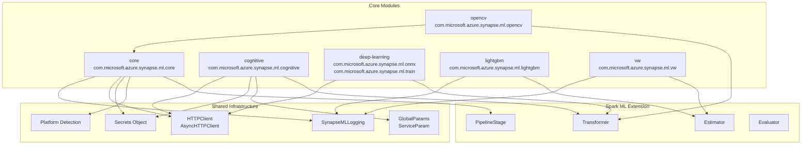
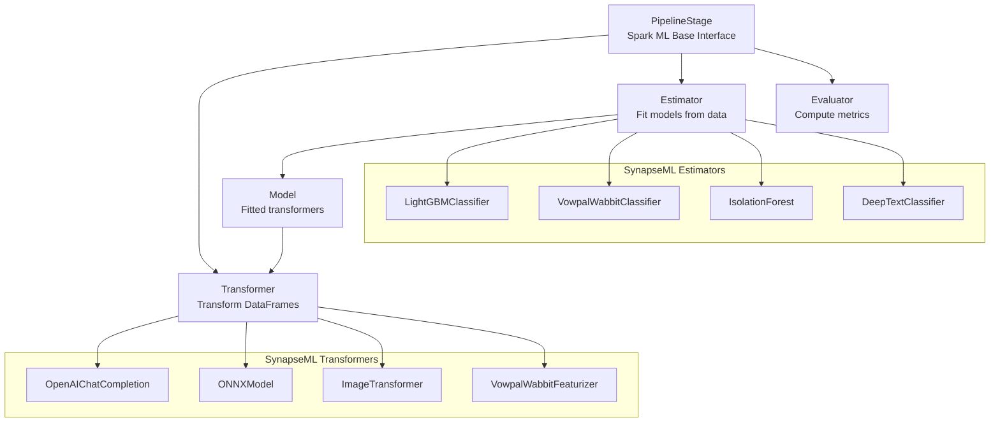
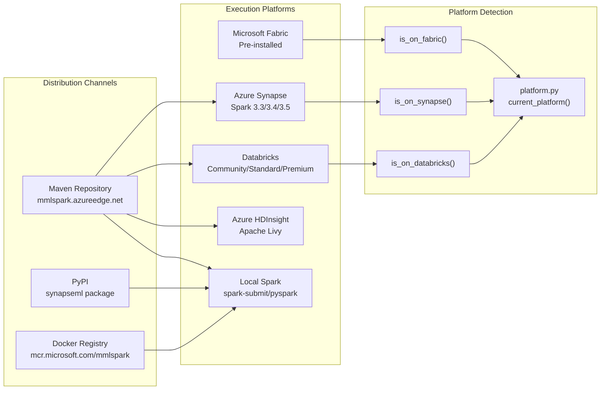

<!-- source: DeepWiki mcp.deepwiki.com · repo microsoft/SynapseML · page 1 Overview · fetched 2026-10-26 -->

# Overview

<details>
<summary>Relevant source files</summary>

The following files were used as context for generating this wiki page:

- [CONTRIBUTING.md](CONTRIBUTING.md)
- [README.md](README.md)
- [website/src/pages/index.js](website/src/pages/index.js)

</details>


This document provides a high-level introduction to SynapseML, explaining its purpose, architecture, and core capabilities. For detailed information about specific subsystems, refer to the linked pages throughout this document.

SynapseML is an open-source library that simplifies the creation of massively scalable machine learning pipelines on Apache Spark. It provides simple, composable, and distributed APIs for a wide variety of ML tasks including text analytics, vision, anomaly detection, deep learning, and traditional machine learning algorithms.

**Scope**: This page covers the overall architecture, component structure, and high-level capabilities. For platform-specific deployment details, see [Deployment](#8). For build and testing infrastructure, see [Development Infrastructure](#3). For specific ML capabilities, see [AI Services Integration](#6).

## What is SynapseML

SynapseML (previously known as MMLSpark) is built on the Apache Spark distributed computing framework and shares the same API as SparkML/MLLib, allowing seamless integration into existing Spark workflows. It enables users to build scalable and intelligent systems that can train and evaluate models on single-node, multi-node, and elastically resizable clusters.

**Key characteristics**:

- **Distributed**: Scales ML workloads across Spark clusters
- **Multi-language**: Supports Python, R, Scala, Java, and .NET
- **SparkML-compatible**: Extends the `PipelineStage` API
- **Cloud-native**: Integrates with Azure services and runs on multiple platforms

**Requirements**: Scala 2.12, Spark 3.4+, Python 3.8+

Sources: [README.md:1-10]()

## Modular Architecture

SynapseML is organized into six independent modules, each providing specialized ML capabilities. All modules share common infrastructure for HTTP communication, logging, secret management, and platform detection.

### High-Level Module Structure



Sources: [README.md:1-10]()

### Module Descriptions

| Module | Package | Purpose | Key Components |
|--------|---------|---------|----------------|
| **core** | `com.microsoft.azure.synapse.ml.core` | Foundational infrastructure, HTTP clients, logging, parameter management | `SynapseMLLogging`, `HTTPClient`, `GlobalParams`, `ServiceParam` |
| **cognitive** | `com.microsoft.azure.synapse.ml.cognitive` | Azure AI Services integration (OpenAI, Cognitive Services, AI Foundry) | `OpenAIPrompt`, `OpenAIChatCompletion`, `OpenAIEmbedding`, `CognitiveServiceBase` |
| **deep-learning** | `com.microsoft.azure.synapse.ml.onnx`, `com.microsoft.azure.synapse.ml.train` | ONNX model inference, Horovod distributed training, PyTorch Lightning | `ONNXModel`, `DeepTextClassifier`, `DeepVisionClassifier` |
| **lightgbm** | `com.microsoft.azure.synapse.ml.lightgbm` | LightGBM gradient boosting algorithms | `LightGBMRegressor`, `LightGBMClassifier`, `LightGBMRanker` |
| **vw** | `com.microsoft.azure.synapse.ml.vw` | Vowpal Wabbit online learning and contextual bandits | `VowpalWabbitClassifier`, `VowpalWabbitRegressor`, `VowpalWabbitContextualBandit` |
| **opencv** | `com.microsoft.azure.synapse.ml.opencv` | Image transformations and computer vision utilities | `ImageTransformer`, `ImageFeaturizer` |

Sources: [README.md:47-64]()

## Component Architecture with Code Entities

The following diagram shows how core components relate to each other using actual class names and file structures from the codebase:

```mermaid
graph TB
    subgraph "AI Service Implementations"
        OpenAIPrompt["OpenAIPrompt<br/>cognitive/src/.../OpenAIPrompt.scala"]
        OpenAIChat["OpenAIChatCompletion<br/>cognitive/src/.../OpenAIChatCompletion.scala"]
        OpenAIEmbed["OpenAIEmbedding<br/>cognitive/src/.../OpenAIEmbedding.scala"]
        CognitiveBase["CognitiveServiceBase<br/>cognitive/src/.../CognitiveServiceBase.scala"]
    end
    
    subgraph "Traditional ML"
        LGBMRegressor["LightGBMRegressor<br/>lightgbm/src/.../LightGBMRegressor.scala"]
        LGBMClassifier["LightGBMClassifier<br/>lightgbm/src/.../LightGBMClassifier.scala"]
        VWClassifier["VowpalWabbitClassifier<br/>vw/src/.../VowpalWabbitClassifier.scala"]
        IsolationForest["IsolationForest<br/>core/src/.../IsolationForest.scala"]
    end
    
    subgraph "Deep Learning"
        ONNXModel["ONNXModel<br/>deep-learning/src/.../ONNXModel.scala"]
        DeepText["DeepTextClassifier<br/>deep-learning/src/.../DeepTextClassifier.py"]
        DeepVision["DeepVisionClassifier<br/>deep-learning/src/.../DeepVisionClassifier.py"]
    end
    
    subgraph "Core Infrastructure"
        HTTPClient["HTTPClient<br/>core/src/.../HTTPClient.scala"]
        AsyncHTTP["AsyncHTTPClient<br/>core/src/.../AsyncHTTPClient.scala"]
        SMLLogging["SynapseMLLogging<br/>core/src/.../SynapseMLLogging.scala"]
        SecretsObj["Secrets<br/>core/src/.../Secrets.scala"]
        PlatformMod["Platform<br/>core/src/.../Platform.scala"]
    end
    
    subgraph "Custom Data Sources"
        ImageFormat["ImageFileFormat<br/>core/src/.../ImageFileFormat.scala"]
        BinaryFormat["BinaryFileFormat<br/>core/src/.../BinaryFileFormat.scala"]
        HTTPSource["HTTPSource<br/>core/src/.../HTTPSource.scala"]
        HTTPSink["HTTPSink<br/>core/src/.../HTTPSink.scala"]
    end
    
    OpenAIPrompt --> OpenAIChat
    OpenAIChat --> CognitiveBase
    OpenAIEmbed --> CognitiveBase
    CognitiveBase --> HTTPClient
    CognitiveBase --> SecretsObj
    
    LGBMRegressor --> SMLLogging
    VWClassifier --> SMLLogging
    
    ONNXModel --> HTTPClient
    DeepText --> ONNXModel
    DeepVision --> ONNXModel
    
    HTTPClient --> AsyncHTTP
    CognitiveBase --> SMLLogging
    
    SecretsObj --> PlatformMod
    SMLLogging --> PlatformMod
    
    HTTPSource --> HTTPClient
    HTTPSink --> HTTPClient
```



Sources: [README.md:47-64]()

## Spark ML Integration

SynapseML extends Apache Spark's ML library by implementing standard SparkML interfaces. All SynapseML components are `PipelineStage` implementations that can be composed into Spark ML pipelines.

### PipelineStage Hierarchy



### Custom Spark Extensions

SynapseML also extends Spark with custom data sources for specialized workloads:

| Extension | Type | Purpose | Key Classes |
|-----------|------|---------|-------------|
| **Image File Format** | `FileFormat` | Distributed image loading with retry logic | `ImageFileFormat` |
| **Binary File Format** | `FileFormat` | Binary file loading with zip archive support | `BinaryFileFormat` |
| **HTTP Source** | Streaming Source | Structured streaming from HTTP endpoints | `HTTPSource`, `HTTPSourceProvider` |
| **HTTP Sink** | Streaming Sink | Structured streaming to HTTP endpoints | `HTTPSink`, `HTTPSinkProvider` |

Sources: [README.md:5-7]()

## Platform Support

SynapseML runs on multiple Spark platforms with platform-aware detection and adaptation. The `Platform` module automatically detects the execution environment and adjusts behavior accordingly.

### Supported Platforms



**Platform-specific features**:
- **Fabric**: Pre-installed, uses Fabric telemetry, token library integration
- **Synapse**: Livy batch submission, mssparkutils integration
- **Databricks**: DBUtils secrets integration, GPU/RAPIDS support
- **Local**: Standalone Python deployment via PyPI

For detailed deployment instructions, see [Installation and Distribution](#8.1).

Sources: [README.md:70-260]()

## Language Support

SynapseML supports five languages through auto-generated bindings from Scala implementations:

| Language | Binding Generation | Import Path | Documentation |
|----------|-------------------|-------------|---------------|
| **Scala** | Native implementation | `com.microsoft.azure.synapse.ml.*` | ScalaDoc |
| **Python** | SparkML wrapper generation | `synapse.ml.*` | Sphinx |
| **R** | Automated R wrapper generation | `synapseml` package | RDoc |
| **Java** | Direct Scala interop | `com.microsoft.azure.synapse.ml.*` | JavaDoc |
| **.NET/C#** | Spark .NET bindings | `Synapse.ML.*` | XML docs |

**Example usage across languages**:

```python
# Python
from synapse.ml.lightgbm import LightGBMClassifier
model = LightGBMClassifier(numLeaves=31, numIterations=100)
```

```scala
// Scala
import com.microsoft.azure.synapse.ml.lightgbm.LightGBMClassifier
val model = new LightGBMClassifier().setNumLeaves(31).setNumIterations(100)
```

```r
# R
library(synapseml)
model <- ml_light_gbm_classifier(num_leaves=31, num_iterations=100)
```

For details on wrapper generation, see [Multi-Language SDK Generation](#3.3).

Sources: [README.md:7-9](), [website/src/pages/index.js:115-122]()

## Key Capabilities

SynapseML provides functionality across several ML domains:

### AI Services

| Capability | Components | Use Cases |
|------------|------------|-----------|
| **Azure OpenAI** | `OpenAIPrompt`, `OpenAIChatCompletion`, `OpenAIEmbedding` | LLM inference, chat applications, embeddings |
| **Cognitive Services** | `TextSentiment`, `ComputerVision`, `FaceAPI` | Text analytics, image analysis, face detection |
| **LangChain** | `LangchainTransformer` | Distributed LangChain execution |

See [OpenAI Integration](#6.1) and [Azure Cognitive Services](#6.2) for details.

### Traditional ML

| Capability | Components | Use Cases |
|------------|------------|-----------|
| **LightGBM** | `LightGBMClassifier`, `LightGBMRegressor`, `LightGBMRanker` | Gradient boosting for tabular data |
| **Vowpal Wabbit** | `VowpalWabbitClassifier`, `VowpalWabbitContextualBandit` | Online learning, reinforcement learning |
| **Anomaly Detection** | `IsolationForest` | Outlier detection |

See [LightGBM Integration](#6.5) and [Vowpal Wabbit Integration](#6.6) for details.

### Deep Learning

| Capability | Components | Use Cases |
|------------|------------|-----------|
| **ONNX** | `ONNXModel` | Distributed model inference |
| **PyTorch Lightning** | `DeepTextClassifier`, `DeepVisionClassifier` | Transfer learning, fine-tuning |
| **Horovod** | Distributed training integration | Multi-node deep learning |

See [Deep Learning Integration](#6.4) for details.

### Computer Vision

| Capability | Components | Use Cases |
|------------|------------|-----------|
| **Image Processing** | `ImageTransformer` | Resize, crop, normalize |
| **Image Loading** | `ImageFileFormat` | Distributed image reading |

See [OpenCV Integration](#6.4) for details.

### HTTP Integration

| Capability | Components | Use Cases |
|------------|------------|-----------|
| **HTTP Transformers** | `HTTPTransformer`, Cognitive Services APIs | Microservice orchestration |
| **Streaming** | `HTTPSource`, `HTTPSink` | Real-time HTTP data processing |
| **Serving** | Model serving capabilities | Deploy models as REST APIs |

See [HTTP Client System](#5.2) for details.

Sources: [README.md:47-64](), [website/src/pages/index.js:14-85]()

## Build and Distribution

SynapseML uses an SBT-based build system with modular project structure. The build produces multiple artifact types:

| Artifact Type | Format | Distribution Channel | Versions |
|--------------|--------|---------------------|----------|
| **JARs** | Signed JAR files | Maven Central, mmlspark.azureedge.net | 1.1.0 (Spark 3.5), 1.0.15 (Spark 3.4), 0.11.4 (Spark 3.3) |
| **Python Wheel** | `.whl` package | PyPI (`synapseml`) | Matches JAR versions |
| **Docker Images** | Container images | mcr.microsoft.com/mmlspark/release | demo, minimal, developer |
| **R Package** | R package | Automated generation | synapse.ml |
| **Documentation** | HTML sites | GitHub Pages, Blob Storage | API docs, website |

**Maven coordinates**: `com.microsoft.azure:synapseml_2.12:1.1.0`

**PyPI package**: `pip install synapseml`

For build system details, see [Build System](#3.2). For release process, see [CI/CD Pipeline](#3.1).

Sources: [README.md:175-224]()

## Testing Infrastructure

SynapseML employs comprehensive testing across multiple dimensions:

| Test Type | Coverage | Execution Environment |
|-----------|----------|----------------------|
| **Unit Tests** | Scala, Python, R | Local Spark |
| **Fuzzing Tests** | All PipelineStages | Automated discovery |
| **E2E Synapse** | Production scenarios | Azure Synapse Spark pools |
| **E2E Databricks** | GPU/CPU workloads | Databricks clusters (CPU, GPU, RAPIDS) |
| **Website Tests** | Documentation code blocks | pytest-codeblocks |
| **Security Scans** | CodeQL, OSSF Scorecards | GitHub Actions |

For testing details, see [Testing Infrastructure](#4).

Sources: [README.md:11-18]()

## Getting Started

To start using SynapseML:

1. **Choose a platform**: Synapse, Fabric, Databricks, or local Spark
2. **Install SynapseML**: Follow platform-specific instructions in [Installation and Distribution](#8.1)
3. **Import the library**: `from synapse.ml.* import *` (Python) or `import com.microsoft.azure.synapse.ml.*` (Scala)
4. **Build pipelines**: Compose SynapseML components with SparkML stages
5. **Scale**: Run on single-node or multi-node clusters

**Next steps**:
- For installation instructions: See [Deployment](#8)
- For example notebooks: See [Example Notebooks](#7.3)
- For API documentation: See [API Reference](https://mmlspark.blob.core.windows.net/docs/1.1.0/scala/index.html)
- For contributing: See [CONTRIBUTING.md:1-81]()

Sources: [README.md:66-270](), [website/src/pages/index.js:158-430]()

---

