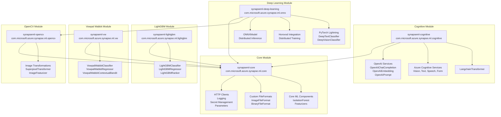
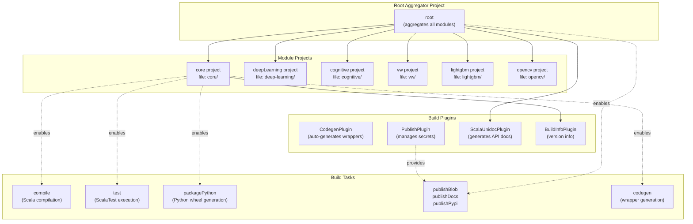
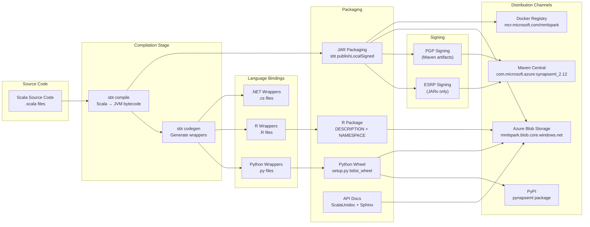
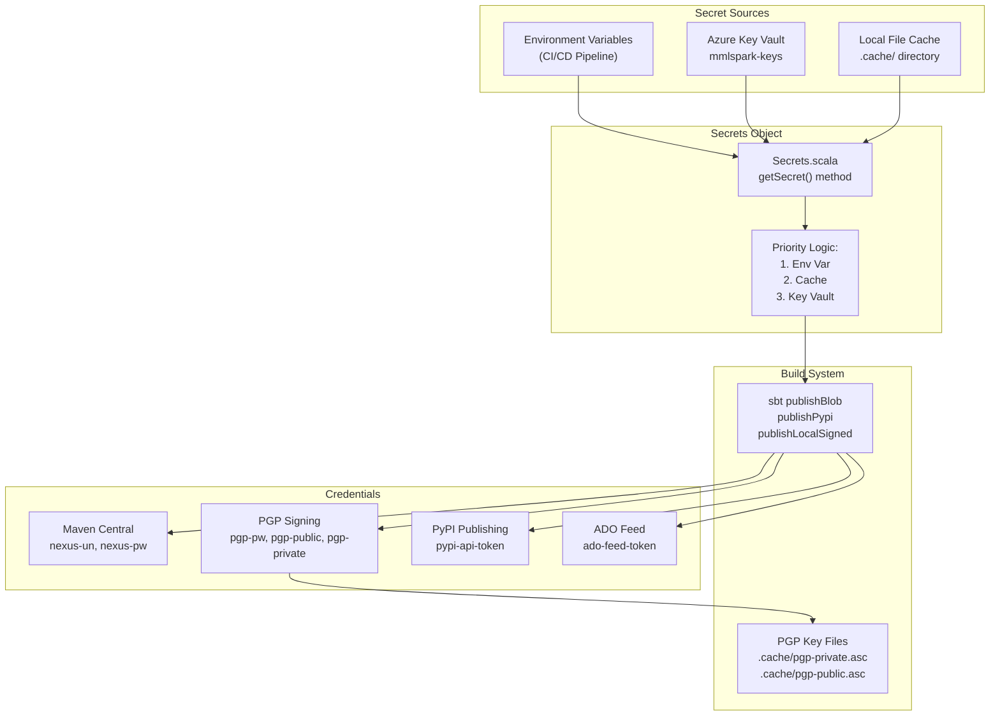

<!-- source: DeepWiki mcp.deepwiki.com · repo microsoft/SynapseML · page 2 Architecture · fetched 2026-10-26 -->

# Architecture

<details>
<summary>Relevant source files</summary>

The following files were used as context for generating this wiki page:

- [.gitignore](.gitignore)
- [CONTRIBUTING.md](CONTRIBUTING.md)
- [README.md](README.md)
- [build.sbt](build.sbt)
- [deep-learning/src/test/python/synapsemltest/dl/conftest.py](deep-learning/src/test/python/synapsemltest/dl/conftest.py)
- [environment.yml](environment.yml)
- [pipeline.yaml](pipeline.yaml)
- [project/PublishPlugin.scala](project/PublishPlugin.scala)
- [project/Secrets.scala](project/Secrets.scala)
- [sonatype.sbt](sonatype.sbt)
- [templates/codecov.yml](templates/codecov.yml)
- [templates/conda.yml](templates/conda.yml)
- [templates/kv.yml](templates/kv.yml)
- [tools/esrp/prepare_jar.py](tools/esrp/prepare_jar.py)

</details>


## Purpose and Scope

This document describes the overall architecture and design principles of SynapseML. It explains how the system is organized into modular components, how it integrates with Apache Spark, and how it adapts to different deployment environments.

For detailed information about specific subsystems:
- Module-specific implementation details: see [System Components](#2.1)
- Spark integration patterns: see [Integration with Spark](#2.2)
- Platform-specific behavior: see [Platform Detection and Adaptation](#2.3)
- Build and release infrastructure: see [Development Infrastructure](#3)
- Testing strategies: see [Testing Infrastructure](#4)

---

## Core Design Principles

SynapseML is designed around several fundamental architectural principles that guide all implementation decisions:

### Built on Apache Spark

SynapseML is built as a native extension to Apache Spark, leveraging Spark's distributed computing capabilities. The library requires Spark 3.4+ and Scala 2.12.17, as specified in [build.sbt:10-13](). All components are designed to operate on Spark DataFrames and RDDs, enabling seamless scalability from single-node to large cluster deployments.

### SparkML Pipeline Compatibility

All machine learning components implement Spark's `PipelineStage` interface, making them fully compatible with SparkML pipelines. This allows SynapseML transformers and estimators to be chained together with native Spark components. The library follows Spark's `MLReadable` and `MLWritable` interfaces for model serialization and persistence.

### Multi-Language Support

While implemented primarily in Scala, SynapseML automatically generates bindings for Python (PySpark), R (SparklyR), and .NET. This wrapper generation mechanism ensures consistent APIs across all supported languages. The build system produces language-specific artifacts that are published to appropriate repositories (Maven Central for JVM, PyPI for Python, NuGet for .NET).

### Platform Adaptation

SynapseML includes platform detection mechanisms that allow it to adapt behavior based on the execution environment (Azure Synapse Analytics, Microsoft Fabric, Databricks, standalone Spark). This enables seamless deployment across different platforms without code changes.

Sources: [README.md:1-10](), [build.sbt:10-13](), [CONTRIBUTING.md:36-43]()

---

## Modular Component Architecture

SynapseML is organized into six core modules, each providing specialized functionality. This modular design allows users to include only the components they need and enables independent development and testing of each module.

### Module Structure



**Module Dependencies and Maven Coordinates**

This diagram shows the module organization as defined in the SBT build configuration, including Maven group IDs and artifact names used for distribution.

Sources: [build.sbt:267-324](), [README.md:181-223]()

---

### Module Descriptions

| Module | Artifact Name | Primary Dependencies | Description |
|--------|--------------|---------------------|-------------|
| **core** | `synapseml-core` | `spark-core`, `spark-mllib`, `spark-avro` | Foundational infrastructure including HTTP clients, logging, parameter management, secret handling, and core ML algorithms like Isolation Forest |
| **cognitive** | `synapseml-cognitive` | `core`, `client-sdk` (Speech SDK) | Azure OpenAI and Cognitive Services integrations, including chat completion, embeddings, vision, text analytics, and speech services |
| **deep-learning** | `synapseml-deep-learning` | `core`, `opencv`, `onnxruntime_gpu`, `onnx-protobuf` | ONNX model inference, Horovod distributed training, and PyTorch Lightning-based classifiers |
| **lightgbm** | `synapseml-lightgbm` | `core`, `lightgbmlib` | LightGBM gradient boosting implementations for classification, regression, and ranking |
| **vw** | `synapseml-vw` | `core`, `vw-jni` | Vowpal Wabbit online learning algorithms including contextual bandits |
| **opencv** | `synapseml-opencv` | `core`, `opencv` | Computer vision operations and image transformations |

Sources: [build.sbt:267-324]()

---

## Build System Architecture

SynapseML uses SBT (Scala Build Tool) as its primary build system, with a sophisticated multi-stage build process that produces artifacts for multiple languages and platforms.

### SBT Project Structure



**SBT Multi-Module Project Configuration**

This diagram illustrates how the root SBT project aggregates six module projects, each with independent compilation and testing capabilities.

Sources: [build.sbt:267-344]()

---

### Build Configuration

The build system is configured with several key settings defined in [build.sbt:1-264]():

**Version and Scala Configuration:**
```
sparkVersion = "3.5.0"
scalaVersion = "2.12.17"
organization = "com.microsoft.azure"
```

**Dependency Management:**
- Core dependencies include `spark-core`, `spark-mllib`, and `spark-avro` with compile scope
- Test dependencies include `scalatest` and `spark-tags`
- Module-specific dependencies are declared in each module's configuration
- Dependency exclusions prevent version conflicts (e.g., excluding `protobuf-java` from transitive dependencies)

**Custom Build Tasks:**
- `getDatasetsTask`: Downloads test datasets from Azure Blob Storage
- `packageSynapseML`: Aggregates all Python modules into a single wheel
- `publishPypi`: Publishes Python package to PyPI using Twine
- `publishDocs`: Generates and uploads Scala and Python API documentation
- `generatePythonDoc`: Uses Sphinx to generate Python API documentation
- `convertNotebooks`: Converts Jupyter notebooks to markdown for website

**POM Post-Processing:**
The build includes custom POM transformation logic [build.sbt:50-70]() that removes scoped dependencies and excludes certain artifacts from the published Maven POM to ensure clean dependency resolution.

Sources: [build.sbt:1-368]()

---

## Distribution and Artifact Pipeline

SynapseML artifacts are built and distributed through multiple channels to support different deployment scenarios.

### Artifact Generation Flow



**Artifact Build and Distribution Pipeline**

This diagram shows how source code is compiled, wrapped for multiple languages, packaged, signed, and distributed to various channels.

Sources: [build.sbt:132-220](), [pipeline.yaml:87-134](), [tools/esrp/prepare_jar.py:1-80]()

---

### Distribution Channels

**Maven Central** ([README.md:176-183]())
- Primary distribution for JVM (Scala/Java) users
- Maven coordinates: `com.microsoft.azure:synapseml_2.12:1.1.0`
- Includes signed JARs with PGP signatures
- Published via Sonatype OSSRH with ESRP signing process

**PyPI** ([README.md:191-203]())
- Python package: `pip install synapseml`
- Contains unified wheel with all modules
- Generated from aggregated Python wrappers [build.sbt:132-185]()
- Published using Twine with API token authentication

**Azure Blob Storage** ([README.md:106-113]())
- Custom Maven repository: `https://mmlspark.azureedge.net/maven`
- Houses documentation, notebooks, and build artifacts
- Used for snapshot versions and internal testing
- Accessed via Azure CLI for publishing

**Docker Images** ([README.md:242-254]())
- Published to Microsoft Container Registry (MCR)
- Three variants: demo, minimal, release
- Include pre-configured Jupyter environments
- Based on Apache Spark base images

Sources: [README.md:70-260](), [sonatype.sbt:1-46](), [project/Secrets.scala:1-194]()

---

## Integration Points

### Spark SQL and DataFrames

SynapseML operates primarily on Spark DataFrames, leveraging Spark SQL's catalyst optimizer for query planning. All transformers and estimators accept DataFrames as input and produce DataFrames as output, maintaining compatibility with the broader Spark ecosystem.

### SparkML Pipeline API

Components implement the following core interfaces:
- `Transformer`: Implements `transform(dataset: DataFrame): DataFrame`
- `Estimator`: Implements `fit(dataset: DataFrame): Model`
- `Model`: Extends `Transformer` with learned parameters
- `MLWritable`/`MLReadable`: For model serialization

### Custom Data Sources

SynapseML extends Spark's data source API with custom implementations:
- `ImageFileFormat`: Reads image files into DataFrame format with retry logic
- `BinaryFileFormat`: Handles binary files with zip support
- `HTTPSource`/`HTTPSink`: Enables HTTP-based structured streaming

### Structured Streaming

The library provides streaming-compatible transformers and sources that integrate with Spark's continuous processing model, enabling real-time ML inference on streaming data.

Sources: [CONTRIBUTING.md:36-43]()

---

## Deployment Configuration

SynapseML adapts its configuration based on the target platform. Each deployment scenario requires specific Spark configuration parameters.

### Platform-Specific Configuration

**Microsoft Fabric** ([README.md:96-113]())
```
spark.jars.packages: com.microsoft.azure:synapseml_2.12:<version>
spark.jars.repositories: https://mmlspark.azureedge.net/maven
spark.jars.excludes: org.scala-lang:scala-reflect,...
spark.yarn.user.classpath.first: true
```

**Azure Synapse Analytics** ([README.md:118-172]())
- Spark 3.3, 3.4, and 3.5 pools supported
- Different SynapseML versions per Spark version
- Configured via notebook `%%configure` magic or pool-level settings

**Databricks** ([README.md:174-189]())
- Installed via Maven coordinates in cluster libraries
- Minimum: Spark 3.2 and Scala 2.12
- DBR 10.1+ recommended to avoid Netty conflicts

**Standalone Spark** ([README.md:191-214]())
- Via `spark-shell --packages` or `pyspark --packages`
- Or programmatically: `spark.jars.packages` in SparkSession builder

Sources: [README.md:70-260]()

---

## Secret and Credential Management

SynapseML implements a centralized secret management system defined in [project/Secrets.scala:1-194]() that abstracts credential retrieval across different environments.

### Secret Retrieval Architecture



**Build-Time Secret Management Flow**

The secret management system prioritizes environment variables (set by CI/CD), then falls back to local cache (for PGP keys), and finally queries Azure Key Vault if neither is available.

Sources: [project/Secrets.scala:1-194](), [sonatype.sbt:29-46]()

---

### Secret Lifecycle

**Discovery Phase** ([project/Secrets.scala:130-138]()):
1. Check for environment variable (e.g., `NEXUS-UN`, `PGP-PW`)
2. If not found, check local cache file in `.cache/` directory
3. If not found, execute Azure CLI command to fetch from Key Vault
4. Cache the secret locally for subsequent builds

**PGP Key Handling** ([project/Secrets.scala:96-108]()):
- PGP keys are stored as Base64-encoded strings in Key Vault
- Decoded and written to `.cache/pgp-private.asc` and `.cache/pgp-public.asc`
- These files are referenced by the SBT PGP plugin for JAR signing

**Publishing Control** ([project/Secrets.scala:17-19]()):
- Publishing is gated by `SYNAPSEML_ENABLE_PUBLISH` environment variable
- If `false`, secret retrieval is skipped and warnings are logged
- This prevents accidental publishing during local development

Sources: [project/Secrets.scala:1-194]()

---

## Conda Environment Management

The development and CI/CD pipeline uses Conda for consistent Python environment management across different platforms.

### Environment Specification

The [environment.yml:1-58]() file defines all dependencies:

**Python and Core Tools:**
- Python 3.11.8
- PySpark 3.5.0
- PyArrow 10.0.1
- Pandas 2.0.3

**Machine Learning Frameworks:**
- PyTorch 2.1.0 and TorchVision 0.16.0
- Horovod (compiled from specific commit)
- PyTorch Lightning 1.5.0
- Transformers 4.49.0

**Development Tools:**
- Sphinx for documentation generation
- pytest and pytest-cov for testing
- Black for code formatting
- Jupyter for notebooks

**Azure Integration:**
- azure-storage-blob for blob storage access
- MLflow for experiment tracking

Sources: [environment.yml:1-58]()

---

### Conda Environment Caching

The CI/CD pipeline implements aggressive caching of the Conda environment to reduce build times, as configured in [templates/conda.yml:1-42]():

**Cache Strategy:**
- Cache key: `'conda | "$(Agent.OS)" | environment.yml'`
- Cached directory: `/usr/share/miniconda/envs` (stored in `CONDA_CACHE_DIR`)
- Cache restored before environment creation
- 30-minute timeout with automatic retry

**Disk Space Management:**
The pipeline includes a cleanup step that removes unused SDKs (Android, Google Cloud) to free disk space before creating the Conda environment, addressing common disk space issues on Azure DevOps agents.

Sources: [templates/conda.yml:1-42](), [pipeline.yaml:60-94]()

---

## CI/CD Integration Architecture

The Azure DevOps pipeline orchestrates all build, test, and release activities through a series of jobs defined in [pipeline.yaml:1-773]().

### Pipeline Job Structure

```mermaid
graph TB
    subgraph "Trigger Events"
        GitPush["Git Push to master/spark3.3/spark3.5"]
        PullRequest["Pull Request"]
        Schedule["Daily Cron: 0 0 * * *"]
    end
    
    subgraph "Preparation Jobs"
        Style["Style Job<br/>scalastyle + black"]
        CondaCache["BuildAndCacheCondaEnv<br/>Conda environment setup"]
    end
    
    subgraph "Build and Publish"
        Publish["Publish Job<br/>sbt packagePython<br/>publishBlob<br/>publishDocs"]
    end
    
    subgraph "Testing Jobs"
        UnitTests["UnitTests Job<br/>30+ test packages<br/>Matrix strategy"]
        PythonTests["PythonTests Job<br/>7 packages<br/>Matrix strategy"]
        RTests["RTests Job<br/>6 packages<br/>Matrix strategy"]
        WebsiteTests["WebsiteSamplesTests<br/>pytest-codeblocks"]
    end
    
    subgraph "E2E Testing"
        E2E["E2E Job<br/>databricks-cpu<br/>databricks-gpu"]
    end
    
    subgraph "Documentation"
        Website["WebsiteAutoDeployment<br/>Docusaurus build<br/>GitHub Pages deploy"]
    end
    
    subgraph "Release"
        Release["Release Job<br/>PyPI publish<br/>Maven Central (ESRP)<br/>GitHub Release"]
    end
    
    GitPush --> Style
    PullRequest --> Style
    Schedule --> Style
    
    Style --> CondaCache
    Style --> Publish
    Style --> UnitTests
    Style --> PythonTests
    Style --> RTests
    Style --> WebsiteTests
    Style --> E2E
    Style --> Website
    
    Publish --> Release
    
    Release -.->|"Conditional:<br/>master + tag v*"| PyPI["PyPI"]
    Release -.->|"Conditional:<br/>master + tag v*"| MavenCentral["Maven Central"]
```

**Azure DevOps Pipeline Job Dependencies**

This diagram shows the pipeline's job structure, including conditional release logic that only triggers for tagged commits on master.

Sources: [pipeline.yaml:1-773]()

---

### Key Pipeline Jobs

**Style Job** ([pipeline.yaml:66-84]()):
- Runs Scala style check via `sbt scalastyle test:scalastyle`
- Runs Python style check via Black formatter
- Gates all other jobs (fails fast on style violations)

**Publish Job** ([pipeline.yaml:87-134]()):
- Generates all artifacts: JARs, Python wheels, R packages, documentation
- Uploads notebooks to Azure Blob Storage
- Publishes badges (version info) to blob storage
- Runs on every commit (not just releases)

**UnitTests Job** ([pipeline.yaml:614-772]()):
- Matrix strategy with 30+ test packages
- Each package runs independently in parallel
- Includes retry logic for flaky tests (Azure Cognitive Services)
- Generates code coverage reports for Codecov

**E2E Job** ([pipeline.yaml:138-181]()):
- Tests on Databricks CPU and GPU clusters
- Executes notebooks as Python scripts
- Provisions ephemeral test clusters
- 120-minute timeout per test run

**Release Job** ([pipeline.yaml:259-353]()):
- Only executes when: `master` branch + Git tag starting with `v`
- Publishes Python wheel to PyPI using Twine
- Signs JARs with ESRP and publishes to Maven Central
- Creates GitHub release with CHANGELOG

Sources: [pipeline.yaml:1-773]()

---

## Version Management and Branching

SynapseML uses a multi-branch strategy to support different Spark versions:

**Active Branches:**
- `master`: Spark 3.5 (current development)
- `spark3.3`: Spark 3.3 support
- `spark3.5`: Spark 3.5 support (may be redundant with master)

**Version Determination:**
Versions are determined dynamically using the `sbt-dynver` plugin, which generates versions from Git tags and commit hashes. Snapshot versions follow the pattern: `<version>-<commits>-<hash>`.

**Release Process:**
1. Tag a commit on `master` with format `v1.x.x`
2. Pipeline detects the tag and triggers Release job
3. CHANGELOG is auto-generated using `git-chglog`
4. Artifacts are signed and published to all channels
5. GitHub Release is created as draft for manual verification

Sources: [pipeline.yaml:4-43](), [pipeline.yaml:265-283](), [sonatype.sbt:45-46]()

---

