<!-- source: DeepWiki mcp.deepwiki.com · repo microsoft/SynapseML · page 2.1 System Components · fetched 2026-10-26 -->

# System Components

<details>
<summary>Relevant source files</summary>

The following files were used as context for generating this wiki page:

- [.gitignore](.gitignore)
- [CONTRIBUTING.md](CONTRIBUTING.md)
- [README.md](README.md)
- [build.sbt](build.sbt)
- [deep-learning/src/test/python/synapsemltest/dl/conftest.py](deep-learning/src/test/python/synapsemltest/dl/conftest.py)
- [environment.yml](environment.yml)
- [pipeline.yaml](pipeline.yaml)
- [project/PublishPlugin.scala](project/PublishPlugin.scala)
- [project/Secrets.scala](project/Secrets.scala)
- [sonatype.sbt](sonatype.sbt)
- [templates/codecov.yml](templates/codecov.yml)
- [templates/conda.yml](templates/conda.yml)
- [templates/kv.yml](templates/kv.yml)
- [tools/esrp/prepare_jar.py](tools/esrp/prepare_jar.py)

</details>


This page details the modular structure of SynapseML, including the core, cognitive, deep learning, LightGBM, VW, and OpenCV modules. SynapseML is organized as a collection of SBT projects that compile into separate JAR artifacts but work together to provide machine learning capabilities at scale. For information on how these modules extend Apache Spark's functionality, see [Integration with Spark](#2.2).

## Module Architecture

SynapseML is structured as six distinct SBT modules, each providing specialized machine learning capabilities. The modules are defined in `build.sbt` and can be used independently or together.

### SBT Module Structure

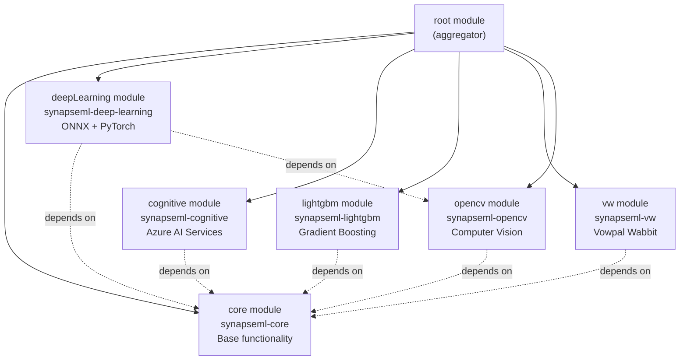

**Module Dependency Structure**

| Module | Artifact Name | Dependencies | Purpose |
|--------|--------------|--------------|---------|
| `core` | `synapseml-core` | Spark 3.5.0, spray-json, httpcomponents | Foundational infrastructure, HTTP clients, logging, file formats |
| `deepLearning` | `synapseml-deep-learning` | `core`, `opencv`, ONNX, pytorch_lightning | ONNX inference, Horovod training, PyTorch integration |
| `cognitive` | `synapseml-cognitive` | `core`, Azure Speech SDK | OpenAI, Azure Cognitive Services, LangChain |
| `lightgbm` | `synapseml-lightgbm` | `core`, lightgbmlib 3.3.510 | LightGBM classification, regression, ranking |
| `vw` | `synapseml-vw` | `core`, vw-jni 9.3.0 | Vowpal Wabbit classifiers, regressors, contextual bandits |
| `opencv` | `synapseml-opencv` | `core`, opencv 3.2.0-1 | OpenCV-based image transformations |

Sources: [build.sbt:267-324](), [build.sbt:326-344]()

## Core Module (`synapseml-core`)

The `core` module provides foundational infrastructure that all other SynapseML modules depend on. It contains shared utilities, HTTP clients, logging systems, and Spark integrations.

### Package Structure

The core module is organized under `com.microsoft.azure.synapse.ml` with the following key packages:

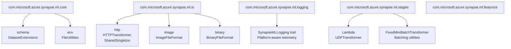

### Core Dependencies

The core module depends on:
- **Apache Spark 3.5.0**: `spark-core`, `spark-mllib`, `spark-avro` (excludes older protobuf)
- **HTTP Libraries**: Apache HttpComponents Client5 5.1.3, httpmime 4.5.13
- **JSON Processing**: spray-json 1.3.5
- **Isolation Forest**: LinkedIn isolation-forest 3.0.5
- **Testing**: ScalaTest 3.2.14, GlobalMentor hadoop-bare-naked-local-fs

Sources: [build.sbt:23-43](), [build.sbt:267-280]()

### Core Functionality

The core module provides several critical systems:

#### HTTP Client Infrastructure

Enables distributed HTTP communication for calling external APIs at scale:
- `HTTPTransformer`: Base class for HTTP-based transformers
- `SharedSingleton`: Connection pooling for efficient HTTP communication
- Support for both synchronous and asynchronous HTTP patterns

#### Custom Spark Data Sources

Extended file format support for ML workloads:
- `ImageFileFormat`: Reads images into Spark DataFrames with retry logic
- `BinaryFileFormat`: Reads binary files with zip archive support
- Patched implementations to handle flakiness in distributed file systems

#### Spark ML Extensions

Enhanced pipeline components:
- `Lambda` and `UDFTransformer`: Apply arbitrary functions as pipeline stages
- `FixedMiniBatchTransformer`: Batch DataFrame rows for efficient processing
- `DatasetExtensions`: Additional DataFrame operations

Sources: [build.sbt:267-280](), [README.md:5-9]()

### Testing Infrastructure

The core module includes comprehensive testing utilities used across all modules:

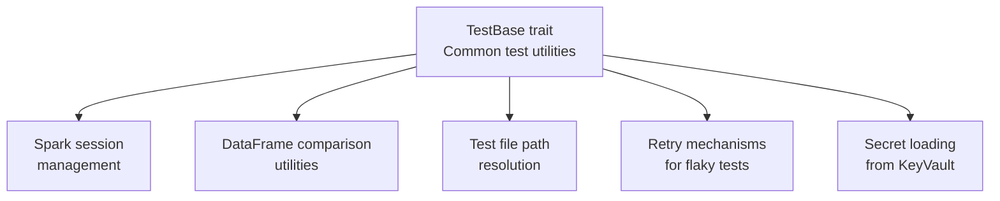

The testing framework supports:
- Automatic Spark session management for tests
- DataFrame comparison with configurable tolerance
- Test dataset loading from `datasetDir` build setting
- Integration with Azure Key Vault for test secrets

Sources: [build.sbt:72-89](), [pipeline.yaml:614-772]()

## Cognitive Module (`synapseml-cognitive`)

The `cognitive` module provides Spark integrations for Azure AI Services, OpenAI, and other cloud-based AI APIs. It depends on the `core` module and adds the Azure Speech SDK.

### Dependencies

```scala
libraryDependencies += "com.microsoft.cognitiveservices.speech" % "client-sdk" % "1.24.1"
```

The module also includes Hadoop dependencies for Azure blob storage access during testing.

Sources: [build.sbt:308-317]()

### Package Structure

The cognitive module is organized under `com.microsoft.azure.synapse.ml.services`:

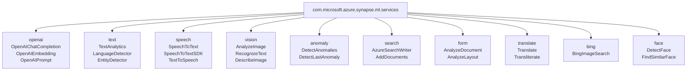

### OpenAI Integration

The OpenAI package provides transformers for leveraging OpenAI and Azure OpenAI services:

**Core Classes:**
- `OpenAIChatCompletion`: Chat completion with streaming support
- `OpenAIEmbedding`: Text embedding generation
- `OpenAIPrompt`: Template-based prompt construction with multimodal support
- `OpenAIDefaults`: Global parameter defaults

**Key Features:**
- Support for both OpenAI API and Azure OpenAI endpoints
- Streaming responses with Server-Sent Events (SSE)
- Multimodal inputs (text + images)
- Response format specification (JSON schema)
- Token usage tracking and rate limiting

Sources: [pipeline.yaml:645-650](), [README.md:52-53]()

### Azure Cognitive Services

The cognitive module includes wrappers for multiple Azure Cognitive Services APIs:

#### Text Analytics
- `LanguageDetector`: Detect language from text
- `EntityDetector`, `NER`, `PII`: Named entity recognition
- `TextSentiment`: Sentiment analysis
- `KeyPhraseExtractor`: Extract key phrases
- `AnalyzeHealthText`: Medical text analysis

#### Speech Services
- `SpeechToText`: REST API-based speech recognition
- `SpeechToTextSDK`: SDK-based speech recognition with websockets
- `TextToSpeech`: Text-to-speech synthesis
- `ConversationTranscription`: Multi-speaker transcription
- `SpeakerEmotionInference`: Emotion detection from speech

#### Computer Vision
- `AnalyzeImage`: Image content analysis
- `RecognizeText`: OCR text extraction
- `DescribeImage`: Generate image captions
- `TagImage`: Automatic image tagging
- `RecognizeDomainSpecificContent`: Celebrity/landmark recognition

#### Other Services
- Anomaly Detection (`DetectAnomalies`, `SimpleDetectAnomalies`)
- Form Recognizer (`AnalyzeDocument`, `AnalyzeLayout`)
- Translator (`Translate`, `Transliterate`, `DetectLanguage`)
- Bing Search (`BingImageSearch`)
- Face API (`DetectFace`, `VerifyFaces`, `FindSimilarFace`)

Sources: [pipeline.yaml:639-671](), [README.md:52-53]()

### LangChain Integration

The cognitive module includes `LangchainTransformer` for distributed execution of LangChain chains:

- Executes LangChain chains across Spark DataFrame rows
- Supports question answering, summarization, and custom chains
- Integrates with vector stores and retrievers

Sources: [README.md:58-59]()

### Service Architecture

All cognitive services extend common base classes:

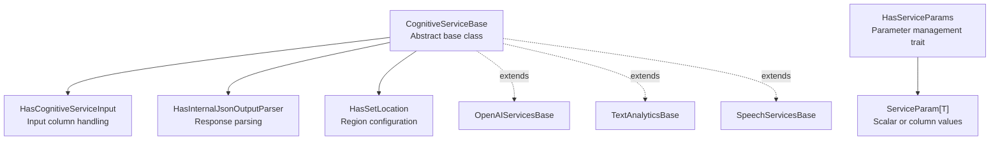

Common patterns:
- `ServiceParam[T]` allows parameters to be either fixed values or DataFrame columns
- `HasInternalJsonOutputParser` standardizes JSON response parsing
- `HasSetLocation` manages Azure region configuration
- `HasCognitiveServiceInput` handles input column mapping

Sources: [build.sbt:308-317](), [pipeline.yaml:639-671]()

## Deep Learning Module (`synapseml-deep-learning`)

The `deepLearning` module provides distributed deep learning capabilities through ONNX Runtime and PyTorch Lightning integration. It depends on both `core` and `opencv` modules.

### Dependencies

```scala
libraryDependencies ++= Seq(
  "com.microsoft.azure" % "onnx-protobuf_2.12" % "0.9.3",
  "com.microsoft.onnxruntime" % "onnxruntime_gpu" % "1.8.1"
)
```

Python dependencies include PyTorch 2.1.0, torchvision 0.16.0, Horovod, and pytorch_lightning 1.5.0.

Sources: [build.sbt:282-292](), [environment.yml:36-42]()

### Package Structure

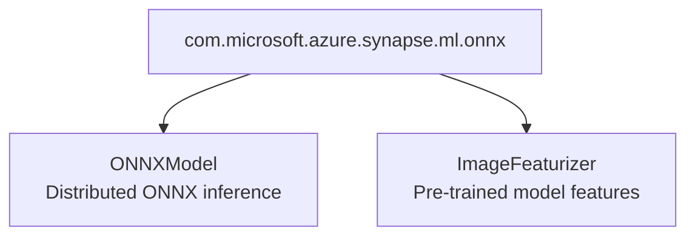

### ONNX Integration

The module provides `ONNXModel` for distributed inference of ONNX models:

**Key Features:**
- Hardware-accelerated inference (CPU/GPU)
- Distributed model execution across Spark cluster
- Support for models exported from PyTorch, TensorFlow, scikit-learn
- Automatic batching and model broadcasting

### PyTorch Lightning Integration

Through Python APIs, the module supports:
- `DeepVisionClassifier`: Image classification with transfer learning
- `DeepTextClassifier`: Text classification with transformer models
- Horovod-based distributed training
- Integration with Petastorm for efficient data loading

The training pipeline uses `pytorch_lightning.LightningModule` and Horovod's `hvd.DistributedOptimizer` for data-parallel training across Spark workers.

Sources: [build.sbt:282-292](), [environment.yml:36-42](), [deep-learning/src/test/python/synapsemltest/dl/conftest.py:1-110]()

## LightGBM Module (`synapseml-lightgbm`)

The `lightgbm` module provides distributed gradient boosting through Microsoft's LightGBM library. It depends on the `core` module.

### Dependencies

```scala
libraryDependencies += ("com.microsoft.ml.lightgbm" % "lightgbmlib" % "3.3.510")
```

Sources: [build.sbt:294-299]()

### Components

The LightGBM module provides three main estimators:

**LightGBM Estimators:**
- `LightGBMClassifier`: Binary and multiclass classification
- `LightGBMRegressor`: Regression tasks
- `LightGBMRanker`: Learning to rank

**Key Features:**
- Native integration with Spark MLlib pipelines
- Distributed training across Spark executors
- Support for categorical features
- Early stopping and cross-validation
- Model persistence and loading

### Pipeline Testing

The module is tested across 6 parallel test splits in the CI pipeline to ensure comprehensive coverage:

```
lightgbm.split1, lightgbm.split2, lightgbm.split3,
lightgbm.split4, lightgbm.split5, lightgbm.split6
```

Sources: [build.sbt:294-299](), [pipeline.yaml:697-714](), [README.md:52-54]()

## Vowpal Wabbit Module (`synapseml-vw`)

The `vw` module integrates Vowpal Wabbit for fast online learning and contextual bandit algorithms. It depends on the `core` module.

### Dependencies

```scala
libraryDependencies += ("com.github.vowpalwabbit" % "vw-jni" % "9.3.0")
```

Sources: [build.sbt:301-306]()

### Components

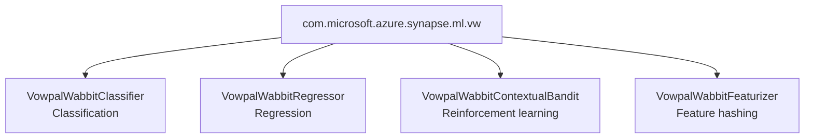

**Key Features:**
- Online learning with single-pass training
- Support for large feature spaces through hashing
- Contextual bandit algorithms for recommendation systems
- Integration with Spark ML feature transformers
- Efficient handling of sparse data

Sources: [build.sbt:301-306](), [pipeline.yaml:726](), [README.md:52-54]()

## OpenCV Module (`synapseml-opencv`)

The `opencv` module provides computer vision transformations using OpenCV. It depends on the `core` module.

### Dependencies

```scala
libraryDependencies += ("org.openpnp" % "opencv" % "3.2.0-1")
```

Sources: [build.sbt:319-324]()

### Components

The OpenCV module provides image transformation pipeline stages:

**Image Transformations:**
- Resizing and scaling
- Color space conversions
- Image filtering and enhancement
- Geometric transformations
- Feature detection and extraction

**Integration:**
- Works with `ImageFileFormat` from core module
- Produces Spark DataFrames with image columns
- Compatible with deep learning module for preprocessing

The module enables building preprocessing pipelines for computer vision tasks within Spark ML pipelines.

Sources: [build.sbt:319-324](), [pipeline.yaml:461](), [pipeline.yaml:715-716]()

## Build and Publishing Infrastructure

The modular structure is supported by SBT build configuration and multi-language SDK generation.

### Publishing Artifacts

Each module publishes its own Maven artifact:

| Module | Maven Coordinates |
|--------|------------------|
| Core | `com.microsoft.azure:synapseml-core_2.12:VERSION` |
| Deep Learning | `com.microsoft.azure:synapseml-deep-learning_2.12:VERSION` |
| Cognitive | `com.microsoft.azure:synapseml-cognitive_2.12:VERSION` |
| LightGBM | `com.microsoft.azure:synapseml-lightgbm_2.12:VERSION` |
| VW | `com.microsoft.azure:synapseml-vw_2.12:VERSION` |
| OpenCV | `com.microsoft.azure:synapseml-opencv_2.12:VERSION` |

The `root` module aggregates all submodules and publishes a combined artifact:
- `com.microsoft.azure:synapseml_2.12:VERSION`

### Multi-Language SDK Generation

SynapseML automatically generates Python and R bindings from Scala implementations:

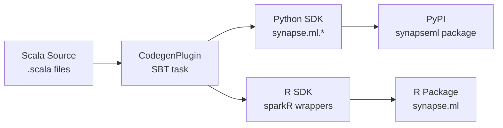

The code generation process:
1. `CodegenPlugin` scans compiled Scala classes
2. Generates Python wrappers with proper type hints
3. Generates R wrappers for SparkR
4. Packages Python code into wheel (`.whl`) files
5. Publishes to PyPI and R package repositories

**SBT Tasks:**
- `packagePython`: Generate Python bindings for a module
- `packageSynapseML`: Combine all modules into single Python wheel
- `publishPypi`: Upload to PyPI
- `publishR`: Package and publish R bindings

Sources: [build.sbt:132-197](), [build.sbt:250-264]()

### Testing Strategy by Module

The CI pipeline tests each module independently:

**Python Tests** (7 parallel jobs):
- `core`, `deepLearning` (split into HuggingFace and non-HF), `lightgbm`, `opencv`, `vw`, `cognitive`

**R Tests** (6 parallel jobs):
- `core`, `deep-learning`, `lightgbm`, `opencv`, `vw`, `cognitive`

**Scala Unit Tests** (30+ parallel jobs):
- Each module's packages tested separately (e.g., `services.openai`, `services.text`, `lightgbm.split1`)

**E2E Tests** (Databricks + Synapse):
- All modules tested together in notebook-based integration tests

Sources: [pipeline.yaml:357-519](), [pipeline.yaml:614-772](), [pipeline.yaml:138-182]()

### Secrets Management for Testing

Build and test infrastructure uses Azure Key Vault for secret management:

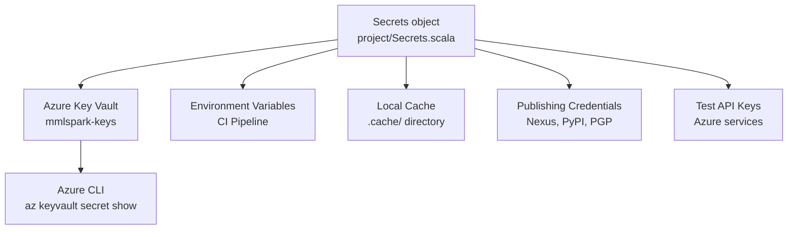

The `Secrets` object manages:
- **Publishing credentials**: Nexus (Maven), PyPI tokens, PGP signing keys
- **Test secrets**: API keys for Azure Cognitive Services, OpenAI
- **Caching**: Secrets cached locally in `.cache/` directory to reduce Key Vault calls

**Secret Loading Priority:**
1. Environment variables (set by CI pipeline)
2. Local cache files (for developer machines)
3. Azure Key Vault (fetched via `az` CLI)

Sources: [project/Secrets.scala:1-194](), [pipeline.yaml:95](), [templates/kv.yml:1-7]()

## HTTP Communication Architecture

The HTTP communication layer is a critical component that enables SynapseML to interact with various AI services.

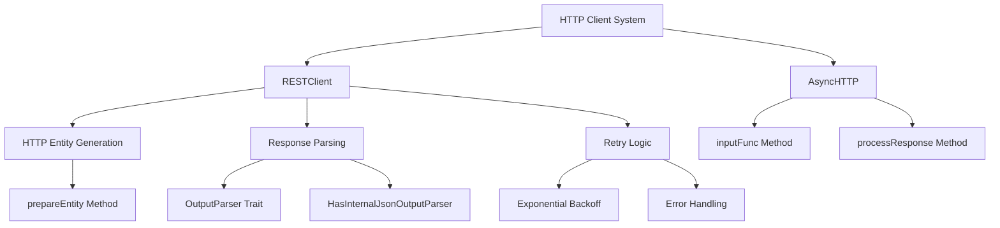

The HTTP communication architecture consists of:

1. **RESTClient** - Handles synchronous HTTP requests with error handling and retries
2. **AsyncHTTP** - Manages asynchronous HTTP communication for streaming services
3. **Entity Generation** - Creates HTTP request bodies from Spark DataFrame rows
4. **Response Parsing** - Converts HTTP responses back into Spark-compatible formats

Sources: [cognitive/src/test/scala/com/microsoft/azure/synapse/ml/services/search/SearchWriterSuite.scala:161-176](), [cognitive/src/main/scala/com/microsoft/azure/synapse/ml/services/speech/SpeakerEmotionInference.scala:43-58]()

## Parameter Management System

SynapseML implements a sophisticated parameter management system that allows transformers to handle both scalar values and DataFrame columns as inputs.

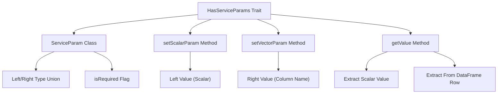

This system allows:

1. API transformers to accept either fixed values or column references
2. Automatic extraction of values from DataFrame rows during transformation
3. Type-safe parameter handling with validation

Sources: [cognitive/src/main/scala/com/microsoft/azure/synapse/ml/services/speech/SpeakerEmotionInference.scala:104-135]()

## Component Relationships and Data Flow

This diagram illustrates how data flows through SynapseML components in a typical ML pipeline:

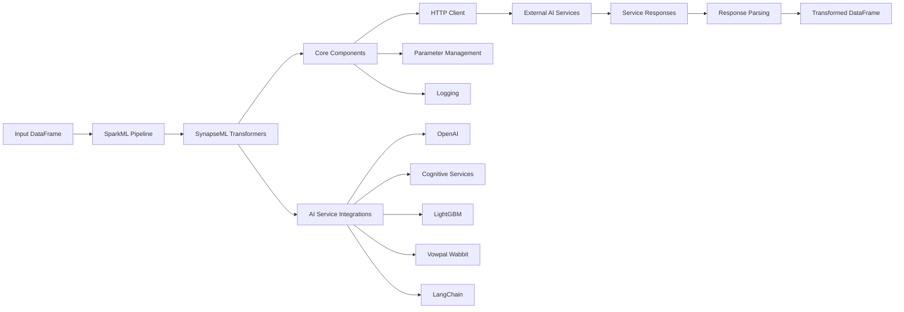

Sources: [README.md:5-59](), [cognitive/src/test/scala/com/microsoft/azure/synapse/ml/services/text/TextAnalyticsSuite.scala:34-291](), [cognitive/src/test/scala/com/microsoft/azure/synapse/ml/services/speech/SpeechToTextSDKSuite.scala:139-487]()

## Common Architecture Patterns

SynapseML employs several common architectural patterns across its components:

1. **Transformer Pattern**: Components extend Spark's Transformer interface, implementing a `transform` method that converts input DataFrames to output DataFrames
   
2. **Service Parameter Pattern**: Service parameters can be specified as either fixed values or column references using the `ServiceParam` class

3. **Error Handling Pattern**: Most services include an error column option to capture and report service-specific errors

4. **Binding Generation Pattern**: Language bindings for Python and R are automatically generated from Scala code

5. **Pipeline Composition Pattern**: Components are designed to be composed in SparkML pipelines

Sources: [CONTRIBUTING.md:35-40](), [cognitive/src/test/scala/com/microsoft/azure/synapse/ml/services/text/TextAnalyticsSuite.scala:21-32](), [cognitive/src/test/scala/com/microsoft/azure/synapse/ml/services/speech/SpeechToTextSDKSuite.scala:27-136]()

## Conclusion

SynapseML's modular architecture provides a flexible and extensible framework for large-scale machine learning on Apache Spark. The system components are designed to work together seamlessly, enabling integration with various AI services while maintaining a consistent API surface. This design allows users to leverage advanced AI capabilities within familiar Spark pipelines, simplifying the development of scalable machine learning applications.

---

