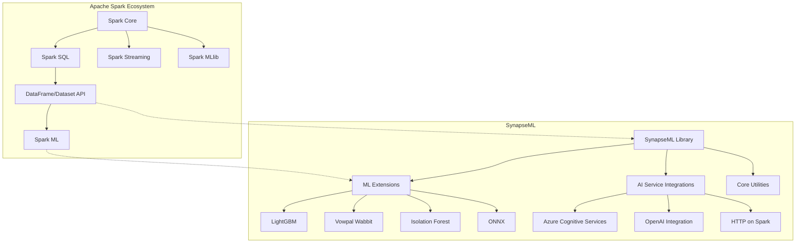
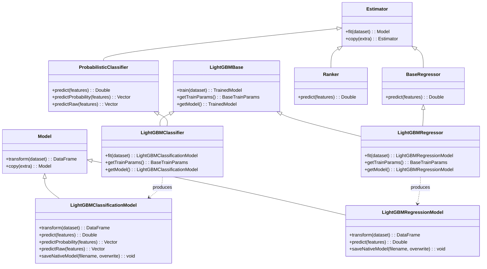
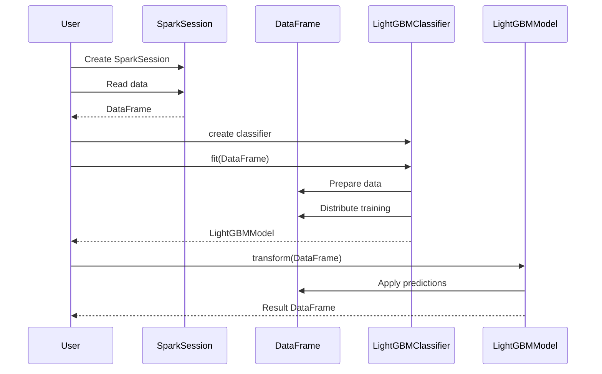
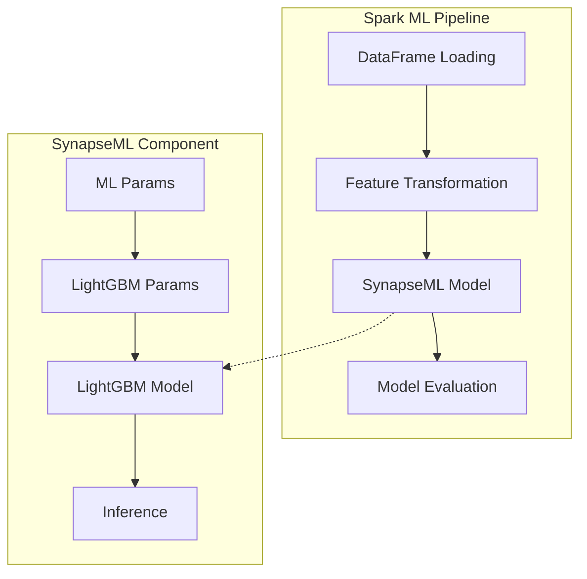
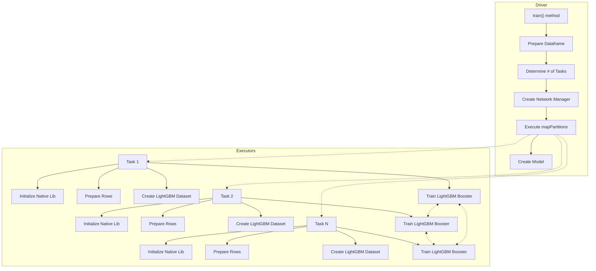
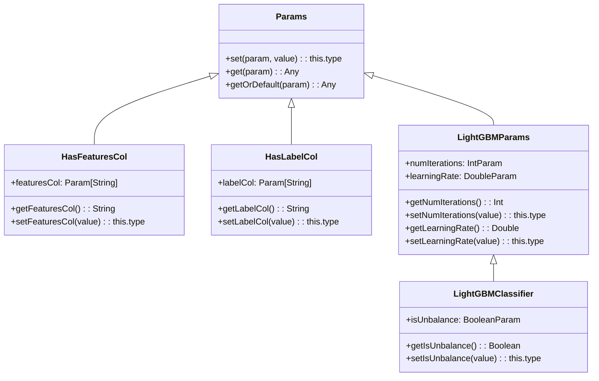

<!-- source: DeepWiki mcp.deepwiki.com · repo microsoft/SynapseML · page 2.2 Integration with Spark · fetched 2026-10-26 -->

# Integration with Spark

<details>
<summary>Relevant source files</summary>

The following files were used as context for generating this wiki page:

- [CONTRIBUTING.md](CONTRIBUTING.md)
- [README.md](README.md)
- [core/src/main/scala/com/microsoft/azure/synapse/ml/io/binary/BinaryFileFormat.scala](core/src/main/scala/com/microsoft/azure/synapse/ml/io/binary/BinaryFileFormat.scala)
- [core/src/main/scala/org/apache/spark/ml/source/image/PatchedImageFileFormat.scala](core/src/main/scala/org/apache/spark/ml/source/image/PatchedImageFileFormat.scala)
- [core/src/main/scala/org/apache/spark/sql/execution/streaming/continuous/HTTPSinkV2.scala](core/src/main/scala/org/apache/spark/sql/execution/streaming/continuous/HTTPSinkV2.scala)
- [core/src/test/scala/com/microsoft/azure/synapse/ml/codegen/RTestGen.scala](core/src/test/scala/com/microsoft/azure/synapse/ml/codegen/RTestGen.scala)
- [core/src/test/scala/com/microsoft/azure/synapse/ml/io/split2/DistributedHTTPSuite.scala](core/src/test/scala/com/microsoft/azure/synapse/ml/io/split2/DistributedHTTPSuite.scala)
- [start](start)
- [tools/docker/demo/Dockerfile](tools/docker/demo/Dockerfile)
- [tools/docker/demo/README.md](tools/docker/demo/README.md)
- [tools/docker/demo/init_notebook.py](tools/docker/demo/init_notebook.py)
- [tools/docker/minimal/Dockerfile](tools/docker/minimal/Dockerfile)
- [tools/tests/run_r_tests.R](tools/tests/run_r_tests.R)
- [vw/src/main/scala/com/microsoft/azure/synapse/ml/vw/VowpalWabbitBaseModel.scala](vw/src/main/scala/com/microsoft/azure/synapse/ml/vw/VowpalWabbitBaseModel.scala)

</details>


This document explains how SynapseML integrates with Apache Spark, describing the core architectural patterns and mechanisms that enable SynapseML to extend Spark's machine learning capabilities while maintaining compatibility with the Spark ML ecosystem.

## Overview

SynapseML (previously known as MMLSpark) extends Apache Spark's machine learning capabilities by providing additional algorithms, transformers, and integrations with external AI services. It's built directly on top of Apache Spark and shares the same API as SparkML/MLLib, allowing users to seamlessly embed SynapseML models into existing Apache Spark workflows.

The integration follows Spark's design principles and extends its core components like `Estimator`, `Transformer`, `Model`, and `Pipeline` to provide a consistent experience for users familiar with Spark ML.



Sources: [README.md:5-9](), [lightgbm/src/main/scala/com/microsoft/azure/synapse/ml/lightgbm/LightGBMBase.scala:27-34]()

## Core Integration Mechanisms

SynapseML integrates with Spark through several key mechanisms:

### 1. Extension of Spark ML Base Classes

SynapseML components extend Spark ML's base classes to maintain API compatibility. For example:

- `LightGBMClassifier` extends Spark's `ProbabilisticClassifier`
- `LightGBMRegressor` extends Spark's `BaseRegressor`
- `LightGBMRanker` extends Spark's `Ranker`

This inheritance ensures that SynapseML's models function as proper Spark ML pipeline components with consistent APIs.



Sources: [lightgbm/src/main/scala/com/microsoft/azure/synapse/ml/lightgbm/LightGBMClassifier.scala:27-30](), [lightgbm/src/main/scala/com/microsoft/azure/synapse/ml/lightgbm/LightGBMRegressor.scala:39-41](), [lightgbm/src/main/scala/com/microsoft/azure/synapse/ml/lightgbm/LightGBMRanker.scala:26-28]()

### 2. DataFrame/Dataset API Integration

SynapseML components work directly with Spark's DataFrame/Dataset API:

- Models take DataFrames as input and produce DataFrames as output
- Transformers process data using DataFrame operations
- SynapseML leverages Spark SQL for data manipulation and preprocessing

This enables seamless integration with existing Spark data processing pipelines.



Sources: [lightgbm/src/main/scala/com/microsoft/azure/synapse/ml/lightgbm/LightGBMBase.scala:109-144](), [lightgbm/src/main/scala/com/microsoft/azure/synapse/ml/lightgbm/LightGBMClassifier.scala:118-163]()

### 3. Pipeline Integration

SynapseML components are designed to be used in Spark ML pipelines:

- Components implement the `PipelineStage` interface 
- Models can be saved and loaded as part of a pipeline
- Components support parameter passing through the Spark ML params system



Sources: [CONTRIBUTING.md:38-40](), [lightgbm/src/main/scala/com/microsoft/azure/synapse/ml/lightgbm/params/LightGBMParams.scala:488-503]()

## Distributed Computing Integration

SynapseML tightly integrates with Spark's distributed computing capabilities to enable scalable machine learning:

### 1. Distributed Training

SynapseML algorithms like LightGBM leverage Spark's distributed computing for training:

- Data is partitioned across worker nodes
- Workers communicate via a network layer for distributed algorithm execution
- Training happens in parallel across multiple Spark executors



Sources: [lightgbm/src/main/scala/com/microsoft/azure/synapse/ml/lightgbm/LightGBMBase.scala:581-606]()

### 2. Distributed Data Processing

SynapseML uses Spark's distributed data processing capabilities:

- Algorithms process data in parallel across partitions
- RDD and DataFrame operations are used for distributed preprocessing
- Data aggregation is handled using Spark's distributed computing primitives

### 3. Barrier Execution Mode

SynapseML supports Spark's barrier execution mode for synchronous distributed computing:

- Enables algorithms that require synchronized communication between workers
- Used for distributed training of models like LightGBM
- Configurable to optimize performance based on the cluster environment

```scala
if (getUseBarrierExecutionMode)
  dataframe.rdd.barrier().mapPartitions(mapPartitionsFunc).collect()
else
  dataframe.mapPartitions(mapPartitionsFunc)(encoder).collect()
```

Sources: [lightgbm/src/main/scala/com/microsoft/azure/synapse/ml/lightgbm/LightGBMBase.scala:620-623]()

## Parameter System Integration

SynapseML integrates with Spark ML's parameter system to provide a consistent interface:

### 1. Parameter Definition

SynapseML components use Spark ML's parameter definition system:

- Parameters are defined using Spark's `Param`, `BooleanParam`, `IntParam`, etc.
- Default values are set using `setDefault`
- Parameters are exposed through getter and setter methods



Sources: [lightgbm/src/main/scala/com/microsoft/azure/synapse/ml/lightgbm/params/LightGBMParams.scala:488-503](), [lightgbm/src/main/scala/com/microsoft/azure/synapse/ml/lightgbm/LightGBMClassifier.scala:37-41]()

### 2. Parameter Passing

Parameters are passed to native libraries and underlying algorithms:

- SynapseML converts Spark ML parameters to format required by underlying implementations
- Parameter validation and transformation is handled during this process
- Sensible defaults are provided while allowing customization

## Serialization and Persistence Integration

SynapseML integrates with Spark's serialization and persistence mechanisms:

### 1. Model Persistence

SynapseML models can be saved and loaded like standard Spark ML models:

- Models implement `MLWritable` and `MLReadable` interfaces
- Models can be saved to disk or cloud storage
- Models can be reloaded for inference or continued training

### 2. Native Model Integration

SynapseML provides native model persistence in addition to Spark's serialization:

- Native models (e.g., LightGBM boosters) can be saved in their native format
- Native models can be loaded for use with non-Spark applications
- Native model representations can be extracted directly from SynapseML models

```scala
// Save a native LightGBM model
lightGBMModel.saveNativeModel("model.txt", overwrite = true)

// Load a native LightGBM model from file
val model = LightGBMClassificationModel.loadNativeModelFromFile("model.txt")

// Load a native LightGBM model from string
val modelString = getLightGBMModelString()
val model = LightGBMClassificationModel.loadNativeModelFromString(modelString)
```

Sources: [lightgbm/src/main/scala/com/microsoft/azure/synapse/ml/lightgbm/LightGBMModelMethods.scala:95-109](), [lightgbm/src/main/scala/com/microsoft/azure/synapse/ml/lightgbm/LightGBMClassifier.scala:196-211]()

## Python Integration

SynapseML provides Python bindings that integrate with PySpark:

### 1. PySpark API Integration

SynapseML's Python API follows the same patterns as PySpark ML:

- Python classes mirror their Scala counterparts
- Python models provide the same APIs as PySpark models
- Parameters can be set and accessed using the same method names

### 2. Python-Specific Extensions

Some Python-specific extensions are provided to improve usability:

- Native type conversions between Python and Scala
- Python-friendly model interfaces
- Additional utility methods for Python users

```python
# Get feature importances
importances = model.getFeatureImportances("split")

# Get SHAP values for a feature vector
shap_values = model.getFeatureShaps(feature_vector)

# Get and set model properties
model.setPredictDisableShapeCheck(True)
best_iteration = model.getBoosterBestIteration()
```

Sources: [lightgbm/src/main/python/synapse/ml/lightgbm/mixin.py:9-93]()

## Example Usage

Here's how SynapseML components are used with Spark:

```scala
// Create a SynapseML classifier integrated with Spark ML pipeline
val pipeline = new Pipeline().setStages(Array(
  new VectorAssembler()
    .setInputCols(featureCols)
    .setOutputCol("features"),
    
  new LightGBMClassifier()
    .setFeaturesCol("features")
    .setLabelCol("label")
    .setPredictionCol("prediction")
    .setNumIterations(100)
    .setLearningRate(0.1)
))

// Train the model using Spark DataFrame
val model = pipeline.fit(trainData)

// Use the model for predictions
val predictions = model.transform(testData)

// Evaluate the model using Spark ML evaluator
val evaluator = new BinaryClassificationEvaluator()
  .setLabelCol("label")
  .setPredictionCol("prediction")
  
val accuracy = evaluator.evaluate(predictions)
```

SynapseML models can be used in existing Spark ML workflows, combined with standard Spark ML components, and evaluated using standard Spark ML evaluators.

## Best Practices

When integrating SynapseML with Spark applications, consider these best practices:

1. **Data Preparation**: Use Spark's DataFrame transformations for data preparation before passing to SynapseML models
2. **Parameter Tuning**: Use Spark ML's cross-validation and parameter grid search with SynapseML models
3. **Pipeline Construction**: Combine SynapseML and Spark ML components in a single pipeline for streamlined workflows
4. **Distributed Computing Configuration**: Configure SynapseML's distributed computing parameters based on your cluster setup
5. **Model Persistence**: Save both the Spark ML pipeline and native models for maximum flexibility

## Conclusion

SynapseML's integration with Spark provides a seamless extension to Spark's machine learning capabilities. By following Spark's design patterns and extending its core components, SynapseML enables users to leverage advanced machine learning algorithms and AI services within their existing Spark workflows, combining the scalability of Spark with the capabilities of specialized ML libraries.

---

