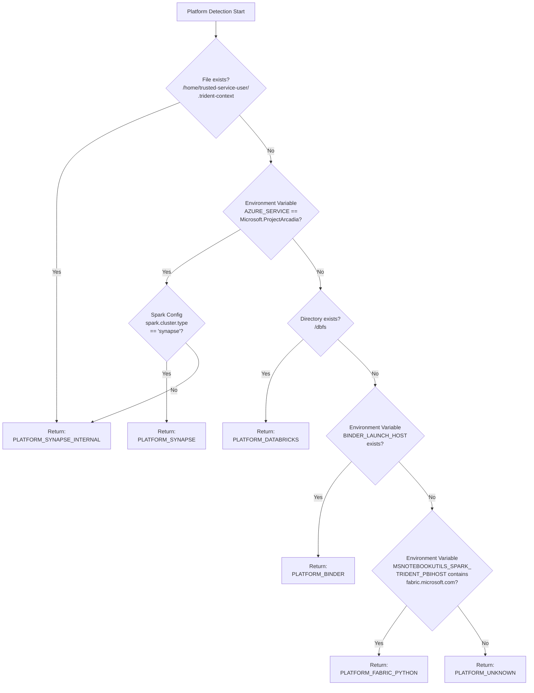
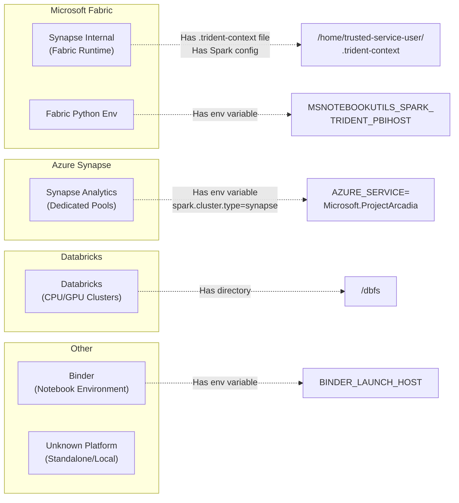
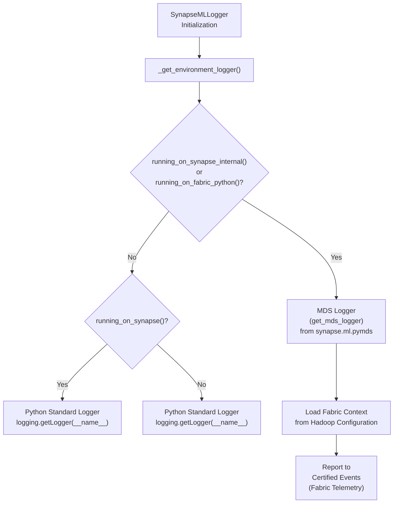
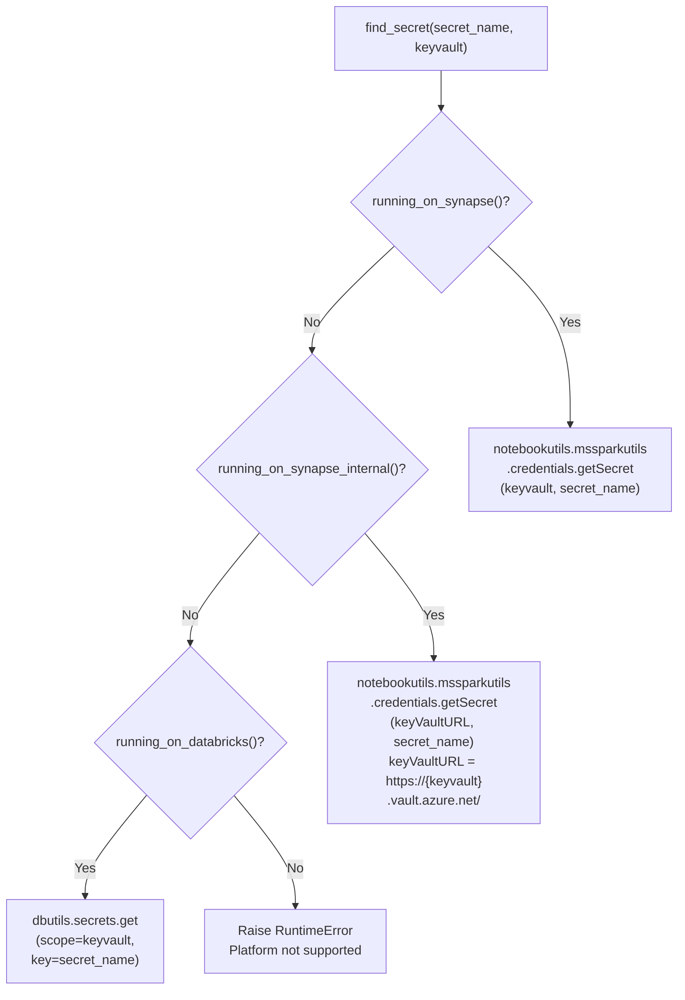
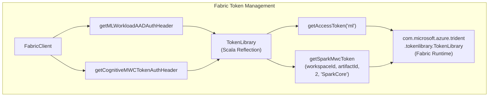
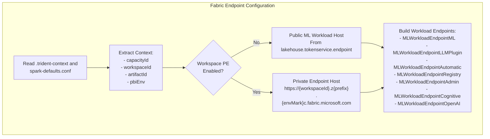
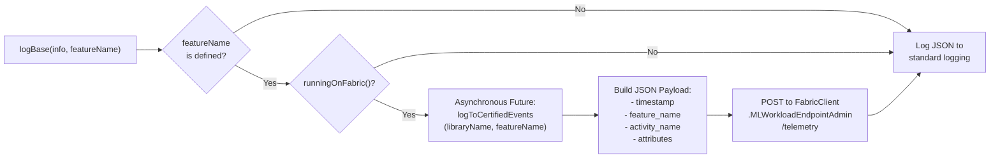
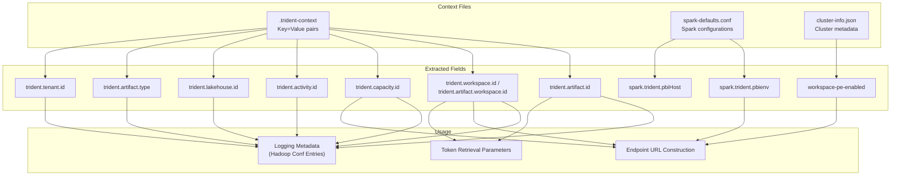
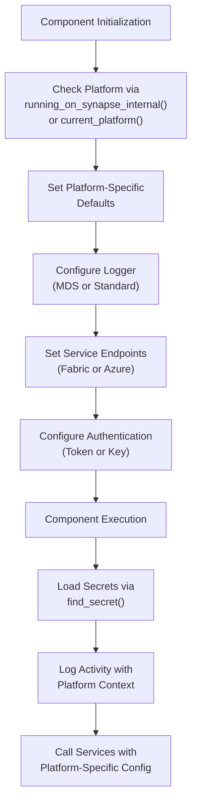

<!-- source: DeepWiki mcp.deepwiki.com · repo microsoft/SynapseML · page 2.3 Platform Detection and Adaptation · fetched 2026-10-26 -->

# Platform Detection and Adaptation

<details>
<summary>Relevant source files</summary>

The following files were used as context for generating this wiki page:

- [.github/ISSUE_TEMPLATE/bug_report_template.yaml](.github/ISSUE_TEMPLATE/bug_report_template.yaml)
- [.github/ISSUE_TEMPLATE/feature_request.md](.github/ISSUE_TEMPLATE/feature_request.md)
- [cognitive/src/main/python/synapse/ml/services/langchain/LangchainTransform.py](cognitive/src/main/python/synapse/ml/services/langchain/LangchainTransform.py)
- [cognitive/src/test/python/synapsemltest/services/langchain/test_LangchainTransform.py](cognitive/src/test/python/synapsemltest/services/langchain/test_LangchainTransform.py)
- [cognitive/src/test/python/synapsemltest/services/test_simple.py](cognitive/src/test/python/synapsemltest/services/test_simple.py)
- [core/src/main/python/synapse/ml/core/init_spark.py](core/src/main/python/synapse/ml/core/init_spark.py)
- [core/src/main/python/synapse/ml/core/logging/SynapseMLLogger.py](core/src/main/python/synapse/ml/core/logging/SynapseMLLogger.py)
- [core/src/main/python/synapse/ml/core/logging/__init__.py](core/src/main/python/synapse/ml/core/logging/__init__.py)
- [core/src/main/python/synapse/ml/core/platform/Platform.py](core/src/main/python/synapse/ml/core/platform/Platform.py)
- [core/src/main/scala/com/microsoft/azure/synapse/ml/fabric/FabricClient.scala](core/src/main/scala/com/microsoft/azure/synapse/ml/fabric/FabricClient.scala)
- [core/src/main/scala/com/microsoft/azure/synapse/ml/fabric/TokenLibrary.scala](core/src/main/scala/com/microsoft/azure/synapse/ml/fabric/TokenLibrary.scala)
- [core/src/main/scala/com/microsoft/azure/synapse/ml/io/http/HTTPClients.scala](core/src/main/scala/com/microsoft/azure/synapse/ml/io/http/HTTPClients.scala)
- [core/src/main/scala/com/microsoft/azure/synapse/ml/logging/SynapseMLLogging.scala](core/src/main/scala/com/microsoft/azure/synapse/ml/logging/SynapseMLLogging.scala)
- [core/src/main/scala/com/microsoft/azure/synapse/ml/logging/common/PlatformDetails.scala](core/src/main/scala/com/microsoft/azure/synapse/ml/logging/common/PlatformDetails.scala)
- [core/src/main/scala/com/microsoft/azure/synapse/ml/logging/common/Scrubber.scala](core/src/main/scala/com/microsoft/azure/synapse/ml/logging/common/Scrubber.scala)
- [core/src/main/scala/com/microsoft/azure/synapse/ml/logging/fabric/CertifiedEventClient.scala](core/src/main/scala/com/microsoft/azure/synapse/ml/logging/fabric/CertifiedEventClient.scala)
- [core/src/test/python/synapsemltest/core/test_logging.py](core/src/test/python/synapsemltest/core/test_logging.py)
- [core/src/test/python/synapsemltest/core/test_template.py](core/src/test/python/synapsemltest/core/test_template.py)
- [core/src/test/scala/com/microsoft/azure/synapse/ml/logging/LoggingScrubberTests.scala](core/src/test/scala/com/microsoft/azure/synapse/ml/logging/LoggingScrubberTests.scala)
- [docs/Get Started/Set up Cognitive Services.ipynb](docs/Get Started/Set up Cognitive Services.ipynb)
- [vw/src/main/scala/com/microsoft/azure/synapse/ml/vw/VectorZipper.scala](vw/src/main/scala/com/microsoft/azure/synapse/ml/vw/VectorZipper.scala)
- [vw/src/main/scala/com/microsoft/azure/synapse/ml/vw/VowpalWabbitCSETransformer.scala](vw/src/main/scala/com/microsoft/azure/synapse/ml/vw/VowpalWabbitCSETransformer.scala)
- [vw/src/main/scala/com/microsoft/azure/synapse/ml/vw/VowpalWabbitClassifier.scala](vw/src/main/scala/com/microsoft/azure/synapse/ml/vw/VowpalWabbitClassifier.scala)
- [vw/src/main/scala/com/microsoft/azure/synapse/ml/vw/VowpalWabbitContextualBandit.scala](vw/src/main/scala/com/microsoft/azure/synapse/ml/vw/VowpalWabbitContextualBandit.scala)
- [vw/src/main/scala/com/microsoft/azure/synapse/ml/vw/VowpalWabbitDSJsonTransformer.scala](vw/src/main/scala/com/microsoft/azure/synapse/ml/vw/VowpalWabbitDSJsonTransformer.scala)
- [vw/src/main/scala/com/microsoft/azure/synapse/ml/vw/VowpalWabbitFeaturizer.scala](vw/src/main/scala/com/microsoft/azure/synapse/ml/vw/VowpalWabbitFeaturizer.scala)
- [vw/src/main/scala/com/microsoft/azure/synapse/ml/vw/VowpalWabbitRegressor.scala](vw/src/main/scala/com/microsoft/azure/synapse/ml/vw/VowpalWabbitRegressor.scala)

</details>


## Purpose and Scope

This document describes SynapseML's platform detection and adaptation system, which enables the library to automatically detect the execution environment (Azure Synapse, Microsoft Fabric, Databricks, etc.) and adapt its behavior accordingly. This system provides a unified API while handling platform-specific requirements for logging, authentication, secret management, and service endpoints.

For information about secret management APIs that use this system, see [Secret Management](#5.4). For logging implementations that adapt based on platform, see [Logging System](#5.1).

## Overview

Platform detection allows SynapseML components to automatically configure themselves based on where they are running. The system performs detection once at module initialization and caches the result. Components query the detected platform to make runtime decisions about authentication methods, logging destinations, service endpoints, and other platform-specific behaviors.

## Platform Detection Mechanism

### Detection Logic Flow



**Sources:** [core/src/main/python/synapse/ml/core/platform/Platform.py:17-34](), [core/src/main/scala/com/microsoft/azure/synapse/ml/logging/common/PlatformDetails.scala:17-30]()

### Python Implementation

The Python platform detection is implemented in the `Platform` module with the following constants and functions:

| Constant | Value | Description |
|----------|-------|-------------|
| `PLATFORM_SYNAPSE_INTERNAL` | `"synapse_internal"` | Microsoft Fabric environment |
| `PLATFORM_SYNAPSE` | `"synapse"` | Azure Synapse Analytics |
| `PLATFORM_FABRIC_PYTHON` | `"fabric_python_env"` | Fabric Python environment |
| `PLATFORM_DATABRICKS` | `"databricks"` | Databricks platform |
| `PLATFORM_BINDER` | `"binder"` | Binder notebook environment |
| `PLATFORM_UNKNOWN` | `"unknown"` | Unknown/unsupported platform |

The `current_platform()` function performs the detection [core/src/main/python/synapse/ml/core/platform/Platform.py:17-34]():

1. Checks if `AZURE_SERVICE` environment variable equals `"Microsoft.ProjectArcadia"` and verifies Spark configuration
2. Checks if `/dbfs` directory exists (Databricks marker)
3. Checks if `BINDER_LAUNCH_HOST` environment variable exists
4. Checks if `MSNOTEBOOKUTILS_SPARK_TRIDENT_PBIHOST` contains `"fabric.microsoft.com"`

Helper functions provide boolean checks for specific platforms:
- `running_on_synapse_internal()`
- `running_on_synapse()`
- `running_on_databricks()`
- `running_on_fabric_python()`
- `running_on_binder()`

**Sources:** [core/src/main/python/synapse/ml/core/platform/Platform.py:1-104]()

### Scala Implementation

The Scala implementation in `PlatformDetails` object provides equivalent functionality:

| Constant | Value | Description |
|----------|-------|-------------|
| `PlatformSynapseInternal` | `"synapse_internal"` | Microsoft Fabric environment |
| `PlatformSynapse` | `"synapse"` | Azure Synapse Analytics |
| `PlatformDatabricks` | `"databricks"` | Databricks platform |
| `PlatformBinder` | `"binder"` | Binder notebook environment |
| `PlatformUnknown` | `"unknown"` | Unknown/unsupported platform |

The `currentPlatform()` method performs detection with caching via `lazy val CurrentPlatform` [core/src/main/scala/com/microsoft/azure/synapse/ml/logging/common/PlatformDetails.scala:17-30]():

1. Checks if `/home/trusted-service-user/.trident-context` file exists (Fabric marker)
2. Checks `AZURE_SERVICE` environment variable and calls `defineSynapsePlatform()`
3. Checks if `/dbfs` directory exists (Databricks marker)
4. Checks if `BINDER_LAUNCH_HOST` environment variable exists

The `defineSynapsePlatform()` method distinguishes between Synapse and Synapse Internal by examining the `spark.cluster.type` configuration [core/src/main/scala/com/microsoft/azure/synapse/ml/logging/common/PlatformDetails.scala:32-40]().

**Sources:** [core/src/main/scala/com/microsoft/azure/synapse/ml/logging/common/PlatformDetails.scala:1-48]()

## Supported Platforms

### Platform Characteristics



**Sources:** [core/src/main/python/synapse/ml/core/platform/Platform.py:6-14](), [core/src/main/scala/com/microsoft/azure/synapse/ml/logging/common/PlatformDetails.scala:9-15]()

### Detection Priority

Platform detection follows a specific priority order to handle overlapping markers:

1. **Synapse Internal / Fabric** (highest priority) - Detected by `.trident-context` file
2. **Synapse** - Detected by `AZURE_SERVICE` environment variable and Spark configuration
3. **Databricks** - Detected by `/dbfs` directory
4. **Binder** - Detected by `BINDER_LAUNCH_HOST` environment variable
5. **Fabric Python Environment** - Detected by `MSNOTEBOOKUTILS_SPARK_TRIDENT_PBIHOST` containing `fabric.microsoft.com`
6. **Unknown** (lowest priority) - Default when no markers match

This priority ensures that the most specific platform is detected when multiple markers are present.

**Sources:** [core/src/main/python/synapse/ml/core/platform/Platform.py:17-34](), [core/src/main/scala/com/microsoft/azure/synapse/ml/logging/common/PlatformDetails.scala:17-30]()

## Platform-Specific Adaptations

### Logging Adaptation

The logging system selects different logger implementations based on the detected platform:



**Python Logging Implementation** [core/src/main/python/synapse/ml/core/logging/SynapseMLLogger.py:85-101]():

- **Synapse Internal / Fabric Python**: Uses MDS logger from `synapse.ml.pymds.synapse_logger` with custom formatter
- **Synapse**: Uses standard Python logger configured with specified log level
- **Other Platforms**: Uses standard Python logger configured with specified log level

**Scala Logging Implementation** [core/src/main/scala/com/microsoft/azure/synapse/ml/logging/SynapseMLLogging.scala:127-140]():

- **Fabric**: Asynchronously logs to Certified Events for telemetry via `CertifiedEventClient.logToCertifiedEvents()`
- **All Platforms**: Logs JSON-formatted messages with scrubbed content (SAS tokens removed)

The logging system also collects platform-specific metadata from Hadoop configuration when running on Fabric:

| Configuration Key | Logged Field | Description |
|-------------------|--------------|-------------|
| `trident.artifact.id` | `artifactId` | Fabric artifact identifier |
| `trident.workspace.id` | `workspaceId` | Fabric workspace identifier |
| `trident.capacity.id` | `capacityId` | Fabric capacity identifier |
| `trident.artifact.workspace.id` | `artifactWorkspaceId` | Artifact workspace identifier |
| `trident.lakehouse.id` | `lakehouseId` | Lakehouse identifier |
| `trident.activity.id` | `livyId` | Activity/Livy session identifier |
| `trident.artifact.type` | `artifactType` | Type of artifact |
| `trident.tenant.id` | `tenantId` | Tenant identifier |

**Sources:** [core/src/main/python/synapse/ml/core/logging/SynapseMLLogger.py:85-122](), [core/src/main/scala/com/microsoft/azure/synapse/ml/logging/SynapseMLLogging.scala:50-92](), [core/src/main/scala/com/microsoft/azure/synapse/ml/logging/fabric/CertifiedEventClient.scala:1-36]()

### Secret Management Adaptation

The `find_secret()` function adapts to each platform's secret management system:



**Platform-Specific Secret Retrieval** [core/src/main/python/synapse/ml/core/platform/Platform.py:57-92]():

- **Synapse**: Uses `notebookutils.mssparkutils.credentials.getSecret(keyvault, secret_name)` with linked service
- **Synapse Internal / Fabric**: Uses `notebookutils.mssparkutils.credentials.getSecret(keyVaultURL, secret_name)` with full URL
- **Databricks**: Uses `dbutils.secrets.get(scope=keyvault, key=secret_name)` with secret scopes
- **Other Platforms**: Raises `RuntimeError` with detailed setup instructions

The error message provides platform-specific guidance for secret configuration, including links to documentation.

**Sources:** [core/src/main/python/synapse/ml/core/platform/Platform.py:57-92]()

### Token Management Adaptation

Token retrieval for authentication is platform-specific, particularly for Fabric:



**Token Library Implementation** [core/src/main/scala/com/microsoft/azure/synapse/ml/fabric/TokenLibrary.scala:9-51]():

The `TokenLibrary` object uses Scala reflection to dynamically invoke methods from the Fabric runtime's token library:

- **`getMLWorkloadAADAuthHeader`**: Returns `"Bearer " + getAccessToken("ml")` for ML workload authentication
- **`getCognitiveMwcTokenAuthHeader`**: Returns `"MwcToken " + getSparkMwcToken(...)` for Cognitive Services authentication

These tokens are used by `FabricClient` to authenticate requests to Fabric ML workload endpoints and Cognitive Services.

**Sources:** [core/src/main/scala/com/microsoft/azure/synapse/ml/fabric/TokenLibrary.scala:1-52](), [core/src/main/scala/com/microsoft/azure/synapse/ml/fabric/FabricClient.scala:194-198]()

### Service Endpoint Adaptation

Service endpoints are automatically configured based on platform, particularly for Fabric:



**Fabric Client Endpoint Configuration** [core/src/main/scala/com/microsoft/azure/synapse/ml/fabric/FabricClient.scala:23-38]():

The `FabricClient` object reads Fabric context from multiple sources:
- `/home/trusted-service-user/.trident-context` - Key-value pairs
- `/opt/spark/conf/spark-defaults.conf` - Spark configuration
- `/opt/health-agent/conf/cluster-info.json` - Cluster metadata

Key lazy values:
- `CapacityID`: Fabric capacity identifier
- `WorkspaceID`: Workspace identifier
- `ArtifactID`: Artifact identifier
- `PbiEnv`: Environment (public, daily, dxt, msit, edog)
- `MLWorkloadHost`: ML workload host URL (public or PE-enabled)
- `WorkspacePeEnabled`: Whether workspace uses private endpoints

Endpoint construction [core/src/main/scala/com/microsoft/azure/synapse/ml/fabric/FabricClient.scala:185-188]():
```
{MLWorkloadHost}/webapi/capacities/{CapacityID}/workloads/ML/{EndpointType}/Automatic/workspaceid/{WorkspaceID}/
```

**LangChain Transformer Endpoint Defaults** [cognitive/src/main/python/synapse/ml/services/langchain/LangchainTransform.py:133-141]():

When running on Synapse Internal (Fabric), the `LangchainTransformer` automatically sets the OpenAI URL to Fabric's ML workload endpoint:
```python
if running_on_synapse_internal():
    from synapse.ml.fabric.service_discovery import get_fabric_env_config
    self._setDefault(
        url=get_fabric_env_config().fabric_env_config.ml_workload_endpoint
        + "cognitive/openai"
    )
```

**Sources:** [core/src/main/scala/com/microsoft/azure/synapse/ml/fabric/FabricClient.scala:1-200](), [cognitive/src/main/python/synapse/ml/services/langchain/LangchainTransform.py:133-141]()

### Telemetry Adaptation

Certified Events telemetry is only enabled on Fabric:



**Certified Events Implementation** [core/src/main/scala/com/microsoft/azure/synapse/ml/logging/fabric/CertifiedEventClient.scala:13-34]():

The `CertifiedEventClient` checks `runningOnFabric` before sending telemetry. The payload includes:
- `timestamp`: Current epoch second
- `feature_name`: Library name (e.g., "SynapseML")
- `activity_name`: Feature being used
- `attributes`: Empty object for future extensibility

The telemetry is posted to `{MLWorkloadEndpointAdmin}/telemetry` endpoint with appropriate authentication headers.

**Python Telemetry** [core/src/main/python/synapse/ml/core/logging/SynapseMLLogger.py:146-153]():

Python logging also supports telemetry reporting:
```python
if feature_name is not None and running_on_synapse_internal():
    from synapse.ml.fabric.telemetry_utils import report_usage_telemetry
    
    report_usage_telemetry(
        feature_name=self.library_name,
        activity_name=feature_name,
        attributes={},
    )
```

**Sources:** [core/src/main/scala/com/microsoft/azure/synapse/ml/logging/fabric/CertifiedEventClient.scala:1-36](), [core/src/main/python/synapse/ml/core/logging/SynapseMLLogger.py:145-154](), [core/src/main/scala/com/microsoft/azure/synapse/ml/logging/SynapseMLLogging.scala:127-140]()

## Platform Context Information

### Fabric Context Extraction

When running on Fabric (Synapse Internal), the system extracts rich context information:



**Context File Parsing** [core/src/main/scala/com/microsoft/azure/synapse/ml/fabric/FabricClient.scala:90-138]():

- **`.trident-context`**: Parsed as simple key=value pairs, ignoring lines with multiple `=` signs
- **`spark-defaults.conf`**: Parsed as space-separated key-value pairs, ignoring comment lines starting with `#`
- **`cluster-info.json`**: Parsed as JSON to extract `cluster_metadata` object

**Python Context Access** [core/src/main/python/synapse/ml/core/logging/SynapseMLLogger.py:104-121]():

The `get_hadoop_conf_entries()` method retrieves context from Fabric's internal utilities:
```python
if running_on_synapse_internal():
    from synapse.ml.internal_utils.session_utils import get_fabric_context
    
    return {
        "artifactId": get_fabric_context().get("trident.artifact.id"),
        "workspaceId": get_fabric_context().get("trident.workspace.id"),
        # ... other fields
    }
```

This context is automatically included in all log entries for correlation and debugging.

**Sources:** [core/src/main/scala/com/microsoft/azure/synapse/ml/fabric/FabricClient.scala:51-143](), [core/src/main/python/synapse/ml/core/logging/SynapseMLLogger.py:103-122]()

## Usage Patterns

### Component Integration Pattern

SynapseML components typically follow this pattern for platform adaptation:



**Example: VowpalWabbit Logging** [vw/src/main/scala/com/microsoft/azure/synapse/ml/vw/VowpalWabbitContextualBandit.scala:109-110]():

```scala
class VowpalWabbitContextualBandit(override val uid: String)
  extends Predictor[Row, VowpalWabbitContextualBandit, VowpalWabbitContextualBanditModel]
    with SynapseMLLogging {
  logClass(FeatureNames.VowpalWabbit)
  // Component automatically logs to appropriate platform logger
}
```

The `SynapseMLLogging` trait automatically:
1. Detects the platform via `PlatformDetails.CurrentPlatform`
2. Includes platform context in log entries
3. Sends telemetry to Certified Events on Fabric
4. Scrubs sensitive information (SAS tokens) from logs

**Example: LangChain with Fabric Defaults** [cognitive/src/main/python/synapse/ml/services/langchain/LangchainTransform.py:133-151]():

```python
class LangchainTransformer(...):
    def __init__(self, ...):
        self.running_on_synapse_internal = running_on_synapse_internal()
        if running_on_synapse_internal():
            from synapse.ml.fabric.service_discovery import get_fabric_env_config
            
            self._setDefault(
                url=get_fabric_env_config().fabric_env_config.ml_workload_endpoint
                + "cognitive/openai"
            )
```

This pattern allows components to work seamlessly across platforms without user configuration when running on supported platforms.

**Sources:** [vw/src/main/scala/com/microsoft/azure/synapse/ml/vw/VowpalWabbitContextualBandit.scala:105-110](), [cognitive/src/main/python/synapse/ml/services/langchain/LangchainTransform.py:113-152]()

### Display Helper Function

The `materializing_display()` function adapts display behavior based on platform [core/src/main/python/synapse/ml/core/platform/Platform.py:95-103]():

```python
def materializing_display(data):
    if running_on_synapse() or running_on_synapse_internal():
        from notebookutils.visualization import display
        
        if isinstance(data, DataFrame):
            data.collect()  # Materialize before display
        display(data)
    else:
        print(data)
```

This ensures optimal display behavior on Synapse/Fabric (using native visualization) vs. other platforms (using print).

**Sources:** [core/src/main/python/synapse/ml/core/platform/Platform.py:95-103]()

## Summary

The platform detection and adaptation system provides:

1. **Automatic Platform Detection**: Single detection at module load with caching for performance
2. **Transparent Adaptation**: Components automatically configure themselves without user intervention
3. **Consistent API**: Users write the same code across all platforms
4. **Platform-Specific Optimization**: Leverages platform-native capabilities (logging, secrets, endpoints)
5. **Graceful Degradation**: Falls back to standard behavior on unknown platforms

The system is designed for extensibility - new platforms can be added by:
1. Adding detection logic to `current_platform()` / `currentPlatform()`
2. Adding platform-specific constants
3. Updating adaptation logic in logging, secrets, and token management
4. Testing the new platform configuration

**Sources:** [core/src/main/python/synapse/ml/core/platform/Platform.py](), [core/src/main/scala/com/microsoft/azure/synapse/ml/logging/common/PlatformDetails.scala]()

---

