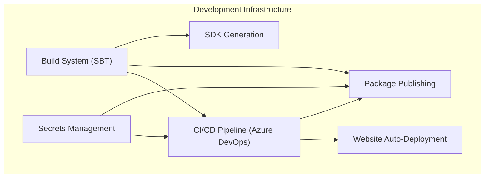
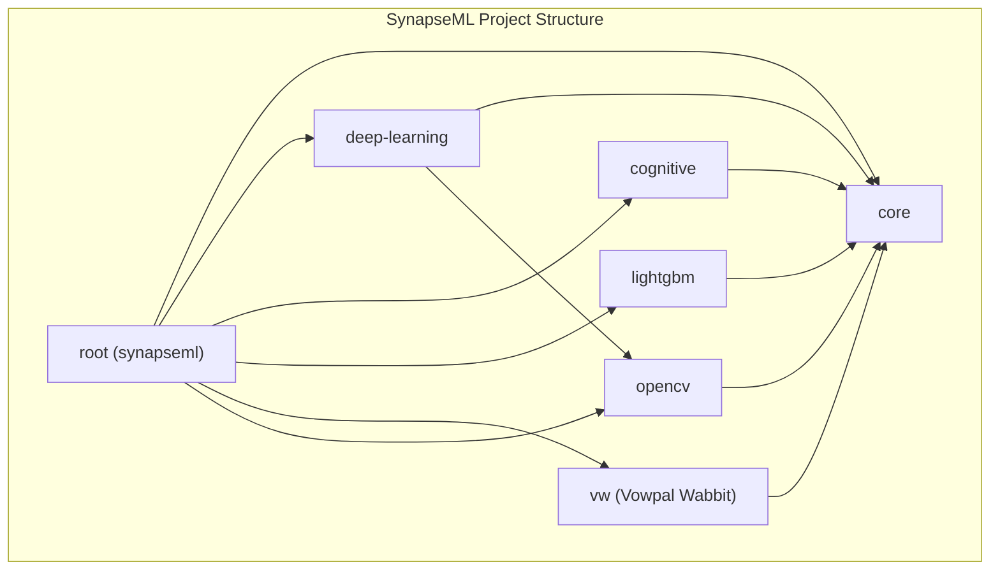
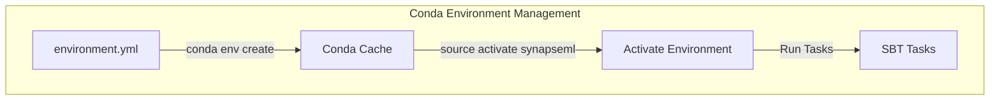
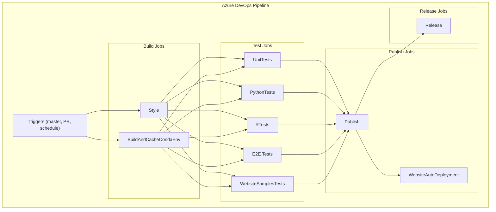
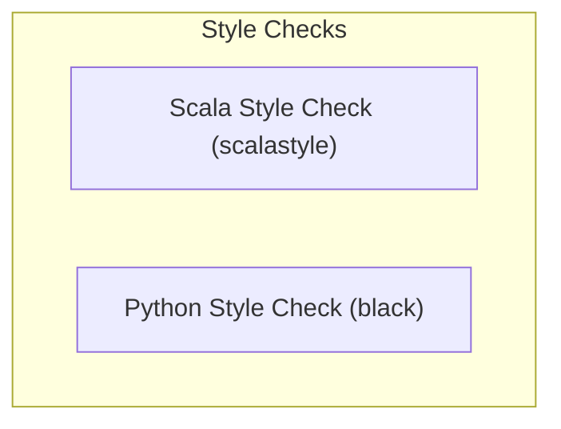
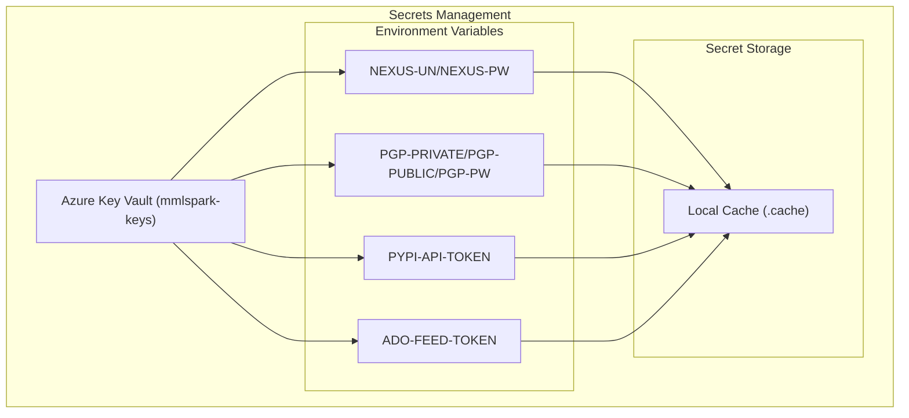
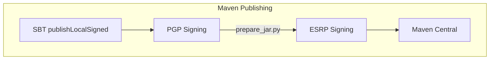
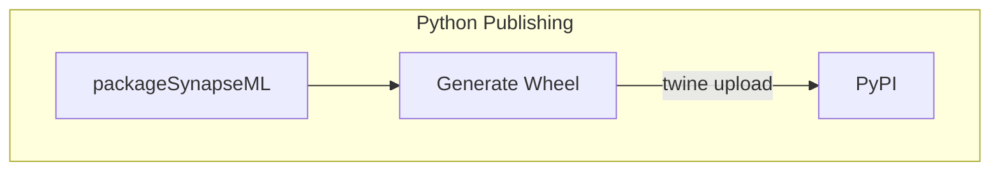
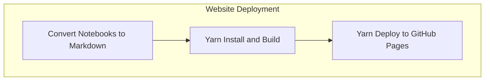

<!-- source: DeepWiki mcp.deepwiki.com · repo microsoft/SynapseML · page 3 Development Infrastructure · fetched 2026-10-26 -->

# Development Infrastructure

Relevant source files

The following files were used as context for generating this wiki page:

- [.gitignore](.gitignore)
- [build.sbt](build.sbt)
- [deep-learning/src/test/python/synapsemltest/dl/conftest.py](deep-learning/src/test/python/synapsemltest/dl/conftest.py)
- [environment.yml](environment.yml)
- [pipeline.yaml](pipeline.yaml)
- [project/PublishPlugin.scala](project/PublishPlugin.scala)
- [project/Secrets.scala](project/Secrets.scala)
- [sonatype.sbt](sonatype.sbt)
- [templates/codecov.yml](templates/codecov.yml)
- [templates/conda.yml](templates/conda.yml)
- [templates/kv.yml](templates/kv.yml)
- [tools/esrp/prepare_jar.py](tools/esrp/prepare_jar.py)

This page provides an overview of the development infrastructure for the SynapseML project, covering the build system, CI/CD pipeline, secrets management, and package publishing mechanisms. For information about testing infrastructure specifically, see [Testing Infrastructure](#4).

## Overview

The SynapseML development infrastructure consists of a set of tools, configurations, and automated processes that enable efficient development, testing, and deployment of the library. This infrastructure is designed to support multiple programming languages (Scala, Python, R) and multiple deployment targets (Maven, PyPI, Docker).

Sources: [pipeline.yaml:1-744](), [build.sbt:1-368]()

## Project Structure

SynapseML is organized as a multi-module SBT project with several subprojects, each focusing on a specific area of functionality.

Sources: [build.sbt:269-344]()

## Build System

SynapseML uses SBT (Scala Build Tool) as its primary build system. The build configuration includes dependency management, multi-project setup, cross-compilation, and custom tasks for packaging and publishing.

### Key SBT Tasks

| Task                | Description                                                     |
|---------------------|-----------------------------------------------------------------|
| `setup`             | Set up library for IntelliJ development                         |
| `getDatasets`       | Download datasets used for testing                             |
| `packagePython`     | Package Python code                                            |
| `packageSynapseML`  | Package all projects into SynapseML                            |
| `publishPypi`       | Publish Python wheel to PyPI                                   |
| `publishDocs`       | Publish documentation for Scala and Python                     |
| `publishBadges`     | Publish badges to SynapseML blob storage                       |
| `uploadNotebooks`   | Upload notebooks to blob storage                               |
| `convertNotebooks`  | Convert notebooks to markdown for website display              |
| `testWebsiteDocs`   | Test code blocks in website documentation                      |

Sources: [build.sbt:74-367]()

## Conda Environment

The project uses Conda to manage development and testing environments, ensuring consistent dependencies across development machines and CI/CD pipelines.

Sources: [templates/conda.yml:1-30](), [pipeline.yaml:65-89]()

## CI/CD Pipeline

SynapseML uses Azure DevOps pipelines for continuous integration and deployment. The pipeline is defined in `pipeline.yaml` and consists of several jobs that build, test, and publish the library.

### Pipeline Jobs Structure

Sources: [pipeline.yaml:4-57](), [pipeline.yaml:65-589]()

### Build and Style Check

The pipeline begins with style checking for both Scala and Python code, ensuring code quality and consistency.

Sources: [pipeline.yaml:66-84]()

### Test Jobs

The pipeline includes several test jobs that run different types of tests for different components of the library:

1. **Unit Tests**: Tests for individual Scala components
2. **Python Tests**: Tests for Python API
3. **R Tests**: Tests for R API
4. **E2E Tests**: End-to-end tests on Databricks and Synapse
5. **Website Tests**: Tests for code samples in documentation

Sources: [pipeline.yaml:356-542](), [pipeline.yaml:138-180]()

## Secrets Management

SynapseML uses Azure Key Vault to securely store and retrieve secrets needed for building, testing, and publishing.

Sources: [project/Secrets.scala:1-194](), [templates/kv.yml:1-7]()

The `Secrets` object provides methods to retrieve secrets either from environment variables (set by the CI/CD pipeline) or from Azure Key Vault. It also caches secrets locally to avoid repeated API calls.

## Package Publishing

SynapseML is published to several repositories:

1. **Maven Central**: For Scala/Java artifacts
2. **PyPI**: For Python package
3. **Azure DevOps Feed**: For internal distribution

### Maven Publishing Flow

Sources: [pipeline.yaml:323-352](), [tools/esrp/prepare_jar.py:1-80](), [sonatype.sbt:1-46]()

### Python Publishing Flow

Sources: [build.sbt:134-187](), [build.sbt:189-198](), [pipeline.yaml:309-322]()

## SDK Generation

SynapseML automatically generates Python and R SDKs from the Scala codebase. This functionality is implemented through a custom SBT plugin (`CodegenPlugin`), which is referenced in the CI/CD pipeline but not included in the provided files.

The SDK generation involves:
1. Generating Python and R code from Scala classes
2. Packaging the generated code into respective formats
3. Running tests on the generated APIs

Sources: [build.sbt:122-131](), [pipeline.yaml:462-464]()

## Website Auto-Deployment

SynapseML uses automated website deployment as part of its CI/CD pipeline. The website is built using Docusaurus and deployed to GitHub Pages.

Sources: [pipeline.yaml:546-589](), [build.sbt:355-359]()

The pipeline:
1. Converts Jupyter notebooks to Markdown files
2. Builds the Docusaurus website using Yarn
3. Deploys the built website to GitHub Pages

## Docker Environments

While currently commented out in the pipeline, SynapseML includes support for building and publishing Docker images:

1. **Demo Image**: Full-featured image with all dependencies
2. **Minimal Image**: Lightweight image with core dependencies
3. **Release Image**: Official release image

Sources: [pipeline.yaml:183-257]()

The Docker images are built and published to Microsoft Container Registry (MCR) when triggered by specific conditions, such as tags on the master branch.

---

