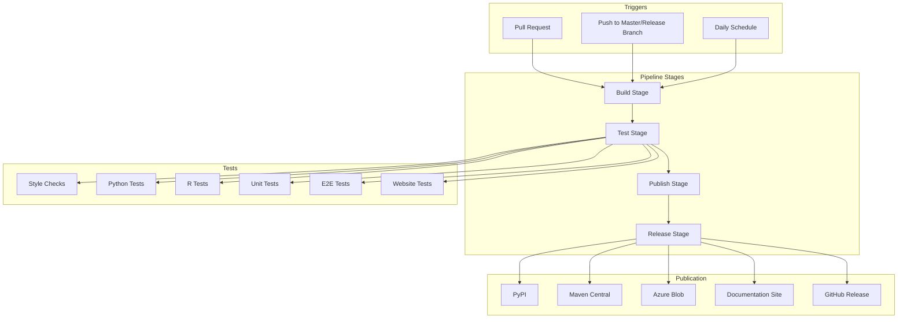
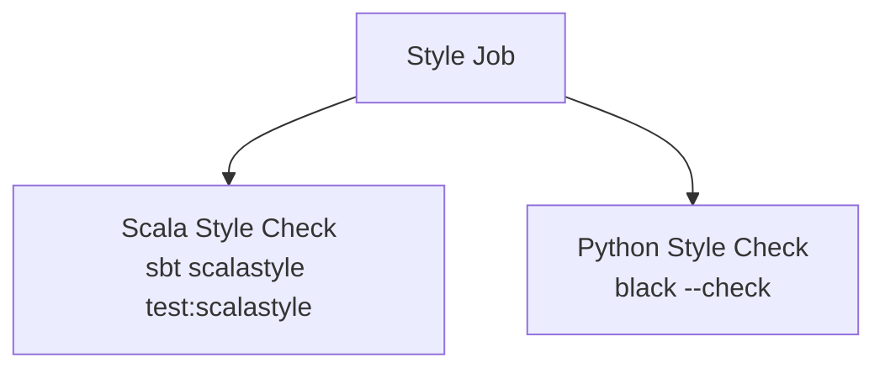
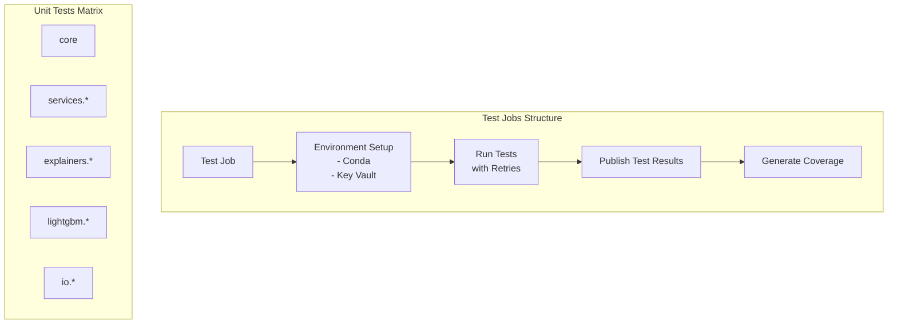
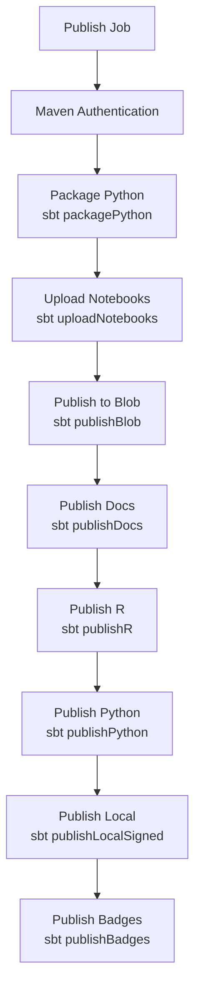
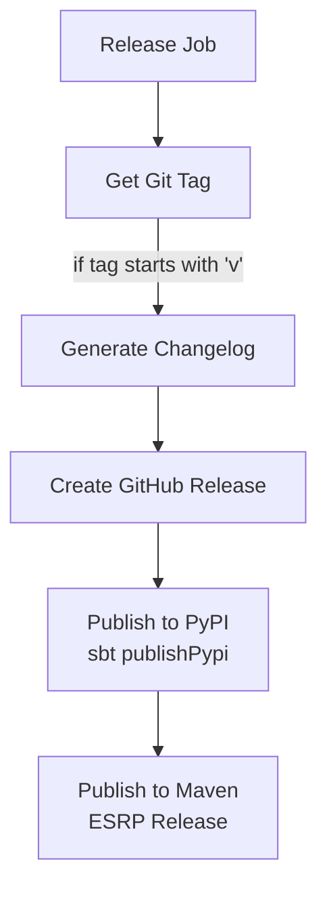
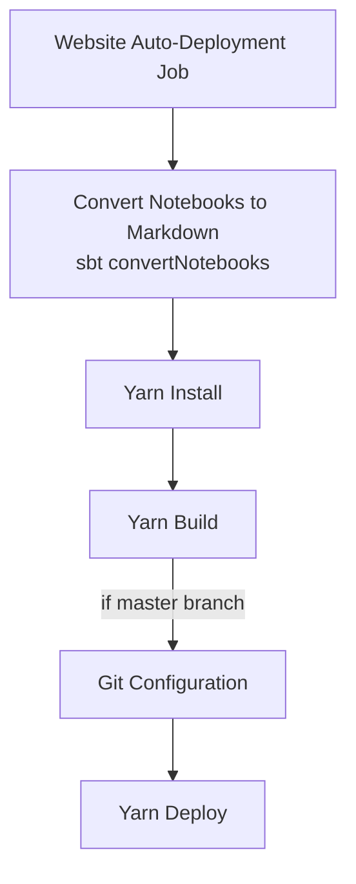
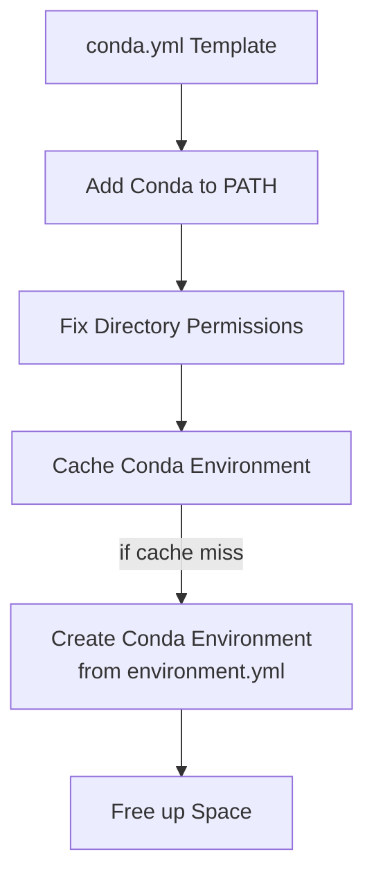
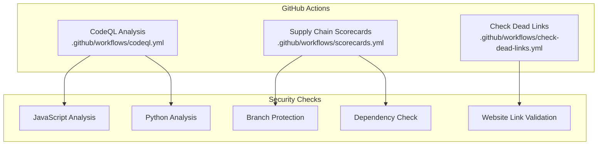
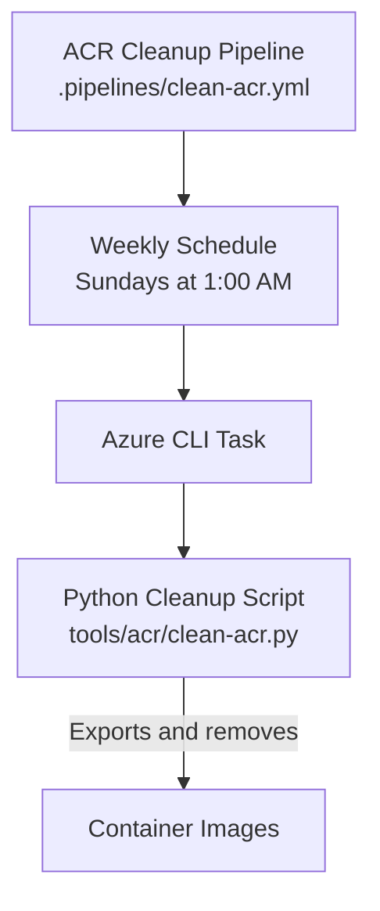

<!-- source: DeepWiki mcp.deepwiki.com · repo microsoft/SynapseML · page 3.1 CI/CD Pipeline · fetched 2026-10-26 -->

# CI/CD Pipeline

<details>
<summary>Relevant source files</summary>

The following files were used as context for generating this wiki page:

- [.gitignore](.gitignore)
- [build.sbt](build.sbt)
- [deep-learning/src/test/python/synapsemltest/dl/conftest.py](deep-learning/src/test/python/synapsemltest/dl/conftest.py)
- [environment.yml](environment.yml)
- [pipeline.yaml](pipeline.yaml)
- [project/PublishPlugin.scala](project/PublishPlugin.scala)
- [project/Secrets.scala](project/Secrets.scala)
- [sonatype.sbt](sonatype.sbt)
- [templates/codecov.yml](templates/codecov.yml)
- [templates/conda.yml](templates/conda.yml)
- [templates/kv.yml](templates/kv.yml)
- [tools/esrp/prepare_jar.py](tools/esrp/prepare_jar.py)

</details>


This document details the continuous integration and deployment pipeline for SynapseML. It covers the Azure DevOps pipeline configuration, build jobs, test execution, and publication processes that enable reliable code delivery. For information on the build system configuration, see [Build System](#3.2), and for details on SDK generation, refer to [SDK Generation](#3.3).

## Pipeline Overview

The SynapseML CI/CD pipeline is implemented using Azure DevOps Pipelines with additional validation through GitHub Actions. The pipeline supports multiple trigger types, provides automated testing across multiple languages, and handles the publication of artifacts to various destinations.

### Pipeline Diagram



Sources: [pipeline.yaml:1-35](), [pipeline.yaml:36-64]()

## Pipeline Configuration

The pipeline is defined in `pipeline.yaml` and uses a variety of Azure DevOps features including parameterization, conditions, and parallel job execution.

### Trigger Configuration

The pipeline is triggered by:
1. Pull requests to master, spark3.3, and spark3.5 branches
2. Direct pushes to these branches
3. Daily scheduled runs at midnight

```mermaid
flowchart LR
    subgraph "Pipeline Triggers"
        PR["PR Trigger" <br> "- master branch" <br> "- spark3.3 branch" <br> "- spark3.5 branch"]
        Push["Push Trigger" <br> "- master branch" <br> "- spark3.3 branch" <br> "- spark3.5 branch"]
        Schedule["Schedule Trigger" <br> "- Daily at midnight"]
    end
    
    subgraph "Exclusions"
        DocFiles["Documentation Files" <br> "- README.md" <br> "- CONTRIBUTORS.md" <br> "- SECURITY.md" <br> "- docs/Reference/*.md"]
    end
    
    PR --> Pipeline["Azure DevOps Pipeline"]
    Push --> Pipeline
    Schedule --> Pipeline
    
    DocFiles -. "excluded from" .-> PR
    DocFiles -. "excluded from" .-> Push
```

Sources: [pipeline.yaml:1-35]()

### Pipeline Parameters and Variables

The pipeline supports customizable behavior through parameters and variables:

| Parameter | Description | Default |
|-----------|-------------|---------|
| `runSynapseExtensionE2ETests` | Run Synapse Extension E2E Tests | `true` |
| `SYNAPSE_ENVIRONMENT` | Synapse Extension E2E Test Environment | `weekly` |

| Variable | Description | Value |
|----------|-------------|-------|
| `runTests` | Controls whether tests are executed | `True` |
| `CONDA_CACHE_DIR` | Directory for Conda environment cache | `/usr/share/miniconda/envs` |
| `UBUNTU_VERSION` | Ubuntu version for build agents | `ubuntu-22.04` |
| `isMaster` | Indicates if build is from master branch | Dynamically set |

Sources: [pipeline.yaml:44-63]()

## Pipeline Jobs

The pipeline is organized into multiple job types that handle different aspects of the build, test, and release process. Jobs are structured to run in parallel when possible to improve pipeline efficiency.

### Style Check Job

The Style job runs code style checks for both Scala and Python code:



Sources: [pipeline.yaml:65-84]()

### Test Jobs

Multiple test jobs are configured to validate different components of the codebase:

1. **UnitTests**: Tests core functionality and services
2. **PythonTests**: Tests Python SDK functionality
3. **RTests**: Tests R SDK functionality
4. **E2E**: End-to-end tests on Databricks and Synapse
5. **WebsiteSamplesTests**: Tests website example code

Test jobs use the following common pattern:
1. Set up environment (Conda, Key Vault access)
2. Run tests with retry logic
3. Publish test results
4. Generate and upload code coverage reports



Sources: [pipeline.yaml:356-432](), [pipeline.yaml:425-496](), [pipeline.yaml:592-743]()

### Publication Job

The Publish job handles artifact creation and uploading:



Sources: [pipeline.yaml:87-135]()

### Release Job

The Release job is triggered when a Git tag with format "v*" is present on the master branch:



Sources: [pipeline.yaml:258-352]()

### Website Auto-Deployment

A specialized job handles website documentation auto-deployment:



Sources: [pipeline.yaml:546-589]()

## Secrets Management

The pipeline uses Azure Key Vault to securely store and retrieve secrets needed for building, testing, and publishing.

```mermaid
flowchart TD
    subgraph "Azure Pipeline"
        AzureTask["Azure Key Vault Task"]
    end
    
    subgraph "KeyVault"
        KeyVault["Azure Key Vault<br>mmlspark-keys"]
        Secrets["Secrets<br>- nexus-un<br>- nexus-pw<br>- pgp-private<br>- pgp-public<br>- pgp-pw<br>- pypi-api-token"]
    end
    
    subgraph "Secrets Usage"
        BuildSystem["Build System<br>project/Secrets.scala"]
        PublishPyPI["Publish to PyPI"]
        PublishMaven["Publish to Maven"]
        SignArtifacts["Sign Artifacts"]
    end
    
    AzureTask --> KeyVault
    KeyVault --> Secrets
    Secrets --> BuildSystem
    BuildSystem --> PublishPyPI
    BuildSystem --> PublishMaven
    BuildSystem --> SignArtifacts
```

The `Secrets` scala object provides an interface for accessing and managing these secrets. It handles:
1. Fetching secrets from Azure Key Vault
2. Caching secrets locally for reuse
3. Providing helper methods for secret management

Sources: [project/Secrets.scala:1-194](), [templates/kv.yml:1-7](), [pipeline.yaml:302-323]()

## Build Environment Configuration

The pipeline uses Conda environments for consistent build and test environments:



The Conda environment caching mechanism improves pipeline performance by reusing previously created environments.

Sources: [templates/conda.yml:1-30](), [pipeline.yaml:498-504]()

## Additional Quality Gates

Beyond the main Azure DevOps pipeline, SynapseML uses GitHub Actions for additional validation:

### Security Scanning



These GitHub Actions workflows run on:
- Pushes to the master branch
- Pull requests to the master branch
- Scheduled runs (weekly for Scorecards)

Sources: [.github/workflows/codeql.yml:1-79](), [.github/workflows/scorecards.yml:1-73](), [.github/workflows/check-dead-links.yml:1-27]()

## ACR Cleanup

A separate pipeline exists for Azure Container Registry maintenance:



This pipeline runs weekly to clean up the Azure Container Registry by exporting images to blob storage and then removing them from the registry.

Sources: [.pipelines/clean-acr.yml:1-30](), [tools/acr/clean-acr.py:1-87]()

## Summary

The SynapseML CI/CD pipeline provides comprehensive validation, testing, and publication capabilities. It ensures code quality through style checks, multiple test suites, and security scanning. The pipeline also automates the publication process to multiple channels including PyPI, Maven Central, and documentation sites.

The pipeline is designed to be flexible and maintainable, with modular components and reusable templates. This structure allows for easy updates and extensions as the project evolves.

---

