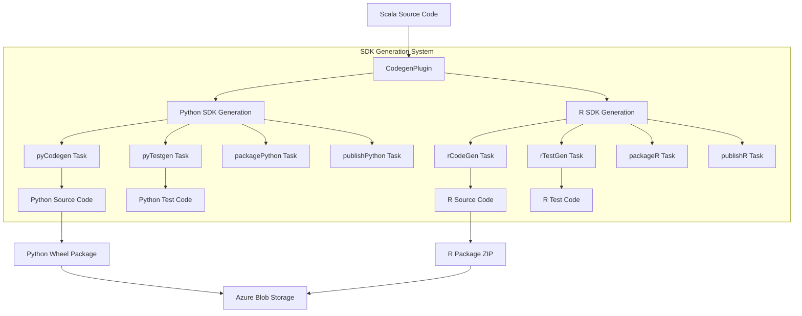
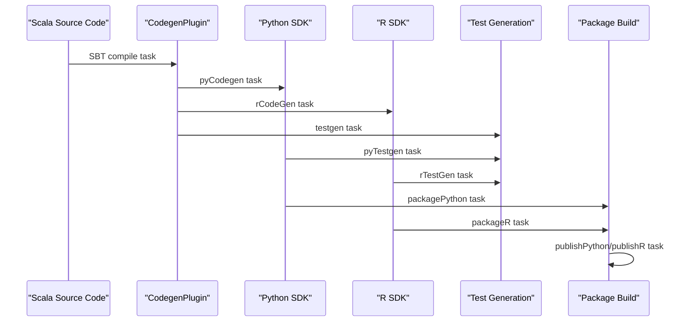
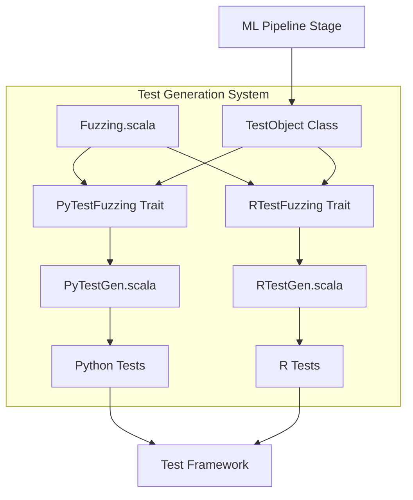
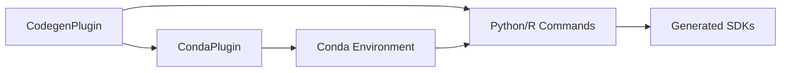

<!-- source: DeepWiki mcp.deepwiki.com · repo microsoft/SynapseML · page 3.3 Multi-Language SDK Generation · fetched 2026-10-26 -->

# SDK Generation

Relevant source files

The following files were used as context for generating this wiki page:

- [.gitignore](.gitignore)
- [build.sbt](build.sbt)
- [core/src/main/scala/com/microsoft/azure/synapse/ml/io/binary/BinaryFileFormat.scala](core/src/main/scala/com/microsoft/azure/synapse/ml/io/binary/BinaryFileFormat.scala)
- [core/src/main/scala/org/apache/spark/ml/source/image/PatchedImageFileFormat.scala](core/src/main/scala/org/apache/spark/ml/source/image/PatchedImageFileFormat.scala)
- [core/src/main/scala/org/apache/spark/sql/execution/streaming/continuous/HTTPSinkV2.scala](core/src/main/scala/org/apache/spark/sql/execution/streaming/continuous/HTTPSinkV2.scala)
- [core/src/test/scala/com/microsoft/azure/synapse/ml/codegen/RTestGen.scala](core/src/test/scala/com/microsoft/azure/synapse/ml/codegen/RTestGen.scala)
- [core/src/test/scala/com/microsoft/azure/synapse/ml/io/split2/DistributedHTTPSuite.scala](core/src/test/scala/com/microsoft/azure/synapse/ml/io/split2/DistributedHTTPSuite.scala)
- [deep-learning/src/test/python/synapsemltest/dl/conftest.py](deep-learning/src/test/python/synapsemltest/dl/conftest.py)
- [environment.yml](environment.yml)
- [pipeline.yaml](pipeline.yaml)
- [project/PublishPlugin.scala](project/PublishPlugin.scala)
- [project/Secrets.scala](project/Secrets.scala)
- [sonatype.sbt](sonatype.sbt)
- [start](start)
- [templates/codecov.yml](templates/codecov.yml)
- [templates/conda.yml](templates/conda.yml)
- [templates/kv.yml](templates/kv.yml)
- [tools/docker/demo/Dockerfile](tools/docker/demo/Dockerfile)
- [tools/docker/demo/README.md](tools/docker/demo/README.md)
- [tools/docker/demo/init_notebook.py](tools/docker/demo/init_notebook.py)
- [tools/docker/minimal/Dockerfile](tools/docker/minimal/Dockerfile)
- [tools/esrp/prepare_jar.py](tools/esrp/prepare_jar.py)
- [tools/tests/run_r_tests.R](tools/tests/run_r_tests.R)
- [vw/src/main/scala/com/microsoft/azure/synapse/ml/vw/VowpalWabbitBaseModel.scala](vw/src/main/scala/com/microsoft/azure/synapse/ml/vw/VowpalWabbitBaseModel.scala)

This document describes the automated SDK generation system in SynapseML, which creates Python and R bindings from the core Scala code. The system enables developers to maintain a single codebase while providing consistent APIs across multiple programming languages.

## Purpose and Scope

The SDK generation system is responsible for:
- Automatically generating Python and R code from Scala classes
- Creating tests for the generated code
- Building and packaging the SDKs for distribution
- Ensuring consistency between the Scala, Python, and R APIs

This system is a critical part of the SynapseML build infrastructure, allowing the project to be used seamlessly in different languages.

Sources: [project/CodegenPlugin.scala:25-30]()

## Architecture Overview

The SDK generation system is implemented as an SBT plugin (`CodegenPlugin`) that integrates with the SynapseML build process. It consists of several key components that handle different aspects of code generation, testing, packaging, and publishing.

### SDK Generation System Architecture

Sources: [project/CodegenPlugin.scala:25-307](), [project/build.scala:1-165]()

## CodegenPlugin Implementation

The `CodegenPlugin` is implemented as an SBT AutoPlugin that provides tasks for generating Python and R code from Scala classes. It uses a configuration case class `CodegenConfig` to manage generation parameters.

### CodegenConfig Parameters

| Parameter | Description |
|-----------|-------------|
| name | Project name |
| jarName | Optional JAR name for codegen |
| topDir | Top directory path |
| targetDir | Target directory path |
| version | Version string |
| pythonizedVersion | Python-compatible version string |
| rVersion | R version string |
| packageName | Package namespace |

Sources: [project/CodegenPlugin.scala:16-23]()

### Key Tasks in CodegenPlugin

The plugin defines several SBT tasks for different aspects of SDK generation:

| Task | Description | Implementation |
|------|-------------|----------------|
| codegen | Generate code from Scala | [project/CodegenPlugin.scala:190-203]() |
| pyCodegen | Generate Python code | [project/CodegenPlugin.scala:114-121]() |
| pyTestgen | Generate Python tests | [project/CodegenPlugin.scala:123-130]() |
| packagePython | Package Python SDK | [project/CodegenPlugin.scala:231-242]() |
| publishPython | Publish Python wheel | [project/CodegenPlugin.scala:254-262]() |
| rCodeGen | Generate R code | [project/CodegenPlugin.scala:132-139]() |
| rTestGen | Generate R tests | [project/CodegenPlugin.scala:141-148]() |
| packageR | Generate roxygen docs and package R | [project/CodegenPlugin.scala:213-222]() |
| publishR | Publish R package | [project/CodegenPlugin.scala:224-230]() |

Sources: [project/CodegenPlugin.scala:42-74](), [project/CodegenPlugin.scala:114-262]()

## Code Generation Process

### Generation Process Flow

Sources: [project/CodegenPlugin.scala:114-148](), [project/CodegenPlugin.scala:213-262]()

### Python SDK Generation

The Python SDK generation process transforms Scala classes and their parameters into equivalent Python classes. The `pyCodegen` task runs the `PyCodegen` class which extracts metadata from the compiled Scala classes and generates Python code.

Key components in Python generation:
- Class translation from Scala to Python
- Parameter conversion between languages
- Type mapping between Scala and Python types
- Documentation generation from Scala docs

Sources: [project/CodegenPlugin.scala:114-121](), [project/CodegenPlugin.scala:231-262]()

### R SDK Generation

Similarly, the R SDK generation process transforms Scala classes and their parameters into equivalent R functions and classes. The `rCodeGen` task runs the `RCodegen` class to extract metadata and generate R code.

Key components in R generation:
- Function generation from Scala classes
- Parameter mapping from Scala to R
- Documentation generation with roxygen2
- Building R package structure

Sources: [project/CodegenPlugin.scala:132-139](), [project/CodegenPlugin.scala:213-230]()

## Test Generation System

An important part of the SDK generation process is the automatic generation of tests for the Python and R bindings. This ensures that the generated SDKs work as expected and maintain compatibility with the core Scala implementation.

### Test Generation Architecture

Sources: [core/src/test/scala/com/microsoft/azure/synapse/ml/core/test/fuzzing/Fuzzing.scala:36-622](), [core/src/test/scala/com/microsoft/azure/synapse/ml/codegen/PyTestGen.scala:1-67]()

### Fuzzing-Based Test Generation

The test generation system uses a technique called "fuzzing" to generate comprehensive tests for the SDK. The `Fuzzing.scala` file defines several traits that implement different aspects of test generation:

- `PyTestFuzzing`: Generates Python tests 
- `RTestFuzzing`: Generates R tests
- `SerializationFuzzing`: Tests serialization/deserialization
- `ExperimentFuzzing`: Tests ML experiments
- `GetterSetterFuzzing`: Tests getter/setter methods

These traits use introspection to analyze the parameters and behavior of the Scala classes and generate equivalent tests for Python and R.

Sources: [core/src/test/scala/com/microsoft/azure/synapse/ml/core/test/fuzzing/Fuzzing.scala:64-122](), [core/src/test/scala/com/microsoft/azure/synapse/ml/core/test/fuzzing/Fuzzing.scala:233-416]()

### Python Test Generation

Python test generation is implemented in the `PyTestFuzzing` trait and is executed by the `PyTestGen.scala` script. The process involves:

1. Generating test models and datasets
2. Creating Python test cases for instantiation and usage
3. Testing model serialization and MLflow integration
4. Validating model correspondence between Scala and Python

Sources: [core/src/test/scala/com/microsoft/azure/synapse/ml/core/test/fuzzing/Fuzzing.scala:64-230](), [core/src/test/scala/com/microsoft/azure/synapse/ml/codegen/PyTestGen.scala:18-67]()

### R Test Generation

R test generation follows a similar pattern in the `RTestFuzzing` trait:

1. Generating test models and datasets
2. Creating R test cases with testthat format
3. Testing model correspondence between Scala and R
4. Validating model functionality

Sources: [core/src/test/scala/com/microsoft/azure/synapse/ml/core/test/fuzzing/Fuzzing.scala:233-422]()

## Package Building and Publishing

After code and test generation, the SDKs need to be packaged and published. The CodegenPlugin handles this process.

### Python Packaging

The Python SDK is packaged as a wheel using the standard Python packaging tools. The `packagePython` task:

1. Ensures the code is generated
2. Sets up the package directory structure
3. Runs the Python `setup.py bdist_wheel` command
4. Creates a universal wheel package

The `publishPython` task then uploads this wheel to Azure Blob Storage.

Sources: [project/CodegenPlugin.scala:231-262](), [project/build.scala:77-83]()

### R Packaging

The R SDK packaging process involves:

1. Generating roxygen2 documentation
2. Creating the R package directory structure
3. Zipping the package
4. Publishing to storage (via the `publishR` task)

Sources: [project/CodegenPlugin.scala:213-230]()

## Integration with Build System

The SDK generation is integrated into the SynapseML build system. The tasks are designed to be composable with other SBT tasks, allowing for smooth integration into the CI/CD pipeline.

### Versioning

The system handles version normalization between Scala, Python, and R:

- Python version normalization via `pythonizedVersion` (converts '-' to '.dev1')
- R version handling specifically for CRAN compliance

Sources: [project/build.scala:26-31]()

### Conda Environment Integration

The SDK generation tasks integrate with the CondaPlugin to ensure that the correct Python/R environment is available for building and testing:

Sources: [project/CodegenPlugin.scala:29](), [project/CodegenPlugin.scala:92-96]()

## Conclusion

The SDK Generation system in SynapseML provides a powerful mechanism for maintaining a consistent API across multiple programming languages. By automatically generating Python and R bindings from the core Scala code, it ensures that users of different languages have access to the same functionality while maintaining a single source of truth in the codebase.

The system's integration with testing, packaging, and publishing makes it a comprehensive solution for multi-language library development. The fuzzing-based test generation further ensures robust cross-language compatibility.

Sources: [project/CodegenPlugin.scala:25-307](), [core/src/test/scala/com/microsoft/azure/synapse/ml/core/test/fuzzing/Fuzzing.scala:604-630]()

---

