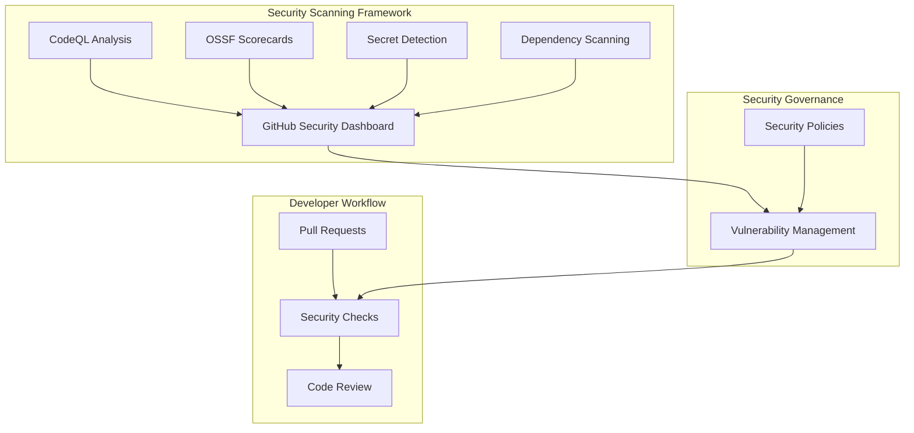
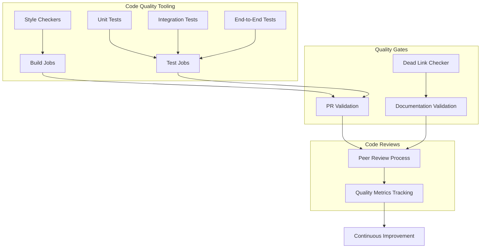
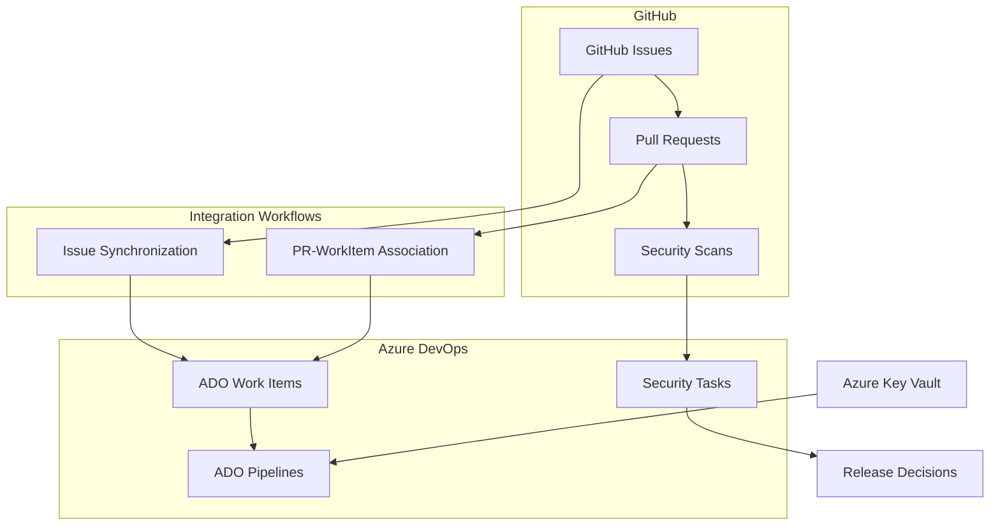
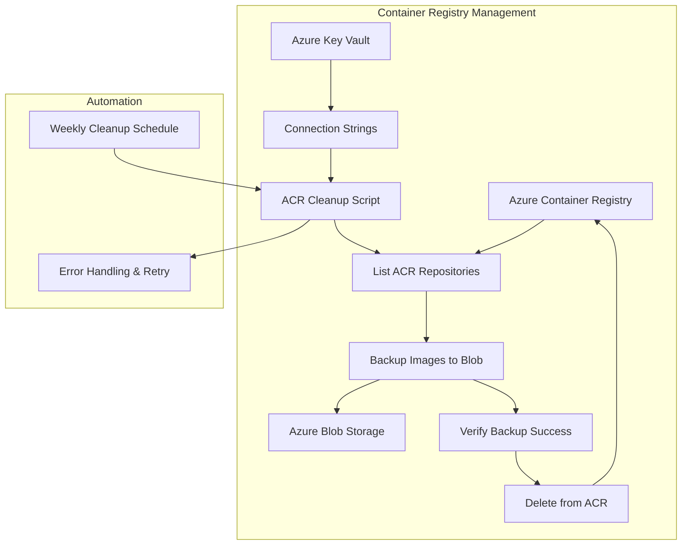

<!-- source: DeepWiki mcp.deepwiki.com · repo microsoft/SynapseML · page 3.4 Security and Code Quality · fetched 2026-10-26 -->

# Security and Code Quality

Relevant source files

The following files were used as context for generating this wiki page:

- [.github/workflows/check-dead-links.yml](.github/workflows/check-dead-links.yml)
- [.github/workflows/codeql.yml](.github/workflows/codeql.yml)
- [.github/workflows/scorecards.yml](.github/workflows/scorecards.yml)
- [.gitignore](.gitignore)
- [.pipelines/clean-acr.yml](.pipelines/clean-acr.yml)
- [build.sbt](build.sbt)
- [deep-learning/src/test/python/synapsemltest/dl/conftest.py](deep-learning/src/test/python/synapsemltest/dl/conftest.py)
- [docs/Deploy Models/Quickstart - Deploying a Classifier.ipynb](docs/Deploy Models/Quickstart - Deploying a Classifier.ipynb)
- [docs/Explore Algorithms/Deep Learning/Distributed Training.md](docs/Explore Algorithms/Deep Learning/Distributed Training.md)
- [docs/Explore Algorithms/Hyperparameter Tuning/Quickstart - Random Search.ipynb](docs/Explore Algorithms/Hyperparameter Tuning/Quickstart - Random Search.ipynb)
- [environment.yml](environment.yml)
- [pipeline.yaml](pipeline.yaml)
- [project/PublishPlugin.scala](project/PublishPlugin.scala)
- [project/Secrets.scala](project/Secrets.scala)
- [sonatype.sbt](sonatype.sbt)
- [templates/codecov.yml](templates/codecov.yml)
- [templates/conda.yml](templates/conda.yml)
- [templates/kv.yml](templates/kv.yml)
- [tools/acr/clean-acr.py](tools/acr/clean-acr.py)
- [tools/esrp/prepare_jar.py](tools/esrp/prepare_jar.py)

This document details the security practices and code quality measures implemented in the SynapseML project. It covers the automated security scanning tools, code quality checks, vulnerability management processes, and best practices for maintaining high standards of code quality and security throughout the development lifecycle.

For information about the CI/CD pipeline implementation, see [CI/CD Pipeline](#3.1). For build system details, see [Build System](#3.2).

## 1. Security Scanning Framework

SynapseML employs multiple automated security scanning tools to identify and mitigate potential vulnerabilities in the codebase.

Sources: [.github/workflows/scorecards.yml:1-72](), [.github/workflows/codeql.yml:1-78]()

### 1.1 CodeQL Analysis

SynapseML uses GitHub's CodeQL to perform static code analysis for identifying security vulnerabilities and code quality issues:

- **Languages analyzed**: JavaScript and Python
- **Execution frequency**: Runs on pushes to master, pull requests to master, and weekly on a schedule
- **Configuration**: Defined in the CodeQL workflow file, which sets up the CodeQL engine and performs analysis steps

The analysis results are uploaded to GitHub's code scanning dashboard, where they can be reviewed and addressed by the development team.

Sources: [.github/workflows/codeql.yml:1-78]()

### 1.2 OSSF Scorecards

The project leverages the Open Source Security Foundation (OSSF) Scorecards to assess security posture against industry best practices:

- **Scans for**: Branch protection rules, maintained status, dependency update practices, code review processes
- **Publishing results**: Results are published to the OpenSSF API and made available through a badge for public transparency
- **Execution frequency**: Weekly on Sundays and on pushes to the master branch

Scorecards evaluates numerous security criteria and provides an overall security score for the project.

Sources: [.github/workflows/scorecards.yml:1-72]()

### 1.3 Dependency Scanning

The project monitors dependencies for security vulnerabilities through automated scanning. When vulnerabilities are detected, they are reported and addressed based on severity level.

## 2. Code Quality Framework

SynapseML maintains code quality through a combination of automated tools, review processes, and standardized practices.

Sources: [.github/workflows/check-dead-links.yml:1-27]()

### 2.1 Automated Code Style Enforcement

The project enforces consistent code style through automated checks in the CI pipeline:

- **Style checkers**: Applied to all code submissions
- **Linting rules**: Tailored for different languages (Python, Scala, R)
- **Enforcement**: Style checks must pass before code can be merged

### 2.2 Comprehensive Testing Strategy

The testing strategy includes various levels of testing to ensure code quality:

- **Unit tests**: Test individual components in isolation
- **Integration tests**: Verify interactions between components
- **End-to-end tests**: Test complete workflows
- **Fuzzing tests**: For robustness of APIs and SDK generation

These tests run as part of the CI/CD pipeline on pull requests and periodic schedules.

### 2.3 Documentation Quality

Documentation quality is maintained through:

- **Dead link checking**: Automated scanning of documentation for broken links
- **Example validation**: Regular verification that example notebooks are functional
- **Consistency reviews**: Ensuring documentation matches implemented functionality

Sources: [.github/workflows/check-dead-links.yml:1-27]()

## 3. Security Process Integration

SynapseML integrates security and code quality processes into the development workflow through GitHub and Azure DevOps.

Sources: [.github/workflows/ado-pr-to-workitem.yml:1-24](), [.github/workflows/ado-integration.yml:1-24]()

### 3.1 GitHub and Azure DevOps Integration

The project synchronizes work tracking between GitHub and Azure DevOps:

- **Issue synchronization**: GitHub issues are synchronized with Azure DevOps work items
- **Pull request integration**: Pull requests are linked to Azure DevOps work items
- **Status tracking**: Work item status is updated based on GitHub activities

This integration ensures traceability between code changes and work items, providing a comprehensive view of development activities and security-related tasks.

Sources: [.github/workflows/ado-pr-to-workitem.yml:1-24](), [.github/workflows/ado-integration.yml:1-24]()

### 3.2 Secure Secret Management

SynapseML manages secrets securely using Azure Key Vault:

- **Secrets storage**: All API keys, tokens, and sensitive configuration values are stored in Azure Key Vault
- **Access control**: Access to secrets is controlled through Azure Active Directory authentication
- **CI/CD integration**: Pipelines retrieve secrets securely during build and deployment processes

This approach prevents secrets from being exposed in the codebase or logs.

## 4. Container Registry Security

SynapseML maintains security in its container infrastructure through regular cleanup and verification processes.

Sources: [.pipelines/clean-acr.yml:1-30](), [tools/acr/clean-acr.py:1-87]()

### 4.1 Container Registry Cleanup

The project implements regular cleanup of the Azure Container Registry (ACR) to maintain security and performance:

- **Backup process**: Images are backed up to Azure Blob Storage before deletion
- **Verification**: Backup success is verified before deletion from ACR
- **Automation**: Process runs on a weekly schedule
- **Error handling**: Includes retry logic for resiliency

This process maintains a clean container registry while ensuring images are properly preserved.

Sources: [.pipelines/clean-acr.yml:1-30](), [tools/acr/clean-acr.py:1-87]()

## 5. Contributor Guidelines

Contributors to SynapseML are expected to follow security and code quality best practices:

1. **Security review**: Include security considerations in code reviews
2. **Test coverage**: Maintain or improve test coverage with new contributions
3. **Documentation**: Update documentation to reflect changes
4. **Dependency management**: Carefully evaluate new dependencies for security implications
5. **Secret handling**: Never commit secrets or credentials to the repository

By following these guidelines, contributors help maintain the project's security and code quality standards.

## 6. Continuous Monitoring and Improvement

SynapseML employs continuous monitoring and improvement processes:

- **Vulnerability monitoring**: Ongoing monitoring for new vulnerabilities in dependencies
- **Security patch management**: Prompt application of security patches
- **Process refinement**: Regular review and improvement of security and code quality processes
- **Training**: Keeping the development team informed about security best practices

These processes ensure that security and code quality remain priorities throughout the project lifecycle.

---

