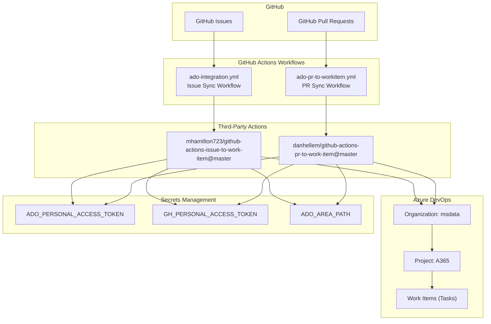
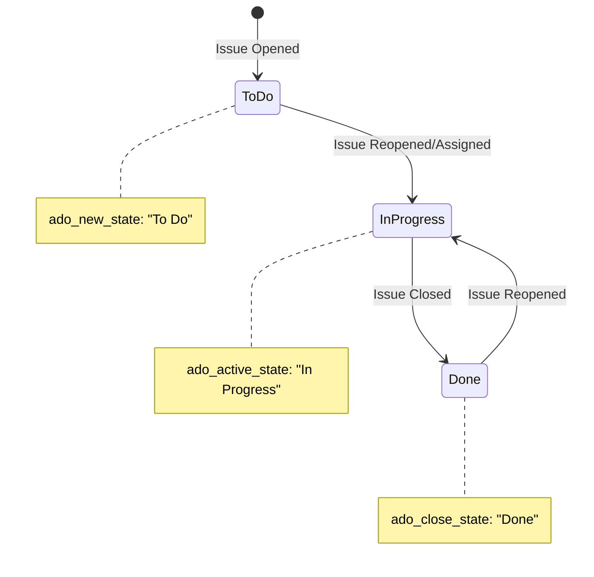
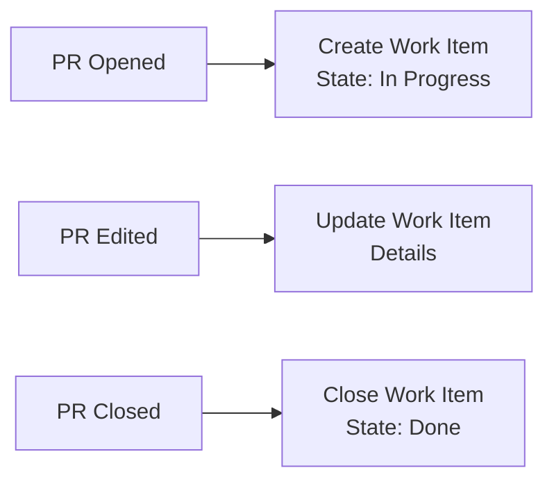
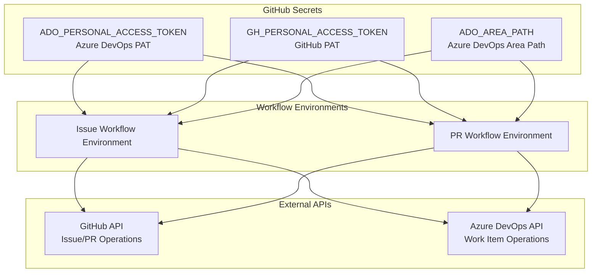
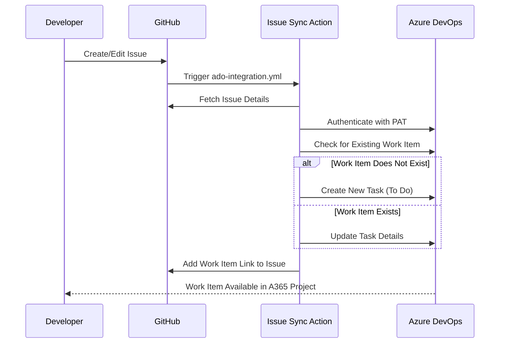
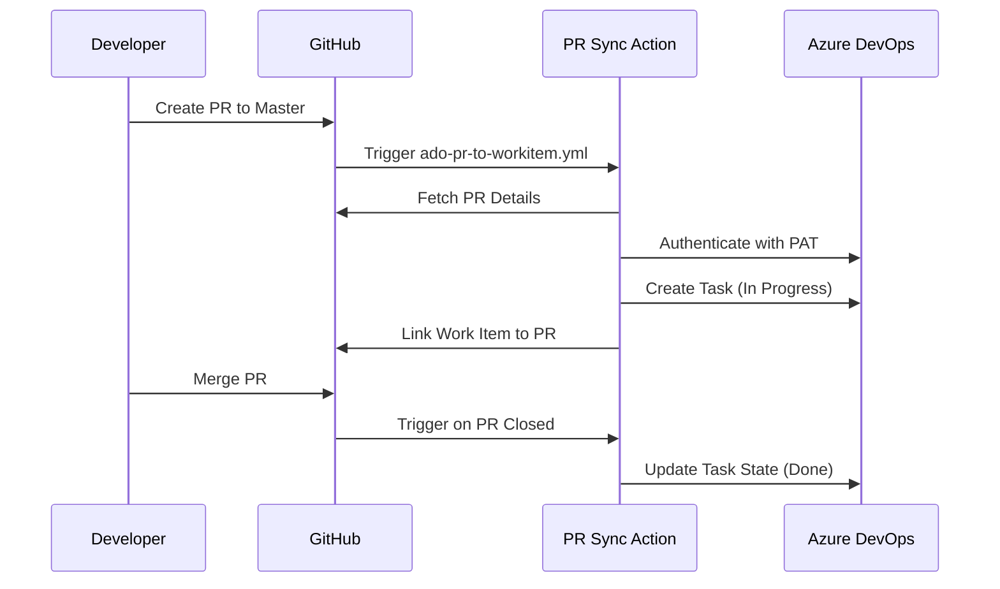
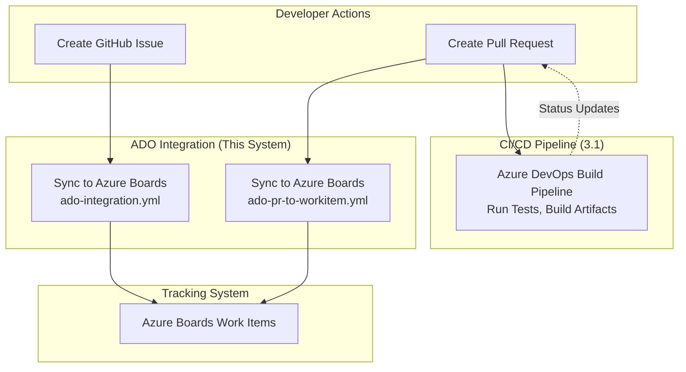

<!-- source: DeepWiki mcp.deepwiki.com · repo microsoft/SynapseML · page 3.5 Azure DevOps Integration · fetched 2026-10-26 -->

# Azure DevOps Integration

<details>
<summary>Relevant source files</summary>

The following files were used as context for generating this wiki page:

- [.github/workflows/ado-integration.yml](.github/workflows/ado-integration.yml)
- [.github/workflows/ado-pr-to-workitem.yml](.github/workflows/ado-pr-to-workitem.yml)

</details>


## Purpose and Scope

This document describes the GitHub to Azure DevOps work item synchronization system that automatically creates and updates work items in Azure Boards based on GitHub issues and pull requests. This integration allows the development team to track work in Azure DevOps while working in GitHub.

This system is distinct from the CI/CD Pipeline ([3.1](#3.1)), which handles build, test, and deployment automation. The Azure DevOps Integration focuses solely on work item tracking and synchronization.

---

## System Overview

The Azure DevOps integration consists of two GitHub Actions workflows that maintain bidirectional synchronization between GitHub and Azure DevOps work items. When developers create or modify issues and pull requests in GitHub, corresponding work items are automatically created or updated in Azure Boards within the `msdata/A365` project.

### Integration Architecture



**Sources:** [.github/workflows/ado-integration.yml:1-24](), [.github/workflows/ado-pr-to-workitem.yml:1-24]()

---

## Issue Synchronization

The issue synchronization workflow (`ado-integration.yml`) monitors GitHub issue events and creates or updates corresponding Azure DevOps work items. This workflow uses the `mhamilton723/github-actions-issue-to-work-item` action.

### Trigger Configuration

The workflow is triggered by the following GitHub issue events:

| Event Type | Description | ADO Action |
|------------|-------------|------------|
| `opened` | New issue created | Creates new work item in "To Do" state |
| `edited` | Issue title/description modified | Updates work item details |
| `deleted` | Issue deleted | Deletes corresponding work item |
| `closed` | Issue closed | Moves work item to "Done" state |
| `reopened` | Closed issue reopened | Moves work item to "In Progress" state |
| `labeled` | Label added to issue | Updates work item tags |
| `unlabeled` | Label removed from issue | Updates work item tags |
| `assigned` | User assigned to issue | Updates work item assignment |

**Sources:** [.github/workflows/ado-integration.yml:4-6]()

### State Mapping



**Sources:** [.github/workflows/ado-integration.yml:20-22]()

### Workflow Configuration

The issue synchronization workflow is defined in [.github/workflows/ado-integration.yml:1-24]() with the following parameters:

| Parameter | Value | Purpose |
|-----------|-------|---------|
| `ado_organization` | `msdata` | Azure DevOps organization name |
| `ado_project` | `A365` | Azure DevOps project name |
| `ado_wit` | `Task` | Work item type to create |
| `ado_new_state` | `To Do` | Initial state for new work items |
| `ado_active_state` | `In Progress` | State for active/reopened items |
| `ado_close_state` | `Done` | State for closed items |
| `ado_bypassrules` | `true` | Bypass Azure DevOps validation rules |

**Sources:** [.github/workflows/ado-integration.yml:16-23]()

---

## Pull Request Synchronization

The pull request synchronization workflow (`ado-pr-to-workitem.yml`) tracks pull requests targeting the `master` branch and creates corresponding Azure DevOps work items. This workflow uses the `danhellem/github-actions-pr-to-work-item` action.

### Trigger Configuration

The workflow is triggered by pull request events on the `master` branch:



**Sources:** [.github/workflows/ado-pr-to-workitem.yml:4-7]()

### Workflow Details

The workflow configuration in [.github/workflows/ado-pr-to-workitem.yml:1-24]() specifies:

```yaml
on:
  pull_request_target:
    types: [opened, edited, closed]
    branches:
      - master
```

Key differences from issue synchronization:

1. **Trigger Type**: Uses `pull_request_target` instead of `pull_request` for security reasons (allows access to secrets in PRs from forks)
2. **Branch Filter**: Only processes PRs targeting the `master` branch
3. **State Model**: Simpler state transitions (no "To Do" state, PRs start as "In Progress")
4. **Debug Mode**: Enables debug logging with `debug: true`

| Parameter | Value | Purpose |
|-----------|-------|---------|
| `ado_organization` | `msdata` | Azure DevOps organization |
| `ado_project` | `A365` | Target project |
| `ado_wit` | `Task` | Work item type |
| `ado_active_state` | `In Progress` | State for open PRs |
| `ado_close_state` | `Done` | State for merged/closed PRs |
| `debug` | `true` | Enable verbose logging |

**Sources:** [.github/workflows/ado-pr-to-workitem.yml:3-23]()

---

## Authentication and Security

Both workflows require secure authentication to both GitHub and Azure DevOps APIs. The authentication mechanism uses GitHub Secrets to store sensitive tokens.

### Required Secrets



### Secret Configuration

The workflows reference secrets in their environment variables:

**Issue Workflow:**
```yaml
env:
  ado_token: "${{ secrets.ADO_PERSONAL_ACCESS_TOKEN }}"
  github_token: "${{ secrets.GH_PERSONAL_ACCESS_TOKEN }}"
  ado_area_path: '${{ secrets.ADO_AREA_PATH }}'
```

**PR Workflow:**
```yaml
env:
  ado_token: '${{ secrets.ADO_PERSONAL_ACCESS_TOKEN }}'
  github_token: '${{ secrets.GH_PERSONAL_ACCESS_TOKEN }}'
  ado_area_path: '${{ secrets.ADO_AREA_PATH }}'
```

#### Token Requirements

| Secret | Permissions Required | Purpose |
|--------|---------------------|---------|
| `ADO_PERSONAL_ACCESS_TOKEN` | Work Items (Read, Write, Delete) | Create, update, and manage Azure DevOps work items |
| `GH_PERSONAL_ACCESS_TOKEN` | repo (Full control) | Read issue/PR metadata and update GitHub objects |
| `ADO_AREA_PATH` | N/A (configuration value) | Specify Azure DevOps area path for work item organization |

**Sources:** [.github/workflows/ado-integration.yml:14-18](), [.github/workflows/ado-pr-to-workitem.yml:15-22]()

---

## Workflow Execution Details

### Issue Sync Execution Flow



### PR Sync Execution Flow



**Sources:** [.github/workflows/ado-integration.yml:9-24](), [.github/workflows/ado-pr-to-workitem.yml:10-24]()

---

## Third-Party Actions

Both workflows depend on community-maintained GitHub Actions for the actual synchronization logic. These actions handle the API interactions with Azure DevOps.

### Issue Sync Action

**Action:** `mhamilton723/github-actions-issue-to-work-item@master`

This action is referenced at [.github/workflows/ado-integration.yml:12]() and provides:
- Bidirectional synchronization between GitHub issues and Azure DevOps work items
- Label and assignment synchronization
- State management based on issue lifecycle events
- Support for the `ado_bypassrules` parameter to skip Azure DevOps validation

### PR Sync Action

**Action:** `danhellem/github-actions-pr-to-work-item@master`

This action is referenced at [.github/workflows/ado-pr-to-workitem.yml:13]() and provides:
- Pull request to work item synchronization
- Debug logging capabilities
- Support for `pull_request_target` trigger type
- Simplified state management for PR workflows

### Action Maintenance

Both actions are pinned to the `@master` branch rather than specific version tags. This approach ensures the workflows receive bug fixes automatically but may introduce breaking changes without notice.

**Sources:** [.github/workflows/ado-integration.yml:12](), [.github/workflows/ado-pr-to-workitem.yml:13]()

---

## Configuration Summary

The following table summarizes the complete configuration for both synchronization workflows:

| Configuration Aspect | Issue Sync | PR Sync |
|---------------------|------------|---------|
| **Workflow File** | `.github/workflows/ado-integration.yml` | `.github/workflows/ado-pr-to-workitem.yml` |
| **Trigger Events** | Issue events (8 types) | PR events (3 types) |
| **Branch Filter** | None | `master` only |
| **Trigger Type** | `issues` | `pull_request_target` |
| **Third-Party Action** | `mhamilton723/github-actions-issue-to-work-item@master` | `danhellem/github-actions-pr-to-work-item@master` |
| **ADO Organization** | `msdata` | `msdata` |
| **ADO Project** | `A365` | `A365` |
| **Work Item Type** | `Task` | `Task` |
| **Initial State** | `To Do` | `In Progress` |
| **Active State** | `In Progress` | `In Progress` |
| **Close State** | `Done` | `Done` |
| **Bypass Rules** | `true` | Not specified |
| **Debug Mode** | Not specified | `true` |

**Sources:** [.github/workflows/ado-integration.yml:1-24](), [.github/workflows/ado-pr-to-workitem.yml:1-24]()

---

## Integration with Development Workflow

The Azure DevOps integration complements the CI/CD Pipeline ([3.1](#3.1)) by providing work tracking capabilities without interfering with automated builds and tests.

### Workflow Relationship



The ADO integration runs independently of the build pipeline, ensuring that work item tracking continues even if builds fail. This separation of concerns allows project managers to track development progress in Azure Boards while engineers work in GitHub.

**Sources:** [.github/workflows/ado-integration.yml:1-24](), [.github/workflows/ado-pr-to-workitem.yml:1-24]()

---

