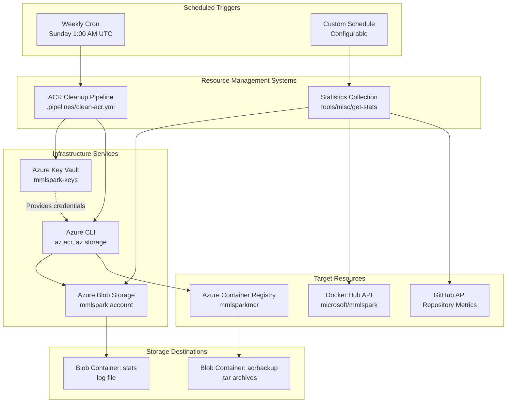
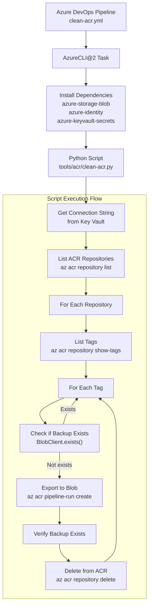
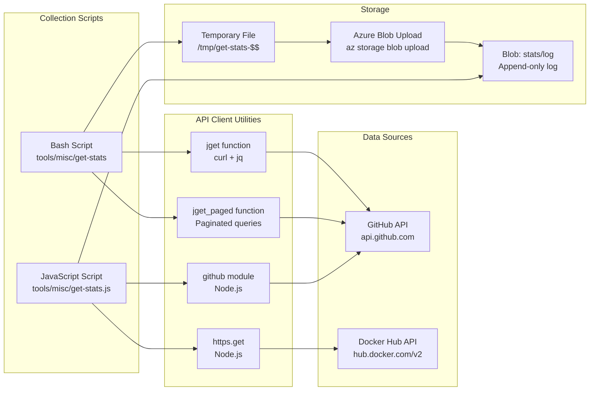

<!-- source: DeepWiki mcp.deepwiki.com · repo microsoft/SynapseML · page 3.6 Resource Management · fetched 2026-10-26 -->

# Resource Management

<details>
<summary>Relevant source files</summary>

The following files were used as context for generating this wiki page:

- [.github/workflows/check-dead-links.yml](.github/workflows/check-dead-links.yml)
- [.github/workflows/codeql.yml](.github/workflows/codeql.yml)
- [.github/workflows/scorecards.yml](.github/workflows/scorecards.yml)
- [.pipelines/clean-acr.yml](.pipelines/clean-acr.yml)
- [docs/Deploy Models/Quickstart - Deploying a Classifier.ipynb](docs/Deploy Models/Quickstart - Deploying a Classifier.ipynb)
- [docs/Explore Algorithms/Deep Learning/Distributed Training.md](docs/Explore Algorithms/Deep Learning/Distributed Training.md)
- [docs/Explore Algorithms/Hyperparameter Tuning/Quickstart - Random Search.ipynb](docs/Explore Algorithms/Hyperparameter Tuning/Quickstart - Random Search.ipynb)
- [tools/acr/clean-acr.py](tools/acr/clean-acr.py)
- [tools/misc/get-stats](tools/misc/get-stats)
- [tools/misc/get-stats.js](tools/misc/get-stats.js)
- [tools/misc/mmlspark.svg](tools/misc/mmlspark.svg)

</details>


## Purpose and Scope

This document describes the automated resource management systems in SynapseML that handle infrastructure cleanup and telemetry collection. These systems run on scheduled intervals to maintain cost efficiency and track project metrics. The page covers two primary systems:

1. **ACR Image Backup and Cleanup** - Automated backup and deletion of Azure Container Registry images
2. **Statistics Collection** - Periodic collection of repository metrics from GitHub and Docker Hub

For information about the CI/CD pipeline infrastructure, see [CI/CD Pipeline](#3.1). For security scanning and code quality, see [Security and Code Quality](#3.4).

## Resource Management Overview

The SynapseML project implements automated resource management to control costs and maintain visibility into project health. These systems run independently as scheduled workflows and operate without manual intervention.



**Sources:** [.pipelines/clean-acr.yml:1-29](), [tools/misc/get-stats:1-57]()

## ACR Image Backup and Cleanup

### Purpose

The ACR cleanup system addresses the cost accumulation from storing Docker images in Azure Container Registry. Over time, the registry accumulates multiple versions of container images from CI/CD builds. The cleanup system:

- Exports all ACR images to cheaper Azure Blob Storage as `.tar` archives
- Deletes images from ACR after successful backup
- Prevents data loss through verification before deletion
- Runs weekly to maintain cost efficiency

### Pipeline Configuration

The cleanup pipeline is defined in [.pipelines/clean-acr.yml:1-29]() and runs on a weekly schedule:

| Configuration | Value |
|--------------|-------|
| **Schedule** | `0 1 * * 0` (Sunday 1:00 AM UTC) |
| **Trigger Mode** | `always: true` |
| **Branch** | `master` |
| **VM Image** | `ubuntu-latest` |
| **Azure Subscription** | `SynapseML Build` |
| **Service Connection** | `synapseml-clean-acr` |

**Sources:** [.pipelines/clean-acr.yml:2-20]()

### ACR Cleanup Workflow



**Sources:** [.pipelines/clean-acr.yml:16-28](), [tools/acr/clean-acr.py:1-87]()

### Implementation Details

The cleanup script `tools/acr/clean-acr.py` implements the following logic:

#### Configuration Variables

```python
acr = "mmlsparkmcr"
container = "acrbackup"
rg = "marhamil-mmlspark"
pipeline = "mmlsparkacrexport3"
```

**Sources:** [tools/acr/clean-acr.py:25-28]()

#### Key Vault Integration

The script retrieves the storage connection string from Azure Key Vault:

```python
keyvaultName = sys.argv[1]  # "mmlspark-keys"
secretName = sys.argv[2]    # "clean-acr-connection-string"
kvUri = f"https://{keyvaultName}.vault.azure.net"
kvClient = SecretClient(vault_url=kvUri, credential=DefaultAzureCredential())
conn_string = kvClient.get_secret(secretName).value
```

**Sources:** [tools/acr/clean-acr.py:30-34]()

#### Backup and Deletion Process

The script processes each repository and tag:

1. **List repositories:** Uses `az acr repository list -n {acr}` to enumerate all repositories
2. **List tags:** Uses `az acr repository show-tags` with `--orderby time_desc` to get tags
3. **Check backup:** Constructs blob name as `{repo}/{tag}.tar` and verifies existence
4. **Export image:** If backup doesn't exist, creates ACR pipeline-run to export
5. **Verify backup:** Confirms blob exists after export
6. **Delete image:** Removes image from ACR using `az acr repository delete`

**Sources:** [tools/acr/clean-acr.py:53-87]()

#### Retry Mechanism

The script includes a custom retry function for Azure CLI commands:

| Parameter | Behavior |
|-----------|----------|
| **Initial Delay** | 5 seconds |
| **Delay Multiplier** | 3x after each failure |
| **Max Attempts** | 5 |
| **Command Output** | Printed to console |

The retry function is defined at [tools/acr/clean-acr.py:37-48]() and used for both export and delete operations.

**Sources:** [tools/acr/clean-acr.py:37-48](), [tools/acr/clean-acr.py:73](), [tools/acr/clean-acr.py:85]()

## Statistics Collection

### Purpose

The statistics collection system tracks project health metrics over time by periodically querying public APIs and storing results in Azure Blob Storage. This provides historical data for:

- Community engagement tracking (stars, forks, watchers)
- Contribution metrics (contributors, pull requests, issues)
- Distribution usage (Docker pulls, tags)

### Collected Metrics

The system collects the following metrics:

#### GitHub Metrics

| Metric | API Endpoint | Description |
|--------|-------------|-------------|
| **Stars** | `/repos/Microsoft/SynapseML` | Repository star count |
| **Watchers** | `/repos/Microsoft/SynapseML` | Subscriber count |
| **Forks** | `/repos/Microsoft/SynapseML` | Fork count |
| **Open Issues/PRs** | `/repos/Microsoft/SynapseML` | Combined open count |
| **Contributors** | `/repos/Microsoft/SynapseML/contributors` | List of contributor logins |
| **Pull Requests** | `/repos/Microsoft/SynapseML/pulls` | Open PR numbers |
| **Issues** | `/repos/Microsoft/SynapseML/issues` | Open issue numbers (excluding PRs) |

**Sources:** [tools/misc/get-stats:34-43]()

#### Docker Hub Metrics

| Metric | API Endpoint | Description |
|--------|-------------|-------------|
| **Pulls** | `/v2/repositories/microsoft/mmlspark/` | Total image pull count |
| **Stars** | `/v2/repositories/microsoft/mmlspark/` | Repository star count |
| **Tags** | `/v2/repositories/microsoft/mmlspark/tags/` | List of available tags |

**Sources:** [tools/misc/get-stats:45-47]()

### Statistics Collection Architecture



**Sources:** [tools/misc/get-stats:1-57](), [tools/misc/get-stats.js:1-64]()

### Bash Implementation

The bash script at [tools/misc/get-stats:1-57]() provides a lightweight implementation:

#### Helper Functions

The script defines two utility functions for API queries:

**`jget`** - Simple JSON query:
```bash
jget() { local url="$1"; shift; curl -s "$url" | jq -r "$@"; }
```

**`jget_paged`** - Paginated query handling:
- Follows `Link` headers for pagination
- Continues until no `next` relation found
- Aggregates results with `jq -sr "add"`

**Sources:** [tools/misc/get-stats:10-22]()

#### Data Collection Process

The script collects data in a structured format:

1. **Timestamp:** UTC timestamp in `YYYY-MM-DD HH:MM` format
2. **GitHub section:** Repository stats, contributors list, PRs list, issues list
3. **Docker section:** Pull count, star count, tags list

Output format example:
```
=========================
2024-01-15 03:00
github:
  stars: 5000
  watchers: 150
  forks: 800
  issues_pulls: 25
  contributors: 120 => user1, user2, ...
  pulls: 10 => #123, #124, ...
  issues: 15 => #100, #101, ...
docker:
  pulls: 100000
  stars: 50
  tags: 15 => latest, v1.0.0, ...
```

**Sources:** [tools/misc/get-stats:26-48]()

#### Storage Upload

The script uploads results using Azure CLI:
- **Upload type:** `--type append` for append-only log
- **Account:** `mmlspark`
- **Container:** `stats`
- **Blob name:** `log`

**Sources:** [tools/misc/get-stats:51-54]()

### JavaScript Implementation

The JavaScript implementation at [tools/misc/get-stats.js:1-64]() provides similar functionality with the `github` npm module:

#### Module Configuration

```javascript
let az = require("azure-storage");
let ghAPI = require("github");
let repo = {owner: "Azure", repo: "mmlspark"};
let repo_pg = Object.assign({}, repo, {per_page: 100});
```

**Sources:** [tools/misc/get-stats.js:4-17]()

#### Pagination Handling

The script implements recursive pagination:

```javascript
let getPaged = (state, combine) => r =>
  !gh.hasNextPage(r) ? Promise.resolve(combine(state, r.data))
  : gh.getNextPage(r).then(getPaged(combine(state, r.data), combine));
```

**Sources:** [tools/misc/get-stats.js:25-27]()

#### Data Aggregation

The script uses `Promise.all` to collect all metrics concurrently:

1. Repository metadata via `gh.repos.get()`
2. Issues and PRs via `gh.issues.getForRepo()` with filtering
3. Contributors via `gh.repos.getContributors()`
4. Docker stats via HTTPS API calls

**Sources:** [tools/misc/get-stats.js:54-61]()

## Resource Management Integration

Both resource management systems integrate with the development infrastructure:

| System | Trigger | Frequency | Storage | Dependencies |
|--------|---------|-----------|---------|--------------|
| **ACR Cleanup** | Azure DevOps cron | Weekly (Sunday 1 AM) | Blob: acrbackup | Azure CLI, Python, Key Vault |
| **Statistics** | Custom scheduler | Configurable | Blob: stats/log | Bash/Node.js, jq, Azure CLI |

These systems operate independently and require:
- Azure service connection with appropriate permissions
- Key Vault access for secrets
- Blob storage write permissions
- API access to external services (GitHub, Docker Hub)

**Sources:** [.pipelines/clean-acr.yml:2-8](), [tools/misc/get-stats:51-54](), [tools/misc/get-stats.js:60-61]()

---

